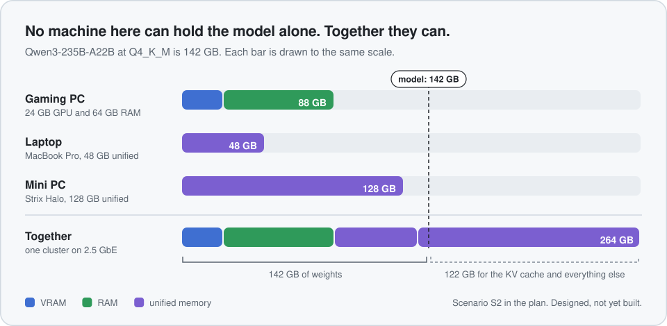
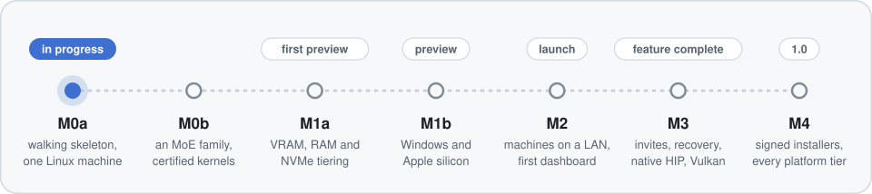
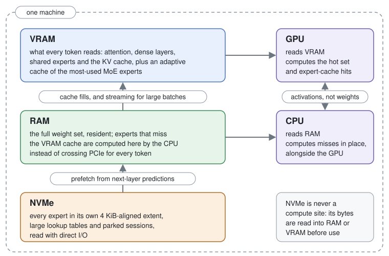
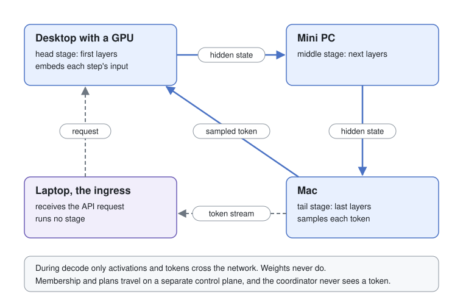

<!-- Translated copies: README.zh-CN.md, README.ja.md, README.de.md, README.fr.md, README.es.md and README.pt-BR.md. Update them in the same change. -->
<p align="center">
  <picture>
    <source media="(prefers-color-scheme: dark)" srcset="docs/media/logo-dark.svg">
    
  </picture>
</p>

<p align="center"><b>English</b>&emsp;<a href="README.zh-CN.md">简体中文</a>&emsp;<a href="README.ja.md">日本語</a>&emsp;<a href="README.de.md">Deutsch</a>&emsp;<a href="README.fr.md">Français</a>&emsp;<a href="README.es.md">Español</a>&emsp;<a href="README.pt-BR.md">Português</a></p>

<h3 align="center">Run one large model across every GPU, memory tier and machine you own</h3>

<p align="center">Placement decided by measuring your hardware. Output that matches the reference by default.<br>
Rust, with native kernels for CUDA, HIP, Metal, Vulkan and the CPU.</p>

<p align="center">
  <a href="#roadmap"></a>
  <a href="#licence-and-credits"></a>
  <a href="Cargo.toml"></a>
  <a href="PLATFORMS.md"></a>
</p>

<p align="center">
  <a href="#how-does-it-work"><b>How&nbsp;it&nbsp;works</b></a>&emsp;
  <a href="#roadmap"><b>Roadmap</b></a>&emsp;
  <a href="PLATFORMS.md"><b>Platforms</b></a>&emsp;
  <a href="plan/README.md"><b>The&nbsp;design</b></a>&emsp;
  <a href="CONTRIBUTING.md"><b>Contributing</b></a>
</p>

> [!IMPORTANT]
> **Syntropy is being built, and there is nothing to install yet.** The complete design is in [`plan/`](plan/README.md), and implementation is under way at milestone M0a. Everything on this page describes what is designed and planned, not something you can run today.

<p align="center">
  <picture>
    <source media="(prefers-color-scheme: dark)" srcset="docs/media/memory-pool-dark.svg">
    
  </picture>
</p>

A gaming PC with a 24 GB graphics card and 64 GB of RAM, a laptop with 48 GB of unified memory and a 128 GB mini PC under the TV can't each hold a 235-billion-parameter mixture-of-experts model, which is 142 GB at 4-bit. Between them they have 264 GB.

Syntropy treats them as one computer with several kinds of memory. It measures how fast each GPU and CPU reads each memory tier, chooses one placement for the whole model, and keeps compute next to the bytes: the device whose memory holds a weight is the device that computes with it. Across machines, only activations travel during decode. Inside a machine, a weight that isn't in the GPU's cache is computed by the CPU where it sits, instead of being copied over PCIe for every token.

## Features

All of this is specified in the design, and none of it is built yet.

### Inside one machine

- **Every memory tier does work.** The hottest weights and MoE experts sit in an adaptive VRAM cache. The full weight set stays resident in RAM, where the CPU computes cache misses in place. Cold experts and large tables are read from NVMe with direct I/O when they are needed.
- **Experts fetched before they're needed.** The prediction of the next layer's experts runs inside the router kernel, so the NVMe and RAM reads for the next layer are under way while the current one computes.
- **Measured, not looked up.** Each machine probes what its GPUs, CPUs, drives and network links deliver, using Syntropy's real kernels. Placement is built from those measurements, not from spec sheets.

### Across machines

- **One placement for the whole model.** A single plan decides which machines take part, which layer range each one runs, which tier holds each tensor group and which device computes it. It records why each group landed where it did.
- **A ring of machines.** The model splits into pipeline stages that hand hidden states straight to the next machine. A single layer is split across machines only on links, such as RDMA over Thunderbolt 5, whose measured latency passes a gate.
- **No setup on a LAN, one token off it.** Machines on the same network find each other. A new one is admitted once you confirm the same six-digit code on both screens. A laptop away from home joins with an invite token that is single-use by default.
- **A lost machine doesn't lose the answer.** Each stage keeps what it recently sent. When a stage machine drops out and the others have room, generation resumes without an error reaching the client.

### For you and your tools

- **Exact unless you say otherwise.** Shortcuts that change output, such as skipping experts that miss the cache, are opt-in, named, and listed on every response they touched.
- **Speculative decoding that keeps the answer.** MTP heads or a draft model propose several tokens, the model checks them all in one pass, and the acceptance rule preserves the model's own output distribution.
- **The APIs your tools already use.** OpenAI- and Anthropic-shaped APIs and a native one, served from whichever machine the request reaches.
- **Native code throughout.** A Rust system layer, native kernels for CUDA, HIP, Metal, Vulkan and the CPU, and ggml as a per-operation fallback for breadth.

## A first look

This is the planned command line from [RFC-0051](plan/rfcs/RFC-0051-cli-and-dashboard.md). None of these commands exist yet.

```sh
syntropy run                     # asks one question, then recommends a model that fits
syntropy plan <model> --explain  # preview placement and predicted speed without loading
syntropy cluster approve <id>    # admit a LAN machine after matching its six-digit code
syntropy invite create           # a single-use token for a laptop away from home
```

Each machine serves the APIs at `http://127.0.0.1:7433` by default, so existing OpenAI and Anthropic clients and SDKs work unchanged ([RFC-0050](plan/rfcs/RFC-0050-api-surface.md)):

```sh
curl http://127.0.0.1:7433/v1/chat/completions \
  -H 'Content-Type: application/json' \
  -d '{"model": "<model>", "stream": true,
       "messages": [{"role": "user", "content": "Why is decode memory-bound?"}]}'
```

## Roadmap

<p align="center">
  <picture>
    <source media="(prefers-color-scheme: dark)" srcset="docs/media/milestones-dark.svg">
    
  </picture>
</p>

The design is complete: 25 RFCs, 98 ADRs, and 1,411 tasks across six areas of the code, each task with testable acceptance criteria and the RFC sections and ADRs it implements. The milestones carry no dates. [RFC-0001 §16](plan/rfcs/RFC-0001-system-architecture.md#16-milestones) defines each one's scope and exit criteria, [ADR-0020](plan/decisions/ADR-0020-platform-support-tiers.md) the platforms each one releases, and the [roadmap](plan/implementation/roadmap.md) lists every milestone's tasks in dependency order. Progress is tracked on the [project board](https://github.com/orgs/syntropyai-hq/projects/1).

<details>
<summary><b>What each milestone delivers</b></summary>
<br>

| Milestone | What it delivers |
|---|---|
| **M0a** | A walking skeleton on one Linux machine: one dense family (Llama) at Q4_K and Q8_0 on the CPU and one NVIDIA GPU, streamed OpenAI-style chat through the real runner, with conformance, the parity harness and the check against the model publisher's reference as merge gates from the first commit. Built and tested, not released. |
| **M0b** | The rest of M0 on the same machine: an MoE family (Qwen-MoE, every expert in VRAM), calibrated tolerances, certified kernel selection, the first hardware probes and a benchmark harness tied to commits. Not released. |
| **M1a** | Tiering on one Linux machine with an NVIDIA GPU or CPU only: VRAM, RAM and NVMe tiers, the expert cache with prediction and prefetch, single-machine placement, KV paging with a prefix cache and saved sessions, and speculative decoding. The first public release, labelled a preview. |
| **M1b** | Windows with NVIDIA and macOS on Apple silicon, plus CPU-only on both. Its scope follows from what M1a measures. |
| **M2** | Several machines on a LAN: discovery and pairing, encrypted transports, the ring pipeline, peer-to-peer weight distribution and the first dashboard, plus a ggml-based Vulkan preview for AMD and Intel GPUs. This release is the launch. |
| **M3** | Feature complete: invite links, recovery from a lost machine, tensor and expert parallelism on fast links, speculation across machines, native HIP and Vulkan kernels, and a throughput mode for several users. |
| **M4** | 1.0: Tier 2 and Tier 3 platforms, signed installers and updates, and performance regression gates on reference hardware. |

</details>

## What it will run on

Each platform has a support tier ([ADR-0020](plan/decisions/ADR-0020-platform-support-tiers.md)), which describes its support at 1.0. [PLATFORMS.md](PLATFORMS.md) has the full matrix, with minimum versions, backends and the milestone at which each platform first ships.

<br>Linux x86_64 with NVIDIA, Windows 11 x86_64 with NVIDIA, macOS 15+ on Apple silicon, and CPU-only on all three. Prebuilt, signed builds. Parity and performance are tested on real hardware, and a failure blocks the release.

<br>Linux with AMD ROCm; Vulkan on AMD, Intel and NVIDIA GPUs; AMD Strix Halo; GB10-class Linux arm64; Raspberry Pi 5-class boards (CPU); RDMA NICs; several GPUs in one machine. Prebuilt builds, parity enforced, performance tracked. The gaps are listed in the release notes.

<br>Android and iOS as nodes; Intel SYCL; CUDA 12 for Pascal and Volta GPUs; WebGPU; Windows 10 22H2; Linux under WSL2 with an NVIDIA GPU. Builds published as experimental.

Not planned for 1.0: macOS on Intel, 32-bit operating systems, Windows on arm64, and a node running inside a browser.

## How does it work?

Generating one token for one user reads every active weight and the whole KV cache once. The arithmetic per byte is small, so decode speed depends on where the bytes sit and how fast the processor next to them can read them. Syntropy is built around that: compute moves to the bytes, and the bytes are placed by measurement.

### Inside one machine

<p align="center"></p>

- **VRAM** holds what every token touches (attention, dense layers, shared experts, the KV cache) and a cache of the most-used MoE experts that adapts to the workload.
- **RAM** holds the full weight set. When a token needs an expert that isn't in the GPU's cache, the CPU computes it there, alongside the GPU, instead of copying it over PCIe. A desktop CPU reads dual-channel DDR5 at 76–122 GB/s, about 3–5× what PCIe 4.0 x16 delivers to the GPU.
- **NVMe** holds cold experts and large lookup tables, stored as whole-expert extents and read with direct I/O. The next-layer prediction starts those reads before the router asks for them.

Syntropy's tier manager owns every resident byte, so the operating system's page cache never decides what stays in memory. Weights are streamed to the GPU only for large batches, such as long prompt chunks, and only where the measured break-even says copying beats computing in place.

### Across machines

<p align="center"></p>

The model is cut into stages by layer range, one stage per machine, and the stages form a ring. The first stage embeds the input, and each stage passes its hidden state directly to the next. The last stage samples the token, returns it round the ring, and streams it to the machine that received the request. A pipeline adds capacity rather than single-stream speed, so the gain comes from moving bytes onto faster memory. A slow machine is left out of the ring when it would only add a hop.

Splitting a single layer across machines, with tensor or expert parallelism, costs a network round trip per layer per token. Syntropy does it only on links whose measured collective latency is low enough for it to pay. In practice that means RDMA-class links. Wi-Fi never qualifies.

One machine is elected coordinator and keeps the cluster's event log of membership and plans. It never sees a token and isn't on the request path, so losing it fails no request.

> [!TIP]
> The longer, plain-language explanation is [docs/HOW_IT_WORKS.md](docs/HOW_IT_WORKS.md). The full designs are in the RFCs: tiers and residency ([RFC-0020](plan/rfcs/RFC-0020-tier-manager-and-residency.md)), the weight I/O path ([RFC-0021](plan/rfcs/RFC-0021-weight-io-path.md)), the expert cache ([RFC-0023](plan/rfcs/RFC-0023-moe-expert-cache-prediction-prefetch.md)), placement ([RFC-0011](plan/rfcs/RFC-0011-joint-placement-solver.md)), distributed execution ([RFC-0032](plan/rfcs/RFC-0032-distributed-execution.md)), and discovery and invites ([RFC-0030](plan/rfcs/RFC-0030-discovery-membership-invites.md)).

## Exact by default

With default settings, Syntropy's output must match a reference forward pass of the same model at the same quantization, within published tolerances ([ADR-0019](plan/decisions/ADR-0019-exactness-contract.md)).

- **The reference** is Syntropy's reference executor: F32 accumulation, a fixed reduction order and weights dequantised exactly from the same file. It is checked in turn against the model publisher's own reference implementation, so "exact" covers Syntropy's reading of the model as well as its kernels.
- **The test** is teacher-forced top-1 agreement and KL divergence over a versioned corpus of chat, code, long context, tool-call JSON and multilingual text. The tolerances are set per dtype class from measurement, versioned, and stamped into every release.
- **What has to pass** is every path the planner can pick in exact mode: each kernel and fallback, each placement shape from one GPU to a ring of machines, speculative and plain decoding, KV paging between tiers, and resumed sessions. A path that fails is approximate, whatever it was meant to be.
- **Shortcuts are opt-in and named**, such as `expert_skip` (missed experts not computed) or `kv_lossy` (KV stored below the model's precision). Every response states its fidelity and the shortcuts that were active, and a request that asks for `exact` is never served by an approximate configuration.

Byte-identical output across different devices is not promised, because different hardware rounds differently within the tolerance. A slower `deterministic` mode is planned for repeatable output on the same build and devices. Tolerances and the parity harness are specified in [RFC-0042](plan/rfcs/RFC-0042-quantization-and-numerical-fidelity.md) and [RFC-0060](plan/rfcs/RFC-0060-testing-and-correctness.md).

## The design

[`plan/README.md`](plan/README.md) is the index and suggests a reading order.

| Path | What it holds |
|---|---|
| [`plan/00-vision-and-scope.md`](plan/00-vision-and-scope.md) | The problem, the scenarios, the platform matrix, target models, success criteria SC-1 to SC-32 (all targets), and what "feature complete" means |
| [`plan/decisions/`](plan/decisions/) | ADRs. ADR-0000 holds the product directives D1–D8, ADR-0001 to ADR-0022 the foundation, and the rest are numbered by area |
| [`plan/rfcs/`](plan/rfcs/) | RFC-0001, the system architecture, and 24 domain RFCs for placement, tiers, distributed execution, compute, product and quality |
| [`plan/implementation/`](plan/implementation/README.md) | The tasks in six epic files, the roadmap, the dependency report, traceability, the risk register and the scripts that check them |
| [`plan/open-questions.md`](plan/open-questions.md) | What is still undecided, each item with the task or measurement that settles it |
| [`plan/glossary.md`](plan/glossary.md) | One term per concept, and the synonyms the plan doesn't use |
| [`plan/research/`](plan/research/) | The evidence: notes on multi-device and tiered-memory inference, backends, and a hardware cost model with cited bandwidth figures |

Every number in the plan is labelled as a `[target]`, an `[estimate]` with its derivation, or a cited measurement of hardware. None is a Syntropy benchmark, because there is nothing to benchmark yet.

## Contributing

AI agents build Syntropy by executing the plan's tasks. An agent takes one task, implements it on its own branch, and opens one change that meets the task's acceptance criteria and cites the RFC sections and ADRs it implements. The task graph decides what can start.

A change merges only when all of these pass ([ADR-0021](plan/decisions/ADR-0021-development-model-ai-agents-open-source.md)):

- build, lint, format, and unit, property and simulator tests;
- the parity harness and the conformance gates;
- the performance regression gates, where the change touches a measured path;
- the dependency and licence policy, the naming check and the task-graph check;
- an independent review agent, never the one that wrote the change, which checks it against the task's acceptance criteria and the cited RFC sections.

The parity harness and the conformance gates are built first, in M0, before the kernels and model families they check. Maintainers also approve the sensitive classes of change: keys, signing, admission and the update client, CI and release configuration, agent instruction files, new model families, new direct dependencies, and any change a gate cannot check or that needs a gate waived.

Outside contributions are welcome under the same gates. [CONTRIBUTING.md](CONTRIBUTING.md) covers issues, pull requests, evidence and AI-assisted work, and [AGENTS.md](AGENTS.md) is the working guide for agents.

## Security

Please report vulnerabilities privately, not in a public issue. [SECURITY.md](SECURITY.md) has the reporting route, the response targets, and a summary of what Syntropy will expose on a network: LAN discovery, pairing, invite links, its API and its update channel.

## Licence and credits

Syntropy is licensed under either of [MIT](LICENSE-MIT) or [Apache-2.0](LICENSE-APACHE), at your option. Contributions are accepted under the same terms, with a Developer Certificate of Origin sign-off on every commit ([ADR-0018](plan/decisions/ADR-0018-licence.md)).

Syntropy's kernel layer builds on [ggml](https://github.com/ggml-org/ggml), the MIT-licensed tensor library, which provides broad backend coverage and the fallback for every operation without a native kernel. Each release will ship a generated `THIRD-PARTY-NOTICES` file listing every component it contains. Syntropy distributes no model weights, and every model keeps its own licence.
