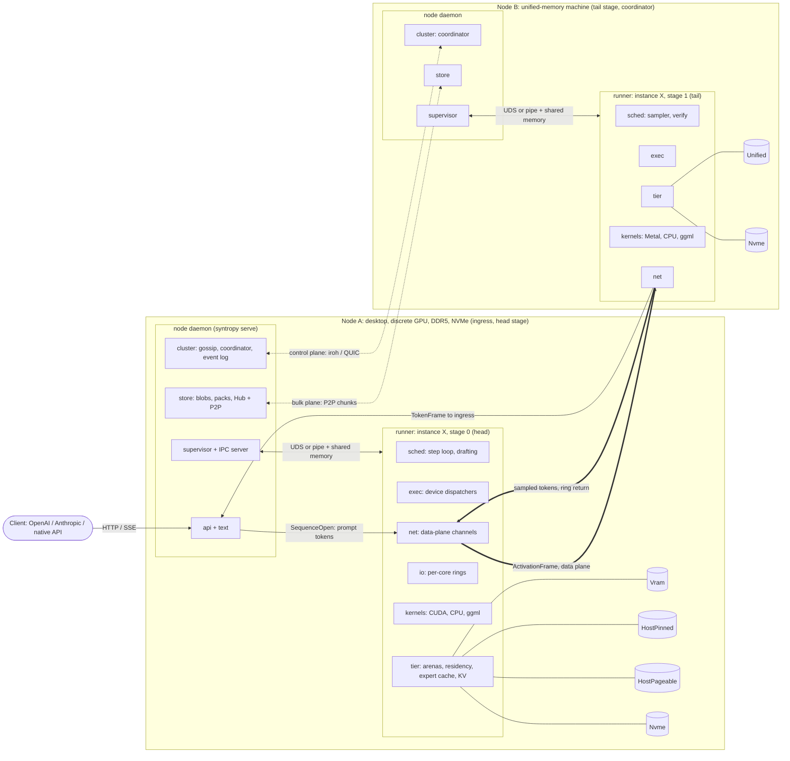
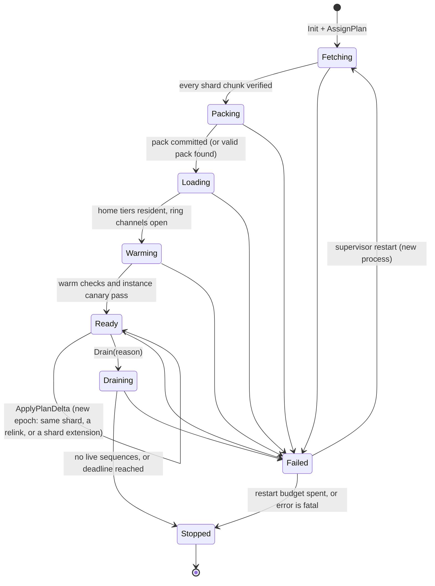

# RFC-0001: System architecture

- **Status:** Draft
- **Date:** 2026-10-19
- **Builds on:** ADR-0000 (D1–D8), ADR-0001 to ADR-0022
- **Expanded by:** every domain RFC listed in §15

## 1. Summary

Syntropy runs one model across every compute device and memory tier the user owns. A node daemon on each host joins a cluster, measures its hardware, and stores model bytes. The coordinator turns the cluster's resource graph and the model's tensor census into a placement plan: an ordered ring of stages, each stage a contiguous layer range on one node, with every tensor group given a home tier and a compute site. Per-model-instance runner processes execute the plan. Inside a stage they compute weights where they reside (VRAM on the GPU, host RAM on the CPU), keep an adaptive expert cache in the fastest tier, and read cold data from NVMe with direct I/O. Between stages they pass activations directly around the ring. The tail stage samples. Tokens go straight to the node that received the request.

This RFC fixes the process model, the crate boundaries, the shared types and traits, and the end-to-end lifecycles. The domain RFCs (§15) expand each interface. They may add fields, variants and methods. They may not rename, remove or change the meaning of anything defined here without amending this RFC.

### 1.1 Goals

1. **Largest model, highest tokens/s the hardware can deliver** (D7). The default objective is batch-1 decode latency for one interactive stream (D2). Throughput is a second objective that the same solver and scheduler accept without a redesign.
2. **Joint placement over devices × tiers × links × experts**, from measured numbers rather than spec sheets (ADR-0008, ADR-0006).
3. **Execute-in-place by default** inside a node, with PCIe streaming only above the measured break-even token count n* (D1, ADR-0006).
4. **Exact output by default** (D3, ADR-0019). Every approximate knob is opt-in, recorded in the plan, and reported on every response it touched.
5. **Zero-configuration LAN clusters plus invite links** (D4), surviving the loss of any single node, including the coordinator, without failing requests that can be recovered.
6. **One static binary per platform** with a fallback for every hardware feature (ADR-0014, ADR-0020).

### 1.2 Non-goals

- Public swarms of untrusted machines (D4). Every cluster member is admitted under the cluster key.
- Byte-identical output across heterogeneous devices (ADR-0019).
- Training, fine-tuning or gradient computation. The only learned components Syntropy produces at runtime are cache and prefetch statistics.
- Publishing a new model interchange format (ADR-0005). Packs are a local cache.
- Datacenter-scale serving features with no home-cluster use: multi-tenant quotas, Kubernetes integration, cross-datacenter replication.

### 1.3 How to read this document

- Type and trait names in `code` are normative. §5 lists each with its owning RFC. "Owner" in a type header names an RFC, never a person or team (ADR-0021).
- "Target" marks a number Syntropy aims for; each target states how it was derived from the cost model in `plan/research/hardware-and-performance-model.md` (cited below as "cost model §n"). "Estimate" marks a derived number, with its derivation. This document contains no measured Syntropy results.
- Notation follows cost model §1: `B` bytes, `W` effective bandwidth, `α`/`β` link latency and goodput, `t_fixed` per-token fixed cost, `h` hit rate, `γ` draft length, `a` acceptance probability.

## 2. System overview

### 2.1 Components



The daemon holds no model bytes and never creates a GPU context (§3.2). Each runner owns the devices, tiers and data-plane channels for one model instance on its node. The coordinator role is just the cluster component on whichever daemon holds the lease. It sits on no request path.

### 2.2 Planes

| Plane | Carries | Transport | Rate and size | Consistency | Owning RFC |
|---|---|---|---|---|---|
| Control | `ClusterCommand`, `ClusterEvent`, gossip, election, plan distribution (by digest above 64 KiB, §5.10), runner state, chunk inventory | iroh/QUIC (TLS 1.3, node keys) | events per second, KiB-scale | single writer, ordered log, snapshots | 0032 (log, election), 0030 (membership), 0033 (recovery) |
| Node query | request/response reads that one daemon makes of another: telemetry snapshots for the dashboard, per-step record drains, trace assembly, load progress, stored-response lookups, cluster-wide `doctor` and debug bundles (RFC-0030 §8.4) | the control connection, one stream per query; replies above 1 MiB by digest on the bulk plane | ≤ 1 Hz per requester for periodic queries | none: never logged, never on the request path | 0030 (channel); 0050, 0051, 0053 (payloads) |
| Data | `ActivationFrame`, `TokenFrame`, sequence control, KV and activation-history replay | per edge from the measured profile: RDMA, QUIC on LAN, shared memory, TCP fallback (ADR-0011) | one frame per stage per step; 8–32 KiB decode, MiB-scale prefill chunks (cost model §3.7) | per-channel FIFO, lossless, epoch-tagged | 0031, 0032 |
| Bulk | weight chunks, pack deltas, persisted session KV | iroh/QUIC, lower priority than data | GB-scale, resumable | content-addressed, BLAKE3-verified | 0041, 0022 |
| Local | daemon↔runner commands, telemetry, local token delivery | Unix-domain socket or named pipe, plus shared memory | per step (telemetry), per state change (commands) | request/response plus SPSC rings | 0001 (§3.6) |

### 2.3 Architectural invariants

These hold in every milestone. A domain RFC that needs to break one amends this RFC first.

1. **Tokens and activations never cross the control plane** (ADR-0010). The coordinator never sees a token.
2. **The coordinator is not on the request path.** Ingress routes from its replica of cluster state. Losing the coordinator never fails an in-flight sequence (ADR-0009).
3. **The daemon never opens a GPU context.** Device enumeration that needs a driver context, microbenchmarks and all kernels run in runner-mode processes (ADR-0015).
4. **One writer per piece of state.** Event log: coordinator. Residency of a device's tiers: that device's dispatcher. KV pages of a stage: that stage's runner. Plan contents: the solver, committed through the coordinator.
5. **The tier manager owns every resident model byte** (ADR-0007). The OS page cache never decides residency; mmap is a tier-manager decision for cold, read-once data.
6. **Committed plans are immutable.** Any change, even a budget tweak, produces a new `PlanEpoch`.
7. **Every data-plane frame carries its plan epoch.** A runner rejects frames for an epoch it is not serving.
8. **Exact mode by default.** Approximate knobs are explicit fields of the plan or the request, never side effects of a fallback.
9. **Hot-path threads never block on async code.** After `Warming` they do not allocate, take a lock shared with a tokio thread, or make a synchronising driver call per token (ADR-0012).
10. **All compute goes through `KernelProvider`.** The executor contains no backend-specific code (ADR-0002).
11. **Experts and tensor groups have exactly one owner node.** Replicas are explicit plan entries for hot data, never accidental duplicates (vocabulary: Owner).
12. **Control-plane protocol logic is sans-I/O** (ADR-0600, RFC-0060 §2). Membership, admission, coordinator election and lease, event-log replication and catch-up, plan transitions (§7.3), the supervisor's restart policy (§3.4) and recovery decisions are written as protocol cores behind `ProtocolCore` (§5.14): deterministic state machines with no sockets, tasks, sleeps or clock reads, driven by a thin shell in production and by the deterministic simulator in tests. They read time only through `Clock`, which is suspend-aware, so a host's sleep counts as elapsed time for leases and failure timers, and randomness only through `Entropy`. Hot-thread timing in `exec` and `obs` goes through a statically dispatched `TickSource`.
13. **Every node validates every log entry before applying it** (RFC-0032 §6.3). An entry that fails `validate()` is never applied, whoever appended it. Authority events (admissions, revocations, keyholder changes, key rotations, the recovery key (`RecoveryKeySet`), invites, cluster-wide API keys and security-class configuration) carry keyholder signatures (RFC-0034 §8.3), any other cluster-scope configuration change must come from a `STAGE_HOST` member, and only nodes whose certificate carries the `COORDINATOR` role may coordinate, so the lease holder cannot forge membership or keys.

## 3. Process model

### 3.1 One binary, three modes

There is one executable, `syntropy` (ADR-0015). It runs in one of three modes:

| Mode | Invocation | Lifetime | Purpose |
|---|---|---|---|
| Daemon | `syntropy serve` (user-facing; `syntropy run`, `pull` and `chat` start or reach one) | long-lived, one per node | control plane, API, discovery, model store, supervision |
| Runner | `syntropy __runner --ipc <handle>` (hidden; spawned by the daemon re-executing `current_exe()`) | one model instance on this node, `Fetching` to `Stopped` | devices, tiers, data plane, execution |
| Probe | `syntropy __runner --probe --ipc <handle>` (hidden) | seconds | device enumeration that needs a driver context, startup microbenchmarks (RFC-0010) |
| Self-test | `syntropy __selftest --root <root>` (hidden; run by the updater on a staged build) | ≤ 20 s | config parse, a state-migration dry run on a copy, module load and device enumeration, the CPU parity smoke test on a fixture model; no network and no GPU context in-process (RFC-0052 §7.3) |

Runner and probe processes are the only ones that load GPU backend modules (§4.2 rule 7). Client subcommands (`ls`, `run`, `chat`, `ps`, `plan`, `cluster`, `doctor` and the rest of the command tree in RFC-0051 §2.1) talk to the local daemon over its API and are owned by RFC-0051.

On Windows the release also ships `syntropyw.exe`, a GUI-subsystem launcher that starts the daemon without a console window, handles end-of-session notices and guards in-place updates. It contains no inference or control-plane code, so "one binary" still holds for everything that serves (RFC-0052 §6.3, ADR-0015 revision of 2026-10-19).

On platforms that forbid spawning a child process (iOS, some Android contexts), the runner runs in-process behind the same IPC protocol carried over in-memory channels (`RunnerHost::InProcess`). That gives up crash isolation and nothing else. It is Tier 3 only (ADR-0020).

### 3.2 What each process owns

| Resource | Daemon | Runner |
|---|---|---|
| Node identity key (Ed25519 secret) | owns; never leaves the daemon | receives a delegated, epoch-scoped data-plane credential (§12) |
| iroh endpoint, discovery sockets | owns (control and bulk planes) | none |
| Data-plane channels | sequence channels only: ingress→head `SequenceOpen`, tail→ingress `TokenFrame` | all stage-to-stage channels, plus its end of sequence channels |
| API listeners, tokenizer, chat templates | owns (`api`, `text`) | tail holds token-level stop sets and grammar masks only |
| Cluster state | full replica; the event log and snapshots when coordinator | the plan slices it was given; nothing else |
| Model store (blob cache, pack directory, Hub and P2P transfer) | owns directory layout, fetch, verification, GC | writes packs through the store API (`Packing`) |
| GPU contexts, streams, events, captured graphs | never | owns, per device it was assigned |
| Tier arenas (VRAM pools, pinned host arena, pageable regions, open pack files) | never | owns, within the device ledger's budget |
| Residency map, expert cache, KV pages | reads digests | owns (single writer per device) |
| Device ledger (which instance holds how much of which device and tier) | owns | requests its budget at `Init`; can only shrink it unprompted |
| Threads | tokio runtimes (§8.1) | dispatchers, CPU pool, I/O engine, one tokio runtime for the net domain |

A **model instance** is the set of runners executing one committed plan's ring. Replicas of one model for throughput are separate instances with separate plans. A node may run runners for several instances. The solver treats an existing instance's ledger reservations as fixed capacity when it plans another.

Every stage of an instance on a node is served by that node's single runner for the instance. A node hosts more than one stage of one instance only in degraded modes (vocabulary: Stage). The head stage's runner also hosts the draft model, when there is one, so drafting never crosses IPC.

### 3.3 Runner lifecycle



A restarted runner always re-enters at `Fetching`. `Fetching` and `Packing` complete at once when the store already holds the verified shard and a pack with a matching `PackKey` (§5.6), so a crash after `Packing` costs only `Loading` and `Warming`.

| State | Work done | Done by | Exit condition | Typical failures (class, §10) |
|---|---|---|---|---|
| `Fetching` | Request the shard from the store; reserve the ledger budget; start progressive locking and DMA registration of the host arenas (§9.2) so capacity is held while bytes arrive; run the layout pass of op selection on synthetic weights (§5.7), so the pack layout is known before `Packing` | store (daemon) moves bytes; runner reserves and selects layouts | all chunks of the shard present and BLAKE3-verified | `Link`, `Integrity` after retries from distinct sources, `Capacity` (disk) |
| `Packing` | Build or validate the per-device pack: read source extents, apply provider repack layouts, write 4 KiB-aligned extents and the sidecar (ADR-0005) | runner, via `store::pack` and `KernelProvider::repack` | sidecar committed by atomic rename | `Capacity` (disk), `Unsupported` (no layout for a dtype: fall back to the ggml layout) |
| `Loading` | Allocate arenas from the plan's budgets; read home-tier bytes with direct I/O; register host memory with providers; open data-plane listeners and connect to ring neighbours | tier, io, net | every `TierAssignment` with this node as owner is resident in its home tier, or extent-mapped when the home tier is `Nvme`; every `DmaPinned` registration has completed, because CUDA graph capture forbids registration from other threads (RFC-0020 §6). Locking that involves no GPU driver (`Locked` `HostPageable` ranges) may continue after `Ready` | `Capacity` (pin or VRAM shortfall), `Device`, `Link` |
| `Warming` | Prepare ops; run the final selection pass (§5.7); capture step graphs per verify-window size; fill the expert cache from the persisted frequency profile; build KV pools; measure α_eff through the real GPU→wire→GPU path; spot-check W_eff against the profile | exec, tier, sched | local checks pass, and the instance canary (one fixed teacher-forced sequence around the ring, compared at the tail with the reference digest) passes. The canary gate is enforced from M1; in M0, before reference digests and packs exist, the step is skipped and reported as `canary: not-run` (RFC-0060 §5.8) | `Correctness` (canary), `Drift` (measured terms more than the drift threshold off the profile, §7.4) |
| `Ready` | Serve sequences; stream telemetry; adopt plan deltas in place (budgets, prefetch, speculative and batching changes, relinks and shard extensions, §5.4) | sched, exec, tier | `Drain`, or a failure | any |
| `Draining` | Admit nothing new; finish or migrate live sequences (§7.5); hand persisted session KV to the store | sched, tier | zero live sequences, or the drain deadline | `Timeout` (sequences past the deadline end with a retryable error) |
| `Failed` | Process exited or was killed; report to the supervisor | supervisor | restart, or give up | — |
| `Stopped` | Process exits; the OS releases pinned memory and device contexts; the daemon unlinks shared memory | — | terminal | — |

An instance becomes routable only when every runner in it is `Ready` and the canary has passed. The coordinator then emits `InstanceRoutable { instance, epoch, context_length }` (§5.10). Bring-up order matters only inside tensor-parallel groups: members open their collective channels in member order, so no member blocks on one that has not started (RFC-0032).

*Note 2026-10-28 (as built, proposed, §18.45; DIST-E1-T05): where the machine lives.*
- **The edge table is in `core`.** `RunnerStateKind::can_become` holds the diagram's edges as a pure function over plain data, which is what layer 0 may hold. Every party that judges a transition reads the same table: the runner's machine, and DIST-E1-T06's supervisor, which checks the reports it receives against it.
- **The machine is in `runner`.** `syntropy_runner::lifecycle::Lifecycle` takes the runner's events (a verified shard, a committed pack, `Drain`, a fault) and returns the one `StateChanged` each transition sends. That message is `ipc`'s, which `core` cannot name (rule 2, §4.2), and the events are the runner's own. The machine reads no clock (RFC-0060 §2.1, rule T1): the caller reports a drain's deadline when it passes.
- **What counts as a transition.** A transition is a change of state kind, or `Ready → Ready` when a plan delta is adopted under a later epoch. A delta whose epoch is not later is refused. Progress inside a state changes its fields and sends nothing. That covers bytes fetched, packed or loaded, a warm step started, the live sequence count, and a change of `degraded`. Byte-level progress travels as RFC-0050 §4.3's `LoadProgress`.
- **A drain always passes through `Draining`.** That holds even with no live sequence, since `Ready → Stopped` is not an edge. It ends when the caller reports zero live sequences or the deadline.
- **Restarts and giving up are the supervisor's** (§3.4). A restart is a new process, whose machine starts again at `Fetching` with a restart count of 0. So the supervisor's count is the real one (DIST-E1-T06). The supervisor builds the `Failed` and `Stopped` it reports from `core`'s types, with its own count. A runner that reports a fault before it exits sends `Failed { restarts: 0 }`. The machine's `Restart` and `GiveUp` events model the supervisor's edges for the property test: `Failed → Fetching` re-enters with the same shard and epoch. `Failed → Stopped` happens only when the supervisor gives up: a spent budget stops as `Drained(DrainReason::RestartBudgetSpent)`, and a fatal error as `Fatal` with the last failure's class (§18.34).
- **Open for the maintainers.**
  - No message reports a change of `degraded` until the next transition. RFC-0033 §7.1 shows degradation in the dashboard and in response metadata. Whether a degradation change should count as a transition, or have a report of its own, is OQ-NET-36, which DIST-E14-T13 settles.
  - A runner not yet `Ready` has no clean stop. §3.3 has no edge from `Fetching`, `Packing`, `Loading` or `Warming` to `Draining` or `Stopped`, so a `Drain` or `Shutdown` there is refused. Such a runner can end only through `Failed`, which the supervisor would count as a failure. The options are failing it as `Cancelled` with no restart, or a `→ Stopped { Drained(reason) }` edge from each bring-up state. That choice is the maintainers', with DIST-E1-T06.

### 3.4 Supervision

- **Spawn.** The daemon creates a socket pair (Unix) or a named-pipe pair (Windows) and a shared-memory region, then spawns the runner with both handles inherited. The runner's first message is `Hello` with its build ID and IPC protocol version (§3.5). A freshly spawned runner whose build ID differs from the daemon's is killed.
- **Liveness.** The runner bumps a heartbeat counter in the shared-memory header on a timer, and a step counter on every step. The supervisor declares the runner hung when the heartbeat stops for `runner.liveness_timeout`, and stalled when it is `Ready`, has live sequences, and the step counter has not moved for `runner.stall_factor` × the plan's predicted step time (with a floor of `runner.stall_floor`). Both end in a kill and `Failed`. Defaults live in RFC-0054 and are tuned by RFC-0033; this RFC fixes only the mechanism.
- **Crash classification.** A runner reports sticky device errors (CUDA sticky errors, Metal command-buffer faults, Vulkan device loss) over IPC before exiting where it can. Exit by signal with such a report is `Device`; without one it is `Internal`.
- **Restart.** Exponential back-off with jitter per (instance, node), with a restart budget per window. When the budget is spent the supervisor submits `ClusterCommand::ReportRunnerFailed`, and the coordinator re-plans without the faulty devices (§7.4).
- **Daemon loss: the bounded orphan rule** (RFC-0052 §6.5; supersedes ADR-0015 decision 6, see its revision of 2026-10-19). Runners use no parent-death signal, exit watch or kill-on-close job. A runner detects daemon loss by end-of-file on its command channel, or by the daemon's heartbeat in the shared-memory header not advancing for `runner.daemon_silence` (suspend-aware, RFC-0033 §8.2). It then enters orphan mode: it keeps serving sequences whose ingress is another node, admits nothing new, and listens on its per-instance adoption socket (`<runtime dir>/adopt/<instance>.sock`, owner-only, peer credentials checked). A daemon that connects within `runner.orphan_grace` re-adopts it when the IPC protocol versions are equal and the observability tables are equal or translatable (§3.5). Otherwise the runner drains for at most `recovery.drain_deadline` and exits, so a runner outlives its daemon by at most `runner.orphan_grace + recovery.drain_deadline`. Each OS's service manager is configured so that stopping the daemon process does not kill its runners (RFC-0052 §6.1–§6.3). Where re-adoption is unavailable (containers, embedded mobile runners, a changed IPC protocol, or a Windows logon task whose job forbids breakaway), updates drain and restart instead. Re-adoption is the in-place upgrade path (RFC-0052 §7.3).
- **Shutdown.** `SIGTERM`, a service stop or `syntropy stop` drains every runner with a deadline, then stops the daemon.

*Note 2026-10-28 (as built, proposed, §18.47; DIST-E1-T06).*
- **Where it lives.** The restart policy is `syntropy_daemon::supervisor::Supervisor`, a `ProtocolCore` (invariant 12). Its policy comes from `cluster`'s `RunnerSection` (RFC-0033 §8.2). `daemon::runner_link` is its shell: it feeds the core a runner's `StateChanged` messages and the shared-memory counters, and carries out the core's outputs.
- **Excused time.** At each deadline, every `sample_period` (a sixth of `runner.liveness_timeout`, 500 ms by default [chosen]), the shell reads the heartbeat, the step counter and the live-sequence count from the shared-memory header, with both clocks. A `SuspendDetector` (§5.14) measures the interval. A counter's silence is counted in excused time, which is running time less two things:
  - the suspend, the gap between the two clocks;
  - lateness on both clocks past one sample period, which covers a paused VM or a starved daemon.

  So a host's sleep never counts against a runner, as RFC-0030 §5.8 step 5 asks. A hang is killed at the first sample whose counted silence reaches `runner.liveness_timeout`. Silence is counted from the sample that saw the last beat, so the kill comes between the timeout and the timeout plus one period after that beat, never before it. A stall needs live sequences, and the count is the header's (§3.5, note of 2026-10-28). The runner changes its count in place, with no `StateChanged`, so a `Ready` report's own count is out of date as soon as a sequence opens. The stopped-clock reading reaches the core through `core`'s `AwakeClock` trait, which `io`'s `SystemClock` implements, so `daemon` never names `SystemClock` (ADR-0022 decision 2).
- **Reports.** Each `StateChanged` is checked against §3.3's edges. For `Ready → Ready`, the epoch must also be later, which `can_become` does not check. An accepted report goes to `report::forward_state_changed`. A refused one is logged and not forwarded.
- **Failures.** A crash is classified as this section says:
  - `Device` after a `Failed { class: Device }` report;
  - `Internal` otherwise;
  - a kill for a hang or a stall is `Timeout` [chosen] (§5.12: "Deadline passed or progress stalled"), unless the runner reported `Device` first: a reported `Device` stays `Device`, so the device is still re-probed.

  The supervisor reports `Failed` for a runner that died without reporting one itself.
- **Restarts.**
  - The back-off doubles per failure in the budget's window, from 1 s to 60 s. The jitter draws the delay from [¾ · base, base] [chosen], through the `Entropy` the core is given.
  - The failure that spends the budget stops the runner with `Drained(RestartBudgetSpent)` (§18.34), and the shell submits `ReportRunnerFailed`. §5.10 gives that command an `ErrorSummary`, which no section defines yet, so the report carries the last failure's class and the failure count [chosen].
  - A `Device` failure is re-probed first, and a device that is gone stops the runner with `Fatal(Device)`.
- **Not built here.**
  - `runner.load_stall`, the bound from `Fetching` to `Warming`: it needs fetch progress that no message carries yet.
  - A clean stop before `Ready` (§3.3's note of 2026-10-28): such a runner ends only through `Failed`, which the supervisor counts as a failure. That choice is the maintainers'.

### 3.5 Daemon↔runner IPC

Two channels per runner:

1. **Command channel**: the socket or pipe. Length-prefixed frames, `postcard`-encoded serde enums, request IDs for replies. A spawned runner is the daemon's own build, and the `Hello` check enforces it. An adopted runner may be the previous build: adoption needs an equal `ipc_protocol { major, minor }`, whose fingerprint covers the command messages and every ring record schema, and observability tables that are equal or translatable (RFC-0052 §6.5, RFC-0062 §10.1).
2. **Shared-memory region**: a header (magic, build ID, `ipc_protocol`, the runner's heartbeat counter, the daemon's heartbeat counter, step counter, current `RunnerState` discriminant) followed by fixed-size SPSC rings. A ring is never resized after `Init`.

| Ring | Direction | Contents |
|---|---|---|
| `telemetry` | runner → daemon | `TelemetryRecord`s: counter and histogram deltas, hit rates, link α samples, NVMe throughput and temperature, batched spans. Its only producer is the drain task (RFC-0053 §1) |
| `step` (one per dispatcher) | runner → daemon | `StepRecord`s, one per stage per step, keyed by `CostTerm` (§13, §14; RFC-0053 §2.5) |
| `local_tokens` | tail runner → daemon | `TokenFrame`s for sequences whose ingress is this node |
| `local_sequences` | daemon → head runner | `SequenceOpen` and `SequenceControl` for sequences whose ingress is this node |
| `log` | runner → daemon | `LogRecord`s with static callsite IDs; the daemon formats them (RFC-0053 §4.1) |

*Note 2026-10-27 (QUAL-E3-T18, as built): the M0 records of `local_sequences` and `local_tokens`.* One slot holds one record: the postcard encoding of one `core::sequence::SequenceControl` on `local_sequences`, or of one `TokenFrame` on `local_tokens`, as the command channel encodes its messages. `syntropy_ipc::shm::records` is the one encoder and decoder; its decoders are total and reserve no memory for a declared length. Ingress (PROD-E2-T02), the head and tail (PLC-E8-T01) and `syntropy-testkit`'s fake runner use it, so a test against the fake runner exercises the encoding ingress uses. RFC-0031 §1 has these rings carry RFC-0031 §6's frame bytes; that codec has no sequence-control frames until DIST-E8-T05 (M2), and §5.8's note of 2026-10-23 already has M0 parity taps travel on `local_tokens` as `core` types, so the move to frame bytes belongs to DIST-E11-T03 (M2). `ipc_protocol` stays 1.0: no build has shipped, and the rings' record types were already declared as these. §18.39 records this, for the maintainers to confirm.

Command-channel messages:

| Direction | Message | Purpose |
|---|---|---|
| D → R | `Init { build_id, instance, config: RunnerConfig, ledger: LedgerGrant, grant: DataPlaneGrant { credential: DataPlaneCredential, seed }, shm: ShmLayout }` | first message; fixes budgets and identity. The daemon generates the runner's data-plane key seed; the node key never leaves the daemon (RFC-0034 §4, §6.3) |
| D → R | `AssignPlan { plan: Arc<PlacementPlan>, stages: SmallVec<[StageIx; 2]> }` | starts `Fetching`, or is checked against the current shard to choose between `ApplyPlanDelta` and drain-and-replace |
| D → R | `ShardProgress { have: Bytes, need: Bytes, complete: bool }` | store progress during `Fetching` |
| D → R | `ApplyPlanDelta { epoch: PlanEpoch, delta: PlanDelta }` | budget, prefetch or speculative changes that leave the shard unchanged |
| D → R | `Drain { reason: DrainReason, deadline: Deadline }` | stop admitting; finish or migrate. A re-plan's successor epoch travels in `DrainReason::Replan` (§18.28) |
| D → R | `Shutdown { deadline: Deadline }` | drain, then exit |
| D → R | `CancelSequence { seq: SequenceId, reason: CancelReason }` | local cancels (remote cancels arrive on the data plane) |
| D → R | `MemoryPressure { level: PressureLevel, reclaim: Bytes, tier: Option<TierId> }` | the OS or the user needs memory back (§10.3). `tier: None` means host RAM; `Some` addresses one GPU's budget drop (DXGI or NVML budget, RFC-0010) |
| D → R | `ConfigChanged { patch: RunnerConfigPatch }` | a `hot` key that runners use changed: log filters, trace sampling, spin and power policy (§11.2, RFC-0054 §9.1) |
| D → R | `PeerRevoked { node: NodeId }` | close every channel to a revoked node within one heartbeat period (RFC-0034 §6.1) |
| D → R | `ProbeRequest { suite: ProbeSuite }` | online re-probe, or the whole job of a probe-mode process |
| D → R | `Ping` | IPC round-trip check |
| R → D | `Hello { pid, build_id, ipc_protocol, obs_tables: Blake3 }` | handshake. `obs_tables` digests the runner's log-callsite, metric and span-name tables; on a mismatch the runner sends the tables, and the daemon decodes that runner's records with them (RFC-0053 §4.1). On an adoption connection the daemon sends its own `ipc_protocol` and digest first (RFC-0052 §6.5) |
| R → D | `StateChanged { state: RunnerState, epoch: PlanEpoch }` | every lifecycle transition; the daemon forwards it as `ClusterCommand::ReportRunner` |
| R → D | `FetchShard { spec: ShardSpec, priority: FetchPriority }` | ask the store for a shard |
| R → D | `PackCommitted { key: PackKey, sidecar: Blake3 }` | pack ready; the store records it for GC and P2P |
| R → D | `ResidencyDigest { version: u64, digest: ResidencySummary }` | low-rate residency summary for routing and the dashboard |
| R → D | `SequenceEnded { seq: SequenceId, outcome: SequenceOutcome }` | finished, failed or migrated |
| R → D | `ErrorReport { error: Error }` | errors that are not tied to one sequence |
| R → D | `EdgeDemoted { demotion: Demotion, cause: DemotionCause, cost: Nanos }` | a hop moved off its transport: the planned one could not connect (`ConnectFailed`, RFC-0031 §3), or it faulted 3 times in 60 s (`RepeatedFaults`, RFC-0031 §7.4). `cost` is the new transport's `cost_t` at the decode frame size. The daemon forwards it as `ReportEdgeDemoted` (RFC-0033 §11). Added by DIST-E7-T11, with an `ipc_protocol` bump (RFC-0031 §3, note of 2026-10-23) |
| R → D | `ProbeResult { profile: CapabilityProfile }` | probe output |
| R → D | `Pong` | — |

*Note 2026-10-22 (amendment, §18.9):* `LedgerGrant` is plain data in `core`: the per-tier bytes the daemon grants the runner. `ipc` carries it in `Init`, and `tier` checks an `ArenaPlan` against it (RFC-0020 §3, §12; OQ-IO-27).

*Note 2026-10-23 (amendment, §18.28): which task adds each message.* `ipc` is layer 1, and rule 2 (§4.2) lets it name only layer-0 types. The message enums stay in `ipc`, with `ipc`'s own types (`ShmLayout`, `DataPlaneGrant`). Every type from outside `ipc` that a message carries, and every type those types hold, lives in `core`, `obs` or `config` as plain data, and each message arrives with the task that owns its field types:
- **DIST-E1-T03** builds the channel and `Hello`, `Ping`, `Pong`, `PeerRevoked`, `ShardProgress`, `AssignPlan`, `ApplyPlanDelta`, `CancelSequence`, `StateChanged` (with `RunnerState`'s `u32` discriminant until DIST-E1-T05 adds the type) and `Init` without `config` and `grant`.
- **DIST-E1-T15:** `Drain`, `Shutdown`, `MemoryPressure` and `SequenceEnded`, and in `core`:
  - `Deadline { within: Nanos }`, a duration counted from the message's receipt. An absolute instant cannot cross machines, and RFC-0011 §13's `RouteRequest` carries `Option<Deadline>` between nodes.
  - `DrainReason` as §5.11 gives it. `Drain` carries no `successor`: `DrainReason::Replan { successor }` is the one place a drain's successor epoch travels.
  - `SequenceOutcome`: `Finished`, `Failed(ErrorClass)` or `Migrated { to: PlanEpoch }`.
  - `FetchPriority`: RFC-0041 §7's `Urgent`, `Normal` or `Background`, which COMP-E12-T04's fetch planner implements. RFC-0031 §6.10's note of 2026-10-23 maps each to the blob-plane class its chunk requests use.
  - `PressureLevel`, moved from `tier`.
- **DIST-E1-T05:** `StateChanged` carries `RunnerState` in place of its discriminant. `RunnerState` and its field types are in `core` (§5.11), `Degradation` (RFC-0033 §7.1) among them. `Draining` carries `deadline: Deadline` for `deadline_ms`. `Stopped` carries the runner's own `StopReason`, which §5.11 never defined: `Drained(DrainReason)` from `Draining`, or `Fatal(ErrorClass)` from `Failed`, when the error is fatal or the restart budget is spent (§3.3), with the last failure's class. It is not the API's completion reason. *Corrected 2026-10-28 (§18.34, §5.11):* a spent restart budget stops as `Drained(DrainReason::RestartBudgetSpent)`, and `Fatal(class)` is for a fatal error only.
- **PROD-E1-T07:** `Init`'s `config` and `ConfigChanged`. `RunnerConfig` is `ResourcePolicy` plus the resolved node-scope values as `KeyPath → ConfigValue`, and `RunnerConfigPatch` the changed `hot` keys in that form. The typed sections are their crates': `runner.*` is `cluster`'s `RunnerSection` (layer 3), and `tier.*` and `io.*` are `tier`'s and `io`'s. PROD-E1-T07 generalises `config`'s section builder over the key scope: one builder with a scope parameter, of which `InstanceSection` (PROD-E1-T24) is the instance-scope use. Each runner crate builds its node-scope section from the values with it.
- **DIST-E7-T04:** `Init`'s `grant` and `DataPlaneGrant`, with `DataPlaneCredential` as plain data in `core` (DIST-E2-T05). Its `purposes` stays a `u16` bitmask, its bit layout given as `core` constants, and `net`'s channel-purpose enum stays in `net`.
- **PLC-E2-T01:** `ProbeRequest`, with `ProbeSuite` and `ModelShapes` in `core`, and every variant but `DevicePath`, which arrives with PLC-E2-T12. `Confirm`'s `ProfileKey` is already in `core`.
- **COMP-E10-T11:** `FetchShard` and `PackCommitted`, with `ShardSpec` and `PackKey`, and their field types `ChunkId` and `LayoutVersion`, in `core`.
- **TIER-E1-T09:** `ResidencyDigest`, with `ResidencySummary` and the types it holds in `core`: `TierUsage`, `Purpose` (moved from `tier`), `PinProgress`, `PinState`, `YieldReport`, `YieldOption`, `KvHeadroom`, `PageClass`, `KvSpillOutcome`, `SpillOutcome` and `ExpertCacheDigest`.
- **DIST-E7-T11:** `EdgeDemoted { demotion, cause, cost }`, with `Demotion` and `DemotionCause` in `core` (RFC-0031 §3, note of 2026-10-23). It reports both demotion paths, the connect-time fallback and DIST-E7-T10's fault-time demotion, and the daemon forwards it as `ReportEdgeDemoted` (RFC-0033 §11).
- **Two fields hold what `core` cannot.** `RemoteEndpoint`, in `ProbeSuite::DevicePath`, holds transport state: keys, socket addresses, a relay URL. The message carries the remote's `NodeId` and the endpoint as bytes in `net`'s encoding (PLC-E2-T12). `DegradeDetail::Fallback` names an `OpKind` and a `ProviderId`, which are `kernels`'. It carries the provider's `ProviderName` (§5.1), which COMP-E2-T13 defines in `core` with `ReaderId`, and the op's name as owned text (DIST-E14-T13).
- **No task yet:** `ProbeResult` waits for the task that defines `CapabilityProfile` (#1524), and `ErrorReport` for the task that builds `core`'s `Error` (§5.12). No task row names either yet.

Each added message or field changes the postcard layout, so it bumps `ipc_protocol` (§5, note of 2026-10-22).

*Note 2026-10-27 (proposed, §18.44; DIST-E1-T13): a test-only message pair.* RFC-0060 §9.2's fault plans are "pushed over IPC in tests". Builds with the test-only `fault-injection` feature (§4.2 rule 10) add one message each way:

| Direction | Message | Purpose |
|---|---|---|
| D → R | `SetFaultPlan(toml: String)` | install a `FaultPlan`, as TOML, with `syntropy_obs::faults::install` on the runner's clock |
| R → D | `FaultPlanSet(Result<(), String>)` | the install's result; on an error the plan installed before stays |

- **The wire index.** Both sit at a fixed wire index, `TEST_VARIANT` = 2²⁰, far above every production variant. Production variants are numbered by their order from 0, and new ones are appended, so the test messages never move them, and a production message's frame is byte for byte the same in both builds.
- **The types.** In code they are the `ipc::cmd::DaemonFrame` and `RunnerFrame` enums, which wrap `DaemonMsg` and `RunnerMsg`. The production enums gain no variant.
- **A production build** has neither type, and reads index 2²⁰ as an unknown variant, so it refuses the frame.
- **The plan's form.** The plan travels as TOML, the form `FaultPlan::from_toml` reads and checks: the plan's types skip absent fields when they serialize, which postcard cannot read back.
- **`ipc_protocol`.** Not bumped: no production message or field changes.

*Note 2026-10-28 (as built, proposed, §18.45; DIST-E1-T05): protocol 2.0.*
- **`StateChanged`'s `state` is a `RunnerState`, and `ipc_protocol` moves from 1.1 to 2.0.** The change replaces a field's type rather than appending a variant. A 1.x peer would read the new variant index and fields as the old `u32`, so it is an incompatible change, and a major bump marks it. `Hello` keeps variant 0 and its layout, so a 1.x peer and a 2.0 peer still reach the version check. An adoption across the bump fails that check, so the runner drains and restarts (§3.4, RFC-0052 §6.5).
- **The shared-memory header's state word** is `RunnerStateKind::discriminant()`: the kind's position in the declaration order above, from 0.
- **`DegradeDetail`'s variants are numbered** `Absorbed` 0, `Demoted` 1 and `Reduced` 2. DIST-E14-T13 appends `Fallback` at 3.
- **The `DIST-E1-T05` bullet above** gave `Fatal(ErrorClass)` for a spent restart budget, against §18.34 and §5.11. It now carries a dated correction, and the built type follows §18.34: `Drained(DrainReason::RestartBudgetSpent)`, and `Fatal` only for a fatal error.
- **Forwarding.** The daemon forwards each `StateChanged` as `ReportRunner { instance, node, epoch, state: RunnerStateKind }` (§5.10). `ClusterCommand` and its client are DIST-E9's, so the forwarding is built up to a seam: `syntropy_daemon::report`'s `ReportSink`, which that client implements.

*Note 2026-10-28 (as built, proposed, §18.47; DIST-E1-T06): the live-sequence count and protocol 3.0.*
- **The shared-memory header gains a live-sequence count.** It sits on its own line after the `RunnerState` word. The runner writes it each time its count changes, and the supervisor reads it at each sample for the stall check (§3.4). The runner's machine changes the count in place, with no `StateChanged`, so no other path carries it.
- **The region's layout version goes to 2, and `ipc_protocol` to 3.0.** The header grows by a line, so the ring table moves, and a reader of layout 1 cannot read the region. That is an incompatible change, so the major moves, by the rule of 2.0 above.

IPC never carries per-token traffic across the network boundary, and no message on the command channel is sent per token. Local token delivery uses `local_tokens`.

## 4. Crate layout

### 4.1 Workspace

One Cargo workspace, Rust 2024 edition (ADR-0001). Every crate is prefixed `syntropy-`. Layers are listed bottom-up; §4.2 defines what each layer may depend on.

| Layer | Crate | Responsibility | Depends on (workspace) | Owning RFC |
|---|---|---|---|---|
| 0 | `core` | IDs, units, dtypes and quant schemes, `Error`, `ResourceGraph`, `CapabilityProfile`, `PlacementPlan` and its parts, policy objects and the pure functions over them (such as `budget::host_usable`, which `probe`, `solver` and `tier` all call), `RunnerState`, session and sequence IDs, `MonoTime`, `Clock`, `Entropy`, `TickSource`, `ProtocolCore` and `Outbox` (§5.14), the `ConformanceManifest` types, and the `BuildId` type (its value is built in `cli`, so a commit change does not invalidate every crate's build cache). Plain data, pure functions and invariant checks only | — | 0001 (per-type owners in §5) |
| 0 | `obs` | span and metric naming, counters and histograms usable from hot threads, telemetry ring codec, `fault_point!` (compiled only under the `fault-injection` feature, rule 10), exporters | `core` | 0053 |
| 0 | `config` | layered loading, schema, policy resolution, per-request override validation | `core` | 0054 |
| 0 | `config-derive` | the `#[derive(ConfigSection)]` macro of the schema as code (RFC-0054 §10.3), which `config` re-exports; no runtime code (added 2026-10-21, note below) | — | 0054 |
| 1 | `manifest` | GGUF and safetensors readers, `TensorCensus`, `ModelManifest`, KV formula, pack sidecar format, tokenizer data extraction | `core` | 0041 |
| 1 | `kernels` | `KernelProvider` trait, `OpKey` registry, per-device op selection (certificates, then microbenchmark, §5.7), buffer, stream and event abstractions, the F32 reference semantics of every op (`kernels::reference`), and the `#[repr(C)]` types and `export!` macro of the provider-library ABI (`kernels::abi`). No `unsafe` | `core` | 0040 |
| 1 | `io` | I/O engines: io_uring, IoRing, IOCP, `preadv` pool, `F_NOCACHE`, mmap fallback; per-core submission rings; registered buffers; the production `Clock` and `Entropy` sources (`SystemClock`, `OsEntropy`, §5.14; added 2026-10-22, ADR-0022) | `core` | 0021 |
| 1 | `net` | `Transport` trait and backends (QUIC via iroh, RDMA via ibverbs and Thunderbolt 5, TCP, shared memory), frame codecs, delegated-credential checks | `core` | 0031 |
| 1 | `ipc` | daemon↔runner protocol, shared-memory layout, SPSC rings | `core` | 0001 |
| 1 | `spsc` | the lock-free SPSC ring of §8.3 that `io`, `net` and `ipc` share: power-of-two capacity, cache-line-padded indices, preallocated slots, wake handles; no tokio (added 2026-10-22, note below) | — | 0001 |
| 2 | `graph` | model graph IR, shared blocks, architecture families, census classifiers, and the reference interpreter (`graph::reference`) that defines each family's semantics by interpreting the IR with `kernels::reference`. `testkit`'s `RefExecutor` drives it with exact dequantisation, a fixed reduction order and taps (ADR-0019 decision 1) | `manifest`, `kernels` (the op vocabulary and reference op semantics) | 0043 |
| 2 | `kernels-cuda`, `kernels-hip`, `kernels-metal`, `kernels-vulkan`, `kernels-cpu`, `kernels-ggml` | `KernelProvider` implementations; the only crates with CUDA C++, HIP, MSL, Slang or ggml. `kernels-cpu` and `kernels-metal` link statically into the core binary. `kernels-cuda`, `kernels-hip` and `kernels-vulkan` are built, each with its ggml GPU backend, as provider libraries inside signed backend modules (rule 7). `kernels-ggml` is linked statically into each artefact that uses it, one private copy per artefact with its symbols hidden (RFC-0040 §8.1) | `kernels` | 0040 (numerics: 0042) |
| 2 | `kernels-loader` | the core side of the provider-library ABI: loading a backend module's library by absolute path, the ABI and build-ID checks, and the `ModuleProvider` proxy that calls through C function pointers; the driver census, which identifies GPUs, vendors, architectures and driver versions in a probe-mode process through runtime-loaded driver libraries, without loading a module or creating a GPU context (RFC-0040 §10.4, §10.5) | `kernels` | 0040 |
| 2 | `tier` | tier manager: arenas, pinned budgets, `ResidencyMap`, expert cache, prefetch, KV store | `manifest`, `kernels`, `io` | 0020 (KV: 0022; experts: 0023) |
| 2 | `solver` | filter→score front end, the DP with greedy in-node placement (the production method), the joint MILP on HiGHS only if a simulation study shows it beating the DP by more than 5% (RFC-0011 §9.5), per-request routing, plan diffing | `manifest` | 0011 |
| 2 | `text` | tokenizers, chat templates, detokenization, stop sequences, tool-call and reasoning parsers, grammar-to-token-mask compiler | `manifest` | 0050 |
| 2 | `probe` | device enumeration, startup microbenchmarks, live-sample aggregation, drift detection | `kernels`, `io`, `net` | 0010 |
| 2 | `store` | Hub range reads, BLAKE3 chunk store, P2P distribution, pack builder, GC, persisted session blobs | `manifest`, `io`, `net` | 0041 (session blobs: 0022) |
| 3 | `exec` | lowers the graph to per-stage step programs; per-device dispatchers; CPU compute pool; doorbells; graph capture | `graph`, `kernels`, `tier` | 0012 (provider contract: 0040) |
| 3 | `cluster` | discovery, invites, SWIM membership, coordinator lease, event log, pure `apply()`, snapshots, re-placement triggers | `net`, `manifest`, `solver` | 0030 (re-placement and recovery: 0033) |
| 4 | `sched` | step scheduler: continuous batching, chunked prefill, verify windows, drafting, acceptance, sampler (with token-level stop sets and grammar masks), activation history | `exec`, `tier`, `graph`, `text` | 0012 |
| 4 | `api` | OpenAI, Anthropic and native HTTP surfaces; ingress routing; sequence channels; dashboard state endpoints | `text`, `cluster`, `solver`, `net`, `ipc` (the local socket's listener, added 2026-10-27, note below), `spsc` (the local rings' ends, added 2026-10-27, note below) | 0050 (dashboard endpoints: 0051) |
| 5 | `runner` | runner process: lifecycle state machine, wiring of exec, sched, tier, io, net and providers; probe mode; loading backend modules through `kernels-loader` | `ipc`, `manifest`, `graph`, `kernels`, `kernels-cpu`, `kernels-metal` (macOS and iOS), `kernels-ggml`, `kernels-loader`, `io`, `tier`, `net`, `probe`, `store`, `exec`, `sched` | 0001 (distributed behaviour: 0032) |
| 5 | `daemon` | node daemon: supervisor, device ledger, wiring of cluster, store, api and probe orchestration | `ipc`, `manifest`, `kernels` (types only), `io`, `net`, `solver`, `text`, `probe`, `store`, `cluster`, `api` | 0001 (recovery: 0033) |
| 6 | `cli` | the `syntropy` binary: argument parsing, mode dispatch, client subcommands, dashboard assets; constructs the `BuildId` value at build time and passes it down (RFC-0062 §8.1) | `daemon`, `runner`, `config`, `obs`, `api` and `ipc` (the client's API types and local socket, added 2026-10-27, note below), and `cluster`, `net` and `sched` (the configuration sections of the binary's registry, added 2026-10-27, note below) | 0051 |
| — | `testkit` | simulated fabric (virtual nodes; links with α, β, p99 and loss; fake devices), the deterministic simulator that drives the protocol cores (`SimClock`, `SimEntropy`), fake `KernelProvider`, `RefExecutor` and the parity harness, golden traces | any (dev-dependency only) | 0060 |
| — | `bench` | benchmark scenarios, result schema, regression gates | `cli` (as a client), `testkit` | 0061 |

*Note 2026-10-21 (amendment, §18.8):* `config-derive` joins layer 0. RFC-0054 §10.3 puts the schema derive in `config`, but Rust requires a proc-macro to be its own crate, and a proc-macro crate can export nothing but macros. `config-derive` therefore holds the derive, with no runtime code and no workspace dependencies, and `config` re-exports it, so other crates name only `config`.

*Note 2026-10-22 (amendment, §18.9):* `spsc` joins layer 1. `io` (its submission rings and RFC-0021 §3.1's rings to the I/O thread), `net` (its rings to the network task, §5.8) and `ipc` all need §8.3's ring, and all three are in layer 1, where rule 2 forbids edges between crates (OQ-IO-29). `spsc` holds the one implementation, with no workspace dependencies, so one set of loom models covers every ring.

*Note 2026-10-27 (amendment, §18.38):* `api` depends on `ipc`. The API's local socket (RFC-0050 §1.1) uses the endpoint and peer check of the daemon-runner channel, in its tokio form (`ipc::cmd::AsyncListener`), and `/v1/syntropy/version` reports `ipc`'s protocol major. The `unsafe` these need stays in `ipc` (rule 8). Layer 4 may depend on layer 1 (rule 2), and neither crate is a compute crate (rule 3).

*Note 2026-10-27 (amendment, §18.40):* `cli` depends on `api` and `ipc`. Its native-API client reads and writes the `syntropy-api` types the server uses, so the two cannot disagree about a field (RFC-0051 §1), and it reaches the local socket through `ipc::cmd::connect_async`. Both edges point to lower layers (rule 2).

*Note 2026-10-27 (amendment, §18.41):* `api` depends on `spsc`. The ingress pipeline (RFC-0050 §2, PROD-E2-T02) holds the daemon side's `local_sequences` producer and `local_tokens` consumer, which `ipc`'s region hands out as `spsc`'s shared ring ends, and it names their types. The `unsafe` stays in `spsc` and `ipc` (rule 8). Layer 4 may depend on layer 1 (rule 2), and `api` is not a compute crate (rule 3).

*Note 2026-10-27 (amendment, §18.42):* `cli` depends on `cluster`, `net` and `sched` for their configuration sections. `config show --resolved`, `config check` and `config path` (RFC-0054 §2.2, §8) resolve over the binary's section registry, which holds every section of the crates the binary links; `cluster`, `net` and `sched` declare theirs, and `cli` is the one crate above all three. All three edges point to lower layers (rule 2).

Packaging, installers, backend modules and update channels (RFC-0052) and CI (RFC-0062) live outside the crate graph, in `packaging/` and `.github/`. A backend module is a directory beside the core binary of the same version holding one provider library and its vendor redistributables (ADR-0507, RFC-0052 §4.3).

### 4.2 Dependency rules

These are enforced in CI by a `cargo metadata` check (RFC-0062), not by review.

1. **`core` depends on no workspace crate.** Its external dependencies are limited to `serde`, `thiserror`, `smallvec` and `bitflags`.
   - *Note 2026-10-21:* "external dependencies" means normal and build dependencies. Dev-dependencies, such as `proptest` for `core`'s own tests, are exempt.
2. **A crate depends only on crates in lower layers.** `obs` and `config` are the exception: every crate except `core` may use them.
   - *Note 2026-10-21:* every crate may also depend on `core`, which depends on none (rule 1). That is how `obs` and `config` depend on `core` inside layer 0, as §4.1's table has them.
   - *Note 2026-10-21:* `xtask`, the CI task runner (RFC-0062 §1), is a workspace member outside the crate graph: no crate depends on it, and it depends on no workspace crate. `ci/layers.toml` lists it as a tool.
   - *Note 2026-10-21 (amendment, §18.8):* `config` may depend on `config-derive`, its own proc-macro crate, inside layer 0, because Rust requires a proc-macro to be its own crate. That is the only edge into `config-derive`: every other crate, whatever its layer, uses the macro through `config`, whose path the generated code names.
   - *Note 2026-10-22 (amendment, §18.9):* `io`, `net` and `ipc` may depend on `spsc` inside layer 1. That is the second same-layer exception, after `config-derive`'s. No other layer-1 crate depends on `spsc`, and crates in higher layers use it as they use any lower layer.
3. **Compute crates never depend on control or network crates.** `graph`, `kernels`, every `kernels-*`, `io`, `tier`, `exec` and `sched` must not depend on `net`, `cluster`, `store`, `api`, `daemon` or `tokio`. The runner bridges compute and network through SPSC rings (§8.3). This keeps the hot path free of async runtimes (ADR-0012) and lets `exec` and `sched` run under `testkit` with no network at all.
4. **`daemon` never links or loads a GPU provider.** It may depend on `kernels` for types, but not on any `kernels-*` crate, `kernels-loader` included, and it never opens a backend module. Only runner and probe processes load provider libraries, and the daemon learns about GPUs from a probe-mode process (RFC-0040 §10.5, ADR-0507 rule 4). This is invariant 3 (§2.3) enforced at link time.
5. **`solver` and `cluster::apply` are pure.** No I/O, no clocks, no threads apart from HiGHS (run single-threaded with a fixed seed). Given the same inputs the solver returns the same plan, so plans are reproducible in tests and on every node. The other protocol cores follow invariant 12.
6. **One crate per external system.** iroh only in `net`; ibverbs and the Thunderbolt RDMA API only in `net`; io_uring, IoRing and IOCP only in `io`; HiGHS only in `solver`; ggml only in `kernels-ggml`; `getrandom` only in `io`; vendor GPU runtimes only in their `kernels-*` crate. `kernels-loader` may load vendor driver libraries at runtime (the CUDA driver, NVML, the Vulkan loader, DXGI/DXCore) for read-only device enumeration, never linking them at build time and never creating a GPU context.
   - *Note 2026-10-22 (amendment, §18.10):* `getrandom` is the OS CSPRNG behind `OsEntropy` (ADR-0022). The rule is on direct dependencies: `io` is the only crate that names `getrandom` as a normal or build dependency. Crates that reach it through other packages, such as the TLS stack under `net`, are not affected.
7. **CPU and Metal providers are built into the core; other GPU providers ship as backend modules** (ADR-0507, RFC-0040 §10.4, RFC-0052 §4). The CPU provider, the Metal provider on macOS, and on iOS and Android every provider the platform uses, are linked statically into the core binary. The CUDA, HIP and Vulkan providers, and the ggml SYCL backend, are provider libraries in separately loaded, signed backend modules: directories beside the core binary of the same version, verified by hash, signature and build ID before loading (ADR-0316), and loaded by absolute path only by runner and probe processes. The boundary is a versioned C ABI generated from the `KernelProvider` trait, with one exported entry symbol and a lockstep build-ID check. The core binary therefore carries no vendor GPU runtime on Linux and Windows, and one core binary runs on hosts with and without each vendor stack (ADR-0014). The `cuda13` module carries Syntropy code only: `setup` fetches NVIDIA's redistributable libraries from NVIDIA and checks each against a hash pinned in the signed module manifest (RFC-0040 §10.3, RFC-0052 §4.4). A build or host without any GPU module runs CPU-only.
8. **`unsafe` is confined** to `kernels-*` (including `kernels-loader`: the provider-library loader and the census), `io`, `tier` (arenas), `net` (RDMA, shared memory), `ipc` (shared memory) and `spsc` (the ring's slots, added 2026-10-22). Every other crate sets `#![forbid(unsafe_code)]`.
   - *Note 2026-10-22 (amendment, §18.9):* OS system calls that need `unsafe` go in `io`, behind safe functions that `probe`, `cluster` and `daemon` call (OQ-PRC-26): E1's host enumeration on Windows and macOS, the AMX and io_uring checks, E3's volume queries and the state directory's DACL. E2's management APIs (NVML, DXGI, IOKit) run in the runner's probe mode, in `kernels-loader`, which rules 4 and 6 already let load them, and the daemon merges the records (RFC-0010 §2.1).
   - *Note 2026-10-22 (amendment, §18.18):* `spsc`'s `unsafe` covers the ring's slots and its wake handle's OS calls: an eventfd on Linux and Android, a kqueue user event on Apple platforms and an event handle on Windows (ADR-0012 item 4; §4.1's row gives `spsc` the wake handles). `spsc` depends on no workspace crate, so it cannot call `io`'s OS functions. The note above that sends OS calls to `io` is for the crates that forbid `unsafe`. `spsc` links `libc` and `windows-sys` for these calls, at the versions `io` uses. Neither is one of rule 6's external systems.
   - *Note 2026-10-22 (amendment, §18.13):* one module-scoped exception. `testkit`'s `guards` module holds exactly one `unsafe impl GlobalAlloc`, the counting allocator of RFC-0060 §3.5, which delegates to `std::alloc::System`. `testkit` sets `#![deny(unsafe_code)]` instead of `forbid`, with a single `#[allow(unsafe_code)]` on that impl. The `check-deps` placement check refuses any other `unsafe`, and any other lint level for it, anywhere in `testkit`, and still requires `forbid` in every other crate outside the list. Because `deny` can be overridden where `forbid` cannot, the check reads every `.rs` file under the root directory of each of `testkit`'s library and bin targets, and refuses every way to compile a file it does not read: a `path` in an attribute (`#[path]`, also inside `cfg_attr`), an attribute built from a macro metavariable, the identifier `include` anywhere, a `macro_rules!` definition, which could assemble either from tokens taken anywhere in the crate, and a build script. It also refuses a file that opens with a shebang (`#!` not directly followed by `[`) or a frontmatter block (`---`), which rustc reads differently from the check; a file whose extension is `rs` only in another case, which a case-insensitive file system lets `mod` load; and any level but a plain `deny` or `forbid` for `unsafe_code` among the crate root's leading attributes. A macro exported by another crate can still emit either from tokens that name neither, the same limit as `unsafe` from another crate's macro.
   - *Note 2026-10-23 (amendment, §18.25):* a second module-scoped exception. `runner` may hold one module, its `NetPool` adapter (TIER-E2-T25), containing only the `unsafe impl net::transport::PoolMemory` for a newtype over `tier`'s owned `NetPool` slot-range lease, with a `// SAFETY:` comment that states each term of the contract the lease meets (TIER-E2-T21). As in `testkit`, `runner` sets `#![deny(unsafe_code)]` instead of `forbid`, with a single `#[allow(unsafe_code)]` on that impl, and the `check-deps` placement check allows `unsafe` in exactly that module and refuses it anywhere else in `runner`. `tier` cannot implement the trait itself, because rule 3 keeps it off `net`, and `core` cannot declare it, because `core` forbids `unsafe` code.
9. **`testkit` is a dev-dependency only.** No production crate depends on it.
   - *Note 2026-10-21:* the same holds for `bench`, the other crate on §4.1's dev-only row ("—").
10. **Test-only features never reach a release.** Any crate may declare the cargo features `fault-injection`, `debug-taps` and `guards`. Release artefacts are built without them, and the L0 `check-deps` job enforces it (RFC-0060 §3.6, RFC-0062 §12.1).

## 5. Core types and interfaces

Signatures are Rust-like. Derives are omitted: unless stated, data types are `Clone + Debug + Serialize + Deserialize`, enums are `#[non_exhaustive]`, and IDs are `Copy + Eq + Ord + Hash`. Each type's header names its owning RFC. The owner may add fields (with serde defaults), enum variants and trait methods (with default bodies). Renaming, removing or changing the meaning of anything below requires an amendment to this RFC. Types marked *(core)* live in `syntropy-core`; the others live in the crate named.

**Note, 2026-10-22 (§18.20): a serde default keeps an added field compatible only in a self-describing encoding.**
- **CBOR.** CBOR carries field names, so the rule above holds where a type travels in it: the control plane, the event log's `event_bytes` and snapshots. An older decoder ignores the new field, and a newer one fills it from its default.
- **The daemon↔runner IPC.** Its command messages are postcard (§3.5), which carries neither field names nor field counts. An added field changes the layout of every IPC message that holds the type, at any depth. A peer of the other build then fails to decode such a message, or reads wrong values from it.
- **Enum variants.** An added enum variant has no default to fall back on. Postcard writes a variant as its index, so an older peer cannot decode a message that holds a new one.
- **The rule for IPC types.** A field or an enum variant added to a type the IPC carries, such as any type under `PlacementPlan` or `PlanDelta`, is an `ipc_protocol` change (RFC-0062 §10.1), whatever its serde default. The IPC schema fingerprint covers nested types and their variants, and the IPC golden vectors include `PlacementPlan`, `StagePlan` and `PlanDelta`. So `compat` fails such an addition without the version change (QUAL-E17-T15).

### 5.1 Identifiers and units *(core)*

```rust
/// Persistent node identity: the node's Ed25519 public key. Generated at first start
/// and stored with the secret key in the daemon's state directory (mode 0600).
/// Owner: RFC-0034.
pub struct NodeId(pub [u8; 32]);
impl NodeId {
    /// First 8 bytes. Used where a compact prefix is enough (frame headers, SequenceId).
    /// Never an identity on its own.
    pub fn short(&self) -> u64;
}

/// A compute engine on a node. Ordinals are assigned by the probe in a fixed order:
/// discrete GPUs by PCI bus ID, then integrated GPUs, then one CPU device per NUMA
/// domain, then NPUs. Stable across restarts while the hardware is unchanged.
/// Owner: RFC-0010.
pub struct DeviceId { pub node: NodeId, pub ordinal: u16 }

/// A memory or storage level on a node. Owner: RFC-0010 (discovery), RFC-0020 (semantics).
pub struct TierId { pub node: NodeId, pub ordinal: u16 }

/// A directed, measured path between two endpoints. Directed because Wi-Fi and other
/// asymmetric links differ by direction. `path` separates parallel paths of one kind
/// (two NICs, several Thunderbolt cables). Owner: RFC-0010 (measurement), RFC-0031 (network kinds).
pub struct LinkId { pub src: Endpoint, pub dst: Endpoint, pub kind: LinkKind, pub path: u8 }
pub enum Endpoint { Device(DeviceId), Tier(TierId), Nic { node: NodeId, ordinal: u16 } }
pub enum LinkKind {
    MemoryBus,          // device ↔ its own tier
    Pcie,               // host ↔ device, including Thunderbolt PCIe tunnels
    Storage,            // Nvme tier ↔ host
    Network(NetMedium), // node ↔ node
}
pub enum NetMedium { Ethernet, WiFi, ThunderboltIp, Rdma(RdmaKind), Overlay, Loopback }
pub enum RdmaKind { RoceV2, InfiniBand, Thunderbolt5 }

/// One committed ring of stages serving one model. Allocated by the coordinator, never reused.
/// Owner: RFC-0011.
pub struct InstanceId(pub u64);
/// Content identity of a model variant. Commits to the source files through their SHA-256
/// digests (`FileDigest`, the Hub's object ID where published), so it is computable from
/// headers and file metadata alone (§5.3, ADR-0411). Owner: RFC-0041.
pub struct ModelId(pub Blake3);
pub struct Blake3(pub [u8; 32]);

pub struct LayerIx(pub u16);
pub struct ExpertIx(pub u16);
pub struct StageIx(pub u16);        // position in the ring; 0 is the head
pub struct TensorId(pub u32);       // index into TensorCensus::tensors
pub struct TensorGroupId(pub u32);  // index into TensorCensus::groups
pub struct GraphVersion(pub u64);

/// Units are newtypes. Interfaces never take bare integers for sizes, rates or times.
pub struct Bytes(pub u64);
pub struct BytesPerSec(pub f64);    // effective (W_eff, β), never peak, unless the field says so
pub struct FlopsPerSec(pub f64);
pub struct Nanos(pub u64);

/// Owner: RFC-0042 (§1.1 there defines ScaleGranularity, including Group, the CtScheme
/// variants and ActQuant).
pub enum DType {
    F32, F16, BF16, F8E4M3, F8E5M2, I8, U8, I32,
    F8E8M0,          // MX power-of-two block scale
    F4E2M1,          // FP4 element, for unpacked tiles in TensorArg dtypes
    F6E2M3, F6E3M2,  // safetensors F6, read-only; widened in packs
    I16, I64, F64,   // index tensors and the reference's diagnostic mode
}
pub enum QuantScheme {
    Plain(DType),
    Ggml(GgmlType),                         // every GGUF block type, read unchanged
    Mxfp4 { block: u16 },
    Nvfp4 { block: u16, scale: DType },
    Fp8 { format: DType, scale: ScaleGranularity },
    CompressedTensors(CtScheme),
}

/// Who reads a stored copy of a tensor group: one (device, provider) pair. `ProviderName` is
/// the owned text of the provider's `ProviderId` (§5.7), so the record postcard-encodes.
/// Owner: RFC-0040 (§5.4), used by RFC-0041's pack extents.
pub struct ReaderId { pub device: DeviceId, pub provider: ProviderName }

/// A measured quantity with its spread and provenance. Every cost-model input is one.
/// Owner: RFC-0010.
pub struct Measured<T> {
    pub p50: T,
    pub p99: T,
    pub samples: u32,
    pub at_unix_ms: u64,
    pub source: MeasureSource,
}
pub enum MeasureSource {
    Startup,   // probe microbenchmark
    Online,    // refined from live timings
    Prior,     // spec sheet or class default; used only until measured, and flagged in plans
}
```

### 5.2 Resource graph and capability profile *(core)*

```rust
/// The solver's input. Built by the coordinator from admitted nodes' NodeInfo and
/// CapabilityProfile records, plus the device ledgers. Device, tier and link records reach it
/// only through the node inventory: `NodeInfo::inventory` on `Admit` (so `NodeAdmitted`
/// carries it), and `CapabilityProfileExt::inventory` on `ReportProfile` after a hardware
/// change (RFC-0010 §2). Owner: RFC-0010.
pub struct ResourceGraph {
    /// Bumped on any change the solver can observe: membership, profile drift past the
    /// threshold (§7.4), ledger changes.
    pub version: GraphVersion,
    pub nodes: Vec<NodeInfo>,
    pub devices: Vec<DeviceInfo>,
    pub tiers: Vec<TierInfo>,
    pub links: Vec<LinkInfo>,
    pub profiles: BTreeMap<NodeId, CapabilityProfile>,
    /// Capacity held by running instances, per device and tier. The solver treats it as
    /// unavailable, except when re-planning the instance that holds it.
    pub reservations: Vec<Reservation>,
}

/// Owner: RFC-0030 (record and mutation through `ReportNodeInfo`), RFC-0010 (`inventory`).
pub struct NodeInfo {
    pub id: NodeId,
    /// Same value for every node on one host, so the solver knows which nodes share
    /// hardware and can use shared-memory links between them.
    pub host: HostFingerprint,
    pub os: OsKind,
    pub arch: CpuArch,
    pub build: BuildId,
    /// Declared protocol ranges in RFC-0031 §10's terms, so admission and the solver can
    /// check compatibility before any data channel opens (RFC-0062 §10).
    pub protocol: ProtocolRanges,               // proto_major; [min_supported, current] for
                                                // wire_minor and feature_level; capability set
    pub power: PowerSource,                     // Mains | Battery { percent }
    pub labels: BTreeMap<String, String>,       // user labels for filter rules (RFC-0054)
    pub roles: RolePrefs,                       // may_coordinate, may_ingress, may_host_stages
    /// DeviceInfo, TierInfo, LinkInfo and HostPoolInfo records for this node (RFC-0010 §2.2).
    pub inventory: NodeInventory,
    /// A downloaded, self-tested build waiting for the coordinated switch (RFC-0052 §7.5).
    pub staged_build: Option<BuildId>,
    pub install: InstallKind,                   // how this node is updated (RFC-0052)
}

/// Build identity. The type lives here; the value is constructed in `cli` at build time and
/// passed down at run time (RFC-0062 §8.1). Owner: RFC-0062.
pub struct BuildId {
    pub version: SemVer,
    pub commit: [u8; 20],
    pub profile: BuildProfile,
    pub target: TargetTriple,
    pub toolchain: Blake3,
}

pub struct DeviceInfo {
    pub id: DeviceId,
    pub kind: DeviceKind,
    pub name: String,
    /// Backend plus architecture generation, e.g. CUDA sm_120, Metal Apple9, x86-64-v4 with AMX.
    /// Part of PackKey (§5.6). Defined in RFC-0040 §2.2; ADR-0405.
    pub class: DeviceClass,
    /// Providers able to drive this device, in preference order (RFC-0040).
    pub backends: SmallVec<[Backend; 4]>,
    pub features: DeviceFeatures,               // bitflags: FP4/FP8 tensor cores, cooperative
                                                // matrix, AMX, AVX-512, SME2, graph capture, P2P
    /// Tiers this device executes against at memory-bus speed (execute-in-place sites).
    pub local_tiers: SmallVec<[TierId; 2]>,
    pub numa: Option<u16>,
    /// Detects hardware changes behind a stable ordinal.
    pub fingerprint: Blake3,
}
pub enum DeviceKind { DiscreteGpu, IntegratedGpu, Cpu, Npu }
pub enum Backend { Cuda, Hip, Metal, Vulkan, Cpu, Ggml(GgmlBackend) }

/// Each NUMA domain contributes one HostPinned and one HostPageable tier, matching the one
/// CPU device per domain (§5.1), so CPU execute-in-place stays NUMA-local. The two host tiers
/// of a domain share one pool of RAM: the inventory's `HostPoolInfo { numa, tiers, usable,
/// pin_limit }` links them, and every consumer applies the joint budget per domain:
/// HostPinned ≤ pin_limit_n and HostPinned + HostPageable ≤ host_usable_n (RFC-0020 §5,
/// RFC-0010 §2.2, RFC-0011 C9).
pub struct TierInfo {
    pub id: TierId,
    pub kind: TierKind,
    pub capacity: Bytes,                        // physical
    /// After OS reserve, driver reserve, wired and pinning limits, and user headroom (§9.2).
    /// HostPinned: pin_limit_n. HostPageable: host_usable_n, shared with HostPinned.
    pub usable: Bytes,
    /// Devices that compute on bytes in this tier without a copy.
    pub affinity: SmallVec<[DeviceId; 4]>,
    pub pin_limit: Option<Bytes>,               // HostPinned: the OS's DMA-registrable ceiling
    pub volume: Option<VolumeInfo>,             // Nvme: filesystem, direct-I/O support,
                                                // shared-lane flag (e.g. chipset-attached)
}

/// Owner: RFC-0020.
pub enum TierKind {
    Vram,          // device-local memory of a discrete GPU
    Unified,       // memory shared by CPU and GPU (Apple, APUs, GB10-class); no PCIe term
    /// Host RAM registered for DMA (ADR-0200): locked, and registered with each provider,
    /// NIC or I/O ring that copies from it. Holds only bytes some device copies: groups with
    /// a StreamSite, copied-miss sources, VRAM-admission sources, staging and network pools.
    HostPinned,
    /// Anonymous host RAM, never file-backed, that only the CPU reads. CPU-only weights and
    /// the in-place share of a RAM expert cache live here, locked against paging when the
    /// budget allows (`Locked`), never DMA-registered. Also mmap'd regions the tier manager
    /// chose for cold, read-once data.
    HostPageable,
    Nvme,          // a storage volume
}

pub struct LinkInfo {
    pub id: LinkId,
    pub transports: SmallVec<[TransportKind; 3]>, // usable on this link, best first
    pub interface: Option<IfaceInfo>,             // name, address, MTU (network links)
    pub metered: bool,
}

/// Measured numbers for one node's devices, storage and outbound links. Produced by the
/// startup microbenchmarks and refined online from live timings. Owner: RFC-0010.
pub struct CapabilityProfile {
    pub node: NodeId,
    pub version: u64,
    pub devices: Vec<DeviceCaps>,
    pub storage: Vec<StorageCaps>,
    pub links: Vec<LinkCaps>,                   // links whose src is on this node
}

pub struct DeviceCaps {
    pub device: DeviceId,
    /// W_eff per (tier, kernel class): weight bytes consumed per second by the kernel that
    /// will actually run, not copy bandwidth. Cost model §3.2, §5.3. A per-class summary:
    /// RFC-0010's `DeviceCapsExt::quant_bw`, keyed by (tier, kernel class, quant scheme) with
    /// a batch curve, is the solver's source of truth, because CPU rates differ by scheme
    /// where a kernel is compute-bound.
    pub tier_bw: Vec<(TierId, KernelClass, Measured<BytesPerSec>)>,
    /// F_eff per (op class, dtype). Used for prefill, verify windows and n*.
    pub throughput: Vec<(OpClass, DType, Measured<FlopsPerSec>)>,
    /// Per-step fixed cost of this backend on this device (launch, sync), fitted as an
    /// intercept. Cost model §3.4.
    pub t_fixed: Measured<Nanos>,
    /// Pinned and pageable H2D/D2H over PCIe or a Thunderbolt tunnel. None on Unified.
    pub host_link: Option<HostLinkCaps>,
    /// Capacity confirmed by allocation probing; may be below what the driver reports.
    pub usable: Vec<(TierId, Bytes)>,
}
/// `AttnKind` includes `Bidirectional`, for encoder-only embedding families (RFC-0040 §3.1).
/// `AttnKind::Compressed` carries a sink flag, `Compressed { sinks }` (RFC-0040 §3.1, revised 2026-10-23).
pub enum KernelClass { DenseGemv, ExpertGemv, Attention(AttnKind), RowGather, Copy }

pub struct StorageCaps {
    pub tier: TierId,
    /// Sustained, thermally throttled read rate at the pack's extent size and queue depth.
    /// This, not the burst rate, is what the solver uses. Cost model §2.4, §3.3.
    pub sustained_read: Measured<BytesPerSec>,
    pub burst_read: Measured<BytesPerSec>,
    pub extent: Bytes,
    pub queue_depth: u16,
    pub small_read: Measured<Nanos>,            // 4 KiB at QD1
    pub temperature_c: Option<Measured<f32>>,
    /// Added by RFC-0021 §10, serde defaults: the chosen I/O engine, its best chunk size,
    /// direct-I/O alignment, whether the volume fell back to buffered reads, SQPOLL use, the
    /// measured read-around efficiency for unpacked units, and the chipset-shared-lane flag.
    pub engine: EngineKind,
    pub chunk: Bytes,
    pub dio: DioAlign,
    pub buffered: bool,
    pub sqpoll: bool,
    pub read_around_efficiency: Option<f32>,
    pub shared_lanes: bool,
}

pub struct LinkCaps {
    pub link: LinkId,
    pub transport: TransportKind,
    /// One-way small-message latency. The solver prices hops at the mean, bounds the tail
    /// with a stall-rate constraint (the histogram and periodic stalls are RFC-0010's
    /// `LinkCapsExt`), and keeps p99 for the TP and EP gate.
    pub alpha: Measured<Nanos>,
    pub beta: Measured<BytesPerSec>,            // goodput
    /// The full one-way time of a collective-sized message through the real path, device
    /// buffer → wire → device buffer: wire latency, synchronisation on both ends, and the
    /// transfer time S/β at the partial size each member sends (h_model × 4 B at decode, S/N
    /// for an all-reduce step). Half the measured round trip; used alone, never with S/β
    /// added again. Measured by RFC-0010's L2 probe and in Warming. Gates cross-node TP and
    /// EP (ADR-0006, cost model §3.8, SC-16, SC-17).
    pub alpha_eff: Option<Measured<Nanos>>,
    pub loss: Option<f32>,
}
```

### 5.3 Model manifest and tensor census (`manifest`)

```rust
/// Syntropy's description of one model variant (one quantization of one model).
/// Owner: RFC-0041 (format and identity), RFC-0043 (family and hyperparameters).
pub struct ModelManifest {
    /// BLAKE3 over the family tag and, per source file the census reads, sorted by (role,
    /// FileDigest): role, FileDigest (the file's SHA-256, the Hub's object ID where
    /// published) and length. Computable from headers and file metadata alone, so no weight
    /// bytes move before placement (§7.1), and stable across releases for the same files
    /// (ADR-0411, RFC-0041 §1). Byte-level dedupe across containers happens at the chunk level.
    pub id: ModelId,
    pub name: String,
    pub source: ModelSource,                    // Hub { repo, revision, files } | Local { paths }
    pub format: SourceFormat,                   // Gguf { version } | Safetensors
    /// Registered by `graph`. A manifest whose family is not registered is rejected.
    pub family: ArchFamily,
    pub hparams: HyperParams,
    pub census: TensorCensus,
    pub kv: KvFormula,
    /// Carries the serialized tokenizer model (RFC-0043 §8.1). Identified separately by
    /// `TokenizerId`, not by `ModelId`, because it does not change KV for a token sequence.
    pub tokenizer: TokenizerSpec,
    pub speculative: SpeculativeSupport,        // native MTP heads, draft heads supplied with the
                                                // model (v1 produces none), draft models
    /// Tensors the family classifies `Ignored`, with the reason (RFC-0043 §4.3). Never placed.
    pub ignored: Vec<(String, &'static str)>,
    /// Other quantizations of the same model with byte totals per class, so the solver can
    /// recommend a smaller variant when this one is slow or does not fit.
    pub siblings: Vec<VariantSummary>,
    /// Digests for the warm-up canary and parity tests (RFC-0060), when known.
    pub reference: Option<ReferenceDigest>,
}

pub struct HyperParams {
    pub n_layers: u16,
    pub hidden: u32,
    pub vocab: u32,
    /// Per layer: `MixerKind` (GQA, MLA, sliding-window, sparse, compressed, linear attention)
    /// and `FfnKind` (dense, or MoE { experts, top_k, shared }) with their block parameters,
    /// and `mtp: bool` for MTP modules, which get LayerIx values after the last decoder layer
    /// (RFC-0043 §3, RFC-0041 §3.1).
    pub layers: Vec<LayerSpec>,
    /// Number of residual streams; above 1 for hyper-connection models. Activation frames
    /// carry all of them.
    pub residual_streams: u8,
    pub extra: BTreeMap<String, HParamValue>,   // family-specific values
}

/// Every tensor, classified by access pattern. Owner: RFC-0041 (records),
/// RFC-0043 (classification rules, supplied per family by `graph`).
pub struct TensorCensus {
    pub tensors: Vec<TensorRecord>,
    /// Placement units. The solver assigns groups, never single tensors.
    pub groups: Vec<TensorGroup>,
    pub totals: ClassTotals,                    // bytes stored and read per token, per class
}

pub struct TensorRecord {
    pub id: TensorId,
    pub name: String,
    pub class: TensorClass,
    pub layer: Option<LayerIx>,
    pub shape: SmallVec<[u64; 4]>,
    pub quant: QuantScheme,
    pub bytes: Bytes,
    pub source: SourceExtent,                   // file index, offset, length in the source file
    pub aux: SmallVec<[SourceExtent; 2]>,       // scale and zero-point extents (RFC-0041)
    /// Merkle root over the tensor's ChunkIds, filled in once its chunks are committed. Chunk
    /// IDs are BLAKE3 of chunk bytes (RFC-0041 §6): the dependency runs from chunks to
    /// tensors. Feeds pack extent keys and integrity checks, not ModelId.
    pub hash: Option<Blake3>,
}

/// Access pattern. Decides home tier, caching and prefetch policy.
pub enum TensorClass {
    /// Read in full every token: attention and mixer weights, norms, dense FFNs, shared
    /// experts, hyper-connection weights.
    DenseEveryToken,
    /// One routed expert. Read only when the router selects it.
    Expert { layer: LayerIx, id: ExpertIx },
    /// Tables addressed by row from token IDs, known a step ahead: token embeddings, n-gram
    /// and per-layer embedding tables.
    RowLookup,
    /// The LM head and MTP output heads. Dense every token; held by the tail stage.
    Head,
    /// A MoE router. Dense and small. The copy on the device that runs the router feeds
    /// next-layer expert prediction, fused into the router op there (ADR-0210); a host copy
    /// is used only where the router itself runs on the CPU.
    Router { layer: LayerIx },
    /// Reserved: a multimodal encoder tower or projector. No v1 family produces it; it is
    /// reserved now so the census types need not change when the first such family lands
    /// (RFC-0043 §2.4, §4.3).
    Encoder { tower: TowerIx },
}

/// Grouping: one group per (layer, mixer) and per (layer, dense FFN); one per (layer,
/// expert) holding its gate, up and down matrices; one per lookup table; one for the head;
/// one per router.
pub struct TensorGroup {
    pub id: TensorGroupId,
    pub class: TensorClass,
    pub layer: Option<LayerIx>,
    pub tensors: SmallVec<[TensorId; 4]>,
    pub bytes: Bytes,
    /// Bytes read per token at batch 1: all of them for dense groups, rows × row size for
    /// lookups, and for experts the prior (uniform routing) until routing statistics exist.
    pub read_per_token: Bytes,
    /// Tied embeddings and MTP modules that read the embedding: one TensorRecord, two groups
    /// (RowLookup on the head, Head on the tail), linked here so each node counts the bytes
    /// and the store fetches the chunks once per node (RFC-0041 §3.1).
    pub shared_with: Option<TensorGroupId>,
}

/// KV and recurrent-state size per layer. Owner: RFC-0022 (§2 there).
pub struct KvFormula {
    pub layers: Vec<LayerKv>,
    pub aux: Vec<AuxKv>,                        // per-token side caches, such as a sparse indexer's keys
    pub dtype: KvDTypeSpec,                     // the reference's KV dtype per layer (exact mode)
    pub layout_version: u16,                    // a bump invalidates prefixes and saved sessions
}
pub enum LayerKv {
    /// 2·n_kv_heads·d_head elements per token (MHA, GQA), or d_c + d_rope (MLA).
    /// `window` caps stored tokens for sliding-window layers. Cost model §3.6.
    PerToken { elems_per_token: u32, window: Option<u32> },
    /// Fixed state per sequence: linear attention and state-space layers.
    Fixed { elems_per_seq: u64 },
    /// Full per-token cache stored, at most `selected` positions read per step.
    Sparse { elems_per_token: u32, selected: u32 },
    /// One compressed entry per `tokens_per_entry` tokens plus a short raw `window`; all
    /// entries, or `selected` of them, read per step (DeepSeek V4-class; M3).
    Compressed { elems_per_entry: u32, tokens_per_entry: u16, window: Option<u32>, selected: Option<u32> },
}
impl KvFormula {
    pub fn stored(&self, layers: Range<LayerIx>, tokens: u64, dtype: KvDType) -> Bytes;
    pub fn read_per_step(&self, layers: Range<LayerIx>, context: u64, dtype: KvDType) -> Bytes;
}
```

*Note 2026-10-28 (owner addition, §18.46; TIER-E6-T01):* `LayerKv::PerToken`, `Sparse` and `Compressed` gain `latent: bool` with a serde default of `false`. It marks an entry that is one latent shared by K and V (MLA, a DSA-class main cache over MLA, a V4-class compressed entry) rather than a K/V pair. The lossy `K8V4` form sizes a latent as `Q8` until OQ-IO-30 is settled (RFC-0022 §2, note of the same date). `KvFormula` lives in `manifest::kv`.

### 5.4 Placement plan *(core)*

```rust
/// Total order over plans in a cluster. `term` is the coordinator lease term that committed
/// the plan; `seq` increases within a term. Ordering is lexicographic, so a plan from a newer
/// coordinator always supersedes one from an older coordinator. Terms are unique per
/// coordinator, not consecutive integers: each embeds a 24-bit node tag, so the two sides of
/// a network split never mint the same plan epoch or instance ID (RFC-0032 §7.2).
/// Owner: RFC-0011 (semantics), RFC-0032 (terms and election).
pub struct PlanEpoch { pub term: u64, pub seq: u64 }

/// The solver's output for one instance. Immutable once committed. Owner: RFC-0011, which
/// defines the named supporting types (`PredictedCost`, `BatchingLimits`, `Assumption`,
/// `DeltaItem`, `TransitionStrategy`, `PlanCertification`) in its §2 and §12.3, and adds
/// `PlacementPlanExt { transition, explanation, solve, degraded, move_bytes, certification,
/// rdma_qps }`.
pub struct PlacementPlan {
    pub epoch: PlanEpoch,
    pub instance: InstanceId,
    pub model: ModelId,
    pub graph: GraphVersion,                    // the ResourceGraph it was solved against
    pub policy: Blake3,                         // digest of the InstancePolicy it was solved under (§11.3)
    pub objective: Objective,                   // §11.3
    pub exactness: ExactnessPolicy,             // §11.3; Exact unless the user opted in
    /// Ring order. stages[0] is the head (embeddings, drafting); the last is the tail (LM
    /// head, sampler). The tail's successor is the head. A one-stage plan is both.
    pub stages: Vec<StageAssignment>,
    /// Exactly one entry per tensor group in the census.
    pub tensors: Vec<TierAssignment>,
    pub expert_cache: Vec<ExpertCacheBudget>,
    pub kv: Vec<KvBudget>,
    pub prefetch: Vec<PrefetchWindow>,
    pub scratch: Vec<(DeviceId, Bytes)>,        // activations, workspaces, captured graphs
    pub speculative: Option<SpeculativeConfig>,
    /// max_sequences, prefill_chunk, micro_batch (throughput mode: sequences per stage step,
    /// so M = D · micro_batch are in flight), prefill_ladder (the captured prefill sizes).
    /// The verify-window ceiling is SpeculativeConfig::max_window, stored once.
    pub batching: BatchingLimits,
    /// The cost model's prediction per stage and per term, keyed by RFC-0053's `CostTerm` so
    /// runners compare like with like (§14), plus t_tok, TTFT per prompt length, the
    /// `context_length` the plan holds KV for, and t_pass per verify-window size. Runners
    /// compare live timings with it to detect drift (§7.4).
    /// Keyed by `CostTerm`. In latency mode it also carries the plan's TTFT, the best
    /// candidate's TTFT and the cap of 2× that the solve was held to (`ttft_ref`, `ttft_cap`),
    /// and the jitter terms of wireless hops (RFC-0011 §2).
    pub predicted: PredictedCost,
    /// Inputs that were MeasureSource::Prior rather than measured. Shown in the dashboard.
    pub assumptions: Vec<Assumption>,
}

pub struct StageAssignment {
    pub stage: StageIx,
    /// The node that owns the stage's ring endpoints. In the cross-node modes this is the
    /// primary member of the fast island.
    pub node: NodeId,
    pub layers: Range<LayerIx>,                 // contiguous, half-open
    pub role: StageRole,                        // bitflags: HEAD, TAIL, DRAFT
    pub mode: ParallelismMode,
    /// Outbound hop to stages[(stage + 1) % len].
    pub next_hop: HopPlan,
    pub predicted_step: Nanos,
}

/// Owner: RFC-0032 (cross-node modes), RFC-0012 (Local and IntraNodeTp execution).
pub enum ParallelismMode {
    /// No intra-layer split. Each layer runs on the compute sites its TierAssignments name, in
    /// layer order. Inside a MoE layer, cache hits run on the GPU while misses run in place
    /// on the CPU, concurrently. This is the default: "single device" generalised to
    /// execute-in-place across a node's devices.
    Local,
    /// Tensor parallel across GPUs of this node over NVLink or PCIe P2P, when the cost model
    /// says it pays.
    IntraNodeTp { devices: SmallVec<[DeviceId; 8]>, split: TpSplit },
    /// Tensor parallel across a fast island of nodes. Allowed only when every member link's
    /// α_eff is below the solver's break-even threshold (ADR-0006, cost model §3.8).
    CrossNodeTp { members: SmallVec<[StageMember; 4]>, split: TpSplit, collective: CollectiveAlgo },
    /// Expert parallel across a fast island: attention on the primary, each expert computed
    /// on its owner. Same gate as CrossNodeTp.
    CrossNodeEp { members: SmallVec<[StageMember; 4]>, owners: ExpertOwnerMap },
}
pub struct StageMember { pub node: NodeId, pub devices: SmallVec<[DeviceId; 4]>, pub link: LinkId }

pub struct HopPlan {
    pub link: LinkId,
    pub transport: TransportKind,
    /// Exact mode: F32 by default. BF16 only where the conformance manifest holds a WireCert
    /// for the family and phase, that is, where the parity harness has passed BF16 for that
    /// family (ADR-0019 decision 5, ADR-0010, RFC-0042 §8.2, RFC-0060 §6.4). Formats below the
    /// family's passed precision need ExactnessPolicy::Approximate with WIRE_COMPRESS.
    pub wire: WireDType,
    pub predicted: Nanos,                       // α + S/β at batch 1
    // Added by RFC-0032 §3.3, serde defaults: prefill_transport, relay (with its RelayVia)
    // and predicted_p99.
}

/// Where a tensor group lives and which device computes it.
/// Owner: RFC-0011 (assignment), RFC-0020 (home-tier semantics).
pub struct TierAssignment {
    pub group: TensorGroupId,
    /// The single node responsible for this group in the cluster.
    pub owner: NodeId,
    /// The tier holding the authoritative resident copy on the owner. Expert-cache copies in
    /// faster tiers are runtime state (ResidencyMap), not plan state.
    pub home: TierId,
    pub compute: ComputeSite,
    /// Deliberate replicas of hot data on other nodes. Rare, and never accidental.
    pub replicas: SmallVec<[NodeId; 2]>,
}

pub struct ComputeSite {
    /// Device that executes the group at decode and small batch sizes: a device in the home
    /// tier's affinity set (execute-in-place). `Nvme` has no compute affinity: for groups
    /// homed there, `decode` is the device that computes the group from its staging tier, the
    /// CPU of the RAM expert cache, or the GPU when the group is copied to VRAM (ADR-0006 item 6).
    pub decode: DeviceId,
    /// From `min_tokens` (the measured n*, cost model §3.2) up, stream the group over `via` to
    /// `device` and compute it there. None when streaming never pays on this hardware.
    pub batched: Option<StreamSite>,
}
pub struct StreamSite { pub device: DeviceId, pub via: LinkId, pub min_tokens: u32 }

/// Owner: RFC-0023 (§2 there defines CachePolicy and MissSplit, which RFC-0011 emits).
pub struct ExpertCacheBudget {
    pub device: DeviceId,
    /// Vram or Unified over a RAM home. Over an Nvme home the RAM cache is two budgets: a
    /// copyable HostPinned part (copied-miss and VRAM-admission sources, under pin_limit)
    /// and an in-place HostPageable part, both under the per-domain joint row (§5.2,
    /// RFC-0020 §2).
    pub tier: TierId,
    pub bytes: Bytes,
    /// Per-layer budgets in bytes. Uneven by design.
    pub per_layer: Option<Vec<Bytes>>,
    pub policy: CachePolicy,                    // admission and eviction policy plus parameters
    /// Starting split of misses between in-place CPU compute and a PCIe copy to the GPU. The
    /// runtime rebalances it from measured costs. A non-zero copy share at batch 1 is the n*
    /// rule applied per quant kernel: it happens only when the CPU kernel is compute-bound
    /// and leaves RAM bandwidth unused.
    pub miss_split: MissSplit,
}

/// Owner: RFC-0022.
pub struct KvBudget {
    pub stage: StageIx,
    pub tier: TierId,
    pub bytes: Bytes,
    pub dtype: KvDType,                         // lossless unless the plan is Approximate
    pub spill: Option<TierId>,                  // receives pages evicted from `tier`
    /// Who attends pages spilled to host RAM, per (stage, class): `CpuSplit { max_rows }`
    /// (the CPU attends passes below max_rows query rows) or `GpuStream` (pages streamed to
    /// the GPU). Chosen by the solver from RFC-0022 §5.4's two cost terms; GpuStream is the
    /// default for MLA, whose CPU attention is compute-bound (RFC-0022 §5.3).
    pub spill_compute: SpillCompute,
}

/// Owner: RFC-0021 (I/O), RFC-0023 (expert prediction feeding it).
pub struct PrefetchWindow {
    pub from: TierId,
    pub to: TierId,
    pub max_inflight: Bytes,                    // bounded by what `to` can hold (§8.4)
    pub lookahead_layers: u16,
}

/// Owner: RFC-0012.
pub struct SpeculativeConfig {
    pub source: DraftSource,                    // Mtp { heads } | DraftHead { group }
                                                // | DraftModel { model, device }
    /// γ_max. A verify window holds γ+1 positions, so graphs, KV provisional slots and the
    /// Verify bucket are sized for T_max = max_window + 1, derived wherever needed and never
    /// stored in a second field. Deltas may lower it, never raise it.
    pub max_window: u16,
    pub tree: Option<TreeShape>,
    /// Exact acceptance: a drafted token survives only if it equals what the target would
    /// have produced at that position under the sequence's sampler (ADR-0017).
    pub acceptance: Acceptance,
}

/// What a runner adopts in place, without reloading. RFC-0011 §12.3 defines DeltaItem:
/// expert-cache, KV, prefetch, speculative and batching budgets, and the new prediction.
/// RFC-0032 §4.1 adds two structural items that keep a runner's KV and activation history,
/// which recovery after a stage loss depends on:
///   Relink { stage, prev, next, hop }: same shard; a different neighbour, hop transport,
///     relay or stage index. The runner stays Ready { degraded: Relinking } while it applies.
///   ExtendShard { stages }: the runner keeps its shard and stage and loads an extra stage's
///     layers, a survivor absorbing a lost stage (RFC-0033 §7.2); Ready { degraded: Absorbing }
///     while the new layers load.
/// Any other change to layers, owners or home tiers is a new shard and goes through
/// drain-and-replace (§7.3). Owner: RFC-0011 (RFC-0032 for Relink and ExtendShard).
pub struct PlanDelta { pub from: PlanEpoch, pub to: PlanEpoch, pub changes: Vec<DeltaItem> }
```

### 5.5 Residency (`tier`)

```rust
/// Live per-node view of which tier holds each tensor group and cached expert, for one
/// instance. Each device's entries have one writer, that device's dispatcher thread.
/// Readers get a consistent snapshot through a seqlock-published version. The daemon sees
/// ResidencySummary digests, never this map. Owner: RFC-0020.
pub struct ResidencyMap {
    pub node: NodeId,
    pub epoch: PlanEpoch,
    pub version: u64,
    pub entries: Vec<Residency>,                // indexed by TensorGroupId
}
pub struct Residency {
    pub home: TierId,
    pub home_handle: TensorHandle,
    pub copies: SmallVec<[CachedCopy; 2]>,      // expert-cache or staged-prefetch copies
}
pub struct CachedCopy { pub tier: TierId, pub state: CopyState, pub handle: TensorHandle }
pub enum CopyState { Inflight { ticket: IoTicket }, Resident, Evicting }

/// Names the bytes of one tensor group, or a slice of one, in one tier. 16 bytes, Copy.
/// Resolution checks `generation`, so a handle to a reused slot fails instead of reading
/// the wrong bytes. Owner: RFC-0020.
pub struct TensorHandle {
    pub tier: u8,                               // node-local tier ordinal
    pub arena: u8,
    pub layout: u16,                            // pack layout variant (provider repack ID)
    pub slot: u32,
    pub generation: u32,
    pub pages: u32,                             // length in 4 KiB pages
}

impl TierManager {
    /// Pins a resident slot for one launch. Eviction of that slot waits until the lease is
    /// released, which happens when the consuming kernel's completion event fires.
    pub fn lease(&self, h: TensorHandle) -> Result<ResidencyLease<'_>, Error>;
    pub fn view(&self, lease: &ResidencyLease<'_>) -> BufferView;
}
```

Expert-cache slots sit at fixed device addresses for the life of a plan epoch, so captured step graphs stay valid. Contents change; addresses do not. The MoE kernel reads a device-resident slot table that maps (layer, expert) to a slot or to "miss". Updating the cache means writing that table, not re-capturing a graph. The mechanism is a host-mapped table-delta ring: the dispatcher appends deltas, and the first node of each captured step, `apply_deltas`, applies those up to the `delta_head` recorded in the step's parameter block, so every compute site evaluates one step at one table version and replays stay correct (RFC-0023 §5.4). KV block tables of running sequences use the same ring (RFC-0022), and RFC-0040 implements `apply_deltas` for every native provider.

### 5.6 Shards and packs (`manifest`)

```rust
/// The tensor byte ranges one node must hold locally to run its stages. Owner: RFC-0041.
pub struct ShardSpec {
    pub model: ModelId,
    pub node: NodeId,
    pub groups: Vec<TensorGroupId>,             // sorted
    pub chunks: Vec<ChunkId>,                   // BLAKE3-addressed chunks covering the groups
    pub digest: Blake3,                         // over `model` and the sorted group list
}

/// Identifies a pack in the node's local cache. Owner: RFC-0041.
pub struct PackKey {
    pub model: ModelId,
    pub class: DeviceClass,
    pub shard: Blake3,                          // ShardSpec::digest
    pub layout: LayoutVersion,                  // bumped when a provider's repack format changes
}
```

The runner builds packs, through `store::pack` and `KernelProvider::repack`, because only it holds the providers whose layouts the pack uses (§3.3, invariant 3). The pack sidecar records offsets, sizes and hashes of every 4 KiB-aligned extent and the `PlanEpoch` that produced it (ADR-0005). The learned expert-frequency profile, the op-selection entries and the canary's reference digest are side records with their own versions, so they survive a layout or container change that rebuilds the pack (RFC-0041 §5.2). The key uses the shard digest, not the epoch: an epoch change that leaves a node's shard unchanged must reuse the pack, not rebuild it.

### 5.7 `KernelProvider` (`kernels`)

```rust
/// A source of kernels for one backend (ADR-0002). Native providers cover the hot ops on
/// Tier 1 backends; the ggml provider covers every op ggml supports and is the correctness
/// reference for native kernels. Owner: RFC-0040.
///
/// Thread affinity: every method that touches a device takes `&DeviceCtx`, which is !Send and
/// exists only on that device's dispatcher thread (§8.2). Enumeration, `ops`, `repack` and
/// `repacked_len` may run on any thread.
pub trait KernelProvider: Send + Sync {
    fn id(&self) -> ProviderId;                 // e.g. "cuda", "metal", "cpu", "ggml-vulkan"
    fn backend(&self) -> Backend;

    /// Devices this provider can drive on this host, with their DeviceClass and features.
    fn enumerate(&self) -> Result<Vec<ProviderDevice>, Error>;
    /// Creates the device context. Called once per device, on its dispatcher thread.
    fn open(&self, dev: DeviceId, opts: &OpenOptions) -> Result<DeviceCtx, Error>;

    // Op registry and capability query.
    /// Every op this provider implements: op kind, accepted quant schemes and dtypes,
    /// layouts, shape constraints.
    fn ops(&self) -> &OpRegistry;
    /// Whether `op` runs on this device at these shapes, its workspace size, and the
    /// provider's own cost estimate. The executor still microbenchmarks before choosing.
    fn query(&self, ctx: &DeviceCtx, op: &OpKey, shape: &ShapeSig) -> Option<OpCaps>;

    // Memory. Called only by the tier manager (§9.1); the executor never allocates.
    /// `AllocRequest { bytes, kind: MemKind::{Device, HostMapped, Unified}, align,
    /// reserve_only }`. `reserve_only` reserves address space to be backed later (CUDA VMM).
    fn alloc(&self, ctx: &DeviceCtx, req: AllocRequest) -> Result<DeviceBuffer, Error>;
    fn free(&self, ctx: &DeviceCtx, buf: DeviceBuffer);
    /// Makes a region of the tier manager's pinned arena DMA-visible to this device.
    fn register_host(&self, ctx: &DeviceCtx, region: HostRegion) -> Result<Registration, Error>;
    /// Wraps memory the tier manager owns, without copying (Unified tiers, no-copy buffers).
    fn import(&self, ctx: &DeviceCtx, region: HostRegion) -> Result<DeviceBuffer, Error>;
    /// Repacks source bytes into this provider's layout for `op`. None means the source
    /// layout is used as is. Runs during Packing (§3.3).
    fn repack(&self, op: &OpKey, src: &[u8], dst: &mut [u8]) -> Option<Result<LayoutVersion, Error>>;
    fn repacked_len(&self, op: &OpKey, src: Bytes) -> Option<Bytes>;

    // Streams and events.
    fn stream(&self, ctx: &DeviceCtx, prio: StreamPriority) -> Result<Stream, Error>;
    fn event(&self, ctx: &DeviceCtx) -> Result<Event, Error>;
    fn record(&self, ctx: &DeviceCtx, s: &Stream, e: &Event) -> Result<(), Error>;
    /// Device-side wait: `s` waits for `e` without a host round trip.
    fn wait(&self, ctx: &DeviceCtx, s: &Stream, e: &Event) -> Result<(), Error>;
    /// The device writes `value` to a host-mapped flag when `s` reaches this point. This is
    /// the doorbell the CPU spins on instead of a driver synchronisation call (§8.2).
    fn signal_host(&self, ctx: &DeviceCtx, s: &Stream, flag: HostFlag, value: u32) -> Result<(), Error>;
    fn copy(&self, ctx: &DeviceCtx, s: &Stream, src: BufferSlice, dst: BufferSlice) -> Result<(), Error>;

    // Launch.
    fn prepare(&self, ctx: &DeviceCtx, op: &OpKey, shape: &ShapeSig) -> Result<PreparedOp, Error>;
    fn launch(&self, ctx: &DeviceCtx, s: &Stream, op: &PreparedOp, args: &OpArgs) -> Result<(), Error>;
    /// Records the launches between begin and end into a replayable graph (CUDA graphs,
    /// Metal indirect command buffers). Providers without capture return Unsupported and the
    /// executor replays the launches itself.
    fn begin_capture(&self, ctx: &DeviceCtx, s: &Stream) -> Result<(), Error>;
    fn end_capture(&self, ctx: &DeviceCtx, s: &Stream) -> Result<CapturedGraph, Error>;
    fn replay(&self, ctx: &DeviceCtx, s: &Stream, g: &CapturedGraph) -> Result<(), Error>;

    /// Intra-node collectives (all-reduce and all-gather over NVLink or PCIe P2P) for
    /// IntraNodeTp. Cross-node collectives are built by RFC-0032 from Transport plus `copy`.
    fn collectives(&self) -> Option<&dyn CollectiveOps> { None }
    /// Checks for sticky device errors. A sticky error fails the runner with class Device.
    fn health(&self, ctx: &DeviceCtx) -> DeviceHealth;

    // Added by RFC-0040 §2.1, which gives their full signatures. All but `build`, `domain`,
    // `poll` and `synchronize` have default bodies (Unsupported, None or a no-op); those four
    // have none, because every backend implements them (corrected 2026-10-23, §18.32).
    // build() -> ProviderBuild           build identity; part of every selection-cache key
    // domain() -> MemoryDomain           providers that share buffers, streams and events
    // memory_info(ctx)                   free and budgeted memory now; never on a hot path
    // map_segment / unmap_segment        back or release part of a reserve_only allocation;
    //                                    addresses never move (elastic expert cache, §9.3)
    // host_registrar(ctx)                a Send registrar for progressive registration from
    //                                    the housekeeping thread (RFC-0020 §6)
    // set_resident(ctx, bufs, bool)      residency hint (Metal residency sets, Vulkan priority)
    // wait_host(ctx, s, flag, value, cmp, reset)
    //                                    device-side wait on a host-written flag: the other half
    //                                    of the doorbell (§8.2); Unsupported splits the step
    // arm_wake(ctx, s, waker)            device-triggered wake for a parked host thread
    // poll(ctx, event) -> bool           non-blocking completion poll, used instead of a sync
    // elapsed(ctx, start, end)           device time between two events
    // synchronize(ctx, s)                blocking drain; allowed only outside Ready
    // copy_batch(ctx, s, pairs)          many copies in one submission
}

/// `op` is one of the kinds RFC-0040 enumerates: quantized GEMV and GEMM, the
/// residency-aware grouped MoE expert kernel, attention (GQA, MLA, sliding, sparse),
/// linear-attention scans, norms, RoPE, activations, row gather, sampling primitives,
/// dtype conversion, and pooling (`OpKind::Pool`) for embedding families. `OpKind::EmbedInject`
/// is reserved for multimodal input.
pub struct OpKey { pub op: OpKind, pub schemes: SmallVec<[QuantScheme; 3]>, pub layout: LayoutVersion, pub variant: u16 }
```

Op selection per device (RFC-0040 §6, ADR-0401). For each op in a stage's step program, the executor considers every provider in the device's memory domain that holds a certificate for the op on that device class in the release's `ConformanceManifest` (RFC-0060 §6.4), and whose `query` returns `Some`. It runs in two passes. The layout pass, during `Fetching`, chooses the layout per tensor group across all its readers on synthetic weights, because the pack layout must be fixed before `Packing`. The final pass, in `Warming`, checks each candidate against `kernels::reference` within RFC-0042's `tol_ref` and benchmarks it. The executor keeps the native candidate, or else the cached choice, unless another passing candidate is more than 3% faster. The choice is cached per node and in the pack's selection record, so a restart skips the benchmark. An op with no certificate for the device class is never selected, even when `query` returns `Some`, with one exception, a **derived certificate** (RFC-0060 §6.4, ADR-0602): on a Tier 1 target with no lab rig, an op certified on a related device class may run in exact mode when it has the same `source_key`, a compatible binary (same-major CUDA cubin, or JIT from identical PTX), and the first-load canary passes with it selected. Output served that way is labelled `exact (derived certification)`.

### 5.8 `Transport`, frames and sequence control (`net`)

*Note 2026-10-22 (DIST-E1-T14): these types live in `core`.* `SequenceControl`, `SequenceOpen`, `SequenceMeta`, `TokenFrame` and `TokenEntry` below, and `TraceContext`, are defined in `core`. `net` encodes them on the wire (RFC-0031 §6.3, §6.5, §6.6) without defining them, as RFC-0060 §5.5's note does for `ParityTapSpec`. Rule 3 (§4.2) keeps `exec` and `sched` off `net`, yet the head's and tail's step loops read these types from the M0 rings: PLC-E8-T01, PLC-E9-T02, PLC-E9-T03 and PLC-E9-T16. The `Transport` trait, `Channel` and `ActivationFrame` stay in `net`. So do its zero-copy codec views, under names of their own, since §5.13 gives each type one owner. `frame::Token<'a>` is a `Token` frame's view of a `TokenFrame`. `frame::TokenEntryView<'a>`, renamed from the `TokenEntry<'a>` DIST-E8-T03 built, is one entry's view: it converts to the owned `TokenEntry` and is encoded from one. `net`'s `Finish` becomes `core`'s `FinishReason`, whose `Error { domain, code }` is the wire's numeric form of §10's `ErrorCode`. The one `TraceContext` keeps `net`'s field names, `version`, `trace_id`, `span_id` and `flags`, where `span_id` is the sender's span, RFC-0053 §3.2's parent span. §5.13 and §18.23 record the move, for the maintainers to confirm.

```rust
/// A data-plane transport backend (ADR-0011). The solver picks one per hop from measured α
/// (HopPlan::transport). Owner: RFC-0031.
pub trait Transport: Send + Sync {
    fn kind(&self) -> TransportKind;            // SharedMemory | Rdma(RdmaKind) | Quic | QuicRelay | Tcp
                                                // QuicRelay marks a relayed path, so plans and
                                                // metrics never mistake it for a direct one
    /// Zero-copy receive, device-memory receive, maximum frame size, whether buffers must be
    /// registered, whether the channel is encrypted (§12).
    fn caps(&self) -> TransportCaps;
    /// Registers a buffer pool (RDMA memory regions, shared-memory segments). Pools come from
    /// the tier manager's pinned arena (§9.4).
    fn register(&self, pool: &BufferPool) -> Result<PoolRegistration, Error>;
    /// Connection setup is asynchronous (QUIC handshakes, RDMA queue-pair setup) and runs in
    /// the runner's net domain, never on a hot thread.
    async fn connect(&self, remote: &RemoteEndpoint, spec: ChannelSpec) -> Result<Channel, Error>;
    async fn accept(&self, spec: ChannelSpec) -> Result<Channel, Error>;
}

/// One ordered, lossless, authenticated stream. The hot-path methods are synchronous and
/// never block: dispatchers and I/O threads poll them. Backends built on async stacks (QUIC)
/// implement them over SPSC rings to a task in the net domain.
impl Channel {
    /// Queues a frame whose payload already sits in a registered buffer. Returns WouldBlock
    /// when send credit is exhausted (§8.4).
    pub fn try_send(&mut self, frame: OutFrame) -> Result<SendTicket, SendError>;
    /// The payload stays in a registered receive buffer until the InFrame is dropped.
    pub fn try_recv(&mut self) -> Option<InFrame>;
    /// A send the peer has cumulatively acknowledged, not merely one the local NIC finished;
    /// its payload buffer may then be reused. Until then the payload stays in the channel's
    /// retention window, which is what lets a link fail over without replay (RFC-0031 §2, §7.3).
    pub fn completed(&mut self) -> Option<SendTicket>;
    pub fn stats(&self) -> ChannelStats;        // α samples, bytes, retransmits, credit stalls
}
/// ChannelSpec::purpose is one of Activations, Tokens, Sequence, Collective, Replay, Tap
/// (parity taps, RFC-0060 §5.5), Bulk.

/// One stage-to-stage message: the hidden state of a batch of token positions at a stage
/// boundary. Logical fields only. RFC-0031 owns the byte layout: a fixed-size 64-byte base
/// header, then a bounded, length-prefixed extension (row spans, tree, side channel), with the
/// payload 64-byte aligned in a registered buffer. The extension's bound comes from the plan's
/// maximum rows per frame times the per-row metadata, not a fixed constant, and its length is
/// in the base header (RFC-0031 §6.8, §8). A receiver parses in two fixed steps.
/// Owner: RFC-0031 (layout), RFC-0032 (semantics).
pub struct ActivationFrame {
    pub instance: InstanceId,
    pub epoch: PlanEpoch,
    /// Strictly increasing per instance, as an identifier. Each stage processes a sequence's
    /// steps in order; frames of different sequences may be processed out of global step order
    /// under lane precedence, decode > replay > prefill (RFC-0012 §3.1, RFC-0032 §3.2).
    pub step: u64,
    pub from: StageIx,
    pub to: StageIx,
    pub kind: FrameKind,
    /// The sequence and positions of each row, in row order.
    pub rows: SmallVec<[RowSpan; 8]>,           // RowSpan { seq, positions: Range<u32>, tree: Option<TreeSlice> }
    pub dtype: WireDType,                       // HopPlan::wire: F32, or BF16 where certified, in
                                                // exact mode; F16 | Q8 approximate only
    pub hidden: u32,
    pub streams: u8,                            // residual streams (hyper-connection models)
    /// rows × streams × hidden elements of `dtype`.
    pub payload: PayloadRef,
    /// Per-row and per-stage data besides the hidden state, as typed items (RFC-0031 §6.3
    /// encodes them; RFC-0032 §3.10 says who adds, forwards and consumes each):
    /// - token IDs for stages that hold RowLookup tables, and per-layer inputs for families
    ///   with per-layer embeddings (size from the boundary's bytes_per_token, RFC-0043 §6.1);
    /// - router hints for the next stage's expert prefetch;
    /// - SequenceMeta (SequenceOpen without the prompt tokens) on a sequence's first frame,
    ///   and sequence control riding the ring;
    /// - each stage's KvHeadroom { tokens: [u32; 3] }, which the head uses for binding
    ///   admission (§8.4 rule 5);
    /// - the prefix-cache items PageKeys, PrefixEvict, PrefixDropped, PrefixPressure,
    ///   PrefixMiss and Restart, and SessionSaved, which names an encrypted blob by its key
    ///   fingerprint and never carries a key (RFC-0022 §7.5, §8.1; RFC-0034 §13);
    /// - trace context, truncation and draft-confidence items.
    pub side: SideChannel,
    pub trace: Option<TraceContext>,            // sampled
}
pub enum FrameKind {
    Prefill { chunk: u32, last: bool },
    Decode,
    Verify { window: u16 },                     // γ+1 drafted positions, or tree nodes
    Replay,                                     // activation-history replay (§7.5)
    Canary,                                     // warm-up check (§3.3)
}

/// Tail → head (ring return) and tail → ingress. Owner: RFC-0031 (layout), RFC-0012 (semantics).
pub struct TokenFrame {
    pub instance: InstanceId,
    pub epoch: PlanEpoch,
    pub step: u64,
    pub entries: SmallVec<[TokenEntry; 8]>,
}
pub struct TokenEntry {
    pub seq: SequenceId,
    /// Accepted tokens in order: one for plain decode, 1..=γ+1 after a verify window.
    pub tokens: SmallVec<[u32; 8]>,
    pub first_position: u32,
    pub logprobs: Option<LogprobBlock>,
    pub finish: Option<FinishReason>,           // Stop | Length | TokenStop | Cancelled | Error(ErrorCode)
    /// Approximate knobs that touched these tokens. Empty in exact mode (D3).
    /// `ApproxFlags` is `ApproxKnobs` (§11.3): one bit table, part of the wire format
    /// (RFC-0031), with ACT_LOWP added by RFC-0042 §10 when that knob lands.
    pub approx: ApproxFlags,
    /// The sequence's sampler draw counter after these tokens (§5.9), stored by ingress in
    /// the transcript so recovery and migration continue the same random stream. u64 here,
    /// in ResumePoint and on the wire (RFC-0031 §6.5, RFC-0032 §3.6–§3.7).
    pub rng_counter: u64,
    /// Teacher-forced logit tap for parity runs (RFC-0060 §5.5); None outside them.
    pub tap: Option<LogitTap>,
}
pub type ApproxFlags = ApproxKnobs;

/// Tail → ingress, instead of tokens, for a prefill-only embedding sequence
/// (`SequenceLimits::embed`). F32, at most a few tens of KiB (RFC-0050 §14, RFC-0031 §6.14).
pub struct EmbeddingResult { pub seq: SequenceId, pub dims: u32, pub vector: PayloadRef }

/// Sequence control on the data plane. Owner: RFC-0032.
pub enum SequenceControl {
    Open(SequenceOpen),                                     // ingress → head
    Cancel { seq: SequenceId, reason: CancelReason },       // ingress → every stage
    Pause { seq: SequenceId },                              // ingress → head (slow client, §8.4):
                                                            // only the head composes steps (ADR-0106)
    Resume { seq: SequenceId },                             // ingress → head
    Release { seq: SequenceId, persist: Option<SessionId> },// ingress → every stage
}
pub struct SequenceOpen {
    pub seq: SequenceId,
    pub session: Option<SessionId>,
    pub ingress: NodeId,
    pub prompt: TokenSlice,                     // token IDs; tokenized at ingress
    pub prefix: Option<PrefixRef>,              // prefix-cache or session hit (RFC-0022)
    /// Seed, temperature, top-k/p, penalties. Constraints travel by reference: `constraint:
    /// Option<GrammarRef>` (BLAKE3 of the compiled grammar), with `grammar_inline` on the
    /// first SequenceOpen that uses a hash, so tails cache compiled grammars; and
    /// `reasoning_budget: Option<u32>`, so the tail can force the family's end-of-reasoning
    /// marker (RFC-0050 §8.3).
    pub sampling: SamplingParams,
    /// Max tokens, deadline, and `embed: Option<PoolingMode>` for a prefill-only embedding
    /// sequence, whose tail returns an EmbeddingResult instead of tokens.
    pub limits: SequenceLimits,
    /// Per-sequence knobs only (expert skipping on misses, top-k reduction). Instance-wide
    /// knobs (lossy wire dtype, lossy KV) come from the plan; ingress never routes an Exact
    /// request to an instance whose plan is Approximate.
    pub exactness: ExactnessPolicy,
    pub priority: Priority,                     // Interactive | Normal | Background (RFC-0012 §6.3);
                                                // RFC-0050 maps API fields onto them
    /// Some(i) when the client supplied the seed: the sampler key is (seed, i), so a repeated
    /// request reproduces. None: the key is (seed ingress generated, SequenceId) (§5.9).
    pub choice_index: Option<u16>,
    /// The router's choices, applied by the head (RFC-0011 §13).
    pub prefill_chunk: u32,
    pub initial_window: Option<u16>,
    /// Continuation after migration or recovery: tokens already emitted, never re-emitted, and
    /// the RNG counter to resume from (RFC-0032 §3.6, RFC-0033 §5).
    pub resume: Option<ResumePoint>,
    /// The principal whose prefix-cache pages this sequence may share (an API key or local
    /// user, hashed; `None` is the local principal), and the token index up to which a prefix
    /// the client marked with `cache_control` is shared: pages wholly inside it are keyed
    /// with the empty salt. The head derives the prefix key's `scope_salt` from it (RFC-0022
    /// §7.1, RFC-0050 §9.5), so one principal's `cached_tokens` reveals nothing about
    /// another's prompts.
    pub prefix_scope: PrefixScope,              // { principal: Option<[u8; 16]>, shared_until: Option<u32> }
    /// From M2: the session's X25519 public key. A stage that saves its part of the session
    /// seals the blob under a fresh content key wrapped to it, so holders keep only
    /// ciphertext; a restore unwraps through the session's ingress (RFC-0034 §13, RFC-0032 §3.6).
    pub session_pk: Option<[u8; 32]>,
    pub trace: Option<TraceContext>,
    /// A teacher-forced parity sequence (RFC-0060 §5.5); accepted only when `debug.parity_api`
    /// is enabled on a loopback listener. The warm-up canary uses the same mechanism.
    pub parity: Option<ParityTapSpec>,
}
```

The head forwards `SequenceOpen` metadata (`SequenceMeta`: every field except the prompt tokens, plus the prompt length) on the sequence's first `ActivationFrame`, so every stage allocates KV for it and the tail learns its sampler and ingress node without a separate round of messages.

*Note 2026-10-23 (DIST-E1-T14, as built): the types this section leaves open.* `syntropy_core::sequence` defines every type above. The listing leaves some shapes open, and the build fixes them:
- **`SamplingParams`** holds `seed`, `temperature` (0 is greedy), `top_p`, `top_k` (0 off), `min_p`, `presence_penalty`, `frequency_penalty`, `repetition_penalty` and `logit_bias`, then amendment A3's `constraint`, `grammar_inline` and `reasoning_budget`. Its defaults are RFC-0054 §5's fallbacks. It also carries `logprobs: Option<u8>`, the top-k alternatives the tail returns, since the tail needs it and no other field holds it.
- **`SequenceLimits`** holds `max_tokens`, `stop_tokens` (the request's stop token IDs, which the tail checks beside the model's end-of-sequence token and end-of-turn set, RFC-0012 §8.4), `deadline` (time from the open to the request's deadline) and amendment A5's `embed`.
- **`CancelReason`** is `ClientGone`, `ClientRequest`, `StopString`, `Deadline` or `Error { domain, code }`, a sequence-scoped error (§10.4). A sequence whose ingress is lost, or whose detach grace runs out, ends with `finish = Cancelled` and a `Release` instead (RFC-0033 §9.2), so neither is a reason.
- **`FinishReason::Error`** and `CancelReason::Error` carry §10's `ErrorCode` in the wire's numeric form, a domain and a code, until `core` has the `Domain` type (DIST-E18-T02).
- **`TokenEntry::rng_counter`** has no serde default, unlike the other additions: a counter read as 0 would restart a resumed sequence's random stream (RFC-0031 §6.5's note of the same date).
- **`LogprobBlock`** follows RFC-0031 §6.5's layout: per token, the chosen logprob and `k` (id, logprob) pairs. `k = 0` is the chosen tokens' logprobs alone, OpenAI's `top_logprobs = 0`, which the in-process path (PROD-E2-T06) carries. The wire's `logprob_k = 0` means no logprobs, so `net` refuses a `k = 0` block with a classified `Unsupported` error until OQ-NET-35 gives it a form.
- **`TokenEntry`** also carries `draft` and `draft_tree`, the tail-side drafter's draft for the next window (RFC-0032 §3.5), which RFC-0031 §6.5 carries on the ring-return copy. A tree node is `DraftNode { parent, depth, flags }`, which `net` re-exports as `TreeNode`.
- **`SequenceMeta`** holds every `SequenceOpen` field but the prompt, `trace` and `prefix_scope` included, which RFC-0032 §3.6's listing leaves out.
- **`net`'s view and the tap block.** `net`'s `TokenEntryView` converts to and from `TokenEntry` for every field but `tap`. The tap block travels as bytes until its codec exists (DIST-E8-T06, M2), and `TokenEntry::tap` is the typed `LogitTap`, so `net` refuses a non-empty tap block either way with a classified `Unsupported` error. M0 loses nothing: PLC-E9-T16's parity taps travel in-process on the `local_tokens` ring as `core` types, never through `net`'s codec.
- **Field types.** `TokenSlice` is the prompt's owned token IDs. `PrefixKey` and `TailId` are RFC-0022 §7.1's and §7.2's, as plain newtypes in `core`, since `core` cannot name a `tier` type. `GrammarRef` is the BLAKE3 of a compiled grammar. `PoolingMode` is `LastToken`, `Mean` or `Cls`. `PrefixScope` is amendment A7's.

*Note 2026-10-23 (DIST-E8-T05): `Reconcile`, and the prompt's binary form.*
- **`SequenceControl::Reconcile { seq, emitted: u32, rng_counter: u64, recent: SmallVec<[u32; 8]> }`** is the sixth variant, as RFC-0033 §11 lists it: ingress tells the head what the client has seen of a sequence during recovery (RFC-0033 §4.2). `recent` holds the last emitted tokens, up to 8, in the order they were emitted.
- **`TokenSlice`'s serde form depends on the format.** A human-readable format such as JSON gets an array of the IDs. A binary one gets a byte string of the IDs as little-endian `u32`s, so a prompt takes 4 bytes a token whatever its IDs, as RFC-0031 §6.6 requires of the `SeqControl` body. That covers CBOR, the IPC's postcard and `canon`. A byte string whose length is not a multiple of 4 is refused. No canonical digest covers a prompt, so no digest changes.

### 5.9 Sessions, sequences and KV

```rust
/// A conversation or agent context whose KV state may persist and be resumed. 128 random
/// bits minted by the ingress node, shown to clients as an opaque string. (core)
/// Owner: RFC-0022.
pub struct SessionId(pub [u8; 16]);

/// One generation stream inside a session (or standalone). Unique cluster-wide without
/// coordination: the ingress node's short ID, its boot counter, and a per-boot counter.
/// The choices of an n > 1 request are separate sequences with distinct SequenceIds.
/// A sequence keeps its SequenceId across migration and recovery. (core) Owner: RFC-0032.
///
/// Sampler keying (ADR-0107, RFC-0032 §3.7). Every random draw is a pure function of
/// (key, rng_counter). When the request supplies its own seed, key = (seed, choice_index),
/// so a repeated request draws the same stream across runs; otherwise key = (seed generated
/// by ingress, SequenceId). `rng_counter` is the per-sequence monotonic draw counter, +1 per
/// draw whatever the position (speculative acceptance may draw several times per position),
/// reported in every TokenEntry and resumed from after migration or recovery.
pub struct SequenceId { pub ingress: u64, pub boot: u32, pub n: u32 }

/// One sequence's KV and recurrent state on one stage. Held by that stage's runner. It
/// leaves the runner only through migration or session persistence. Recurrent state of
/// linear-attention and state-space layers is the `State` page class of the same store, with
/// the same residency, export and persistence paths, so no sibling type exists (RFC-0022 §3,
/// §6). (`tier`) Owner: RFC-0022.
pub struct KvHandle {
    pub seq: SequenceId,
    pub stage: StageIx,
    pub layers: Range<LayerIx>,
    pub tokens: u32,                            // committed positions
    pub pages: PageTableId,                     // into the stage's KV page pool
    pub residency: KvResidency,                 // pages per tier: hot window in Vram, rest spilled
    /// Content key of a shared prefix this sequence extends: BLAKE3 over the token prefix,
    /// the ModelId and every setting that changes KV contents (KV dtype, RoPE config), with
    /// the principal's scope salt mixed in after any shared span (RFC-0022 §7.1).
    pub prefix: Option<PrefixKey>,
}

impl KvStore {
    pub fn open(&mut self, seq: SequenceId, stage: StageIx, prefix: Option<PrefixKey>) -> Result<KvHandle, Error>;
    pub fn append(&mut self, h: &mut KvHandle, positions: Range<u32>) -> Result<KvWriteSlots, Error>;
    /// Drops positions from `to` on: rejected speculative positions, cancelled chunks.
    pub fn truncate(&mut self, h: &mut KvHandle, to: u32);
    /// Copy-on-write fork at `at`: tree-verify branches and shared prefixes.
    pub fn fork(&mut self, h: &KvHandle, at: u32) -> Result<KvHandle, Error>;
    /// Writes the pages to the store's session blobs (bulk plane for remote holders).
    pub fn persist(&mut self, h: &KvHandle, session: SessionId) -> Result<PersistTicket, Error>;
    pub fn release(&mut self, h: KvHandle);
    // Added by RFC-0022 §4 and §6: attach (map a prefix or session hit), export and import
    // (migration), headroom() -> KvHeadroom (admissible tokens per tier, for the side
    // channel), restore_state (roll recurrent state back to a slot or checkpoint).
}
```

### 5.10 Cluster commands and events (`cluster`)

```rust
/// A request to change cluster state, sent to the coordinator. Idempotent by CommandId
/// (origin node plus counter); the coordinator deduplicates. Rejected commands get a
/// CommandRejected reply, not an event. Every originator journals its commands and
/// re-submits them after a term change until they are applied (RFC-0032 §6.10).
/// Owner: RFC-0032 (the type, the full catalogue in its §6.5, log mechanics, election and
/// terms). Variants are specified by RFC-0030 (membership and admission), RFC-0011
/// (placement), RFC-0033 (recovery), RFC-0034 (security), RFC-0041 (store) and the RFC
/// named beside each. This summary shows the base set and the variants other RFCs asked
/// RFC-0001 to list; RFC-0032 §6.5's catalogue is the full list, including the membership,
/// recovery and security variants not shown here.
pub enum ClusterCommand {
    // Membership
    Admit { candidate: NodeInfo, proof: AdmissionProof },     // LAN discovery or invite token;
                                                              // candidate.inventory carries the
                                                              // node's device, tier and link records
    Leave { node: NodeId, reason: LeaveReason },              // User | Shutdown | Sleep | Upgrade
                                                              // | Restart { back_within_ms }; Sleep
                                                              // and Restart skip suspicion (RFC-0030 §5.9)
    Revoke { node: NodeId, revocation: SignedRevocation },    // keyholder-signed (RFC-0034 §8.1)
    ReportNodeInfo { info: NodeInfo },                        // mutable fields only: power, labels,
                                                              // role preferences, staged_build, install
    // Resources: profiles are reported at startup, after a model probe, and on drift past
    // the threshold (§7.4)
    ReportProfile { profile: CapabilityProfile },
    ReportLedger { node: NodeId, ledger: LedgerSummary },
    // Models and placement
    RegisterModel { model: ModelId, manifest: ManifestDigest }, // body fetched by digest over bulk
    /// "Serve this"; idempotent. `evictable` lists idle instances the requester's preview
    /// showed must be unloaded to make room; the coordinator unloads them and commits the new
    /// plan in one decision, so two ingress nodes cannot race and evict more than needed.
    EnsureInstance { model: ModelRef, policy: InstancePolicy, evictable: SmallVec<[InstanceId; 4]> },
    UnloadInstance { instance: InstanceId },
    RequestReplan { instance: InstanceId, reason: ReplanReason },
    /// Workload statistics for the solver: hit curves, union curves and per-tier hit rates
    /// (RFC-0023 §13), acceptance, context and concurrency statistics (RFC-0012 §11). Sent at
    /// most once per 60 s per instance, only on a material change, and at Draining.
    ReportWorkload { instance: InstanceId, node: NodeId, report: WorkloadReport },
    // Runners
    ReportRunner { instance: InstanceId, node: NodeId, epoch: PlanEpoch, state: RunnerStateKind },
    ReportRunnerFailed { instance: InstanceId, node: NodeId, error: ErrorSummary },
    // Store
    AnnounceChunks { node: NodeId, model: ModelId, have: ChunkSetDigest },
    /// A batch of chunk IDs; the body travels by digest on the bulk plane. `evidence` is one of
    /// OriginHashes | Witnesses | KeyholderVerified; without valid evidence the batch commits
    /// as provisional (RFC-0041 §6.3, RFC-0034 §8.3, §10.1).
    ProposeChunkIds { file: FileDigest, range: Range<u32>, body: Blake3, evidence: ChunkEvidence },
    ReportSuspectSource { node: NodeId, model: ModelId, chunk: ChunkId }, // RFC-0041 §8.4
    // Sessions: only persisted sessions are logged; live sequences never are
    PinSession { session: SessionId, instance: InstanceId, holders: SmallVec<[NodeId; 4]> },
    DropSession { session: SessionId },
    // Configuration
    SetClusterConfig { patch: ConfigPatch },
}

/// RFC-0054 §2.3. `origin` names the proposing node, configuration layer and file path,
/// and carries per key the (index, term) of the value the proposer last saw.
pub struct ConfigPatch {
    pub set: Vec<(KeyPath, ConfigValue)>,
    pub unset: Vec<KeyPath>,
    pub origin: ProposalOrigin,
}

/// One instance's workload report. Owners: RFC-0023 (`experts`), RFC-0012 (the rest);
/// RFC-0011 assembles `WorkloadStats` per model from these in ClusterState.
pub struct WorkloadReport {
    pub experts: Option<ExpertWorkloadReport>,   // hit_curves, union, tier_hit, balancer fit
    pub acceptance: Vec<AcceptanceReport>,       // per drafter: greedy and sampled
    pub context: Option<ContextStats>,
    pub concurrency: Option<ConcurrencyStats>,
}

/// A fact in the event log, appended only by the coordinator. Every node runs `validate()`
/// and then the pure, total `apply(&mut ClusterState, &ClusterEvent)` (invariant 13).
/// Owner: RFC-0032, which also owns `ClusterState` (§6.2 there); variant owners as for
/// ClusterCommand.
pub enum ClusterEvent {
    NodeAdmitted { info: NodeInfo },            // carries the node's inventory
    NodeSuspected { node: NodeId },             // gossip suspicion; informational only
    NodeFailed { node: NodeId },                // confirmed failure; triggers re-placement
    NodeLeft { node: NodeId },
    NodeSleeping { node: NodeId, incarnation: u64 },   // Leave { Sleep }: no suspicion, no failure
    NodeRestarting { node: NodeId, back_by_ms: u64 },  // suspicion and recovery held until then
    NodeRevoked { node: NodeId },
    NodeInfoChanged { node: NodeId, info: NodeInfo },
    CoordinatorElected { node: NodeId, term: u64, lease_until_ms: u64 },
    GraphUpdated { version: GraphVersion, delta: GraphDelta },
    ModelRegistered { model: ModelId, manifest: ManifestDigest },
    InstanceRequested { instance: InstanceId, model: ModelId, policy: InstancePolicy },
    /// Inline when the plan's compact encoding (RFC-0011 §11.2) is at most 64 KiB; otherwise
    /// the BLAKE3 digest and size, with the body on the bulk plane, fetched and verified
    /// before validate() and apply(), as RegisterModel already does for manifests. `summary`
    /// (instance, epoch, each stage's node and layer range) serves logs and the dashboard.
    PlanCommitted { plan: PlanBody, summary: PlanSummary }, // PlanBody: Inline(Arc<PlacementPlan>)
                                                            // | ByDigest { digest: Blake3, len: Bytes }
    RunnerStateChanged { instance: InstanceId, node: NodeId, epoch: PlanEpoch, state: RunnerStateKind },
    /// All runners Ready, canary passed. `context_length` is the plan's published KV reach,
    /// which ingress checks against prompt + max_tokens before routing (RFC-0011 §13).
    InstanceRoutable { instance: InstanceId, epoch: PlanEpoch, context_length: u32 },
    InstanceUnroutable { instance: InstanceId, reason: UnroutableReason },
    PlanRetired { instance: InstanceId, epoch: PlanEpoch },
    InstanceRemoved { instance: InstanceId },
    WorkloadUpdated { model: ModelId, instance: InstanceId, report: WorkloadReport },
    ChunksAnnounced { node: NodeId, model: ModelId, have: ChunkSetDigest },
    ChunkIdsCommitted { file: FileDigest, range: Range<u32>, body: Blake3,
                        evidence: Option<ChunkEvidence> },   // None: provisional (RFC-0041 §6.3)
    SessionPinned { session: SessionId, instance: InstanceId, holders: SmallVec<[NodeId; 4]> },
    SessionDropped { session: SessionId },
    ClusterConfigChanged { patch: ConfigPatch },
}

/// Log record (RFC-0032 §6.1). `index` is dense and increasing; `term` fences entries from
/// a deposed coordinator.
pub struct LogEntry {
    pub index: u64,
    pub term: u64,
    pub at_ms: u64,                  // coordinator wall clock at append; never read by apply()
    pub cause: Option<CommandId>,    // the command that produced it; drives re-submission
    pub event: ClusterEvent,         // decoded view of event_bytes
    /// The event's encoding exactly as the coordinator wrote it. Persisted, relayed and
    /// hashed verbatim and never re-encoded, so nodes of different minors agree on the chain.
    pub event_bytes: Bytes,
    /// BLAKE3(prev.chain ‖ index ‖ term ‖ cause ‖ event_bytes): two nodes agree on the log up
    /// to index i exactly when their chains at i match. Used in sync, heal and debugging; not
    /// a security mechanism (that is validate() and keyholder signatures).
    pub chain: Blake3,
}
```

The log's volume is bounded by membership, placement and lifecycle changes. No variant is emitted per request, per token or per routine profile sample, which keeps the control plane quiet under load. Workload reports are rate-limited for the same reason. The coordinator replies to a command only after one eligible follower has acknowledged the resulting entry, or after `log.ack_timeout` with `replicated = false`, and followers make durable-class events durable before acknowledging (RFC-0032 §6.3, §6.6).

### 5.11 `RunnerState` *(core)*

```rust
/// Owner: RFC-0001 (states, transitions), RFC-0033 (restart policy).
pub enum RunnerState {
    Fetching { have: Bytes, need: Bytes },
    Packing { done: Bytes, total: Bytes },
    Loading { done: Bytes, total: Bytes },
    Warming { step: WarmStep },                 // Prepare | Capture | CacheFill | LinkProbe | Canary
    /// Degradation includes the declared fallbacks of §10.2 and the in-place transitions
    /// Relinking, Absorbing (RFC-0032 §4.1) and TransportDemoted (RFC-0031); RFC-0033 §7.1
    /// defines the type.
    Ready { live_sequences: u32, degraded: Option<Degradation> },
    Draining { reason: DrainReason, deadline: Deadline, live_sequences: u32 },   // `deadline_ms` before §18.28
    Failed { class: ErrorClass, during: RunnerStateKind, restarts: u32 },
    Stopped { reason: StopReason },             // defined below by §18.28
}
/// Field-less mirror used in the event log.
pub enum RunnerStateKind { Fetching, Packing, Loading, Warming, Ready, Draining, Failed, Stopped }
pub enum DrainReason { Replan { successor: PlanEpoch }, Unload, Shutdown, NodeLeaving, RestartBudgetSpent }
/// Why a runner stopped (§18.28): after a drain, or from `Failed` (§3.3). Not the API's completion reason.
/// From `Failed`, a spent restart budget is `Drained(DrainReason::RestartBudgetSpent)` and a fatal error
/// `Fatal(class)`, so the supervisor and the event log name the same reason (§18.34).
pub enum StopReason { Drained(DrainReason), Fatal(ErrorClass) }
```

### 5.12 Error taxonomy *(core)*

```rust
/// Every fallible interface returns Result<T, Error>.
/// Owner: RFC-0001 (classes and propagation), each domain RFC (codes in its domain).
pub struct Error {
    pub class: ErrorClass,
    /// Stable machine-readable code: (Domain, u16). Each domain RFC publishes its codes.
    pub code: ErrorCode,
    pub message: String,                        // for people; never parsed
    pub scope: ErrorScope,                      // Sequence(SequenceId) | Stage(StageIx) | Runner
                                                // | Node(NodeId) | Link(LinkId) | Instance | Cluster
    pub retry: RetryHint,                       // Never | After(Nanos) | OnNewPlan | Backoff
    pub context: SmallVec<[(Cow<'static, str>, String); 4]>, // Cow since 2026-10-23 (§18.32)
    pub source: Option<Box<Error>>,
}

pub enum ErrorClass {
    InvalidRequest, // bad client input
    Unsupported,    // op, dtype or feature missing on this device or build
    Capacity,       // VRAM, pinned RAM, disk, KV pool or admission limit
    Transient,      // momentary: would-block, EAGAIN, one lost control message
    Link,           // transport or network failure on one link
    Device,         // device fault or sticky driver error
    Integrity,      // hash mismatch, truncated or corrupt pack or chunk
    Correctness,    // parity or canary failure
    Drift,          // measured costs no longer match the plan's prediction
    Timeout,        // deadline passed or progress stalled
    Auth,           // admission, credential or signature failure
    Cancelled,      // client or system cancellation
    Internal,       // a bug
}
```

§10 defines what each class triggers.

*Note 2026-10-28 (as built, COMP-E13-T15):* two parts of `core::Error`'s behaviour are visible on the wire.
- **`MAX_SOURCE_DEPTH` = 16.** A decode refuses an error whose `source` chain is deeper than 16 sources below the outermost error. A nested chain decodes by recursion, so without the bound a forged `ErrorReport` frame could exhaust the receiver's stack. `Error::with_source` keeps a chain it builds within the same bound, so a sender never builds an error its receiver refuses. Past the bound it keeps the outermost sources and drops the deepest ones, unlinking them one at a time.
- **The `sources_dropped` context key** (`core::SOURCES_DROPPED`). The deepest error kept records how many sources were dropped, including any an earlier cut recorded. A received count is untrusted, so the sum saturates at `u64::MAX`.

### 5.13 Ownership summary

| Interface | Crate | Owning RFC | Also expanded by |
|---|---|---|---|
| `NodeId` | core | 0034 | 0030 |
| `NodeInfo` | core | 0030 | 0010 (`inventory`, `HostPoolInfo`, `RdmaPortInfo`), 0052 (`staged_build`, `install`), 0062 (`protocol`) |
| `BuildId` | core (type); value built in `cli` | 0062 | 0052 |
| `DeviceId`, `TierId`, `LinkId`, `DeviceKind`, `Measured` | core | 0010 | 0031 (network `LinkKind`s) |
| `TierKind` | core | 0020 | 0010 |
| The host budget rule (`budget::host_budget`, `HostBudget`, `HostBudgetPolicy`, `HostPoolInfo` construction, `IoFixedLedger`) | core | 0020 (§5) | 0010 (probe inputs), 0011 (the joint host rows) |
| `DeviceClass`, `CpuIsa`, `DeviceFeatures` | core | 0040 | 0010 (`Npu`, ADR-0405 decision 4's fields, the provider-record merge) |
| `ExtentRef`, `StepLayer`, `FileIx`, `HostRegion` | core | 0020 (`ExtentRef`, `StepLayer`), 0021 (`FileIx`, `HostRegion`) | 0040 (`HostRegion`) |
| `BufferView`, `ViewKind` | core | 0020 | 0040 (`OpArgs::weights`) |
| `ResourceGraph`, `CapabilityProfile` | core | 0010 | 0011 (what the solver reads), 0021 (`StorageCaps` fields) |
| `ModelManifest`, `ModelId`, `TensorCensus`, `TensorClass`, `ShardSpec`, `PackKey` | manifest (`ModelId`, and `ShardSpec` and `PackKey` by §18.28: core) | 0041 | 0043 (classification, `LayerSpec`, `TokenizerSpec`), 0042 (quant schemes) |
| `DType`, `QuantScheme` | core | 0042 | 0040 |
| `KvFormula` | manifest | 0022 | 0043 |
| `PlacementPlan`, `StageAssignment`, `TierAssignment`, `PlanDelta`, and the named parts RFC-0011 defines (`PredictedCost`, `BatchingLimits`, `Assumption`, `DeltaItem`, `TransitionStrategy`, `PlanCertification`) | core | 0011 | 0020, 0022, 0023, 0032 (`DeltaItem::Relink`, `ExtendShard`), 0053 (`CostTerm` keys) |
| `PlanEpoch` | core | 0011 (semantics) | 0032 (terms) |
| `ParallelismMode`, `HopPlan` | core | 0032 | 0012, 0011, 0060 (`WireCert` gate on `wire`) |
| `ExpertCacheBudget`, `CachePolicy`, `MissSplit`, `PrefetchWindow` | core | 0023 | 0020, 0021 (`PrefetchWindow` I/O) |
| `KvBudget`, `SpillCompute` | core | 0022 | 0011 |
| `SpeculativeConfig` | core | 0012 | 0011 |
| `ResidencyMap`, `TensorHandle` | tier | 0020 | 0023, 0040 |
| `KvHandle`, `KvStore`, `SessionId` | tier, core | 0022 | 0050 (session API) |
| `SequenceId` and the sampler key | core | 0032 | 0012 (ADR-0107), 0050 |
| `KernelProvider`, `OpKey` | kernels | 0040 | 0042 (numerics), 0012 (dispatch), 0020 (segments, registrar) |
| `Transport`, `Channel` | net | 0031 | 0034 (encryption), 0032 |
| `ActivationFrame`, `EmbeddingResult` | net | 0031 (layout) | 0032, 0012 (semantics), 0022 and 0043 (side-channel items), 0050 (`EmbeddingResult`) |
| `TokenFrame`, `TokenEntry`, `FinishReason` | core (revised 2026-10-22, was net; §5.8's note); `net` keeps the borrowed views `Token<'a>` and `TokenEntryView<'a>` | 0031 (layout) | 0032, 0012 (semantics), 0022 (side-channel items) |
| `SequenceControl`, `SequenceOpen`, `SequenceMeta` | core (revised 2026-10-22, was net; §5.8's note) | 0032 | 0011 (routing fields), 0050 (`SamplingParams`, `SequenceLimits`), 0060 (`parity`) |
| `TraceContext` | core (added 2026-10-22; §5.8's note) | 0053 (semantics), 0031 (layout) | — |
| `PrefixRef`, `PrefixKey`, `TailId` | core (added 2026-10-23; §5.8's note) | 0022 | 0032 |
| `GrammarRef` | core (added 2026-10-23; §5.8's note) | 0050 | 0012 (masks) |
| `ClusterCommand`, `ClusterEvent`, `LogEntry`, `ClusterState` | cluster | 0032 | 0030 (membership, admission), 0011 (placement), 0033 (recovery), 0034 (security), 0041 (store), 0022 (sessions), 0054 (`ConfigPatch`), 0023 and 0012 (`WorkloadReport`) |
| `RunnerState` | core | 0001 | 0033 (`Degradation`, restart policy) |
| `ReplanReason`, `DriftTerm`, `WorkloadTerm` | core (added 2026-10-23, §18.33) | 0033 | 0010 (the terms), 0031 (`DriftTerm::Hop`), 0054 (`Config { keys }`) |
| `Error`, `ErrorClass`, `ErrorCode`, `Domain` | core | 0001 | every RFC (codes in its domain; the `Domain` variant and range come with its table), 0050 (the API shape per code) |
| Policy objects (`Objective`, `ExactnessPolicy`, `ResourcePolicy`, `ResourceOverlay`, `InstancePolicy`), and the plain-data field types `config` parses into (`Fidelity`, `ApproxParams`, `NetworkScope`, `Reserve`, `Fraction`, the selectors, `PlacementPin`, `TensorOverride`, `KeyPath`, `ConfigValue`; OQ-PRD-27) | core | 0054 | 0011, 0012, 0042 |
| Canonical encoding (`canon::to_bytes`), behind `InstancePolicy::canonical_bytes` and `digest_with` | core | 0054 (§4.5) | |
| `MonoTime`, `Clock`, `Entropy`, `TickSource`, `ProtocolCore`, `Outbox` | core | 0060 | 0030, 0032, 0033 (the protocol cores) |
| `ConformanceManifest` and its certificates | core | 0060 | 0040 (`OpCert` selection), 0011 (`WireCert`, `PathCert`), 0042 |
| `ParityTapSpec`, `ForceMode`, `TapMode`, `TeacherStreamId`, `LogitTap`, `TapRow`, `TapValues` | core | 0060 | 0012 (tail semantics), 0031 (wire layout), 0050 (parity endpoint) |
| `TelemetryRecord`, `StepRecord`, `LogRecord`, `CostTerm` | obs | 0053 | 0012, 0011, 0061 |
| `Figure<T>` | api | 0051 | 0050 |

### 5.14 Time, entropy and protocol cores *(core)*

```rust
/// Monotonic nanoseconds since an arbitrary origin, including time the host spent suspended,
/// so leases and failure timers see a suspend as elapsed time. Never compared across nodes.
/// Owner: RFC-0060 (§2.1 there).
pub struct MonoTime(pub u64);

pub trait Clock: Send + Sync {
    fn now(&self) -> MonoTime;
    /// Wall clock, for log stamps, lease expiry hints and Measured::at_unix_ms only.
    /// Protocol decisions never depend on it.
    fn unix_ms(&self) -> u64;
}
pub trait Entropy: Send + Sync {
    fn fill(&self, buf: &mut [u8]);
}
/// Hot-thread timing in `exec` and `obs`: statically dispatched (a generic parameter),
/// monomorphised to the TSC or the OS monotonic clock in production at no cost, and to the
/// simulator's device timelines in tests.
pub trait TickSource { /* methods: RFC-0060 §2.1 */ }

/// A deterministic control-plane state machine (invariant 12): no sockets, tasks, sleeps or
/// clock reads. A thin shell feeds it messages and timer expiries and executes its outputs.
/// Owners keep each core's Input and Output enums public: RFC-0030 (membership, admission),
/// RFC-0032 (election, event log, plan transitions), RFC-0033 (recovery), this RFC
/// (supervisor policy, §3.4).
pub trait ProtocolCore {
    type Input;    // inbound messages, timer expiries, local commands, peer-status changes
    type Output;   // outbound messages, timer requests, events to apply, effects for the shell
    fn handle(&mut self, now: MonoTime, input: Self::Input, out: &mut Outbox<Self::Output>);
    /// Earliest time at which the core wants a timer input.
    fn next_deadline(&self) -> Option<MonoTime>;
}
pub struct Outbox<O> { items: SmallVec<[O; 8]> }
```

The production sources are in `io` (ADR-0022), and the simulator's are in `testkit`.

*Note 2026-10-28 (owner addition, proposed, §18.47; DIST-E1-T06):* `core::clock` gains three pieces, and `io`'s `SystemClock` implements the trait.
- `AwakeTime`, a reading of the clock that stops during suspend. It moved from `io`, which re-exports it.
- `AwakeClock: Clock`, with `awake()` and `tick()`.
- `SuspendDetector`, which turns two successive observations of both clocks into an `Interval { running, awake }`, with `suspended(slack)` and `late(expected, slack)`.

Code that detects a suspend takes an `AwakeClock`, so it runs on virtual time. That is the runner supervisor (§3.4) and the membership shell's resume detection (RFC-0030 §5.8, DIST-E4-T05).

- *Note 2026-10-22 (amendment, §18.10):* `SystemClock` and `OsEntropy` moved from this block to `syntropy_io::os`. Reading a suspend-aware clock needs an `unsafe` OS call, and the OS CSPRNG needs `getrandom`, which rules 1 and 8 of §4.2 keep out of `core`. Their two rules moved with them: `SystemClock::now` reads a suspend-aware clock (`CLOCK_BOOTTIME`, `mach_continuous_time`, `QueryInterruptTime`), never one that stops during sleep, and key material always comes from `OsEntropy`. The same module also reads the clock that stops during suspend, which RFC-0030 §5.8 compares with `now` to detect a suspend.

### 5.15 Conformance manifest *(core)*

```rust
/// What the release has certified by measurement (ADR-0602, RFC-0060 §6.4). Loaded and
/// signature-checked by the daemon at start, and read by op selection (§5.7), the solver
/// (HopPlan::wire, path shapes) and the scheduler (certified run-time values). An
/// uncertified path is an unverified path, not an approximate knob: approximate mode does not
/// unlock it. Certificates are keyed by content (kernel object, family source, numerics), so
/// they stay valid across builds that leave those bytes unchanged. Owner: RFC-0060.
pub struct ConformanceManifest {
    pub schema: u16,
    pub build: BuildId,
    pub corpus: CorpusVersion,
    pub ceilings: CeilingTableVersion,          // the RFC-0042 table results were judged against
    /// Each records the golden data it passed against (the digest of the publisher-reference
    /// logits and hidden-state norms, and the tolerance-table version) and the longest
    /// certified context, `max_ctx` (RFC-0043 §9.4, RFC-0060 §7).
    pub families: Vec<FamilyCert>,
    pub ops: Vec<OpCert>,                       // provider, device class, OpKey, kernel, source_key, shapes,
                                                // the rig's device and driver (ADR-0405)
    pub wire: Vec<WireCert>,                    // family, phase, dtype: BF16 wire in exact mode
    pub paths: Vec<PathCert>,
    pub knobs: Vec<KnobCost>,                   // each approximate knob's measured top-1 and KL cost
}
```

### 5.16 Figures returned to clients (`api`)

```rust
/// How the API returns every predicted or measured number (RFC-0051 §3.1, §4), so the label is a
/// property of the data rather than of each view: the dashboard, the CLI and API clients all
/// render the same kind and basis. Owner: RFC-0051.
pub struct Figure<T> {
    pub value: T,
    pub kind: FigureKind,                       // Measured | Estimate | Target
    pub basis: Option<String>,                  // the measurement, formula or budget it comes from
}
```

## 6. Request lifecycle

### 6.1 Ingress and routing

1. **Accept.** The ingress daemon's `api` validates the request and applies the chat template, keeping template spans and content spans apart. It tokenizes content spans with special-token matching off, so text in a user, tool or document span can never become a control token; raw special tokens reach the model only through the native API's opt-in. It range-checks every token ID the request supplies against the model's `vocab_limit` (the smallest of the embedding rows, the LM-head rows and the sampler table, from `HyperParams` and the census), and resolves or mints the `SessionId`.
2. **Route.** `solver::route` picks an instance from the ingress node's replica of cluster state. Candidates are the routable instances of the requested model whose plan's exactness is compatible with the request and whose published `context_length` covers the prompt plus `max_tokens`. The score is predicted TTFT (prefill cost after any prefix or session hit at the head), plus queue depth from the instance's last telemetry digest, plus the α of the ingress→head and tail→ingress hops. A pinned session's holders win ties (RFC-0011 §13, RFC-0022). The router also chooses the request's prefill chunk and first verify window, which travel in `SequenceOpen`. Routing is a local computation: the coordinator is not consulted.
3. **No instance.** Ingress first runs a local placement preview (RFC-0011 §14.1), with idle instances (no live sequences, not preloaded) as eviction candidates.
   - If no feasible plan exists even after evicting them, ingress fails at once with `model_does_not_fit` (HTTP 400 with a fit report, not retryable). Holding a request for a model that can never fit only delays the answer (RFC-0050 §4.3).
   - If routable instances pass every other filter but none has enough `context_length`, ingress fails at once with `context_length_exceeded`, naming the largest planned limit. It never re-plans for one request, because each plan already holds the largest context its memory allows for `max_sequences`; the live demand feeds the next re-plan instead (RFC-0050 §4.2, RFC-0011 §13). Automatic placement likewise refuses before loading when the preview's `context_length` is short of the request.
   - Otherwise it submits `EnsureInstance`, with `evictable` naming the idle instances the preview chose, and holds the request until `InstanceRoutable` arrives or the request deadline passes. On timeout it returns a `Capacity` error with a retry hint.

   An automatically placed instance takes its `InstancePolicy` from the cluster-scope `policy.*` tables (§11.1), so every ingress node builds the same policy and the same digest for the same model. Requests trigger placement; they never fail just because a model was not loaded beforehand.
4. **Open.** Ingress sends `SequenceOpen` to the head runner over a sequence channel, or through `local_sequences` when the head is on the same node.
5. **Transcript.** Ingress keeps the sequence's prompt, its emitted tokens and the latest `rng_counter` until it ends. That transcript is what makes migration possible after any stage failure, and what a lost head re-prefills from (§7.5).

### 6.2 Prefill and decode

```mermaid
sequenceDiagram
  autonumber
  participant C as Client
  participant I as Ingress daemon (api)
  participant H as Head runner (stage 0)
  participant M as Mid runner (stage 1)
  participant T as Tail runner (stage 2)

  C->>I: POST /v1/chat/completions (stream)
  I->>I: template, tokenize, route (local)
  I->>H: SequenceOpen { prompt, sampling, prefix }
  H->>H: prefix/session lookup; split uncached suffix into chunks
  Note over H,T: Prefill: chunks pipelined, so stage s runs chunk c while stage s+1 runs chunk c-1
  H->>M: ActivationFrame Prefill { chunk 0 } (+ SequenceOpen metadata)
  H->>M: ActivationFrame Prefill { chunk 1 }
  M->>T: ActivationFrame Prefill { chunk 0 }
  M->>T: ActivationFrame Prefill { chunk 1, last }
  T->>T: LM head on last position, sample token 1
  T-->>I: TokenFrame { token 1 }
  T->>H: TokenFrame { token 1 } (ring return)
  I-->>C: SSE delta (detokenized, stop strings checked)
  loop Decode, one step per token
    H->>H: embed token; run layers 0..a
    H->>M: ActivationFrame Decode
    M->>M: run layers a..b
    M->>T: ActivationFrame Decode
    T->>T: layers b..n, LM head, sampler
    T-->>I: TokenFrame { token k }
    T->>H: TokenFrame { token k }
    I-->>C: SSE delta
  end
  T-->>I: TokenFrame { finish: Stop }
  I->>H: SequenceControl::Release { persist: session? }
  H->>M: Release (rides the ring)
  M->>T: Release
  I-->>C: final event, usage, approximation flags
```

**Prefill.**
- The head looks up the longest cached prefix (prefix cache or persisted session KV, RFC-0022) and splits the uncached suffix into chunks of `batching.prefill_chunk` tokens.
- Chunks flow through the ring back to back. Each stage starts chunk c+1 as soon as it has sent chunk c, so with m chunks over D stages the bubble fraction is (D−1)/(m+D−1) (cost model §3.7).
- A chunk at or above a group's `StreamSite::min_tokens` (n*) streams that group's weights to the GPU over PCIe in large micro-batches. Below n* the group computes in place. For MoE layers a chunk of tens of tokens touches nearly every expert (cost model §3.5, §3.9), so chunk size is a plan decision, not a constant.
- Prefill frames are MiB-scale. Hop time hides behind compute when a chunk's compute time exceeds its transfer time, which the solver checks per hop.
- Decode steps of other live sequences interleave with prefill chunks under the scheduler's policy: in latency mode the active interactive sequence's decode step goes first (up to 4 live sequences may decode in one step on dense and RAM-resident MoE instances when KV fits; an NVMe-tiered MoE instance decodes one at a time and queues the next), and prefill chunks are capped so it stalls by at most one chunk per stage; in throughput mode the scheduler fills each step up to the batching limits, with `micro_batch` sequences per stage step and D · `micro_batch` in flight around the ring (RFC-0011 §2, RFC-0012 §4.3, §6.1). Every stage processes each sequence's steps in order and serves its decode lane before replay and prefill, so frames of different sequences may run out of global step order (§5.8, RFC-0032 §3.2).
- For stages whose routed pool is homed on `Nvme`, prefill runs in layer-major groups that read the pool once per group rather than once per chunk; the group size comes from the stage's scratch, and an M1 spike sets the defaults (RFC-0012 §4.4).

**Decode.** One step per token (or per verify window, §6.4). The tail sends each token both ways at once: back to the head to start the next step, and to ingress for the client. Delivery to ingress is therefore off the next step's critical path.

**Completion.** The tail sets `finish` when it samples EOS, hits the length limit or a token-level stop set. Ingress detects stop strings, which can span token boundaries, and sends `Cancel` when one matches. The tail may already have produced up to one ring traversal of extra tokens; ingress discards them. `Release` and `Cancel` travel the ring as side-channel data on the next frame, so ingress needs channels only to the head and from the tail.

### 6.3 Inside one stage step

The step program (`exec`, built during `Warming`) is one captured graph per (batch shape, verify-window size) where the provider supports capture. Its inputs arrive through the step descriptor, which carries the device-visible address of the inbound frame's registered receive buffer, so the graph's first node reads the activations in place (RFC-0012 §3.1, RFC-0040 §4); its outputs leave through a registered send buffer (step 6). For each layer in the stage's range it does the following.

1. **Dense groups** (`DenseEveryToken`, `Router`, `Head`). Compute on the group's `ComputeSite::decode` device, reading from its home tier: GPU over `Vram`, CPU over its NUMA domain's host tier (`HostPageable` for groups only the CPU reads, `HostPinned` for groups that are also streamed), iGPU over `Unified`. A layer boundary that changes device is a `t_switch` hand-off of one activation (cost model §3.2).
2. **Attention.** Read the sequence's KV for this layer from its tier window (RFC-0022) and append the new positions. Pages spilled to host RAM are attended where the plan's `spill_compute` says: by the CPU for small passes (`CpuSplit`, merged with the GPU's partial) or streamed to the GPU (`GpuStream`).
3. **MoE layers.**
   1. The router runs on the router's device, normally the GPU, and writes the selected expert IDs to the layer's host-mapped doorbell (`signal_host`). The same fused router op also writes the predicted experts of the next `lookahead_layers` layers (ADR-0210).
   2. The dispatcher and the CPU compute pool both read the doorbell, each spinning on its own flag, never on a driver call. Each computes the split of the selection into **hits** (resident in the device's expert cache, per the device slot table), **copied misses** (copied over PCIe by the GPU's copy engine) and **in-place misses** (computed by the CPU in host RAM where they sit). The split is a deterministic function of the doorbell and the step's parameter block (the `MissSplit` balance parameters, written by the dispatcher before launch), and the GPU derives its copy-slot assignments from the same rule, so all three sites agree without another message. The dispatcher issues the copied misses on the copy stream, followed by a stream write-value that the compute stream waits on (RFC-0023 §6).
   3. A miss whose home is `Nvme` and is not resident in RAM is a demand read on the I/O engine, ahead of every prefetch. In exact mode the step waits for it. Expert skipping exists only in approximate mode (D3).
   4. The GPU sums the partial outputs and the next layer starts.
   5. The cache updates its statistics. Admissions and evictions happen off the critical path: a victim is dropped at once, and a new expert becomes visible in the slot table only after its copy lands (RFC-0023).
4. **Prefetch.** The predictions from step 3.1, or exact pre-gating where the family has it, issue reads into the `PrefetchWindow` for `Nvme → host RAM` and `HostPinned → Vram`. Across a stage boundary the predictions for the next stage's first layers travel as router hints in the side channel. On a busy NVMe volume a prediction is read only when its expected saving beats the bandwidth a wrong read wastes, within a per-token prefetch byte cap (RFC-0023 §9, §10; RFC-0021).
5. **Row lookups.** Token embeddings and n-gram rows are addressed by token IDs that are known when the previous token is sampled, so the head issues their reads as soon as the `TokenFrame` arrives.
6. **Hand-off.** The final hidden state is written into a registered send buffer and queued on the outbound channel as an `ActivationFrame`. At the tail, the LM head and the sampler run instead.

### 6.4 Speculative verify windows

Drafting runs where its inputs are (ADR-0017):

| `DraftSource` | Runs on | Why |
|---|---|---|
| `Mtp` (model-native heads) | tail | needs the target's final hidden state; the tail holds a duplicate of the embedding rows the heads consume |
| `DraftHead` (small trained head per family) | tail | same inputs as MTP |
| `DraftModel` (independent small model) | head | needs only tokens; the head's runner hosts it |

```mermaid
sequenceDiagram
  autonumber
  participant H as Head (stage 0)
  participant M as Mid (stage 1)
  participant T as Tail (stage 2)
  participant I as Ingress
  Note over T: token t sampled; MTP heads draft d1..dγ
  T->>H: TokenFrame { t } + draft { d1..dγ }
  H->>M: ActivationFrame Verify { window γ+1 at positions p..p+γ }
  M->>T: ActivationFrame Verify { window γ+1 }
  T->>T: target outputs at p..p+γ; accept longest exact prefix d1..dj, plus one bonus token
  T-->>I: TokenFrame { d1..dj, bonus }
  T->>T: draft the next window
  T->>H: TokenFrame { d1..dj, bonus } + next draft
  Note over H,T: the next Verify frame starts at position p+j+1; each stage drops KV from that position on
```

- A verify window costs one ring traversal, the same hop count as one plain token, and while every tier the stage touches stays memory-bound, about the same stage time (cost model §3.10). That is how speculation amortises both slow tiers and network hops.
- **Implicit truncation.** A frame for a sequence starting at position p tells every stage that its KV from p on is invalid. Rejected positions need no extra message.
- **Exactness.** Acceptance compares drafts with what the target produces under the sequence's sampler, so the output distribution matches non-speculative decoding (ADR-0017, ADR-0019).
- **MoE limit.** A window of γ+1 tokens touches the union of their experts, U(γ+1), not k experts (cost model §3.9). The solver sizes γ per plan from the measured tiers and the learned acceptance rate. On tiered MoE plans it often chooses MTP with γ = 1.
- **Acceptance** is learned online per (drafter, target, greedy or sampled), reported to the coordinator in `ReportWorkload` (RFC-0012 §11).
- Tree windows use the same frames with `RowSpan::tree` and KV forks (`KvStore::fork`). Pipelining several speculative windows through the ring at once is an M3 extension owned by RFC-0012.
- **Staging** (ADR-0017 item 7, §16). M1a: model-native MTP heads and independent draft models, on one node. M3: the loader for draft heads supplied with a model (v1 produces none), wide trees for I/O-bound targets, asynchronous speculation, and speculation across pipeline stages.

## 7. Model load and placement lifecycle

### 7.1 From request to ready

```mermaid
sequenceDiagram
  autonumber
  participant D as Requesting daemon
  participant K as Coordinator
  participant O as Owner daemon (store, supervisor)
  participant R as Owner's runner
  participant P as Chunk holder (cluster node or Hub)

  Note over O: at startup: probe runner measures devices; daemon probes links; ReportProfile
  D->>D: resolve ModelRef; read headers only (GGUF tensor info, safetensors JSON via range read)
  D->>D: census: family classifier assigns TensorClass; KvFormula; ModelId
  D->>K: RegisterModel { model, manifest digest }
  D->>K: EnsureInstance { model, policy }
  K->>D: fetch manifest body by digest (bulk plane)
  K->>K: filter, score, DP (MILP only where built), per-node capacity check
  K-->>O: PlanCommitted { epoch } (event log, every node)
  O->>R: spawn; Init; AssignPlan
  R->>O: FetchShard { spec }
  O->>P: chunk requests (cluster holders first, Hub range reads last)
  P-->>O: chunks, BLAKE3-verified on receipt
  O->>R: ShardProgress { complete }
  R->>R: Packing, Loading, Warming (connect ring, capture graphs, canary)
  R->>O: StateChanged { Ready }
  O->>K: ReportRunner { Ready }
  K-->>D: InstanceRoutable { instance, epoch }
```

1. **Probe** (RFC-0010). At daemon start a probe-mode runner enumerates devices, confirms usable capacity by allocation, and runs the cost model §5.3 microbenchmark set. Target: under 15 s per node, all nodes in parallel (cost model §5.3). The daemon probes links to every admitted node over each transport the pair supports. The sustained NVMe read, which needs 60–120 s, runs in the background during the first model load and replaces the quick figure when done. Profiles are cached on disk by hardware fingerprint and build, and reused as `Startup` data on restart until the quick re-probe finishes.
2. **Census** (RFC-0041, RFC-0043). Needs only headers, so no weight bytes move before placement. Unknown families and unclassifiable tensors are rejected (`Unsupported`), not guessed.
3. **Solve** (RFC-0011). The coordinator filters devices (backend coverage for the family's ops, labels, roles, power policy), scores them, then places with the DP over contiguous layer ranges and greedy in-node placement. The joint MILP, built only where it beats the DP by more than 5% (RFC-0011 §9.5), runs with a time limit, warm-started from the DP plan; if it does not finish, the best incumbent or the DP plan is used. In latency mode the solve minimises decode time subject to a TTFT cap of 2× the best candidate's TTFT (from M2). A departure-prone node (a laptop, a battery-powered node or one on Wi-Fi) hosts a stage only for a predicted gain of at least 10% [target] or when the model needs its capacity. Every node's budget is checked on its own, never only the cluster total. Instances still loading count against capacity.
4. **Commit.** `PlanCommitted` carries the whole plan. Every daemon applies it; each owner node spawns or updates its runner.
5. **Fetch** (RFC-0041). The store expands the `ShardSpec` into chunks and sources each one from the local blob store, then the nearest cluster holder by measured link, then Hub HTTP range reads. Every received chunk is checked against the committed chunk table. A batch of chunk IDs binds the cluster only with evidence: origin chunk hashes that each receiver checks itself, two independent witnesses, or a keyholder's signature; until then it is provisional, and no node serves its chunks to another for packing (RFC-0041 §6.3, RFC-0034 §10.1). Best effort: where the origin publishes chunk metadata, each chunk crosses the internet at most once per cluster, because nodes that need a chunk nobody holds yet wait for the first fetcher and then pull it over the LAN. Without origin metadata a chunk may cross twice, because the second node that needs it reads it from the origin to witness it.
6. **Pack, load, warm, ready**: §3.3. `InstanceRoutable` makes the instance visible to every ingress.

### 7.2 Re-placement triggers

| Trigger | Urgency | Rule |
|---|---|---|
| `NodeFailed`, `NodeLeft`, `NodeRevoked` affecting an instance | immediate | re-plan with survivors; recover live sequences (§7.5) |
| Restart budget spent on a runner | immediate | re-plan without the faulty devices |
| A ring edge down past `link.failover_timeout` while both nodes stay reachable | immediate | relink the hop over another path with every shard kept (`ReplanReason::EdgeLost`, `DeltaItem::Relink`; RFC-0033 §3.3) |
| `NodeAdmitted` | deferred | solve in the background; adopt only when the predicted gain passes the hysteresis threshold and the move pays back (below) |
| Capability drift: a measured term more than `replan.drift_threshold` (default 20%) off the profile for longer than `replan.drift_window` | deferred | `ReportProfile`, `GraphUpdated`, then as for `NodeAdmitted`. The 10% drift event of §7.4 is telemetry only |
| Workload drift: hit curves, acceptance or context lengths off what the plan assumed (`WorkloadUpdated`, RFC-0010 §7) | deferred | delta solve over budgets only (RFC-0011 §12.3); a delta that improves predicted `t_tok` by at least 2% is adopted in place, since nothing moves; otherwise as for `NodeAdmitted` |
| A hop demoted to another transport (RFC-0031 §3, §7.4), applied as RFC-0033 §11's `EdgeDemoted` event | deferred | the next solve costs the new transport; solve in the background and adopt as for `NodeAdmitted`, with `ReplanReason::Drift { term: DriftTerm::Hop { link, transport } }`, `transport` the planned one (RFC-0033 §6.1, note of 2026-10-23) |
| Sustained memory pressure (§10.3) | deferred | first degrade locally; re-plan only when the ladder is exhausted or pressure outlasts `replan.pressure_window` |
| User: load, unload, policy change; a cluster or `hot` node key the solver reads (headroom, labels, GPU filters) | as requested | new epoch (`ReplanReason::Config`) |

**Hysteresis and payback.** A deferred re-plan is adopted only when (a) predicted `t_tok` (or throughput, in throughput mode) improves by at least `replan.min_gain`, and (b) the bytes the new plan must move, divided by the measured rates of the links that move them, are recovered by the predicted gain within `replan.payback_horizon`. A re-shard can move hundreds of GB; the cost model's example is 377 GB at 3.5 GB/s ≈ 108 s (cost model §5.3). The research's rebalancing rule of a 20 % minimum gain is the starting default for `replan.min_gain` (RFC-0033 tunes it). In latency mode a deferred re-plan also waits for an idle window, up to `replan.max_defer`.

### 7.3 Plan epochs and transitions

Every committed plan has a new `PlanEpoch`; an instance keeps its `InstanceId` across epochs. On `PlanCommitted` each daemon compares its node's part of the new plan with the old one:

- **Unchanged shard**: `ApplyPlanDelta`. This covers budget, prefetch, speculative and batching changes, and also neighbour, hop-transport, relay and stage-index changes (`Relink`). The runner adopts it between steps and stays `Ready`, briefly `Ready { degraded: Relinking }` while channels re-pair. It keeps its KV and activation history, which recovery after a stage loss depends on (RFC-0032 §4.1).
- **Unchanged shard plus another stage's layers**, a survivor absorbing a lost stage: `ApplyPlanDelta` with `ExtendShard`. The runner keeps serving its own stage and loads the new layers into the tiers the repair plan assigns, reporting `Ready { degraded: Absorbing }` until they are resident (RFC-0033 §7.2).
- **Any other change to the node's shard or stages**: a new runner for the new epoch, and `Drain` for the old one. Two strategies:
  - **Make-before-break** when the device ledgers have room for both: new runners fetch, pack, load and warm while the old epoch serves. When the new epoch is routable, ingress sends new sequences there and the old epoch drains.
  - **Break-before-make** when they do not, which is the usual case because plans fill memory: the old epoch drains first, then the new runners load. Ingress holds new requests (bounded by the request deadline) for the gap.

The solver states which strategy a plan needs; it is part of the move cost in §7.2. Frames carry the epoch, so both epochs can share links and nodes safely during the overlap (invariant 7).

### 7.4 Drift detection

Each runner compares per-term live timings (§14) with `PlacementPlan::predicted`. Short excursions are telemetry. A sustained deviation of more than 10% raises a drift event (dashboard and telemetry only). A sustained deviation of more than 20% produces a `ReportProfile` with `MeasureSource::Online` values, which may trigger re-placement (RFC-0010 owns the thresholds and windows). Typical causes are NVMe thermal throttling, a Wi-Fi link degrading, another process taking GPU memory or bandwidth, and expert hit rates that differ from the prior. Hit rates, acceptance and context lengths are workload terms, not hardware: their drift goes to the coordinator as `RequestReplan { WorkloadDrift }`, with the current curves in `ReportWorkload`, never as a `ReportProfile` (§7.2, RFC-0010 §7). While progressive pinning is still running, the gap between planned and actual pinning is not counted as drift. Drift is class `Drift`, never a failure.

### 7.5 In-flight sequences across a plan change or failure

A sequence on an epoch being retired is handled by the cheapest available option, chosen per sequence from the cost model:

| Option | Mechanism | Needs | Cost |
|---|---|---|---|
| Finish | keep decoding on the old epoch until the drain deadline | old runners still alive | none, if it finishes in time |
| KV migration | ship the sequence's KV pages for each moved layer range to the new stage over the bulk plane | old KV holder alive; fast link | KV bytes / β (1.3 GB for a 4 K-token Llama-70B prompt, ≈4.5 s at 2.5 GbE: cost model §5.4) |
| Activation-history replay | every sending stage keeps, per live sequence, the activations it sent across its outbound boundary, in the wire dtype (ADR-0010 item 4, ADR-0311, RFC-0033 §4.1). The lost stage's predecessor replays its history to rebuild KV on the replacement stage. The head's own inputs are token IDs, which ingress holds | the lost stage's predecessor alive (ingress, for a lost head) | memory ≈ context × hidden × wire bytes per boundary: 32 KiB per token at hidden 8192 in F32, so 128 MiB at 4 K tokens; compute ≈ the stage's prefill over that context |
| Re-prefill | ingress replays prompt plus emitted tokens on the new epoch | ingress alive | a full prefill |

Emitted tokens are never retracted: the sequence resumes at the next position on the new epoch. In exact mode this stays inside ADR-0019's contract, which is teacher-forced agreement, not byte identity.

**Unplanned stage loss.** The lost stage's sequences stall. The coordinator re-plans with the survivors: either a replacement node loads the lost layer range (fetching its shard P2P where needed), or survivors absorb it into slower tiers as a degraded plan (`ExtendShard`, §7.3), and the other runners relink in place, keeping their KV and history. The lost stage's predecessor then replays its outbound history into the replacement, and the sequences continue. Losing the head forces a re-prefill of the head's layer range only, from the ingress transcript: ingress re-opens each sequence on the new head with its emitted count and `rng_counter`, and stages that survived keep their KV (RFC-0033 §4.4). Losing the ingress node ends its sequences, because the client connection went with it: the tail sees its token channel to that ingress fail and cancels the sequences around the ring. v1's single points of failure are the ingress node, for its own sequences, and the coordinator, for placement changes during an election (RFC-0033 §2). No history is replicated to a standby.

## 8. Threading and async model

ADR-0012 splits the system into async domains for control, network and API, and synchronous pinned threads for everything on the per-token path.

### 8.1 Async domains (tokio)

| Process | Runtime | Runs | Why separate |
|---|---|---|---|
| Daemon | `ctl` (multi-thread, `daemon.ctl_threads`) | API server, cluster (gossip, election, log, apply), supervisor IPC, ingress sequence channels | must keep 1 s heartbeats (ADR-0009) and token streaming responsive |
| Daemon | `bulk` (multi-thread, `daemon.bulk_threads`) | store transfers, Hub range reads, P2P chunk serving; BLAKE3 hashing on its blocking pool | a 100 GB download must not starve `ctl` |
| Runner | `net` (current-thread, on one reserved core) | QUIC endpoint, connection setup for every transport, IPC command channel, telemetry flush | the only async code in a runner; it touches hot threads only through rings |

### 8.2 Dedicated threads (runner, no async runtime)

| Thread | Count | Owns | Loop |
|---|---|---|---|
| Device dispatcher | one per GPU or NPU device, plus one per CPU device | `DeviceCtx`, streams, events, captured graphs; that device's arenas, expert cache and residency entries (single writer, invariant 4) | poll inbound rings; build step inputs; launch the step program; queue outbound frames; poll completions. The thread is a loop over `Dispatcher::poll_once`, one non-blocking step of that work, which the simulator calls directly (RFC-0060 §2.3) |
| CPU compute pool | per NUMA domain, sized by the plan | nothing persistent; borrows tier-manager views | spin on the step's doorbells, run in-place kernels (dense RAM layers, expert misses), write results to host-mapped memory, signal completion. A loop over `ComputePool::run_inline` |
| I/O engine | one I/O thread per NVMe volume that holds a tier, at most two per NUMA domain, each with its own submission ring (io_uring, IoRing, IOCP or `preadv` pool; ADR-0012, ADR-0013) | registered buffers, open pack files | drain request rings (demand first, then prefetch); submit; reap completions; post them to rings |
| Net poller | optional, one per RDMA NIC | RDMA completion queues | busy-poll; hand frames to dispatcher rings. Without it, the dispatcher polls the CQ itself |
| Housekeeping | one, low priority | the activation-history store (single writer, fed by send completions, RFC-0033 §4.1) | publish `ResidencyDigest`, run cache admission policy, schedule KV spill writes, lock and register host ranges progressively through each provider's `host_registrar` (RFC-0020 §6), append outbound activations to the history store, aggregate statistics |

The scheduler (`sched`) runs inside the step loop of the stage's primary dispatcher. It is a library called once per step, not a thread.

**Core assignment.** The runner assigns cores at `Loading` from the probe's topology: dispatcher cores, I/O cores, the `net` core and compute-pool cores, NUMA-local to the memory each touches, on performance cores of hybrid CPUs. `resource.reserve_cores` stays free for the user's own work.

**No synchronising driver call per token.** In the MoE path the GPU writes expert IDs with `signal_host`, and the CPU pool spins on that flag. The CPU writes its partial outputs and a flag into host-mapped memory, and the GPU stream waits on the flag device-side (stream wait-on-value or the backend's equivalent). The host never calls a stream or device synchronise inside a step (invariant 9). Spinning backs off to a parked wait after an idle period, and is limited further on battery power (`ResourcePolicy::power`).

### 8.3 Handoff rings

All rings are lock-free SPSC with power-of-two capacity, cache-line padded, and sized at `Warming`. A consumer with several producers polls one SPSC ring per producer in round-robin; there are no MPSC queues on hot paths.

| Producer → consumer | Payload | Notes |
|---|---|---|
| net (QUIC task, RDMA poller, shm reader) → dispatcher | `InFrame` (handle to a registered receive buffer) | buffer returns to the pool when the frame is dropped |
| dispatcher → net | `OutFrame` | completion returns the send buffer |
| dispatcher → I/O engine | `ReadRequest { extent, dest, priority, ticket }` | demand reads carry `Priority::Demand` |
| I/O engine → dispatcher | `ReadCompletion { ticket, result }` | the dispatcher, as single writer, flips residency to `Resident` |
| GPU ↔ CPU pool | doorbell slots in host-mapped memory | one slot per MoE layer per step; not a queue |
| hot threads → housekeeping | statistics deltas | lossy, counted when dropped |
| runner → daemon | `telemetry`, per-dispatcher `step`, `local_tokens`, `log` rings (§3.5) | `local_tokens` is lossless |
| daemon → head runner | `local_sequences` ring | lossless |

### 8.4 Back-pressure rules

1. **Activations and tokens are never dropped.** A full outbound ring or exhausted channel credit holds the producing stage before its next step. The held time is reported as `credit_stall`.
2. **Control traffic may drop under congestion** and recovers by NACK and resend. Gossip never waits on a slow node.
3. **A slow client never slows the ring.** Ingress buffers up to `api.max_buffered_tokens` per sequence. Above that it sends `Pause` to the head, which composes every step (ADR-0106) and leaves the sequence out of steps (its KV stays allocated and counted) until `Resume` (RFC-0012 §10.2).
4. **Demand reads preempt prefetch.** Prefetch is bounded by `PrefetchWindow::max_inflight`. When the window is full, new predictions are discarded, not queued.
5. **KV admission control.** Ingress gates on the instance's gossiped KV headroom digest: it forwards a sequence only when the advertised headroom covers its expected footprint, and otherwise queues (bounded) or rejects with `Capacity`. The head makes the binding decision, with fresh values: every stage reports its `KvHeadroom` (admissible tokens per tier) on its outbound frames, the tail returns the list to the head, and the head takes the minimum over stages per tier (RFC-0012 §10.1, RFC-0032 §3.10). A sequence that does not fit is paused first, before any failure, unless policy forbids pausing or its deadline passes (RFC-0022 §11). This is the main limit in throughput mode (cost model §3.6).
6. **The bulk plane yields to the data plane.** Weight and session transfers on a link that carries a ring hop are rate-limited so that hop's measured p99 α stays within its plan prediction (RFC-0031).
7. **Expert-cache changes never block a step.** Victims are dropped at once; newcomers become visible when their copy lands.
8. **Telemetry is lossy.** A full `telemetry` ring drops the oldest samples and counts the drops.

*Note 2026-10-27 (PROD-E8-T01, §18.43):* a full lossy ring, `telemetry` or a dispatcher's step ring, drops the **new** record, not the oldest. An SPSC producer cannot take back a record its consumer has not read. The writer counts the drop (`syntropy_obs_ring_dropped_records_total{ring}`), and the write never waits. The telemetry drain keeps its last read for the series a dropped record carried, and sends those deltas again with its next records, so the record is lost but the counts it carried are not.

## 9. Memory model

### 9.1 Who allocates what

| Memory | Allocated by | Mechanism | When | Budget from |
|---|---|---|---|---|
| `Vram` | tier manager (runner) | `KernelProvider::alloc`: one reserved virtual range per purpose, backed by physical segments (CUDA VMM, Metal heaps, Vulkan device memory), so slot addresses never move | `Loading` | `TierAssignment`, `KvBudget`, `ExpertCacheBudget`, `scratch` |
| `Unified` | tier manager | ordinary memory imported as a GPU buffer without copying (`import`) | `Loading` | as above, within the GPU wired or allocation cap |
| `HostPinned` | tier manager | DMA-registered host memory (ADR-0200): anonymous memory, locked (`mlock`, `VirtualLock`) and registered with each provider, NIC or I/O ring that copies from it (`register_host`, or `host_registrar` from the housekeeping thread). Registration units snap to extent, slot and segment boundaries, so no DMA source spans two registrations (RFC-0020 §6.1) | progressively from `Fetching` (§9.2); every registration completes before `Warming` captures step graphs | as above, within `pin_limit` and the per-domain joint row (§5.2) |
| `HostPageable` | tier manager | anonymous memory, never file-backed, that only the CPU reads: CPU-only weights, the in-place share of a RAM expert cache, the activation-history store. Locked when the budget allows (`Locked`), never DMA-registered. mmap only for cold, read-once data where measurement favours it | locking progressively from `Fetching`; may continue after `Ready` | `TierAssignment`, within `host_usable` jointly with `HostPinned` |
| `Nvme` | store (files), io (reads) | pack files with 4 KiB-aligned extents; session blobs | `Packing` | disk quota (`store.max_bytes`) |
| Scratch: activations, workspaces, captured graphs | tier manager, for the executor | sub-arena per device, sized from `plan.scratch` and providers' `query` workspace sizes | `Loading`; nothing is allocated after `Warming` | `plan.scratch` |
| I/O staging and network buffer pools | tier manager | sub-arenas of `HostPinned`, registered with RDMA as memory regions, and with io_uring as fixed buffers only for the hot destinations, because fixed buffers are charged to the user's `RLIMIT_MEMLOCK` (ADR-0203 item 6, which narrows ADR-0013 item 2) | `Loading` | a fixed share of the pinned budget, set by the plan |
| Ggml-only device (the M2 Vulkan preview) | tier manager, through ggml | every purpose's buffer allocated through ggml's Vulkan buffer type at `Loading` and recorded in the device's arena directory, so handles, leases and the residency map are unchanged; fixed per epoch, with no elastic segments (RFC-0020 §4.1) | `Loading` | the device budget, fixed per epoch |
| Daemon memory | daemon | ordinary heap; download buffers are pageable and written straight to disk | any time | `daemon.max_rss` |

Kernel providers never allocate model or activation memory on their own initiative. They declare workspace needs through `query`, and the tier manager supplies them from scratch.

Each host tier has internal sub-arenas, each with its own budget so one cannot starve another (RFC-0020 §2). `HostPinned` holds only DMA sources: groups with a `StreamSite`, the copyable share of the RAM expert cache over an `Nvme` home (copied-miss and VRAM-admission sources), KV spill pages a GPU reads, I/O staging and network pools. `HostPageable` holds groups only the CPU computes, the in-place share of that RAM expert cache, and the history store. The split matters in the DeepSeek-V3-class desktop case of cost model §4 b2: the ≈115 GB RAM cache exceeds every OS's pin ceiling, so only its copyable share counts against `pin_limit`.

### 9.2 Pinned budgets per OS

Locked memory cannot be swapped, so its budget is a product decision as well as a performance one: `resource.ram_headroom` is always left for the user. Limits below come from `tiered-memory-inference.md` §10.2 and cost model §2.1. RFC-0020 §4–§6 owns the exact rules. They bound `HostPinned` (DMA registration) and, jointly with it, the locked `HostPageable` share; locking CPU-only bytes is optional, and a range that cannot be locked stays resident as pageable memory.

| OS | Ceiling | Mechanism and rules |
|---|---|---|
| Linux | the smallest of `RLIMIT_MEMLOCK` (unless the process holds `CAP_IPC_LOCK`), the cgroup v1/v2 limit minus current usage, and MemAvailable minus headroom, per NUMA node | lock in steps. Gate each step on MemAvailable minus the reserve, cgroup headroom and the per-node available estimate; there is no free-page (MemFree) test anywhere, because page cache keeps MemFree near the watermarks on a normal host. The commit (`MADV_POPULATE_WRITE`) forces reclaim at the allocator's pace, and registration then pins only pages already resident, so the driver never outruns reclaim. Back off on PSI `some avg10` (or the `/proc/vmstat` `allocstall_*` counters without PSI) and on slow steps; give up, leaving ranges `Underpinned`, only after sustained pressure (RFC-0020 §6) |
| Windows | about half of RAM lockable for GPU access; WDDM caps host registration for helper GPUs at 8 GiB | reserve address space at `Fetching` and commit per pin step inside the gate, which also requires commit headroom (commit limit minus commit charge), so no commit charge is taken before the gate allows it; raise the working set, then lock per-range (one range per layer or expert block); a single PCIe read never spans two ranges; pin first the experts the VRAM cache will not hold |
| WSL2 (Tier 3, ADR-0020) | `cudaHostAlloc` capped at about 1 GiB | detect the paravirtual GPU device and use `cudaHostRegister` on ordinary memory; KV spill to `HostPinned` is off by default, and `tier.wsl_kv_spill` opts in after measurement (RFC-0020 §5) |
| macOS | wired memory with a footprint cap; the GPU's wired limit defaults to roughly 65–75 % of RAM (undocumented `iogpu.wired_limit_mb`) | there is no `HostPinned` tier on Apple silicon. The `Unified` tier's cap is the lower of the GPU working-set limit the OS reports and RAM minus the RFC-0020 reserve, further bounded by what is available now (RFC-0010 §2.2). Raising the OS limit is an explicit opt-in through `syntropy tune`, which explains the change, needs administrator approval and reverts it on uninstall (ADR-0007 item 3); Syntropy never changes the sysctl silently. `ResourcePolicy::max_pinned_fraction` is unset here unless the user sets it |
| Android, iOS | no practical pinning | `HostPageable` only, with small slices (ADR-0020 Tier 3) |

**Progressive pinning.** The host arenas are locked, and their DMA sources registered, in steps of `tier.pin_step`, with the machine's responsiveness checked between steps, starting in `Fetching` so the time overlaps the download. Locking tens of GB in one call can stall a desktop for minutes (`tiered-memory-inference.md` §10.2), which Syntropy must not do. DMA registration completes before `Warming` captures step graphs, until RFC-0020's Open question 9 shows that registration during captured decode leaves step time unaffected; locking that involves no GPU driver may continue after `Ready`. Ranges not yet pinned are costed as `HostPageable` and are never a DMA source.

### 9.3 VRAM split

Each discrete GPU's budget for an instance is reserved in this order. The solver sets every size except the context reserve, which is measured:

```text
| context reserve | scratch | dense hot set | KV hot window | expert cache (remainder) | headroom |
```

1. **Context reserve**: memory the driver and context take, measured by the probe as free memory before and after context creation.
2. **Scratch**: activations, provider workspaces, captured graphs, and staging slots for copied misses.
3. **Dense hot set**: every `DenseEveryToken`, `Router` and `Head` group homed in `Vram`.
4. **KV hot window** (`KvBudget`).
5. **Expert cache**: what is left, in per-layer budgets.
6. **Headroom**: `resource.vram_headroom` for other applications.

KV and the expert cache compete for the same bytes. The solver trades them: above a context threshold, keeping only the hot KV window in VRAM and spilling the rest to host RAM frees VRAM for experts (`tiered-memory-inference.md` §12.1). How cheap that is depends on the attention kind and on `spill_compute`: for dense MLA, whose CPU attention is compute-bound, spilled pages are streamed and the trade rarely pays; for sparse and hybrid models it often does (RFC-0022 §5). Because the expert cache sits on mapped physical segments, it can shrink by unmapping tail segments when another application needs VRAM, after first compacting each layer's hot residents out of those segments (RFC-0020 §8.4). The remaining slots keep their addresses, so captured graphs stay valid. A planned budget change arrives as a `PlanDelta`. A shrink forced by the memory-pressure ladder (§10.3) or the VRAM budget watch is applied locally first and reported afterwards as a smaller ledger (RFC-0020 §8.5, §11).

### 9.4 Zero-copy paths

| Path | Mechanism | Copies |
|---|---|---|
| NVMe → pinned → GPU (discrete) | io_uring `READ_FIXED` with `O_DIRECT` from a 4 KiB-aligned pack extent into a registered pinned buffer: the `HostPinned` home itself, or a staging slot; then a provider `copy` on the copy stream into a VRAM expert slot; an event makes the slot visible. Windows uses IoRing with registered buffers and unbuffered handles; macOS uses `F_NOCACHE` reads into page-aligned buffers (ADR-0013) | one DMA from SSD to RAM, one over PCIe; no page cache, no CPU memcpy |
| NVMe → GPU direct | not in v1; a read-only capability report records whether GPUDirect Storage would get a direct path | — (ADR-0013, ADR-0014) |
| Network → pinned → GPU | RDMA writes land in a registered pinned receive pool, consumed in place by a CPU stage or copied once to the GPU; GPUDirect RDMA where NIC and GPU support it. QUIC and TCP receive from the kernel socket into a pinned receive buffer, then copy once to the GPU | RDMA: zero host copies; IP: one host copy, which is unavoidable. Decode frames are 8–32 KiB, so the copy costs microseconds (cost model §3.2, `t_switch`) |
| Unified memory (Apple, Strix Halo, GB10-class) | direct reads into a page-aligned unified buffer that the GPU imports without copying | no host↔device copy at all; the tier graph is {`Unified`, `Nvme`} (cost model §2.3) |
| Co-located nodes on one host | shared-memory ring | the payload is written once |
| CPU execute-in-place | CPU kernels read the host tier where the bytes sit (`HostPageable`, or `HostPinned` for groups that are also streamed) | none |
| NVMe → host RAM for the CPU | direct reads into the `HostPageable` home or cache slot; no DMA registration needed | one DMA from SSD to RAM |

Forbidden on every streaming path: copies from pageable memory to a device (the driver bounces them through its own staging buffer, at about a quarter of the pinned rate: cost model §2.3), and mmap of a hot tier (ADR-0007). The one measured exception is `MacMapped` on macOS: where the probe finds mmap reads faster at the model's real request size, the I/O engine reads through a mapping and copies into slots the tier manager owns, and never counts the page cache as residency (ADR-0013 item 5, RFC-0021).

## 10. Error model and degradation

### 10.1 What each class triggers

| Class | Default action | Retried by | Client sees |
|---|---|---|---|
| `InvalidRequest` | reject | nobody | 400 with the API shape's invalid-request error |
| `Unsupported` | take the declared fallback (§10.2); at plan time the filter drops the device | — | nothing if a fallback exists; otherwise 400 naming the unsupported feature |
| `Capacity` | at admission: queue (bounded) or reject; in `Loading`: correct the profile's usable capacity and re-plan; at runtime: the memory-pressure ladder (§10.3) | ingress, after the hint | 429 or 503 with `Retry-After` when rejected; nothing otherwise |
| `Transient` | retry in place, bounded attempts, jittered back-off | the layer that saw it | nothing |
| `Link` | fail over to the link's next transport and reconnect; past `link.failover_timeout`, treat the edge as down and re-plan | `net`, then the coordinator | nothing when recovery succeeds (§7.5); otherwise a stream error |
| `Device` | the supervisor restarts the runner; the stage's sequences recover as a stage loss (§7.5); repeated failures re-plan without the device | supervisor | nothing when recovery succeeds |
| `Integrity` | refetch the chunk from a different source; delete and rebuild a corrupt pack; corrupt bytes are never served | store | nothing; load takes longer |
| `Correctness` | fail closed: the runner does not reach `Ready`, or the op choice moves to the next provider that passes parity | — | nothing, or `Capacity` if no instance can be served |
| `Drift` | re-plan under the rules in §7.2 | coordinator | nothing |
| `Timeout` | request deadline: end the sequence; stall: the supervisor kills the runner (then as `Device` or `Internal`) | — | 504 before the first token; a stream error after it |
| `Auth` | reject; never retried automatically | — | 401 or 403; failed node admissions appear in the dashboard |
| `Cancelled` | release resources; not reported as a failure | — | nothing (the client left) |
| `Internal` | restart the runner, or the daemon component under the supervisor; write a diagnostic bundle | supervisor | 500 before the first token; a stream error after it |

### 10.2 Retry, fail or degrade

- **Retry** only `Transient` and `Link` errors, at the lowest layer able to, with bounded attempts. A client-visible action is never repeated: emitted tokens are never emitted twice.
- **Degrade** only along declared paths. Each one is visible as `Ready { degraded }`, in the dashboard and in response metadata:
  1. provider: native kernel → ggml provider;
  2. transport: RDMA → QUIC → TCP, per edge (ADR-0011);
  3. tier: smaller caches, KV spilled to RAM or NVMe, capacity shrink;
  4. feature: graph capture off, speculative decoding off, a smaller verify window (ADR-0014 fallbacks);
  5. topology: a survivor absorbs a lost stage's layers into slower tiers.
- **No degradation changes output.** Anything that would, such as expert skipping, lossy KV or lossy wire activations, is an approximate-mode knob that needs explicit opt-in (D3). A fallback path never turns one on.
- **Fail** when correctness is at stake, or when no declared fallback exists.

### 10.3 Memory-pressure ladder

The daemon watches OS memory-pressure signals (pressure-stall information and cgroup events on Linux, dispatch memory-pressure sources on macOS, memory resource notifications on Windows), GPU budget signals (DXGI and NVML budgets), and the user's headroom setting. Each runner publishes a **yield menu** in its residency digest: for every rung below, the bytes it could release and the predicted Δt_tok for its instance. The daemon fills the amount it needs from the cheapest entries across all its runners, cheapest Δt_tok per byte first, and sends each runner `MemoryPressure { level, reclaim, tier }` with its share, so an idle instance's KV goes before an active instance's expert cache (RFC-0020 §11). Each runner gives memory back in this order, stopping when its `reclaim` is met:

1. KV spill pages for idle sessions, written to NVMe through the store.
2. RAM expert-cache entries over an `Nvme` home (they are cache, not home).
3. Prefetch staging and other caches; activation-history segments spill to their file.
4. Host copies of groups whose home is `Nvme`, or that have a replica elsewhere.
5. At `Critical` only: unlock the `Locked` `HostPageable` homes, so the OS can page them instead of killing the runner. Reported as `Ready { degraded }`.

`ResourcePolicy::memory_yield` sets which rungs apply at which level (RFC-0020 §11.5). Groups homed in RAM cannot be released without a new plan. When the ladder is exhausted the runner reports `Drift` with a reduced usable capacity, and §7.2 decides whether to re-plan; a yield by itself requests no re-plan. Every step is reported, and the new token-time cost is predicted before and measured after, so the dashboard can show what yielding memory to the user costs.

### 10.4 How errors reach the API

- A sequence-scoped error at any stage cancels the sequence around the ring with the error attached. The tail reports it as `TokenEntry::finish = Error(code)`.
- Before the first token, ingress returns an HTTP status and an error body in the request's API shape. After streaming has started, it emits the shape's in-stream error event and closes the stream. RFC-0050 owns the exact mapping per API.
- An instance-scoped error before the first token makes ingress re-route the request to another instance when one exists. After the first token, recovery uses §7.5; the client sees the stream continue.
- Every response carries Syntropy metadata: an extension object named `syntropy` in every API shape (first-class in the native API), plus the `Syntropy-Fidelity`, `Syntropy-Approximate` and `Syntropy-Warning` headers (RFC-0050 §10). It names the instance, epoch, fidelity (`exact`, `exact (derived certification)` or `approximate`), the position from which a sequence is beyond its family's certified context (`FidelityReport::beyond_certified_from`, with the `Syntropy-Certified-Context` header; a label, not a fidelity value, because no knob is active; ADR-0019 decision 7), the manifest that vouches for the plan (`certification`, where `Uncertified` means no valid manifest), the approximate knobs that touched the output, active degradations including certification refusals, and recovery events such as a migration. `Syntropy-Warning` names request fields that were ignored.
- `ErrorCode` is `(Domain, u16)`. Each domain RFC publishes its codes, and codes are never reused. Messages are for people and are never parsed.

## 11. Configuration model

RFC-0054 owns the schema, file format and validation. This section fixes the layering, the scopes and the policy objects that §5 refers to.

### 11.1 Scopes and precedence

Every key has exactly one **scope**, declared in the schema:

| Scope | Lives in | Example keys | Who may set it |
|---|---|---|---|
| `node` | the node's config file, env, CLI | data directories, pinned-memory reserve, `trusted_fabric` interfaces, API bind address | the node's operator |
| `cluster` | the event log (`ClusterCommand::SetClusterConfig`) | `allow_approximate`, network scope (LAN only or invites), default objective, invite policy, the model policy tables `policy.*` | the operator of a member holding `STAGE_HOST`; the coordinator orders the patches. Keys under `security.*`, `invite.*`, `coordinator.*`, `swim.*` and `cluster.lan_admission`, plus `cluster_aliases`, `network_scope`, `allow_approximate`, `update.*` and the exactness and pin fields of `policy.*`, need a keyholder's signature (invariant 13, RFC-0054 §2.3), so a guest member cannot redirect model names, relax exactness or widen the network scope |
| `instance` | `InstancePolicy` on `EnsureInstance` | objective, exactness policy and `default_fidelity`, placement pins, regex tensor overrides, speculative mode, context length, and instance keys that domain RFCs declare | the client or operator that loads the model; for automatic placement, the `policy.*` tables |
| `request` | the API request body | `fidelity`, sampling parameters, `max_tokens`, session ID | the API client, within instance limits |

The `policy.*` tables are cluster-scoped storage for default instance policies. When ingress places a model automatically on its first request (§6.1 step 3), it builds the `InstancePolicy` from them, so every ingress node builds the same policy and digest. An explicit `EnsureInstance` overrides them for its instance (RFC-0054 §2.1, §5.4).

Precedence within a scope, lowest first: built-in defaults < config file < environment (`SYNTROPY_*`) < CLI flags. Cluster-scoped keys come only from the event log; a node-local file cannot override them, though a node can refuse to host instances that violate its own `node` limits. Request keys can only *narrow* an instance setting: a request may ask for `exact` on an instance that allows approximate, never the reverse unless the instance and the cluster both allow it (§11.3).

### 11.2 Ownership and loading

- Each crate declares its config section as a `serde` struct with defaults and doc comments. `syntropy-config` merges the layers, rejects unknown keys and type errors at load, and produces one immutable `ResolvedConfig` snapshot per process.
- Runners receive their resolved instance config from the daemon over IPC at spawn. They never read files or env themselves, so a runner's behaviour is fully described by its spawn message plus any `ConfigChanged` patches (§3.5), which stays testable under `testkit`.
- **Hot reload**: keys marked `reload = "hot"` (log level, API keys, dashboard settings, memory-yield aggressiveness) take effect on `SIGHUP` or `syntropy config reload`. The runner-relevant ones (log filters, trace sampling, spin and power policy) reach running runners as `ConfigChanged`. A `hot` node key that changes what the solver sees (headroom and fractions, labels, GPU filters) also submits `RequestReplan { Config }` for the affected instances as part of taking effect.
- An `instance`-class change takes effect through a new plan epoch, which the runner adopts in place with `ApplyPlanDelta` when §7.3 allows; it needs a full instance restart only when the shard changes. A `node`-class change needs a daemon restart. Cluster patches apply as events, and the instance-affecting ones trigger `RequestReplan` with `ReplanReason::Config` naming the changed keys.
- `syntropy config show --resolved` prints the effective value of every key and the layer it came from.

### 11.3 Policy objects (`core`)

```rust
/// What the solver and scheduler optimise. Default: Latency (D2).
pub enum Objective {
    Latency,                                     // min t_tok, then min TTFT
    Throughput { per_sequence_floor_tps: f32 },  // max Σ tok/s subject to a per-sequence floor
}

/// Exact by default (D3, ADR-0019). Approximate lists the knobs that may be used.
pub enum ExactnessPolicy {
    Exact,
    Approximate { knobs: ApproxKnobs },
}

bitflags! {
    /// Named per ADR-0019 §6. Each knob carries a published KL/top-1 cost.
    pub struct ApproxKnobs: u32 {
        const EXPERT_SKIP        = 1 << 0;
        const EXPERT_DEFER       = 1 << 1;
        const MISS_LOW_PRECISION = 1 << 2;
        const TOPK_REDUCE        = 1 << 3;
        const KV_LOSSY           = 1 << 4;
        const WIRE_COMPRESS      = 1 << 5;
        const APPROX_ATTENTION   = 1 << 6;
        const SPEC_LENIENT       = 1 << 7;
    }
}

/// How hard Syntropy may lean on a personal machine. A node's own resolved policy;
/// RFC-0054 §4 adds headroom, reserved cores and GPU filters.
pub struct ResourcePolicy {
    pub memory_yield: MemoryYield,       // Never | UnderPressure (default) | Aggressive
    /// Cap on HostPinned as a fraction of RAM, per-OS default (RFC-0020 §5). None means
    /// unset, the macOS default, where the Unified cap of §9.2 applies instead.
    pub max_pinned_fraction: Option<f32>,
    pub power: PowerPolicy,              // Performance | Balanced (default) | Battery
    pub network_scope: NetworkScope,     // Lan | LanAndInvites (default, D4)
}

/// The instance's resource settings: every field optional, holding only values set
/// explicitly in the policy tables or in EnsureInstance. Each stage node applies it to its
/// own ResourcePolicy and it may only narrow it. Because node-computed defaults never enter
/// it, InstancePolicy::digest() is the same on every ingress node (RFC-0054 §4.5).
/// (Revised 2026-10-22, §18.16: canonical_bytes() and digest_with(hash) in place of digest().)
pub struct ResourceOverlay { /* Option of each ResourcePolicy field, plus headroom,
                                reserved cores and GPU filter: RFC-0054 §4.5 */ }

/// Carried by EnsureInstance; the instance-scoped bundle. EnsureInstance is idempotent by
/// (ModelId, InstancePolicy::digest()). Owner: RFC-0054 §4.5, which adds context, node
/// filter, keep-alive, preload, deterministic and dense-on-NVMe fields.
/// (Revised 2026-10-22, §18.16: canonical_bytes() and digest_with(hash) in place of digest().)
pub struct InstancePolicy {
    pub objective: Objective,
    pub exactness: ExactnessPolicy,            // the knobs this instance allows
    /// What a request that states no fidelity gets: Exact (default) or Approximate.
    /// See the resolution rule below.
    pub default_fidelity: Fidelity,
    pub resources: ResourceOverlay,
    pub pins: Vec<PlacementPin>,               // operator overrides; the solver treats them as constraints
    pub tensor_overrides: Vec<TensorOverride>, // regex on tensor names → tier or compute site
    pub speculative: SpeculativeMode,          // Auto (default) | Off | Force(config)
    /// Instance-scope keys that domain RFCs declare (for example `recovery.history`,
    /// `ring.max_inflight_steps`), by key path; covered by the digest.
    pub domain: BTreeMap<KeyPath, ConfigValue>,
}
```

Approximate mode is per-model knobs only; there is no named approximate preset. For an exact model, the only mention of approximate options is one informational line in `syntropy plan` and the placement-preview view, shown only when a knob has a measured cost report and a large predicted gain (RFC-0051 §2.5).

Resolution rule for exactness (ADR-0019 decision 7, revised 2026-10-19). A request's fidelity is the one it states; a request that states none takes the instance's `default_fidelity`, which is `Exact` unless the operator set it. The effective policy is `Approximate` only if that fidelity is `approximate`, the instance policy is `Approximate`, and the cluster key `allow_approximate` is true. The effective knob set is the intersection. Anything else resolves to `Exact`. An explicit `exact` is always honoured or fails: a request that asks for `exact` on a configuration that cannot serve it fails with an error naming the active knobs. Labels do not change: a response served approximately says so and names its knobs, whether the request or the instance default asked for it.

## 12. Security boundary overview

RFC-0034 owns the threat model and mechanisms. The trust zones and enforcement points are fixed here.

| Zone | Contents | Trust | Enforcement |
|---|---|---|---|
| Z0 Runner | one model instance's process, its devices and memory | trusts its daemon only | spawned by the daemon with an inherited IPC endpoint; refuses all other local connections |
| Z1 Node | daemon, runners, data directory, local IPC | the OS user that runs Syntropy | UDS / named-pipe permissions (owner only); data directory mode 0700; the node key is never readable by other users |
| Z2 Cluster | admitted nodes | mutual: each node holds an admission certificate signed by the cluster key, an Ed25519 signing key held by keyholders (ADR-0313); trust among members is tiered by certificate role | QUIC/TLS 1.3 with Ed25519 node identities on every IP path; admission checked before any model traffic. A new LAN node is admitted by one confirmation on a keyholder, after a commit-then-reveal exchange, with a 6-digit SAS shown on both devices and picked by number matching on the keyholder (`cluster.lan_admission = confirm`, the default; ADR-0302), or through an invite token. Pairing windows accept wired and Thunderbolt interfaces only unless the operator includes Wi-Fi. Every node validates every log entry, and authority events carry keyholder signatures (invariant 13); only `STAGE_HOST` members change cluster-scope configuration (§11.1, RFC-0034 §8.3). Losing the only keyholder is recoverable with an optional offline recovery code, which always rotates the cluster key (RFC-0034 §5.5). Revocation through a signed `ClusterCommand::Revoke` |
| Z3 API clients | HTTP clients of the API | localhost: trusted for `inference` and read-only routes; any other bind: none | `admin`, `sessions`, stored-response retrieval and keyholder actions need the peer-credential-checked local socket or an API key, on loopback too, because any local process can reach a loopback port; the dashboard on loopback gets its admin session from a one-time login URL. Non-localhost binds require an API key and TLS (ADR-0505, RFC-0034 R3). On an encrypted overlay interface such as Tailscale, TLS may be omitted, but the API key is still required. Plain HTTP on a LAN address needs the explicit opt-in `api.allow_plaintext_lan = true`, which the dashboard flags permanently. The dashboard follows the same rules. The debug endpoints (`/v1/syntropy/parity`, `/v1/syntropy/debug/telemetry` and the bench controls on generation, gated by `debug.parity_api`, `debug.telemetry_api` and `debug.bench_api`) answer only on loopback listeners and the local socket, are off by default in every build, and no key can enable them for remote callers (RFC-0054 §7.1) |
| Z4 Internet | model hubs, relays, update server | none | content addressing (BLAKE3) and signature checks on weights, modules and updates; relays see only encrypted QUIC. The built-in relay set is a hosted relay service delivered as a signed TUF target, and weight chunks never travel through a relay (RFC-0030 §6.4) |

Rules that cross zones:
1. **Authentication is never delegated to a link** (ADR-0011 item 4). RDMA queue pairs and shared-memory segments are paired only through the authenticated control connection.
2. **Plaintext data planes are limited** to shared memory on one host, RDMA over a direct Thunderbolt 5 cable between two admitted nodes, and RoCEv2 on interfaces the operator marks `trusted_fabric`. Every other data path is encrypted.
3. **Everything fetched is verified** before use: shard chunks by BLAKE3 against the model's chunk manifest, backend modules and updates by signature (RFC-0052).
4. **No telemetry leaves the machine by default** (RFC-0053). Exporters are opt-in per node.
5. **Invite tokens** are single-use by default, expire, and carry scopes; they authorise one admission, not a standing credential (RFC-0030, RFC-0034).
6. **Clustered nodes beacon only where their cluster lives, and blinded.** Their beacons carry no node ID, cluster tag, name or role that a non-member can read, so a laptop on a hotel network neither tracks itself nor points at its keyholder (RFC-0030 §4.8).
7. **Saved conversation data is ciphertext on every holder** from M2, under a per-session key only the session's ingress can unwrap (`SequenceOpen::session_pk`, §5.8); stored Responses records stay on the ingress only (RFC-0034 §13).

## 13. Observability hooks

RFC-0053 owns exporters, dashboards and retention. The naming scheme and hot-path rules are fixed here so every crate instruments consistently from M0.

- **Metric names**: `syntropy_<crate>_<thing>_<unit>`, snake case, base units (`_seconds`, `_bytes`, `_total`). Labels are bounded sets only. The identity labels are `node`, `instance`, `stage`, `device`, `tier`, `link`, `backend` and `op_class`. Besides them: enumerated labels whose values are fixed at compile time (such as `kind`, `term`, `class`, `purpose`, `state`, `priority`, `result`, `reason`, `transport`, `fidelity`, `knob`, `phase`; RFC-0053 §2.4 lists them); `layer`, on expert-cache metrics only; `model`, on request metrics only. Never sequence IDs, session IDs or tensor names as labels.
- **Hot-thread instrumentation**: dispatcher and I/O threads record into fixed-size counters and histograms in `syntropy-obs`, keyed by a per-(runner, role) context object passed to the thread rather than by thread-local storage, so simulated nodes sharing one OS thread keep separate counters. They are lock-free and allocation-free, and are drained by a task every 250 ms into `TelemetryRecord`s. Times come from a `TickSource` (§5.14). Nothing on a hot thread formats a string, takes a lock or makes a syscall to report.
- **Per-step records**: each stage's primary dispatcher writes one fixed-size `StepRecord` per step into its own `step` ring (§3.5), keyed by RFC-0053's `CostTerm`, the same key space as `PredictedCost` (§14). It holds the plan epoch; the step kind (prefill chunk, decode, verify, replay, canary) and its token count; bytes read per tier; expert hits and misses per layer group; kernel time; inbound wait; hop send time and `credit_stall` per outbound hop; expert-miss time split into CPU in place and NVMe demand wait; total `t_switch`; `t_sample` at the tail; and accepted tokens per verify window. So the §14 decomposition is measured from M0, not inferred. RFC-0053 §2.5 owns the encoding. The records feed `probe` (online refinement, RFC-0010), drift detection (§7.4) and the dashboard.
- **Tracing**: one trace per request, with W3C trace context propagated in `SequenceOpen` and on token frames, so a request's spans cover ingress, every stage and the return path. Span names: `syntropy.<crate>.<operation>`. Per-token spans are sampled (default: the first 4 tokens and 1 in 64 after that). Prefill chunks and recovery events are always recorded.
- **Debug surface**: `GET /v1/syntropy/debug/state` returns the full `ClusterState` (rebuilt from the event log), each runner's `ResidencyMap` summary, and the current `PlacementPlan` with the solver's explanation (RFC-0011). Beside it are three gated endpoints, each loopback-only and off unless its key is set (§12, RFC-0054 §7.1): `/v1/syntropy/parity` (`debug.parity_api`, teacher-forced parity runs, RFC-0060), `/v1/syntropy/debug/telemetry` (`debug.telemetry_api`, streams an instance's `StepRecord`s for a time window, RFC-0061), and the bench controls `bench: { ignore_eos, gen_tokens }` on `POST /v1/syntropy/generate` (`debug.bench_api`). `syntropy doctor` runs the checks of RFC-0053 against this surface, and `doctor --cluster` reaches other nodes over the node-query channel (§2.2).

## 14. Performance budget

The decode critical path for one token on a single-stream pipeline, from the cost model (`plan/research/hardware-and-performance-model.md` §3.2–§3.10):

```
t_tok = Σ_s [ Σ_tiers B_{s,tier} / W_eff(s,tier)        weight and KV reads per stage
            + t_miss,s                                   expert misses: CPU in place or NVMe → RAM
            + n_switch,s · t_switch                      device hand-offs inside the stage
            + t_fixed,s ]                                launch, sync, graph replay
      + Σ_hops ( α_e + S / β_e )                         activation frames around the ring
      + t_sample + t_emit                                sampler at the tail, token to ingress
```

With speculative decoding, the per-token cost is the verify-window cost divided by the expected accepted tokens (SC-21).

| Term | What drives it | Owning component | Budget (all **[target]**; see `00-vision-and-scope.md` §7) |
|---|---|---|---|
| `B_{s,tier}` | which bytes sit in which tier | solver (RFC-0011), census (RFC-0041) | predicted bytes per tier within 5% of measured (SC-11) |
| `W_eff` | kernel quality and access pattern | kernel providers (RFC-0040) | η ≥ 0.80 dense on `Vram`/`Unified`, ≥ 0.63 grouped MoE; CPU in place ≥ 0.75 × min(probed DRAM read rate, the scheme's in-cache ALU-bound rate), gated for schemes whose ALU-bound rate exceeds the DRAM rate and reported for the others (SC-1) |
| `t_miss` | hit rate, prefetch precision, NVMe rate | expert cache (RFC-0023), I/O path (RFC-0021) | t_tok ≤ 1.10 · t_overlap(h), whose NVMe term counts mispredicted prefetch bytes (SC-5); NVMe ≥ 0.85 × probe (SC-7); ≥ 50% of NVMe misses submitted to the device before the layer's router runs (SC-8) |
| `n_switch · t_switch` | CPU↔GPU splits inside a layer | executor (RFC-0012), tier manager (RFC-0020) | no host synchronise inside a step (invariant 9); hand-offs only where the plan has them |
| `t_fixed` | launches, graph replay, host work, host waits | executor and scheduler (RFC-0012) | t_fixed ≤ 0.2 · B_ref / W_probe (SC-2) on CUDA and HIP, and on dense stages on every backend. Metal and Vulkan MoE stages need one host wait per host-interacting MoE layer (RFC-0012 §7.5), so SC-2 is provisional there until the M0b spike PLC-E7-T20 measures the value |
| `α_e + S/β_e` | link choice, frame size, receive path | transport (RFC-0031), distributed execution (RFC-0032) | per hop ≤ α_probe + S/β_probe + 2·t_switch (SC-12) |
| `t_sample + t_emit` | sampler, grammar masks, detokenisation, egress | scheduler (RFC-0012), API (RFC-0050) | inside `t_fixed` of the tail stage; detokenisation and egress off the dispatcher thread |
| Unexplained remainder | anything the model misses | every RFC; measured by RFC-0061 | ≤ 5% of t_tok on one device (SC-3), on a pipeline (SC-13) |

Rules that follow from the budget:
1. **Every component reports its term.** The per-step records (§13) carry each row, so the remainder is measured, not guessed. A regression in any row fails the RFC-0061 gate for that row.
2. **The solver predicts every row before load**, keyed by RFC-0053's `CostTerm` exactly as the measurements are (`PredictedCost`, §5.4), and the dashboard shows predicted against measured per stage. A sustained deviation of more than 10% raises a drift event, for telemetry and the dashboard only. A sustained deviation of more than 20% sends `ReportProfile` and may lead to a re-plan (§7.2, §7.4). RFC-0010 §7 owns the thresholds and windows.
3. **Nothing on the path allocates, locks or makes a syscall per token** except the I/O submissions and transport sends the plan calls for.

## 15. RFC map

Each domain RFC belongs to an area, by number: 001x placement (PLC), 002x tiers (TIER), 003x distributed (DIST), 004x compute (COMP), 005x product (PROD) and 006x quality (QUAL). RFC-0001 is ARCH. An area is the scope of a set of documents and of the code they specify, used to route tasks, findings and review. It is not a group of people, and nobody owns one (ADR-0021 decision 3). "Owns" in the table below means the RFC that defines a type.

| RFC | Title | Scope | Owns or expands (§5) | First milestone |
|---|---|---|---|---|
| 0010 | Resource graph & capability probing | enumeration, microbenchmarks, online refinement, drift | `ResourceGraph`, `CapabilityProfile`, `Measured<T>` | M0 |
| 0011 | Joint placement solver | DP with greedy placement, the MILP where it pays, filter→score, routing, explanations | `PlacementPlan`, `StageAssignment`, `TierAssignment`, `PlanDelta` | M1 |
| 0012 | Execution scheduler | step loop, chunked prefill, batching, graph capture, sampling, speculative decoding | `SpeculativeConfig`, sequence control, `Objective` use | M0 |
| 0020 | Tier manager & residency | arenas, pinned budgets, residency, memory pressure | `ResidencyMap`, `TensorHandle`, `ResourcePolicy` use | M1 |
| 0021 | Weight I/O path | io_uring, IoRing, IOCP, preadv/F_NOCACHE, staging, alignment | I/O engine traits in `io` | M1 |
| 0022 | KV cache, prefix cache & sessions | KV layout and paging, tiering, prefix cache, saved sessions | `KvHandle`, `KvBudget`, `SessionId` | M1 |
| 0023 | MoE expert cache, prediction & prefetch | adaptive cache, CPU in place, prediction, ownership | `ExpertCacheBudget`, `CachePolicy`, `PrefetchWindow` | M1 |
| 0030 | Discovery, membership & invites | mDNS/multicast, SWIM, invites, identity, the node-query channel | `NodeInfo`, `AdmissionProof`, membership and admission variants of `ClusterCommand`/`ClusterEvent` | M2 |
| 0031 | Transport & wire protocol | `Transport` backends, byte layouts, flow control | `Transport`, `ActivationFrame`, `TokenFrame` | M2 |
| 0032 | Distributed execution | ring PP, cross-node TP/EP, event log, coordinator election and terms | `ParallelismMode`, `HopPlan`, `SequenceControl`, `ClusterCommand`, `ClusterEvent`, `LogEntry`, `ClusterState` | M2 |
| 0033 | Fault tolerance & elasticity | replay, migration, degraded modes, re-placement | `ReplanReason`, recovery events | M3 |
| 0034 | Security & trust | threat model, keys, admission, encryption policy | admission certificates, `trusted_fabric` | M2 |
| 0040 | Kernel providers & backends | `KernelProvider`, native and ggml providers, builds, the provider-library ABI and `kernels-loader` | `KernelProvider`, `OpKey`, `KernelClass` | M0 |
| 0041 | Model formats, packs & weight distribution | GGUF/safetensors readers, census, packs, store, P2P | `ModelManifest`, `TensorCensus`, `ShardSpec`, `PackKey` | M0 |
| 0042 | Quantization & numerical fidelity | dtypes, kernels per dtype, parity metrics, tolerances | `DType`, `QuantScheme`, `ExactnessPolicy` semantics | M0 |
| 0043 | Model graph IR & architecture families | IR, shared blocks, families, tokenizer, conformance | `HyperParams`, `KvFormula`, `GraphVersion` | M0 |
| 0050 | API surface | OpenAI, Anthropic and native APIs, routing, metadata | API types in `api` and `text` | M0 |
| 0051 | CLI & dashboard | command tree, dashboard views, placement preview | CLI in `cli`, `Figure<T>` | M0 |
| 0052 | Packaging, install & updates | installers, backend modules, signing, services, updates, runner survival across a daemon restart | `packaging/` | M1 |
| 0053 | Observability | metrics, traces, logs, doctor, exporters | `syntropy-obs`, `StepRecord`, `TelemetryRecord`, `CostTerm` | M0 |
| 0054 | Configuration & policy | schema, layering, validation, reload | `ResolvedConfig`, policy objects (§11.3) | M0 |
| 0060 | Testing & correctness | test pyramid, parity harness, simulator, chaos, certification | `syntropy-testkit`, `Clock`, `Entropy`, `ProtocolCore`, `ConformanceManifest` | M0 |
| 0061 | Benchmarking & performance regression | methodology, lab, roofline reporting, gates | `syntropy-bench` | M0 |
| 0062 | CI/CD & release engineering | CI matrix, signing, versioning, compatibility | `.github/`, dependency rules (§4.2), `BuildId` | M0 |

ADR number ranges: 0001–0099 foundation; 0100–0199 for RFC-001x; 0200–0299 for RFC-002x; 0300–0399 for RFC-003x; 0400–0499 for RFC-004x; 0500–0599 for RFC-005x; 0600–0699 for RFC-006x.

## 16. Milestones

Every exit criterion is a **[target]**, measured by RFC-0061's methodology on the reference rigs it names. SC numbers refer to `00-vision-and-scope.md` §7.

This section and the epics in `implementation/epics/` are authoritative for milestone scope. Vision §8 is derived from them: `implementation/tools/roadmap.py` writes its checklist from the deliverables and exits below, so a scope change is made here and in the epics, never in the vision.

Agents deliver each milestone by executing its tasks (ADR-0021). A milestone exits when every one of its tasks has merged through the gates and the independent review agent, and its exit criteria pass on the reference rigs at a recorded commit; a simulation result does not count as a rig measurement. Each rig is a serial resource, so hardware measurements queue through the lab dispatcher. The milestones carry no dates: the schedule is set by rig time, CI capacity and how fast changes clear the gates and review.

The milestones run in the order M0a, M0b, M1a, M1b, M2, M3, M4. M0 is split so that the first token flows end to end through the real stack before the lab, benchmark and certification infrastructure is built around it. M1 is split so that a public build reaches Linux users with NVIDIA GPUs before the Windows and Apple ports. A task sits in exactly one milestone and depends only on tasks in the same milestone or an earlier one. M0 depends on nothing later, and neither does M0a on its own.

### M0a: walking skeleton
One dense family end to end on one Linux machine, CPU and CUDA, behind every merge gate. It is the first integration point, and nothing in it is built for scale.
- The workspace builds on every Tier 1 OS, and CI enforces the §4.2 dependency rules (RFC-0062).
- The merge gates of ADR-0021 decision 5 run from the first commit: build, lint and tests; the DCO, licence and dependency checks; the workflow security lint; the independent review-agent job; and the sandbox in which agent runs read untrusted content. The repository's security baseline, the private vulnerability-reporting channel and the agent trust tiers are in place from the first commit too (RFC-0062 §12.5, §12.6, §13; ADR-0021; ADR-0624).
- GGUF reader, census and manifest for `llama` at Q4_K and Q8_0. Such a model runs end to end through the OpenAI Chat Completions API with streaming, through the daemon and a real runner, on the CPU provider and on CUDA (RFC-0041, RFC-0043, RFC-0050, RFC-0051).
- Execution is eager; this exit needs no captured graphs (RFC-0012).
- Op selection takes native CPU and CUDA ops from a static allow-list for the `llama` op set and falls back to the ggml provider. Certificate-gated selection arrives in M0b (RFC-0040).
- Conformance is a gate. Every op `llama` uses passes on the CPU provider in hosted CI and on CUDA on R-ADA, against the ggml provider and the F64 reference, as a required check on every change that touches a provider (RFC-0060 §4).
- The parity harness is a gate. Teacher-forced parity of `llama` against the `testkit` reference executor is a required check on every change to a kernel, a provider, the graph or a family module, on the CPU in hosted CI and on R-ADA. Until M0b's calibration it uses the tolerance table's provisional ceilings (RFC-0060 §5, RFC-0042).
- The model-definition oracle gates `FamilyCert`. Golden logits and hidden-state norms for `llama` come from the publisher's reference implementation, run in F32 on the same dequantised weights, and are stored offline. `llama`'s `FamilyCert` is issued only when they pass, and they re-run on every change to the family module or a shared block (RFC-0042 §7, RFC-0060 §7, ADR-0019).
- Hardware jobs on R-ADA run for changes on this repository's branches. Fork pull requests get the hosted checks only, until M1b (RFC-0062 §3).
- Exit: `llama` at Q4_K and Q8_0 runs end to end through the OpenAI streaming endpoint on the CPU provider and on R-ADA, eagerly, with parity `smoke` passing on both, every conformance and parity gate required and green at the exit commit, and `llama`'s `FamilyCert` issued against the publisher's reference. No SC is required at this exit.

### M0b: parity, certification and the lab
The rest of M0, on the same single device: the MoE family, certification, probes, the lab and the benchmark harness.
- `qwen_moe` (GQA with softmax top-k MoE, every expert resident in VRAM), its `FamilyCert` gated on golden logits from the publisher's F32 reference as in M0a (RFC-0043, RFC-0042 §7).
- The other M0 schemes (Q4_0, BF16, F16) and captured execution on CUDA (RFC-0040, RFC-0012).
- Calibration on the M0 families replaces the provisional parity ceilings. The MoE ceilings stay `provisional` until the fixed-order F32 calibration reference on a GPU lands, cross-checked against the CPU `F32Fixed` reference on the nano and micro fixtures (RFC-0042 §6).
- A minimal signed `ConformanceManifest` (op and family certificates) gates op selection in place of M0a's allow-list; the CUDA provider loads as a provider library through `kernels-loader` (RFC-0060 §6.4, RFC-0040).
- The `Warming` canary step is skipped and reported `not-run` (no reference digests or packs yet).
- Probe suite v1 measures `W_eff`, pinned PCIe, NVMe sustained read and `t_fixed` within SC-22's budget (RFC-0010).
- The lab dispatcher with just-in-time runners, the benchmark harness tied to a commit, ABBA block statistics, noise bands and the PR† regression gate in report-only mode (RFC-0061, RFC-0062).
- The deterministic simulator core, the fuzz targets for the M0 parsers, and release automation (RFC-0060, RFC-0062).
- The release-signing hierarchy: offline root and targets keys on hardware tokens, online keys in an HSM-backed key service, and a dry-run signing ceremony before the first public release candidate (RFC-0062 §7, RFC-0034).
- Exit: parity passes for `llama` and `qwen_moe` on the CPU and on R-ADA (SC-29 holds from here on, every release), and single-tier decode meets SC-4 for the all-`Vram` case on the CUDA rig. The MoE ceilings are reported `provisional`. The single-device baseline comparison under ADR-0612 gets its early read on R-ADA (spike S-10), recorded with the exit.

### M1a: Linux preview (CUDA and CPU tiering)
Single-device tiering with CUDA and the CPU on Linux, which is the story of the cost model's scenarios (a) and (b2). M1a ships publicly, labelled a preview; the launch waits for M2.
- Tier manager with DMA-registered `HostPinned` and locked `HostPageable` arenas per NUMA domain, the Linux budgets, and progressive locking and registration; packs with 4 KiB alignment; the io_uring and thread-pool I/O engines (RFC-0020, RFC-0021, RFC-0041).
- Expert cache with decayed LFU, CPU execute-in-place for misses, next-layer prediction fused into the router op, and prefetch. How much of the NVMe expert tier M1a takes on follows the hit curves from S-01's routing traces. Until those exist, the model class that fits in RAM leads, and DeepSeek-V3 at Q4 is a capacity demonstration (RFC-0023).
- Solver v1 on one node (devices × tiers): the DP with greedy in-node placement, and a placement preview in the CLI. The MILP is built only if S-09's simulation study shows it beating the DP by more than 5% on a reference input (RFC-0011, ADR-0008).
- Single-node KV: paging across `Vram` → host RAM → `Nvme` with the `spill_compute` choice (CPU split attention on the CUDA and CPU providers, streaming to the GPU), the prefix cache on a single-stage instance, saved sessions on one node with incremental saves, and recurrent state in the same store (RFC-0022). Cross-node KV follows in M2 (prefix cache across stages, KV export and import for re-placement) and M3 (KV migration for recovery, session restore under a changed split or from remote holders).
- The CPU provider's AVX-512 and AMX paths, and CUDA conformance on R-BW (RFC-0040).
- Single-node speculative decoding with model-native MTP heads and with independent draft models (ADR-0017 item 7). Latency mode runs up to 4 concurrent decode rows for dense models, and for RAM-resident MoE when KV fits; NVMe-tiered MoE stays serial (RFC-0012).
- The `Warming` canary gate is enforced from M1a (in M0 it is reported `not-run`).
- The preview's API: OpenAI Chat Completions with tools, reasoning and structured output; stateless Responses and fill-in-the-middle; Anthropic Messages; the native `generate` API; one-node placement previews and automatic placement on first request. Positions past the longest certified context are labelled beyond the certified context (`FidelityReport::beyond_certified_from`, RFC-0050 §10). `admin`, `sessions` and keyholder routes answer only over the local socket or with a key, and every non-loopback bind needs a key and TLS (RFC-0050, RFC-0051, RFC-0054).
- Hooks reserved for multimodal input: an `EmbedInject` node, an encoder node class and census classes. v1 is text-only (RFC-0043).
- One-command install on Linux, with the `cuda13` module fetching NVIDIA's redistributable libraries at setup; a first-run picker that asks one use question; the model catalogue (RFC-0052, RFC-0051).
- What a public build needs: imported `cargo vet` audits for dependency updates, the expedited security-release path, signed Linux artefacts and the update channels, and header parsing of newly downloaded models in a resource-limited child process (RFC-0062, RFC-0034, RFC-0041).
- A standalone network probe for alpha testers' homes, shipped mid-M1a, whose traces set M2's Wi-Fi priors, wireless timeouts and relay sizing (RFC-0030, RFC-0031).
- Exit: SC-1 to SC-11 and SC-18 to SC-21 on the Linux single-device rigs, including scenario (a) and (b2) of the cost model. The single-device baseline comparison on R-ADA under ADR-0612 passes; it is a release gate from the first M1a release candidate. The MoE ceilings stay `provisional` until the GPU calibration reference lands.

### M1b: Windows and Apple silicon
M1a's single-device tiering on Windows and on macOS with Apple silicon. Its scope is reviewed at M1a's exit against M1a's measurements: a feature whose M1a measurement misses its SC is re-planned before it is ported.
- The Metal native provider and the Metal probes; `Unified` arenas, the wired limit and the macOS I/O engines (`F_NOCACHE` with `preadv`, and mapped reads); the NEON and SME2 CPU paths (RFC-0040, RFC-0020, RFC-0021).
- Windows: working-set locking, the IoRing and IOCP engines, and the WDDM and WSL2 specifics (RFC-0020, RFC-0021, RFC-0040).
- One-command install on Windows (MSI and winget) and on macOS (app bundle and Homebrew cask), and a non-root LaunchDaemon for headless Macs, tested with FileVault on. Signing and notarisation follow RFC-0062 §7 (RFC-0052).
- Hardware runs for fork pull requests start, each run approved by a maintainer (RFC-0062 §3).
- The Thunderbolt 5 RDMA raw-path probe on a pair of Macs, which decides whether Mac-pair TP and SC-17 stay in M3 (RFC-0031, RFC-0032).
- The pairing protocol's commit-then-reveal exchange, modelled and tested against a grinding relay before `PairRequest` freezes (RFC-0030 §6).
- Exit: SC-1 to SC-11 and SC-18 to SC-21 on the Windows and Apple single-device rigs, wherever each applies. SC-2 on Metal and Vulkan MoE stages is provisional until the M0b spike PLC-E7-T20 sets it (`00-vision-and-scope.md` SC-2). If the Ultra-class Mac in the test matrix has 256 GB, scenario (b1)'s single-node case is measured on a model that fits it (ADR-0610).

### M2: multiple devices on a LAN
Several machines on one LAN, and the public launch: the M2 release carries the announcement and the public benchmark page.
- Discovery with blinded beacons sent only on networks where a member has been seen, SWIM membership, coordinator lease and event log, with the election and split-heal design model-checked before its code; admission with commit-then-reveal and number matching, and encryption (RFC-0034 core). Coordination is keyholders-only by default, offered with a second-keyholder grant at pairing, with an optional offline recovery code at bootstrap, a guard against removing the last keyholder, and re-founding (RFC-0030, RFC-0032, RFC-0034).
- QUIC, TCP and shared-memory transports; RDMA over Thunderbolt 5 on macOS (RFC-0031).
- Ring pipeline across nodes with chunked pipelined prefill; joint solver over devices × tiers × links. Latency mode minimises decode time subject to a TTFT cap of 2× the best candidate's TTFT (RFC-0032, RFC-0011).
- Shard-only fetch and P2P chunk distribution (RFC-0041).
- Session data held on other nodes is stored as ciphertext under a per-session key that the session's own node holds (RFC-0022, RFC-0034).
- The simulated fabric for multi-node tests (RFC-0060).
- Dashboard v1: topology, tiers, plan explanation, live rates, multi-node previews, and a minimal chat view with one conversation over native sessions; routing across nodes and cluster-wide API keys (RFC-0051, RFC-0050, RFC-0034).
- The embeddings API with one embedding family, on a single node (RFC-0050, RFC-0043).
- A ggml-only `vulkan` module for AMD and Intel GPUs, labelled a Tier 2 preview (RFC-0040, ADR-0020).
- Syntropy-only nightly benchmark results are public from M2 (RFC-0061).
- Exit: SC-12 to SC-14, SC-22 to SC-25 and SC-27 on the cost model's scenario (c) rig and, if M1b's raw-path probe passed, a two-Mac Thunderbolt rig. SC-15 (throughput mode) is an M3 exit, because throughput mode lands in M3.

### M3: feature complete
- Invite links with relays and hole punching, the built-in relay set read from a signed `relays.json`; Tailscale paths (RFC-0030, RFC-0034).
- Fault tolerance: activation-history replay from every sending stage, request migration, in-place relink and shard extension, KV migration on re-placement and recovery, an evictable second copy of each stage's source chunks on the node a repair would absorb it into, a 60 s detach grace that lets a client re-attach to a paused stream, degraded modes, automatic re-placement (RFC-0033, RFC-0022, RFC-0050).
- Cross-node TP/EP on links that pass the α gate; RoCEv2 behind `trusted_fabric` (RFC-0032, RFC-0031). If M1b's probe measures a raw-path `α_eff` above 65 µs between the Macs, SC-17 is report-only at this exit and Mac-pair TP moves to M4 or after 1.0.
- Speculative decoding across stages; trained draft heads loaded where a model ships them, though v1 produces none; wide trees for I/O-bound targets; asynchronous speculation behind a flag (RFC-0012, ADR-0017).
- Runner re-adoption across daemon updates (§3.4).
- The `Compressed` KV class with the DeepSeek-V4-class family (RFC-0022, RFC-0043).
- HIP and Vulkan native providers; ROCm and Vulkan modules (RFC-0040).
- Throughput mode with continuous batching (RFC-0011, RFC-0012).
- Stored Responses, kept on the ingress only, and the local-runner API shape (RFC-0050).
- Dashboard and API surfaces for invites, admissions and recovery events, and the opt-in approximate settings, each labelled (RFC-0051, RFC-0050, RFC-0054).
- Every v1 family from ADR-0003, each through the conformance suite (RFC-0043, RFC-0060).
- Exit: SC-15, SC-16, SC-17, SC-26 and SC-28, with SC-17 report-only under the Mac-pair rule above; the chaos suite of RFC-0060 passes (node kill mid-generation completes the request).

### M4: hardening and 1.0
- Tier 2 and Tier 3 platforms per ADR-0020; signed installers and update channels for every Tier 1 OS (RFC-0052, RFC-0062).
- Performance regression gates on every Tier 1 rig; published benchmarks tied to commits, comparisons with other engines included (RFC-0061).
- Wire-protocol and pack-format compatibility policy in force (RFC-0062).
- Complete observability, and an external security audit of admission, transport credentials, the update client, the local API CA and API authentication, required before the 1.0 release candidate (RFC-0053, RFC-0034, RFC-0062 §13).
- Exit: every SC target met on its rig, or waived in writing by a maintainer with the measurement attached; zero open P0 defects.

### Rules for every milestone
- **Re-baseline at each exit.** At every exit the task sizes and the agent-model schedule (`implementation/tools/sizing.py`, `schedsim.py`) are re-run against measured burn-up, and the scope-cut order below is re-checked.
- **Functional close.** A task closes on its functional criteria: tests, conformance and parity. An efficiency, tok/s or SC target sits in a separate performance task that no functional task depends on and that feeds the milestone exit. No row carries a criterion that applies from a later milestone; that criterion is its own task in the later milestone (`depcheck.py` reports `AC-LATER`).
- **Spikes gate what they inform.** Every spike is timeboxed at 5–10 days of elapsed time [target], names the default that applies if the timebox runs out, and has a dependency edge from every task its answer can change (`SPIKE-NOBOX`, `SPIKE-LEAF`). Spikes that can reverse a design run at the end of M0b or the start of M1a, and a re-plan of the tasks they touch follows them.
- **Rigs are dependencies.** A task whose criteria need a lab rig depends on the task that brings that rig online, in the same milestone or an earlier one (`RIG-PATH`, `RIG-LATER`).
- **The M0 spike sprint.** Spikes S-01 to S-08, and S-09's solver-scale run, are throwaway standalone harnesses, and the product tasks re-measure what they find. Each needs only its rigs and a few foundation tasks (the corpus sources, the crate types it measures), so the sprint starts as soon as those are in place and runs in parallel with M0a. The harnesses sit in M0b because the skeleton does not depend on them. The exception is S-08, the CPU kernel-language comparison, which is in M0a because M0a's CPU GEMV kernels follow its answer. M1a's NVMe expert tier waits for S-01's routing-trace hit curves.
- **The thesis checkpoint.** The single-device baseline comparison on R-ADA under ADR-0612 gets an early read at the M0b exit (S-10) and gates the M1a exit; a failure re-plans M2 before M2 starts. From the first M1a release candidate it is a release gate: a release candidate ships only when the comparison has run on it under ADR-0612's protocol and passed, or a maintainer has waived it in writing with the measurement attached (RFC-0061 §7.7).
- **Provisional MoE ceilings.** Until the fixed-order F32 calibration reference on a GPU lands, every exit that reports MoE tolerance ceilings (M0b, M1a, M1b) marks them `provisional`.
- **Quality gates are never cut.** No milestone exits by removing or relaxing a gate. M4's written waiver is the only exception, and it waives an SC target, not a gate.

### Scope-cut order
If measured burn-up at a milestone exit shows that 1.0 cannot be reached as scoped, scope is cut in this order, one step at a time:
1. Tier 3 mobile builds (ADR-0020).
2. The native HIP and Vulkan providers. The ggml provider covers those backends instead, starting from M2's ggml `vulkan` module (RFC-0040).
3. Cross-node TP and EP (ADR-0006).
4. Throughput mode (RFC-0011, RFC-0012).
5. Asynchronous speculation (ADR-0017).
6. RoCE (RFC-0031).

The order is re-checked at every exit against measured burn-up. A cut moves its work after 1.0 and is recorded in §18. Quality gates are never on the list: parity, conformance, the security checks and the review agent stay whatever else is cut.

### Recurring operations
Five streams of standing work recur for as long as Syntropy ships, and no milestone closes them:
- ggml pin bumps: rebase, regenerated bindings and full op conformance (ADR-0403);
- lab operations: OS images and driver bumps, availability and continuity (RFC-0061);
- releases: release candidates, soaks and promotion between channels (RFC-0062);
- dependency and image bumps: the weekly dependency-update batches and the build images (RFC-0062);
- new model families: implementation and certification of each (ADR-0003).

Each occurrence is a recurring agent task that a scheduled job opens from the stream's template in `governance/recurring.toml`, and agents execute it through the normal gates and review (RFC-0062 §14). Physical lab upkeep and release approvals are maintainer actions. Each stream has a reserve of rig hours in the rigs' nightly and weekly windows, set at each milestone exit from the previous milestone's measured rig use. The work is tracked apart from milestone burn-up, so that milestone progress is not overstated.

## 17. Open questions

1. **Stage granularity for hybrid models.** *Resolved.* `KvHandle` covers recurrent state: `State` is a page class of the same store, with the same residency, export and persistence paths, and stage cut points move state and KV together (RFC-0022 §3, §6, §10). No sibling type is needed.
2. **Head and coordinator failover in v1.** *Resolved for the head.* Every sending stage keeps its outbound history, and a lost head re-prefills only its own layer range from the ingress transcript (§7.5, RFC-0033 §2, §4.4), so no history is replicated to a standby. The coordinator's election window remains a single point of failure for placement changes, not for in-flight sequences. Within a capability class, a coordinator-eligible node that hosts no stage ranks first in the election (ADR-0009, revised 2026-10-20), so the window rarely delays a stage's recovery.
3. **Per-collective latency on RDMA over Thunderbolt 5.** SC-17 assumes the gap between wire latency and effective collective cost is GPU sync and implementation, not the wire. If the probe disagrees, cross-node TP on Mac pairs drops in priority. Owner: RFC-0031; raw-path probe in M1b, frame-path spike in M2. *Answered for the schedule (2026-10-20).* The consequence is fixed before the probe runs. M1b's raw-path probe on a pair of Thunderbolt 5 Macs measures `α_eff`; above 65 µs, SC-17 becomes report-only at the M3 exit and Mac-pair TP moves to M4 or after 1.0 (§16 M3). The frame-path measurement through Syntropy's codec stays an M2 spike, run only if the raw-path probe passes.
4. **Pinned-memory limits on WSL2 and Windows** constrain `HostPinned` far below RAM. Is a dedicated large-page or locked-section path worth building? Owner: RFC-0020; benchmark in M1.
5. **ggml provider buffer interop.** Native and ggml providers must share buffers without copies for per-op fallback inside one stage. The exact ggml buffer-type contract needs a spike. Owner: RFC-0040; spike in M0.

The full register is `plan/open-questions.md`.

## 18. Amendment log

The change history of this RFC since its first draft: what changed, the sections touched and the technical reason, grouped by the date the change landed. A domain RFC's requested amendment is listed when this RFC took it. Changes these passes need in other documents are in §18.6.

### 18.1 Amendment pass (2026-10-19)

The domain RFCs' proposed amendments, and corrections to this RFC's first draft, applied here and in the foundation ADRs and the vision.

| Change | Sections touched | Reason |
|---|---|---|
| node-query channel as a plane | §2.2 | one row covers both; message set from RFC-0030 §8.4 |
| telemetry digests, drains, trace assembly and cluster `doctor` ride the node-query channel | §2.2 | — |
| invariant: every node validates every entry; authority events carry keyholder signatures; only `COORDINATOR`-role nodes coordinate | §2.3 (invariant 13) | matches RFC-0032 §6.3 and RFC-0034 §8.3 |
| client command list follows RFC-0051 §2.1; hidden `__selftest` mode | §3.1 | the list now names representative commands and points to RFC-0051 instead of enumerating a list that would drift |
| hidden `__selftest` mode | §3.1 | — |
| canary gate enforced from M1; skipped and reported `canary: not-run` in M0 | §3.3 | — |
| `telemetry` ring carries `TelemetryRecord` from the drain task only; one `step` ring per dispatcher with `StepRecord`; `log` carries `LogRecord`; `Hello` carries the observability table digest; ring schemas are part of `ipc_protocol` | §3.5 | — |
| `Hello` digest field | §3.5 | — |
| D → R `PeerRevoked { node }`; `Init` carries `DataPlaneGrant { credential, seed }` | §3.5 | — |
| glossary: the cluster key is an Ed25519 signing key held by keyholders; members hold admission certificates | glossary ("Cluster key", "Admission certificate"); §12 (Z2) | the glossary's "(proposed)" placeholder is removed |
| `MemoryPressure` gains `tier: Option<TierId>` | §3.5 | — |
| test-only cargo features may be declared anywhere and never ship; `fault_point!` in `obs` | §4.1 (`obs` row), §4.2 rule 10 | same rule from two RFCs |
| dependency rule 10, release artefacts without test-only features | §4.2 rule 10 | RFC-0060 also lists `guards`, so all three features are named |
| pure policy functions such as `budget::host_usable` live in `core` | §4.1 (`core` row) | `probe`, `solver` and `tier` are all layer 2 and cannot depend on each other |
| `graph` depends on `kernels` for the op vocabulary and reference semantics | §4.1 (`graph` row) | both are lower layers, so rule 2 holds |
| `graph::reference` defines family semantics; `testkit`'s `RefExecutor` drives it | §4.1 (`graph`, `testkit` rows) | reconciles §4.1 with ADR-0019 decision 1 |
| ggml linked statically, one private copy per artefact with hidden symbols | §4.1 (`kernels-*` row) | — |
| `kernels-loader` crate; rules 6 and 8 name it | §4.1, §4.2 rules 4, 6, 8 | placed in layer 2, not RFC-0040 §1's "layer 1": it depends on `kernels` (layer 1), and rule 2 forbids a same-layer dependency. RFC-0040 §1's row should say layer 2 (§18.1) |
| loader and census outside `syntropy-kernels`, rules 6 and 8 amended | §4.1, §4.2 | — |
| GPU providers ship as separately loaded, signed modules with a versioned C ABI; rule 7, the `runner` row, the `kernels-*` row and rule 4 | §3.1, §4.1, §4.2 rules 4 and 7 | the `runner` row also lists `kernels-ggml`, because the core links ggml CPU (and ggml Metal on macOS), which RFC-0040/A3's list left out |
| rule 7 and the `runner` row | §4.1, §4.2 rule 7 | — |
| rule 7 states that GPU backends ship as modules beside the core of the same version, loaded only by runner and probe | §4.1, §4.2 rule 7 | — |
| `DType` gains `F8E8M0`, `F4E2M1`, `F6E2M3`, `F6E3M2` | §5.1 | shown in the signature, since §5 shows added fields |
| `DType` gains the above plus `I16`, `I64`, `F64`; `ScaleGranularity::Group`, `CtScheme`, `ActQuant` | §5.1 | the supporting types are pointed to RFC-0042 §1.1 rather than copied |
| device, tier and link records reach the graph through `NodeInfo::inventory` (on `Admit`) and `CapabilityProfileExt::inventory` (on `ReportProfile`) | §5.2, §5.10 (`Admit`, `NodeAdmitted` comments) | — |
| profiles are reported at startup, after a model probe, and on drift | §5.10 | — |
| `quant_bw` is the solver's source of truth; `tier_bw` a per-class summary | §5.2 | — |
| one `HostPinned` and one `HostPageable` tier per NUMA domain | §5.2 | — |
| the two host tiers of a domain share one RAM pool, carried in the graph | §5.2 | `HostPoolInfo` is RFC-0010's record; the joint rows are stated once in the `TierInfo` comment |
| `pin_limit` and `host_usable` per domain are joint budgets across the host tiers | §5.2 | — |
| §5.2 states that a domain's two host tiers share one pool | §5.2 | — |
| `StorageCaps` gains `engine`, `chunk`, `dio`, `buffered`, `sqpoll`, `read_around_efficiency`, `shared_lanes` | §5.2 | shown in the signature; RFC-0010 owns the type (§18.1) |
| `BuildId` fields; the type in `core`, the value built in `cli`; `NodeInfo` carries declared protocol ranges in RFC-0031's terms | §4.1 (`core`, `cli`), §5.2 | — |
| `BuildId` type in `core`, value in `cli` | §4.1, §5.2 | — |
| protocol ranges in `NodeInfo` | §5.2 | — |
| `NodeInfo::staged_build`, `NodeInfo::install` | §5.2, §5.10 (`ReportNodeInfo`, `NodeInfoChanged`) | `ReportNodeInfo`/`NodeInfoChanged` are RFC-0030 §8.1's mechanism, shown because §5.10 lists node-originated commands |
| `ModelManifest::id` over the family tag and per-file (role, `FileDigest`, length) | §5.1, §5.3 | — |
| `ModelId` commits to source content through file SHA-256 digests (ADR-0411) | §5.1, §5.3; glossary "Model content hash" | the old definition needed every weight byte before placement, contradicting §7.1 step 2 |
| `TensorRecord::hash` is the Merkle root over the tensor's `ChunkId`s | §5.3 | typed `Option<Blake3>`, because it is filled in only once the chunks are committed; RFC-0041 should say so (§18.1) |
| `TensorRecord::aux`, `TensorGroup::shared_with`, `LayerSpec::mtp` | §5.3 | — |
| `ProposeChunkIds`, `ReportSuspectSource`, `ChunkIdsCommitted` | §5.10 | `ProposeChunkIds` and `ChunkIdsCommitted` also carry chunk evidence, for a model with no published hash metadata (§7.1 step 5) |
| `LayerSpec` carries `MixerKind`, `FfnKind` and `mtp` | §5.3 | — |
| side data includes per-layer inputs for per-layer-embedding families | §5.8 | — |
| `ModelManifest::ignored`; `TokenizerSpec` carries the serialized tokenizer model | §5.3 | `TokenizerId` noted from ADR-0411 decision 5 |
| `LayerKv::Compressed`; `KvFormula::aux`, `dtype`, `layout_version` | §5.3 | — |
| side channel carries the prefix-cache items, `SessionSaved` and `KvHeadroom` | §5.8 | one list for all side-channel contents |
| `SideChannel` gains the prefix items and `KV_HEADROOM`; `SequenceOpen::parity` | §5.8 | — |
| `KvBudget::spill_compute` | §5.4 | — |
| `Leave` gains `reason`; `Sleep` recorded as `NodeSleeping` | §5.10 | the reason set follows RFC-0030 §8.1, which also has `Restart { back_within_ms }` → `NodeRestarting` |
| `DeltaItem::Relink` and `ExtendShard`, adopted in place with `Ready → Ready` and `Relinking`/`Absorbing` | §3.3, §5.4, §5.11, §7.3 | consistent with ADR-0009 item 6 and needed by RFC-0033's repair; §7.3 states the narrowed drain-and-replace rule |
| `LogEntry` gains `at_ms` and `chain` | §5.10 | — |
| `LogEntry::cause`; replies wait for one follower's acknowledgement | §5.10 | — |
| `LogEntry::event_bytes`, never re-encoded | §5.10 | — |
| terms are unique per coordinator (24-bit node tag), not consecutive | §5.4 | — |
| `ComputeSite::decode` for `Nvme`-homed groups | §5.4 | — |
| `PlanCommitted` by digest above 64 KiB, with a summary | §2.2, §5.10 | — |
| `PlanCommitted` by digest | §5.10 | — |
| §5.4 points to RFC-0011 for the named types | §5.4, §5.13 | — |
| `BatchingLimits::micro_batch`; throughput mode plans `M = D · micro_batch` | §5.4, §6.2 | — |
| `SequenceOpen` gains `prefill_chunk` and `initial_window` | §5.8 | — |
| the instance publishes `context_length`, checked by ingress | §5.4 (`PredictedCost`), §5.10 (`InstanceRoutable`), §6.1 | carried on `InstanceRoutable`, so every ingress has it without telemetry |
| amendment B6 on `SequenceOpen` | §5.8 | — |
| amendment B7 | §5.10, §6.1 | — |
| one meaning for `SpeculativeConfig::max_window` | §5.4 | PLC adopted γ_max and deleted `max_verify_window`; §5.4's `batching` comment, which still named a "max verify window", is corrected, and T_max is stated as derived |
| `Router` comment: the copy on the router's device feeds prediction | §5.3, §6.3; glossary | — |
| name the table-delta ring and `apply_deltas` | §5.5 | — |
| `CachePolicy`, `MissSplit` defined in RFC-0023 §2 | §5.4, §5.13 | — |
| `ClusterCommand::ReportWorkload`, `ClusterEvent::WorkloadUpdated` | §5.10 | — |
| workload statistics reach the coordinator through `ReportWorkload` | §5.10 | — |
| add `ReportWorkload` and `WorkloadUpdated` | §5.10, §5.13 | one `WorkloadReport` bundles RFC-0023's `ExpertWorkloadReport` with RFC-0012's acceptance, context and concurrency statistics, so one command and one rate limit cover both |
| `ReportWorkload` includes `AcceptanceReport`; ADR-0017 item 5 narrowed | §5.10; ADR-0017 item 5 | — |
| `Priority` = `Interactive \| Normal \| Background` | §5.8 | — |
| fixed-size base header plus a bounded, length-prefixed extension | §5.8 | — |
| `TransportKind::QuicRelay` | §5.8 | — |
| `Channel::completed` means acknowledged by the peer | §5.8 | — |
| `EnsureInstance::evictable` | §5.10 | — |
| `SamplingParams` carries `GrammarRef`, `grammar_inline`, `reasoning_budget` | §5.8 | — |
| `EmbeddingResult` message; `SequenceLimits::embed` | §5.8, §5.13 | — |
| `pub type ApproxFlags = ApproxKnobs` | §5.8 | — |
| `ApproxFlags` defined in RFC-0042 §10, with `ACT_LOWP` | §5.8 | one bit table: the alias, with RFC-0042 adding knobs to `ApproxKnobs` |
| `ConfigPatch { set, unset, origin }`; `ReplanReason::Config { keys }` | §5.10 | RFC-0033 owns `ReplanReason`, whose §6.1 still has field-less `Config` (§18.1) |
| `PlacementPlan::policy: Blake3` | §5.4 | — |
| `ConformanceManifest` in `core`; selection and `HopPlan::wire` gated by certificates | §4.1, §5.4, §5.7, §5.15 | — |
| `SequenceOpen::parity`, `TokenEntry::tap`, `Tap` channel purpose | §5.8 | the `debug.parity_api` key is RFC-0054's |
| adopts RFC-0060 A3 and A4 | §5.8, §8.2 | — |
| record the trait methods RFC-0040 adds | §5.7 | listed by name and purpose with a pointer to RFC-0040 §2.1, which owns the signatures; `arm_wake` added from RFC-0040 |
| `map_segment`, `unmap_segment`, `host_registrar` | §5.7 | — |
| selection runs in a `Fetching` layout pass and a `Warming` final pass | §3.3, §5.7 | — |
| §5.7's selection paragraph rewritten to RFC-0040 §6 | §5.7 | the derived-certificate exception (`exact (derived certification)`) is added to the same paragraph |
| derived certificates, labelled `exact (derived certification)` | §5.7; glossary | — |
| `Figure<T> { value, kind, basis }` | §5.13, §5.16 | — |
| sans-I/O protocol cores behind `ProtocolCore`/`Clock`/`Entropy`; `Clock` suspend-aware | §2.3 (invariant 12), §4.1, §4.2 rule 5, §5.14 | — |
| `MonoTime`, `Clock`, `Entropy`, `ProtocolCore`/`Outbox` in `core`; invariant 12 | §2.3, §5.14 | this revision adds admission to the core list and states the suspend-aware clock |
| `TickSource` beside `Clock`; counters keyed per (runner, role) context | §2.3, §5.14, §13 | the trait's methods are left to RFC-0060 §2.1, which owns it |
| `Dispatcher::poll_once`, `ComputePool::run_inline`; §8.2's threads loop over them | §8.2 | — |
| ladder rung 5 at `Critical`; the yield menu | §10.3 | — |
| the expert-cache shrink is local first from the ladder and the VRAM watch; `PlanDelta` for planned changes | §9.3 | — |
| WSL2: KV spill to `HostPinned` off by default, `tier.wsl_kv_spill` opts in | §9.2 | — |
| `ResourcePolicy::max_pinned_fraction: Option<f32>` | §11.3 | — |
| align RFC-0001 and the ADRs with RFC-0020: §9.3 local shrink, §9.2 WSL2, ADR-0007 items 4 and 10, `Option<f32>`, ADR-0013 item 2 | §9.2, §9.3, §11.3; ADR-0007, ADR-0013 revisions | the Apple third term (`available + own − headroom`) is RFC-0010's and was applied by PLC; §9.2 points to it |
| §8.2: one I/O thread per NVMe volume that holds a tier, at most two per NUMA domain | §8.2 | matches ADR-0012's note on I/O threads per volume |
| the `MacMapped` exception to the forbidden paths | §9.4 | — |
| inputs arrive through the step descriptor | §6.3 | — |
| per-stage KV headroom on the side channel; the head makes the binding admission decision | §5.8, §8.4 rule 5 | — |
| head admission on fresh headroom; ingress gates on the digest | §8.4 rule 5 | the pause-first rule of RFC-0022 §11 added |
| `Pause` and `Resume` go from ingress to the head | §5.8, §8.4 rule 3 | — |
| the same | §5.8, §8.4 | — |
| single-node draft models at M1 | — | — |
| single-node draft-model speculation in M1 with MTP; trained draft heads, trees for I/O-bound targets, asynchronous and cross-stage speculation in M3 | §6.4, §16 M1 and M3; ADR-0017 item 7; vision M1 and M3 | — |
| speculative decoding across stages in M3 | §6.4, §16 M3 | ADR-0017 already said so |
| every sending stage keeps its outbound history (ADR-0311); a lost head re-prefills its layers from the ingress transcript; history F32, 128 MiB per boundary at 4K tokens | §6.1 step 5, §7.5, §17 Q2, §16 M3; glossary "Activation-history replay", "Head stage"; vision §3.2 | — |
| §7.5 history row: every sending stage, wire dtype, corrected memory figure | §7.5 | — |
| §7.5 stage-loss paragraph; v1's single points of failure | §7.5 | — |
| §17 question 2 answered | §17 | the coordinator part stays open in RFC-0033 open question 4 |
| depends on RFC-0032/A1 | — | — |
| single-node KV paging, prefix cache and saved sessions in M1; cross-node KV in M2/M3; `KvHandle` covers recurrent state | §5.9, §16 M1, §17 Q1 | — |
| §17 item 1 resolved | §5.9, §17 | — |
| record the M1 and M2/M3 KV items | §16 M1 | taken from RFC-0022's Rollout table |
| drift has two thresholds: 10% raises an event; 20% sends `ReportProfile` and may re-plan | §7.2, §7.4, §14 rule 2; glossary | §7.4 was already updated; §7.2's trigger row now gives the 20% default and says the 10% event is telemetry only |
| the same two thresholds | §14 | — |
| §6.1 step 3: a local preview fails at once with `model_does_not_fit` | §6.1 | — |
| `policy.*` tables are cluster-scoped storage for default instance policies | §6.1, §11.1 | — |
| `instance`-class changes take effect through a new epoch; solver-visible `hot` node keys request a re-plan | §7.2, §11.2 | — |
| D → R `ConfigChanged { patch }` | §3.5, §11.2 | — |
| `InstancePolicy::resources: ResourceOverlay`; `domain` map | §11.3 | — |
| the instance policy carries an overlay of optional fields | §11.3 | — |
| apply RFC-0054 A9 | §11.3 | — |
| per-model approximate default; explicit `exact` honoured or fails; `allow_approximate` still gates | §11.1, §11.3; ADR-0019 decision 7 (dated revision) | — |
| `InstancePolicy::default_fidelity` | §11.3 | this revision records it as a dated revision of ADR-0019 decision 7 instead of a superseding ADR |
| A6 needs ADR-0019 decision 7 superseded | ADR-0019 | RFC-0050 G4 and its test were updated by PROD |
| debug endpoints answer only on loopback, off by default, never enabled for remote callers | §12 (Z3), §13 | — |
| name the record `StepRecord`; add the RFC-0061 B1 fields | §3.5, §13 | — |
| `t_miss` split, `t_switch_total`, `t_sample`, `credit_stall` per hop, accepted tokens, token count | §13 | — |
| key `PredictedCost` by `CostTerm` | §5.4, §14 rule 2 | RFC-0011 already keys `StageCost.terms` by it |
| extend the label list | §13 | the full enumerated list is pointed to RFC-0053 §2.4 rather than copied |
| list the three gated debug endpoints | §13 | — |
| `GET /v1/syntropy/debug/telemetry` | §13 | — |
| node key `debug.bench_api` | §12, §13 | — |
| extension object `syntropy`; `Syntropy-Fidelity`, `-Approximate`, `-Warning` headers | §10.4 | — |
| LAN admission defaults to `confirm` with a 6-digit SAS (ADR-0302) | §12 (Z2) | SC-25 already reworded |
| SC-2 as written for CUDA/HIP and dense stages; provisional for Metal and Vulkan MoE stages until the spike (M0b, corrected 2026-10-22) | §14, §16 M1; vision SC-2 | the spike is PLC-E7-T20, the successor this revision allows |
| mark SC-2 provisional for those stages | §14; vision SC-2 | — |
| `ClusterCommand`, `ClusterEvent`, `LogEntry`, `ClusterState` owned by RFC-0032 | §2.2, §5.4 (`PlanEpoch` terms), §5.10, §5.13, §15; glossary (coordinator, event log, commands, events, `apply()`, lease); ADR-0009 item 1 | — |
| the §5.13 table | §5.13 | — |
| `HostPinned` is DMA-registered host memory a device copies from; CPU-only weights in `HostPageable` anonymous memory, locked when the budget allows | §1, §2.1, §5.2 (`TierKind`, `TierInfo`), §5.4 (`ExpertCacheBudget`), §6.3, §9.1, §9.2, §9.4; glossary (tiers, pinned memory, expert cache, misses, execute-in-place); ADR-0006 item 6, ADR-0007 items 3 and 6; vision §2, S1, SC-6 | D1's "pinned RAM" in ADR-0000 is left as written; the glossary says it means host RAM the tier manager holds, since a product directive changes only by superseding ADR |
| macOS cap: the lower of the OS GPU working-set limit and RAM minus reserve; raising it is an opt-in through `syntropy tune` | §9.2, §11.3 (`max_pinned_fraction` unset); ADR-0014 Apple rule | ADR-0007 item 3 already had it |
| §9.2 macOS row | §9.2 | — |
| DMA registration completes before `Ready` until RFC-0020 open question 9 is settled | §3.3 (`Loading` row), §9.1, §9.2; ADR-0007 item 4 note | RFC-0020 §6 also requires it before `Warming` captures graphs, so the rule sits on `Loading`'s exit |
| ADR-0007 item 4 note | ADR-0007 | — |
| ADR-0007 item 10: re-plan only when the ladder is exhausted or pressure persists | §7.2, §10.3; ADR-0007 item 10 | — |
| ADR-0007 item 3's Linux gate: MemAvailable before committing, MemFree before registering | §9.2 (Linux row); ADR-0007 item 3 | §9.2's Linux row had the same MemFree gate, so it is corrected too |
| next-layer expert prediction fused into the router op on the router's device (ADR-0210) | §5.3 (`Router`), §6.3 steps 3.1 and 4, §16 M1; glossary ("Router", "Next-layer expert prediction") | — |
| §6.3 step 3: both readers of the doorbell, copy stream and write-value, deterministic split | §6.3 | — |
| `HopPlan::wire`: F32 by default; BF16 only where the harness passed the family | §5.4, §5.8 (`ActivationFrame::dtype`); ADR-0010 items 5 and 6 (dated revision); glossary "Activation frame" | ADR-0010 item 5 and its note allowed BF16 only where the reference holds BF16, which never happens (ADR-0019 decision 1) |
| the `HopPlan::wire` comment | §5.4 | — |
| RNG key (seed, choice_index) with a client seed, else (generated seed, `SequenceId`); counter always `rng_counter` | §5.8 (`choice_index`, `rng_counter`), §5.9; ADR-0019 decision 8 note; glossary "Sequence" | — |
| record the key rule in RFC-0001 | §5.9 | — |
| note on ADR-0019 item 8's cross-request determinism | ADR-0019 | — |
| supersede ADR-0015 decision 6 with RFC-0052 §6.5's bounded orphan rule; ADR-0021 or a dated revision | §3.4, §3.5; ADR-0015 decision 6 and Revisions | a dated revision of ADR-0015, not a new ADR, as ADR-0019's per-model default was; foundational ADRs are revised in place with a Revisions section |
| `Hello` carries `ipc_protocol` and the observability digest; same build to spawn, same IPC protocol to adopt; ADR-0015 decision 6 superseded | §3.4, §3.5; ADR-0015 | — |
| the same, with §3.4's "never outlive" replaced by the bound | §3.4; ADR-0015 | — |
| ADR-0015 decision 1 gains the Windows launcher `syntropyw.exe` | §3.1; ADR-0015 decision 1 | — |
| the same | ADR-0015 | — |
| SC-24: deb/rpm GPU installs take two commands; WSL2 as Tier 3 in ADR-0020 | §9.2; vision SC-24 and §5; ADR-0020 | — |
| SC-24 names package installs as two commands | vision SC-24 | — |
| WSL2 in ADR-0020 | ADR-0020 | — |
| SC-24 notes the CUDA toolkit step where the redistribution fallback applies | vision SC-24 | — |
| SC-5's NVMe term adds `B_waste`; SC-8's "issued" means submitted to the device | vision SC-5, SC-8; §6.3 step 4, §14 | — |
| SC-9 as an aggregate over every trace, after a 4,096-access warm-up per layer, with a 0.5-point tolerance | vision SC-9 | wording matches RFC-0023 §5.3 |
| SC-18's streamed term counts NVMe-resident bytes at `W_nvme`; annotate the cost model's b2 prefill figure | vision SC-18; §6.2 | the research note is outside this pass's files (§18.1) |
| define `α_eff` as half the round trip at the partial size, S/β included, used alone | §5.2 (`LinkCaps::alpha_eff`); vision SC-16, SC-17; glossary "α_eff" | SC-17's illustration already gave ≈34.5 tok/s at 40 µs |
| ADR-0011 item 6 (per-neighbour cap within a device budget) and item 7 (demotion resends retained frames, not RFC-0033 replay) | ADR-0011 | — |
| D5: replace the draft-head method name | ADR-0017 Options item 4; glossary "Drafter" and "Draft head" | the glossary used the same name in two entries, so they are renamed too |
| M0 needs a MoE family | §16 M0; vision §8 M0 | COMP put `qwen_moe` in M0 across its RFCs; RFC-0001 now names both M0 families, and the vision's M0 line, which listed only dense blocks, adds the MoE one |
| CPU execute-in-place gate ≥ 0.75 × min(DRAM rate, ALU-bound rate), gated only where the ALU bound exceeds DRAM | §14 (`W_eff` row); vision SC-1 | — |
| §5.7 selection paragraph | §5.7 | — |
| ADR-0016's chunk-table estimate becomes ≈500K entries | ADR-0016 item 1 | — |
| list `ReaderId` and `ProviderName` among `core` owner additions | §5.1 | — |
| §7.1's "crosses the internet at most once" gains the no-metadata exception; `ProposeChunkIds` gains `evidence` | §5.10, §7.1 step 5; ADR-0016 items 1 and 3 | ADR-0016 also said the first fetcher's hash binds the cluster, so it is revised to the evidence rule |
| the expert profile and canary digest become separately versioned side records | §5.6; ADR-0005 decision 3, ADR-0007 item 7; glossary "Pack", "Canary" | — |
| SC-28 covers the loss of any stage node other than the ingress, with a zero history term for a lost head | vision SC-28 | RFC-0033 extends the guarantee to head and tail loss; the vision's "non-head" qualifier rested on a head-only history, and every sending stage now keeps its own (§7.5) |
| delete "a standby head stage that keeps a replica of the boundary history" from the post-v1 list | vision §3.2 | no history replica is needed (RFC-0033 amendment 3); RFC-0033's warm-standby and replica options are v1 features of a different kind |

### 18.2 Corrections (2026-10-20)

Each earlier change was re-checked against the text as it reads. These were missing or wrong and are made here.

| Change | Sections touched | Reason |
|---|---|---|
| the Linux pinning gate follows RFC-0020 §6: no free-page test anywhere; each step gated on MemAvailable minus the reserve, cgroup headroom and the per-NUMA available estimate; the commit forces reclaim and registration pins only resident pages; distress from PSI `some avg10`, or the `allocstall_*` counters without PSI, plus step latency; give-up only after sustained pressure | §9.2 (Linux row); ADR-0007 item 3, Context, Revisions | the 2026-10-19 text gated registration on MemFree after committing, which can deadlock |
| SC-22 states the ≈11 s critical path, the ≤ 5 s model probe, `probe.model_wait` at 7 s, and the sustained NVMe run after the first load or in an idle window, never during `Packing` or `Loading` | vision SC-22 | it said the sustained run happens during model load, which RFC-0010 S2 no longer does. RFC-0021 §10 still says so (§18.1) |
| "within 2× the spread" means "not shown to exceed" it under RFC-0060 §5.4's one-sided test at the report's α, with that section's power target | ADR-0019 decision 3 note, Revisions | the reading matches ADR-0601 and ADR-0422, which already used it; the note also records their 3× per-category multiple |
| the b2 prefill figure's NVMe-resident pool bytes stream at `W_nvme`, once per chunk or per layer-major group | `research/hardware-and-performance-model.md` §4 b2 (dated note); vision SC-18 pointer | closes the §18.6 request; the ≈281 GB and ≈47 s are RFC-0012 §4.4's estimate |
| SC-17's bound is `α_eff ≤ α_wire + S/β + 2 · t_switch`, 31.5–76.5 µs for a 28 KiB partial at 2.5 GB/s | vision SC-17 | the row above was marked applied, but only SC-16 and the cross-reference had changed; SC-17's 20 µs low end was below the wire time alone. RFC-0032 still quotes the old bound (§18.1) |
| the frame extension is bounded by the plan's maximum rows times per-row metadata, not 4 KiB, per RFC-0031 amendment 1 | §5.8 (`ActivationFrame` comment) | not in the log before this pass |
| `TokenEntry::rng_counter` is u64, as in `ResumePoint` and on the wire | §5.8 | the sampler key rule had landed, but not its u64 counter width |
| steps are per-instance identifiers; each stage processes a sequence's steps in order, with lane precedence decode > replay > prefill across sequences | §5.8 (`ActivationFrame::step`), §6.2 | not in the log before this pass |
| `ReaderId` placed as its own item, with `ProviderName` explained as the owned text of the `ProviderId` | §5.1 | the row above was marked applied, but the insertion split `Measured<T>` from its doc comment and left `ProviderName` undefined |
| §6.1 step 3: a request no instance's `context_length` covers fails at once with `context_length_exceeded`; no per-request re-plan | §6.1 | §6.1 still asked for a larger instance, an outcome RFC-0050 §4.2 no longer has |
| `InstanceRoutable` carries `context_length` in §3.3 too | §3.3 | §3.3 still showed the old variant |
| ADR-0010's earlier note on BF16 is marked superseded | ADR-0010 | the dated revision landed, but the note above it still read as current |
| §16 exits: SC-15 moves from M2 to M3 with throughput mode; SC-28 joins the M3 exit; SC-29 holds from M0 | §16 | throughput mode and stage-loss recovery are M3 deliverables in RFC-0011, RFC-0012, RFC-0033 and every epic |

### 18.3 Development model (2026-10-20)

Directive D8 and ADR-0021 make Syntropy open source from its first commit and built by AI agents executing the plan's tasks, with maintainers as the only human role. These changes remove wording that assumed people in each area. No type, interface, lifecycle or target changes.

| Change | Sections touched | Reason |
|---|---|---|
| the header builds on D1–D8 and ADR-0001 to ADR-0021; §1.3 states that "Owner" in a type header names an RFC, never a person or group | header; §1.3 | §5's "Owner:" lines name documents |
| §15 maps each RFC number range to its area, and states that an area is the scope of a set of documents and their code, used to route tasks and review, and owned by nobody | §15 | the map read as a list of owners' scopes |
| §16 states how a milestone exits: tasks merged through the gates and the review agent, and exit criteria passing on the reference rigs at a recorded commit, where a simulation does not count as a rig measurement; the schedule is set by rig time, CI capacity and how fast changes clear the gates and review | §16 (preamble) | the milestones said what exits, not how delivery is judged or what bounds the schedule |
| M0 states that the merge gates run from the first commit, and the parity harness and conformance gates exist before the kernels and families they check | §16 M0 | the gates are the only review safety net, so they must precede the code they guard |
| M4's SC waiver is made in writing by a maintainer, with the measurement attached | §16 M4 | "waived in writing" named no one who could waive |
| the vision header builds on D1–D8; new §3.4 "How Syntropy is built"; §8 says a box is ticked when its tasks have merged through the gates and the review agent | vision header, §3.4, §8 | the vision did not say who builds Syntropy or what counts as delivered |
| the glossary defines maintainers, Maintainer action, area, agent, review agent and gate, and rejects "team" and "owner area" with their variants | glossary | one term per concept |
| the plan README gains "How Syntropy is built", D8 in the directive list and ADR-0021 in the foundational table | `plan/README.md` | the entry point for readers and agents |

### 18.4 Milestone restructure and design revisions (2026-10-20)

M0 and M1 are split, every milestone follows the same rules, three foundation ADRs are revised, and the domain RFCs' changes of the same date are taken into §2–§17.

| Change | Sections touched | Reason |
|---|---|---|
| M0 splits into M0a, a walking skeleton (CPU and CUDA, Q4_K and Q8_0, eager execution, a static op allow-list, the merge gates, and conformance and the parity harness as required gates), and M0b, the rest of M0. M1 splits into M1a, the Linux CUDA and CPU preview shipped publicly, and M1b, which brings Windows and Apple silicon and is scoped from M1a's measurements. The public launch moves to M2 | §16 preamble, M0a, M0b, M1a, M1b, M2 | M0's first end-to-end token arrived only at its end, behind the lab, benchmark and certification work, and the first public build came after more than half of all tasks. The split puts an integration point first and users earlier. The gates come before the code they guard (ADR-0021) |
| "Rules for every milestone": functional close with performance targets in their own tasks, no "from Mn" criteria in earlier rows, spikes timeboxed at 5–10 days with a named default and dependency edges, rigs as dependencies, re-baselining at each exit, quality gates never cut. `implementation/tools/depcheck.py` reports rows that break them, and `milestone_split.py` cuts one false M0 edge | §16 | performance targets in functional tasks held their dependents open, spikes gated nothing, and rig needs were invisible to the graph |
| golden logits and hidden-state norms from the publisher's reference implementation in F32 gate `FamilyCert` from M0a (`llama`) and M0b (`qwen_moe`) | §16 M0a, M0b | without them a RoPE, norm or routing bug in Syntropy's own family graph passes every parity gate, because the reference executor runs the same graph |
| the MoE tolerance ceilings are `provisional` at the M0b, M1a and M1b exits until the fixed-order F32 calibration reference on a GPU lands | §16 M0b, M1a, rules | the CPU reference cannot calibrate MoE-class models in reasonable time, so until the GPU reference exists the MoE ceilings rest on dense evidence |
| §16 and the epics are authoritative for milestone scope; `roadmap.py` generates vision §8's checklist from §16 | §16 preamble; vision §8 | the vision and §16 had drifted apart on signing and updates, coordinator failover and the dashboard |
| "Scope-cut order": Tier 3 mobile, then native HIP and Vulkan (ggml covers them), cross-node TP and EP, throughput mode, asynchronous speculation, RoCE; re-checked at every exit; quality gates never cut | §16; ADR-0002, ADR-0006 | an order agreed in advance keeps cuts on features and off the gates |
| "Recurring operations": five standing streams as recurring agent tasks, each with a reserve of rig hours, tracked apart from milestone burn-up | §16 | the mechanism is RFC-0062 §14; a schedule built from one-off tasks alone would hide the standing work |
| the single-device baseline comparison on R-ADA under ADR-0612 gates the M1a exit and is a release gate from the first M1a release candidate, with an early read (S-10) at the M0b exit | §16 M0b, M1a, rules; ADR-0002 | nothing else tests the claim that Syntropy's executor keeps up with existing engines on the scenario its targets come from |
| if M1b's raw-path probe measures `α_eff` above 65 µs between two Macs, SC-17 is report-only at M3 and Mac-pair TP moves to M4 or after 1.0 | §16 M3; §17 question 3; ADR-0006 | turns the measurement directly into a schedule change |
| ADR-0006: D1 is a reference design, so the solver streams wherever measurement shows streaming beating execute-in-place, with no further review. ADR-0014: GPUDirect Storage and DirectStorage leave v1 as read-only capability reports; no `sm_90a`- or `sm_100a`-only kernels; kernels fit the default GPU watchdogs and the TTM `pages_limit` is an opt-in `tune` step | ADR-0006, ADR-0014 | the technical reasons are in each ADR's revision note |
| §16 names the milestone each settled scope question lands in. M1a: DP and greedy placement, with the MILP only above a 5% gain; stateless Responses and FIM; multimodal hooks with a text-only v1; 4 decode rows; the beyond-the-certified-context label; loopback scopes; NVIDIA libraries fetched at setup; the public-build release requirements. M1b: fork-PR hardware runs, the headless-Mac daemon, the Thunderbolt 5 probe. M2: per-session keys for session data on other nodes, keyholders-only coordination with a recovery code, the TTFT cap, the chat view, the ggml `vulkan` preview, embeddings, public nightly numbers. M3: stored Responses, the local-runner shape, no draft heads produced in v1. Also the M0 spike sprint, and M1a's NVMe expert scope set by S-01's traces | §16 | each item's detail is in its area's RFC |
| invariant 13's authority events include the recovery key (`RecoveryKeySet`), and any other cluster-scope configuration change must come from a `STAGE_HOST` member | §2.3 | the invariant enumerates the authority events; a guest member could otherwise change cluster behaviour |
| the solver's production method is the DP with greedy in-node placement; the joint MILP is built only if a simulation study shows it beating the DP by more than 5% on a reference input | §4.1 (`solver`), §7.2 (diagram, step 3), §15 (0011) | the worked examples are all solved by filling the fastest memory first, so the evidence does not separate a MILP from a good greedy, and the MILP brings a solver dependency, determinism tuning and crash-isolated previews |
| the `cuda13` module carries Syntropy code only; `setup` fetches NVIDIA's redistributable libraries from NVIDIA against hashes pinned in the signed module manifest | §4.2 rule 7 | fetching from the vendor redistributes nothing and keeps the install to one command |
| `LinkCaps::alpha` is priced at the mean, with the tail bounded by a stall-rate constraint and p99 kept for the TP and EP gate | §5.2 | charging p99 on every token mispredicts a wireless hop by about 20× [estimate] and keeps Wi-Fi nodes out of rings that need their memory |
| `TensorClass` reserves `Encoder { tower }` for multimodal towers and projectors, and `AttnKind` includes `Bidirectional` | §5.2, §5.3 | census classes are cheap to reserve before the types freeze and costly after; the embedding family in M2 needs bidirectional attention |
| `PredictedCost` carries the plan's TTFT, the best candidate's TTFT and the 2× cap the latency-mode solve is held to, and wireless jitter terms; §7.2 states the TTFT cap from M2 and the 10% [target] stage margin for departure-prone nodes | §5.4, §7.2 | a decode-only plan on the two-machine scenario gives a 4K-token TTFT of about 22 s against 3.6–5.9 s on the PC alone [estimate]; a laptop gains a ring little and is the node likeliest to stall it |
| draft heads are those supplied with a model, and v1 produces none; M3 has the loader | §5.3 (`SpeculativeSupport`), §6.4 | nothing in the plan produces trained draft heads |
| `SequenceOpen` gains `prefix_scope` (the principal, and the end of any span marked shared), from which the head derives the prefix key's scope salt | §5.8, §5.9 | `cached_tokens` turns an instance-wide prefix cache into an exact oracle for other users' prompts |
| `SequenceOpen` gains `session_pk`, the session's X25519 public key; holders seal saved KV to it, `SessionSaved` names a blob by its key fingerprint only, and §12 rule 7 states that saved conversation data is ciphertext on every holder | §5.8, §12 | session KV and transcripts otherwise persist in plaintext on other members' disks |
| each `FamilyCert` records the golden data it passed against and the longest certified context; positions past it are labelled beyond the certified context in response metadata (`FidelityReport::beyond_certified_from`) | §5.15, §10.4 | the publisher-reference check gates every family, and parity is measured only up to the certified context |
| ingress keeps template and content spans apart, tokenizes content with special-token matching off, and range-checks every supplied token ID against `vocab_limit` | §6.1 step 1 | content could otherwise forge roles, system turns and tool calls, and out-of-range IDs would reach device tables |
| latency mode decodes up to 4 sequences per step on dense and RAM-resident MoE instances when KV fits; NVMe-tiered MoE stays serial | §6.2 | parallel agent sub-tasks and tool calls otherwise run one at a time |
| the NVMe → GPU direct path is not in v1; a read-only capability report records whether GPUDirect Storage would get a direct path | §9.4 | the direct mode is documented for data-centre and workstation GPUs only, so consumer cards take the bounce path Syntropy already builds |
| cluster-scope configuration is set by `STAGE_HOST` members, and the alias, network-scope, approximate-permission, update and exactness keys need a keyholder | §11.1 | an ingress-only guest could otherwise redirect model names, relax exactness and widen the network scope |
| approximate mode is per-model knobs only, with no named preset, and one informational line in `syntropy plan` and the preview | §11.3 | exact output is the default, and a nudge in the run path would erode it |
| Z2: pairing uses a commit-then-reveal exchange and number matching, pairing windows accept wired and Thunderbolt interfaces only by default, and an optional offline recovery code survives the loss of the only keyholder | §12 (Z2) | as first written, an attacker on the LAN could grind the 6-digit SAS in about 10⁶ hashes while a user paired a real device; without recovery, losing the only keyholder stranded the cluster |
| Z3: localhost is trusted for `inference` and read-only routes only; `admin`, `sessions`, stored responses and keyholder actions need the local socket or a key, and the dashboard gets a one-time login URL | §12 (Z3) | any local process could otherwise mint invites and approve joins on a keyholder |
| Z4: the built-in relay set is a hosted relay service delivered as a signed TUF target, and weight chunks never travel through a relay | §12 (Z4) | free public relays are not meant for production traffic |
| rule 6: clustered nodes beacon only on networks where their cluster lives, and blinded | §12 | open beacons carried a persistent node ID and a keyholder flag on every network a laptop joined |
| §16 gains the release-signing hierarchy (M0b); header parsing in a resource-limited child process and the home network probe (M1a); the pairing commit-then-reveal model (M1b); blinded beacons, the election model check and the pairing exchange (M2); the signed relay list, second copies of source chunks and the 60 s detach grace (M3); M2's two-Mac Thunderbolt exit rig only if M1b's raw-path probe passed | §16 | each lands before the milestone that depends on it |
| §17 question 2 notes that a coordinator-eligible node with no stage ranks first in the election; question 3 names M1b for the raw-path probe | §17 | the election window then rarely delays a stage's recovery |
| §16 M0a: the repository's security baseline, the private vulnerability-reporting channel and the agent trust tiers are in place from the first commit; M1b's exit measures scenario (b1) on a model that fits when the Ultra-class Mac has 256 GB; M4 requires an external security audit before the 1.0 release candidate; a failed thesis checkpoint re-plans M2, and its release gate takes a written waiver with the measurement attached | §16 M0a, M1b, M4, rules | the repository is public from its first commit; the test matrix may hold a 256 GB machine; the audit covers the paths an attacker on the LAN or the update channel would use |
| `OpKey`'s note lists pooling (`OpKind::Pool`) and reserves `OpKind::EmbedInject` | §5.7 | the M2 embedding family pools hidden states; the multimodal hook is reserved before the op set freezes |
| ADR-0021: agents draft ADRs and maintainers accept them; a `Proposed` ADR binds no task, and every ADR is `Accepted` | ADR-0021 decision 9 | a task could not tell whether a `Proposed` ADR bound it |
| ADR-0000 D8 and ADR-0021: maintainers are the only human role, with the change classes they approve, a maintainer registry, multi-person keys held by different maintainers, outside pull requests from the first commit with fork hardware runs after M1a, one `dco` check, and sandbox and wall-clock bounds on agent runs | ADR-0000 D8; ADR-0021 | agents build Syntropy, so the gates and the sandbox are the controls on their changes |
| ADR-0018: `CDLA-Permissive-2.0` allowed; MPL source pointers printed; Apache `NOTICE` files propagated; vendored files listed one by one; the binaries' GPLv2-compatibility claim corrected; NVIDIA libraries fetched at setup rather than shipped | ADR-0018 | MPL-2.0 §3.2 and Apache-2.0 §4(d) require the pointers and notices |
| ADR-0019: the publisher's reference implementation in F32 on the same dequantised weights defines the model (decision 1a); the reference may run on a GPU in fixed order, cross-checked on the CPU; responses are exact up to the longest certified context and labelled beyond the certified context after it | ADR-0019 decisions 1, 1a, 7; vision §2, §3.1, SC-29 | a family-module bug otherwise passes every parity gate; the CPU reference cannot calibrate MoE families in time; parity is measured only up to 128K |
| ADR-0000: D1 is a reference design, D4's "first release" means 1.0, D5's scope covers research notes and component names, and benchmark reports may name baselines | ADR-0000 | M1a ships publicly before LAN clusters exist, and the measurements, not the directive's wording, decide streaming against execute-in-place |
| ADR-0003: each new family is brought up by agents and approved by a maintainer, with targets of 4 weeks on existing blocks and 8 with a new block [estimate], and the coverage-lag trigger measured from the public release | ADR-0003 | the trigger had no start point and no capacity behind it |
| ADR-0020 and vision §3: M1a is the Linux preview, M1b brings Windows and Apple silicon, the launch is at M2, and a ggml-only `vulkan` module is a Tier 2 preview in M2 | ADR-0020; vision §3 | Radeon, Arc and Strix Halo GPUs were otherwise CPU-only until M3 |
| vision §3.2–§3.5 and §7: the scope-cut order; a minimal dashboard chat view from M2; text-only v1 with reserved hooks; English-only v1; SC-24 "one question and one model choice"; SC-25 adds `NodeFailed` within 8 s on a LAN; SC-17 report-only at M3 if `α_eff` exceeds 65 µs | vision §3.2–§3.5, SC-17, SC-24, SC-25 | the vision states what v1 ships and what the targets promise; each line follows a §16 or domain RFC change |
| §9.1 gains the ggml-only device row: the M2 Vulkan preview's buffers are allocated through ggml at `Loading`, recorded in the arena directory, and fixed per epoch | §9.1 | a device whose only provider is ggml has no elastic arenas, yet the tier manager still accounts for every byte (ADR-0007) |
| `prefix_scope`'s comment: `None` is the local principal, and pages wholly inside the shared span are keyed with the empty salt | §5.8 | matches RFC-0022 §7.1 and RFC-0050 §9.5 |

### 18.5 Decision revisions (2026-10-21)

| Change | Sections touched | Reason |
|---|---|---|
| ADR-0621 decision 3: the PR title's scope may be left out, and a scope that is given is a crate, an area, `plan`, `deps` or `release`; release-please's PR title is fixed to `chore(release): release…` (RFC-0062 §8.2), and RFC-0062 §8.3 counts a breaking marker in any commit's subject | ADR-0621 decision 3; RFC-0062 §8.2, §8.3, §12.3 | QUAL-E1-T05's criteria require `feat!: x`, which has no scope, to pass once labelled; `plan` scopes the design documents' titles; `deps` is Renovate's scope; release-please's default title puts the branch name in the scope; and a single-commit PR lands under its commit's subject |

### 18.6 Changes requested in other documents

Changes these passes need in documents this RFC does not edit. The Area column names the domain whose documents change.

| Change | Area | Documents |
|---|---|---|
| `syntropy-kernels-loader` is layer 2, beside the provider crates, because it depends on `kernels` (layer 1); RFC-0040 §1 says "layer 1" | COMP | RFC-0040 §1 |
| State that `TensorRecord::hash` is unset (`Option<Blake3>`) until the tensor's chunks are committed | COMP | RFC-0041 §1 |
| Add `ClusterCommand::ReportWorkload` and `ClusterEvent::WorkloadUpdated` to the catalogue, carrying `WorkloadReport` (owners RFC-0023 and RFC-0012; consumer RFC-0011), under the 60 s rate limit | DIST | RFC-0032 §6.5 |
| `InstanceRoutable` gains `context_length` | DIST | RFC-0032 §6.5 |
| `SequenceOpen` gains `choice_index` beside `SequenceMeta::choice_index`, since `SequenceMeta` is derived from it | DIST | RFC-0032 §3.6 |
| Note that `Admit`'s `NodeInfo` carries the inventory, so `NodeAdmitted` adds the node's device, tier and link records | DIST | RFC-0030 §8.1 |
| `ReplanReason::Config` gains `keys: Vec<KeyPath>`; add `WorkloadDrift { term }`, which RFC-0010 §7 already sends | DIST | RFC-0033 §6.1 |
| List RFC-0032's `Relink` and `ExtendShard` in `DeltaItem`, and qualify "every variant leaves the shard unchanged" for `ExtendShard` | PLC | RFC-0011 §12.3 |
| Give `TickSource`'s methods, which RFC-0001 §5.14 points to | QUAL | RFC-0060 §2.1 |
| The protocol-core owner list names election and the event log as RFC-0032's cores (`ElectionCore`, `LogCore`), not RFC-0030's, because RFC-0032 owns the log | QUAL | RFC-0060 §2.2 |
| Annotate the b2 prefill figure (394 GB at 25 GB/s): NVMe-resident pool bytes stream at `W_nvme`, once per chunk or per layer-major group. Done 2026-10-20 (§18.2) | research notes | `research/hardware-and-performance-model.md` §4 b2 |
| Delete "the pinning loop checks real `MemFree_n` again after committing (§6)": §6 has no free-page test. Done 2026-10-20 | TIER | RFC-0020 §5 (Linux paragraph) |
| Sustained NVMe run: "during the first `Loading`" becomes "after the first `Loading` completes, or in an idle window, never while `Packing` or `Loading` use the volume", as RFC-0010 S2 and SC-22 say. Done 2026-10-20 | TIER | RFC-0021 §10 step 6 |
| SC-17's bound is `α_wire + S/β + 2 · t_switch`; Goals item 3 and §5.3 still quote `α_wire + 2 · t_switch`. Done 2026-10-20 | DIST | RFC-0032 Goals, §5.3 |
| RFC-0062 §12.1: row 1 checks `core`'s normal and build dependencies (rule 1's 2026-10-21 note), and row 7 is named for rule 7 as it now reads (GPU providers ship in backend modules) instead of "backends are cargo features resolved at runtime" | QUAL | RFC-0062 §12.1 |

### 18.6a Core types for the I/O interface (2026-10-21)

*Note 2026-10-23:* this entry was headed §18.6, a number §18.6 "Changes requested in other documents" already had. It is §18.6a, so the log keeps its date order without renumbering the entries after it. The two citations of §18.6, in this section's introduction and in §18.2's row on the b2 prefill figure, mean "Changes requested in other documents", and no text cited this entry by number.

`syntropy-io`'s interface (RFC-0021 §2) needs types that other crates share. They are placed in `core`.

| Change | Sections touched | Reason |
|---|---|---|
| `ExtentRef` and `StepLayer` (RFC-0020 §3), and `FileIx` and `HostRegion` (RFC-0021 §2), are `core` types with serde derives; §5.13 gains their ownership row | §5.13; RFC-0020 §3 and RFC-0021 §2 (dated notes) | `io` (layer 1) carries `ExtentRef` and `StepLayer` in its requests, `tier` (layer 2) round-trips `ExtentRef` in `ArenaPlan`, and `io` and `kernels` (both layer 1) register `HostRegion`s; `core` is the only crate all of them can depend on (§4.2 rules 1 and 2) |

### 18.7 Dependency rules as checked (2026-10-21)

`cargo xtask check-deps` (QUAL-E1-T03) checks §4.2's rules over `cargo metadata`. Writing the check showed four places where the rules' text was narrower or wider than the design meant. Each now has a dated note under its rule. The check enforces every note, and none rejects a crate in the workspace.

| Change | Sections touched | Reason |
|---|---|---|
| rule 1's external dependencies are its normal and build dependencies; dev-dependencies are exempt | §4.2 rule 1 | `core`'s tests use `proptest` and `serde_json`, which the allow-list does not name |
| every crate may depend on `core` | §4.2 rule 2 | §4.1's table has `obs` and `config` depend on `core` inside layer 0, which "lower layers only" would forbid |
| `xtask` is a workspace member outside the crate graph, with no workspace edges either way | §4.2 rule 2 | §4.1 does not list it, and `ci/layers.toml` needs a row for every member |
| rule 9 covers `bench` as well as `testkit` | §4.2 rule 9 | both sit on §4.1's dev-only row |

### 18.8 The config derive crate (2026-10-21)

RFC-0054 §10.3 puts the schema in `syntropy-config` as a derive macro. Rust requires a proc-macro to be its own crate, and §4.1 listed none.

| Change | Sections touched | Reason |
|---|---|---|
| `config-derive` joins layer 0, with no workspace dependencies; `config` depends on it and re-exports `#[derive(ConfigSection)]`, and no other crate depends on it | §4.1 (row and dated note); §4.2 rule 2 (dated note) | Rust requires a proc-macro to be its own crate, and PROD-E1-T01 builds the derive; `ci/layers.toml` needs a row for every member, and "lower layers only" would forbid `config`'s edge to a crate in its own layer |

### 18.9 The SPSC ring crate and other decisions of the readiness audit (2026-10-22)

The readiness audit of the next M0 wave raised decisions the maintainers took on 2026-10-22. Those that change this RFC are below.

| Change | Sections touched | Reason |
|---|---|---|
| `spsc` joins layer 1 with no workspace dependencies; `io`, `net` and `ipc` may depend on it inside the layer; it is on rule 8's `unsafe` list | §4.1 (row and dated note); §4.2 rules 2 and 8 (dated notes) | `io`, `net` and `ipc` all need §8.3's ring and are all in layer 1 (OQ-IO-29); DIST-E1-T12 adds the crate as PROD-E1-T01 added `config-derive` (§18.8) |
| OS system calls that need `unsafe` go in `io`; E2's management APIs run in the probe-mode runner, in `kernels-loader` | §4.2 rule 8 (dated note); RFC-0010 §2.1 | rule 8 keeps `unsafe` out of `probe`, `cluster` and `daemon`, and rule 4 keeps vendor libraries out of the daemon (OQ-PRC-26) |
| `LedgerGrant` is plain data in `core` | §3.5 (dated note) | `ipc` carries it and `tier` checks it, and `tier` has no edge to `ipc` (OQ-IO-27) |

### 18.10 The production clock and entropy sources (2026-10-22)

ADR-0022, accepted 2026-10-22 (option 1a), moves the two production sources of §5.14 out of `core`. The traits and plain types stay.

| Change | Sections touched | Reason |
|---|---|---|
| `SystemClock` and `OsEntropy` leave `core` for `syntropy_io::os`, with their two rules (a suspend-aware `now`; key material only from `OsEntropy`); `MonoTime`, `Clock`, `Entropy`, `TickSource`, `ProtocolCore` and `Outbox` stay in `core` | §5.14 (dated note); RFC-0060 §2.1 (dated note) | the suspend-aware clocks need an `unsafe` OS call and the CSPRNG needs `getrandom`, which rules 1 and 8 keep out of `core`; `io` may already use `unsafe` (rule 8, ADR-0001 item 4), and every crate that builds the sources (the daemon, the runner, `probe`) already depends on it |
| `io`'s Responsibility cell gains the production `Clock` and `Entropy` sources | §4.1 | the crate table names where each type lives |
| rule 6 gains "`getrandom` only in `io`", checked on direct normal and build dependencies | §4.2 rule 6 (dated note); RFC-0062 §12.1 (dated note) | ADR-0022 decisions 3 and 4: accepting the ADR approves `getrandom` as a direct dependency of `io`; other crates reach `getrandom` through the TLS stack and test crates, which the rule does not forbid |
| "Builds on" extends to ADR-0022 | header | ADR-0022 is a foundation ADR |

### 18.11 One device class (2026-10-22)

ADR-0405, accepted 2026-10-22 (option A, with V1 for exactness on Vulkan), defines `DeviceClass` once. RFC-0010 §1.2 and RFC-0040 §2.2 had defined it twice, with different variants. §5.2, §5.6 and §5.15 used the type without defining it.

| Change | Sections touched | Reason |
|---|---|---|
| `DeviceClass`, `CpuIsa` and `DeviceFeatures` gain an ownership row: `core`, owned by RFC-0040, expanded by RFC-0010 (`Npu`, decision 4's fields, the provider-record merge) | §5.13; RFC-0010 §1.2 and RFC-0040 §2.2 (dated notes) | `DeviceInfo` and `ConformanceManifest` are `core` types that hold a `DeviceClass` (rule 1), and `kernels` re-exports it |
| `DeviceInfo::class` cites its definition in RFC-0040 §2.2 and ADR-0405 | §5.2 | one key for placement, packs (§5.6), certificates (§5.15) and the selection cache |
| `OpCert` records the rig's device and driver, so a lookup can tell a full certificate from a derived one on Vulkan | §5.15 (comment); RFC-0060 §6.4 and RFC-0040 §6.2 (dated notes) | ADR-0405's V1: a Vulkan certificate covers another device or driver of its class only as a derived certificate, with identical SPIR-V, the first-load canary and the `exact (derived certification)` label |

### 18.12 Buffer views in core (2026-10-22)

COMP-E1-T05 binds `BufferView` in `kernels`' `OpArgs::weights`. RFC-0020 §3 had defined it in `tier`, a layer above `kernels`.

| Change | Sections touched | Reason |
|---|---|---|
| `BufferView` and `ViewKind` are `core` types with serde derives, and `tier` re-exports them; §5.13 gains their ownership row | §5.13; RFC-0020 §3 (dated note) | `kernels` (layer 1) names `BufferView` in `TensorArg` (RFC-0040 §3.5), and rule 2 forbids an edge from `kernels` to `tier` (layer 2) |

### 18.13 The counting allocator's `unsafe` (2026-10-22)

| Change | Sections touched | Reason |
|---|---|---|
| rule 8 gains one module-scoped exception: `testkit::guards` holds the single `unsafe impl GlobalAlloc`, which delegates to `std::alloc::System`, and `testkit` moves from `forbid(unsafe_code)` to `deny(unsafe_code)` with one `allow` on that impl | §4.2 rule 8 | a `#[global_allocator]` must implement `GlobalAlloc`, which is an `unsafe` trait, and RFC-0060 §3.5 places `CountingAlloc` in `testkit::guards`. The maintainers chose this over a new allocator crate or a third-party allocator (QUAL-E3-T25, issue #1530) |

### 18.14 SME2 detection on Linux (2026-10-22)

COMP-E3-T01 found that the detection macro named for SME2 does not compile on the pinned toolchain.

| Change | Sections touched | Reason |
|---|---|---|
| On Linux and Android the CPU provider detects SME2 from `AT_HWCAP2` (`HWCAP2_SME2`, bit 37) through `getauxval`, not `is_aarch64_feature_detected!("sme2")`; macOS keeps `hw.optional.arm.FEAT_SME2` | RFC-0040 §7.3 and ADR-0402 item 3 (dated notes) | on 1.99.1 the macro's `sme` and `sme2` names are unstable (E0658), and release builds use stable only (ADR-0001 decision 1). `AT_HWCAP2` is what ADR-0014's SME2 row names and what the macro reads, so the result is the same and the provider can switch to the macro once it is stable |

### 18.15 The host budget rule in core (2026-10-22)

| Change | Sections touched | Reason |
|---|---|---|
| RFC-0020 §5's host budget rule is `syntropy_core::budget`: `host_budget(&HostBudgetInputs, &HostBudgetPolicy) -> HostBudget`, `host_pool`, `numa_available` and `IoFixedLedger`, not RFC-0010 A5's `host_usable(&HostMemInfo, &ResourcePolicy)`; WSL2 is `HostOs::Linux` with `HostMemInfo::wsl2`; Linux `lockable` adds back `own_locked`; Windows falls back to `windows_lockable` before H5 | §5.13 | `ResourcePolicy` is not in `core` yet and `HostMemInfo` lacks `own`, the OS kind, the macOS working-set limit and the user's `locked_vm`; `probe`, `solver` and `tier` all call the rule (TIER-E2-T01; RFC-0020 §5, note of 2026-10-22; RFC-0010 A5) |

### 18.16 Policy objects in core, and the policy digest (2026-10-22)

| Change | Sections touched | Reason |
|---|---|---|
| The policy objects and their plain-data field types are in `core` (`syntropy_core::policy`), with `syntropy_core::canon`, a canonical encoding over serde. `InstancePolicy::digest()` becomes `canonical_bytes() -> Vec<u8>` and `digest_with(&self, hash: impl FnOnce(&[u8]) -> Blake3) -> Blake3`: the digest is still BLAKE3 over the canonical bytes, computed by the crate that links BLAKE3 | §5.13, §11.3; RFC-0054 §4.5 | rule 1 (§4.2) keeps `blake3` out of `core`, and `core` holds the `Blake3` type only; OQ-PRD-27 puts the field types in `core` (PROD-E1-T04; RFC-0054 §4.5, note of 2026-10-22) |

### 18.17 Code owners for the task runner and the cargo configuration (2026-10-22)

| Change | Sections touched | Reason |
|---|---|---|
| `xtask/` and `.cargo/` join RFC-0062 §12.3's CI and release configuration, so `CODEOWNERS` makes a maintainer a required reviewer for both | RFC-0062 §12.3, §12.6 (dated notes); `.github/CODEOWNERS`; `xtask/src/codeowners.rs` | `lint` runs the PR's own `xtask`, whose steps hold the policy checks, such as the determinism lints (QUAL-E3-T03), and `.cargo/config.toml` reaches every cargo run from the root. Without an owner, a PR could weaken a check, or change how cargo runs clippy, with only the review agent's approval. Maintainer decision, 2026-10-22 |

### 18.18 The SPSC ring's `unsafe` and its parker (2026-10-22)

| Change | Sections touched | Reason |
|---|---|---|
| `spsc`'s `unsafe` covers its wake handle's OS calls as well as the ring's slots: an eventfd, a kqueue user event and an event handle. `spsc` links `libc` and `windows-sys` for them | §4.2 rule 8 (dated note) | §4.1 gives `spsc` the wake handles (ADR-0012 item 4), and their OS calls need `unsafe` FFI. `spsc` depends on no workspace crate, so it cannot call `io`'s OS functions, and neither binding crate is one of rule 6's external systems (DIST-E1-T01). Maintainer decision, 2026-10-22 |
| On Apple platforms, ADR-0012 item 5's park is std's kernel wait on a dispatch semaphore, not an address wait | ADR-0012 (dated revision) | std's thread parker waits on an address on Linux, Android and Windows, but not on Apple platforms, where the address-wait calls are private API. `os_sync_wait_on_address` (macOS 14.4) is a later option. Maintainer decision, 2026-10-22 |

### 18.19 safetensors sub-byte lengths (2026-10-22)

| Change | Sections touched | Reason |
|---|---|---|
| RFC-0041 §2.2's Container row is revised. "Sub-byte types round up per row as the dtype defines" becomes whole-tensor bit packing, as the format's reference reader does it. A tensor holds `numel × bits` bits. One whose bits are not a whole number of bytes is `HeaderInvalid`; any other takes `numel × bits / 8` bytes | RFC-0041 §2.2 (dated revision note) | Exactness: the per-row rule refuses valid files, such as an `F6 [4, 2]` of 6 bytes, and accepts invalid ones, such as an `F4 [3]` (COMP-E10-T10) |

### 18.20 Serde defaults and the IPC protocol (2026-10-22)

| Change | Sections touched | Reason |
|---|---|---|
| §5's rule that an owner may add fields with serde defaults keeps compatibility only in self-describing encodings (CBOR). A field added to a type the postcard IPC carries, such as any type under `PlacementPlan` or `PlanDelta`, is an `ipc_protocol` change, and so is an enum variant added to such a type. QUAL-E17-T15's criteria cover a nested field, a new `PlanDelta` variant, and golden vectors of `PlacementPlan`, `StagePlan` and `PlanDelta` | §5 (dated note); QUAL-E17-T15 | postcard carries no field names and writes a variant as its index. An added field changes the layout of every IPC message that holds the type, and an older peer cannot decode a new variant. Adoption across builds needs an equal `ipc_protocol` (§3.5). The post-merge reviews of #1658 found both sides of this. In CBOR, an old four-field `HopPlan` inside a larger message decoded as the new type, with the new fields at their defaults. In postcard, the old `HopPlan` failed to decode, or with trailing bytes misread. Issues #1675 and #1660 |

### 18.21 The dependency policy's targets and its first exceptions (2026-10-22)

DIST-E7-T23 pins iroh 1.4.1 in `net`. The maintainers decided on 2026-10-22 how ADR-0018 §3's policy applies to it.

| Change | Sections touched | Reason |
|---|---|---|
| ADR-0018 §3's policy is checked for the targets of RFC-0062 §4.1, through `deny.toml`'s `[graph] targets`; the first per-crate MPL-2.0 exception is `attohttpc@0.30.1`; RUSTSEC-2024-0436 (`paste`, unmaintained) is ignored until 2027-01-22 (#1700) | ADR-0018 §3 (dated revision); RFC-0062 §11.2 (dated note) | iroh-relay's wasm32-only crates reach no shipped artefact; iroh's port mapping, which brings attohttpc, raises the share of direct paths; `paste` is a build-time proc-macro reached only through iroh's netlink stack, with no known vulnerability |

### 18.22 Parity tap types in `core` (2026-10-22)

RFC-0060 §5.5 (amendment A4) defines the teacher-forced tap types that §5.8's `SequenceOpen::parity` and `TokenEntry::tap` hold. QUAL-E5-T19 builds them in `core`.

| Change | Sections touched | Reason |
|---|---|---|
| `ParityTapSpec`, `ForceMode`, `TapMode`, `TeacherStreamId`, `LogitTap`, `TapRow` and `TapValues` gain an ownership row: `core`, owned by RFC-0060 | §5.13; RFC-0060 §5.5 (dated note) | the tail in `exec`, the parity endpoint in `api` and the driver build against one definition, and rule 3 keeps `exec` off `net`; §5.8's `TokenEntry::tap: Option<LogitTap>` is unchanged, because `LogitTap` is the per-entry block of RFC-0031 §6.5 (a plan correction recorded in RFC-0060 §5.5 and RFC-0050 §13.6) |

### 18.23 Sequence control and token types in `core` (2026-10-22)

| Change | Sections touched | Reason |
|---|---|---|
| `SequenceControl`, `SequenceOpen`, `SequenceMeta`, `TokenFrame`, `TokenEntry`, `FinishReason` and `TraceContext` live in `core`, not `net`; `net` encodes them without defining them, and keeps its zero-copy views under names of their own (`Token<'a>`, `TokenEntryView<'a>`) | §5.8 (dated note), §5.13; RFC-0053 §3.2 (dated note) | rule 3 (§4.2) keeps `exec` and `sched` off `net`, and the head's and tail's step loops read these types from the M0 rings (DIST-E1-T14, which defines them). For the maintainers to confirm |

### 18.25 The `NetPool` adapter's `unsafe` (2026-10-23)

DIST-E7-T01 defines `net::transport::PoolMemory`, an `unsafe trait`: implementing it promises that a pool's memory is allocated, aligned, stable and used by nothing else. A runner's network pools live in `tier`'s `NetPool` arena.

| Change | Sections touched | Reason |
|---|---|---|
| rule 8 gains a second module-scoped exception: one `runner` module holds only the `unsafe impl PoolMemory` for a newtype over `tier`'s `NetPool` lease, with a `// SAFETY:` comment stating the contract the lease meets; `runner` moves from `forbid(unsafe_code)` to `deny(unsafe_code)` with one `allow` on that impl, and `check-deps`' placement check allows `unsafe` in exactly that module | §4.2 rule 8 (dated note) | rule 3 keeps `tier` off `net`, so `tier` cannot implement the trait, and `core` forbids `unsafe` code, so it cannot declare it; `runner` (layer 5) may depend on both. The cost: the refusals rule 8's note of 2026-10-22 gives `testkit` then apply to all of `runner`, so no `include`, no `#[path]` attribute, no local `macro_rules!` definition and no build script anywhere in it, since any of them could compile code the placement check does not read. Recommended by the stand-in engine-lane review of #1737 and taken under the maintainer's standing instruction, for the maintainers to confirm; TIER-E2-T25 builds it |

### 18.26 Hot-thread placement on Apple platforms (2026-10-23)

| Change | Sections touched | Reason |
|---|---|---|
| On Apple platforms, ADR-0012 item 2's hot threads run unpinned at QoS `USER_INTERACTIVE`, and their placement report gives no core and NUMA node 0 | ADR-0012 (dated revision); RFC-0012 §1.1 (dated note) | macOS and iOS have no call that binds a thread to a core, and Apple silicon ignores the `THREAD_AFFINITY_POLICY` tags. The recommended option, taken under the maintainer's standing instruction, 2026-10-23 |
| The OS calls that place hot threads (`cpu_topology`, `pin_current_thread`, `raise_current_thread_priority`, `current_core`) are `syntropy_io::os` functions, and `exec` keeps `forbid(unsafe_code)` | §4.2 rule 8 (its note of 2026-10-22 already places OS calls that need `unsafe` in `io`) | PLC-E7-T01 pins its dispatchers, and pinning, priority and NUMA queries need `unsafe` FFI |
| `/debug/state` lists each runner's hot-thread placement records | RFC-0050 §13.6 (dated note) | PLC-E7-T01's criterion: dispatchers report their pinned core and NUMA node in the debug state |

### 18.27 Compressed attention follows DeepSeek-V4's reference code (2026-10-23)

| Change | Sections touched | Reason |
|---|---|---|
| `AttnKind::Compressed` becomes `Compressed { sinks: bool }`, so `KernelClass::Attention` carries the sink flag. `AttnIndex(CompressedTopK)` runs only on layers whose ratio has an indexer (r = 4), r = 128 layers read every formed entry, and r = 0 layers read the raw window alone. `deepseek4` lists `AttnIndex(CompressedTopK)` as its indexer and no longer lists `SparseIndexed` or a separate `SlidingGqa`. In code, `core`'s `AttnKind::Compressed` is still a unit variant, and COMP-E1-T10 moves it, changing its serde and postcard forms, so that change bumps `ipc_protocol` (§18.20) and the IPC schema fingerprint changes with it | §5.2 (`KernelClass` doc); RFC-0040 §3.1 (dated note); RFC-0043 §3.1, §5.5, open question 2; ADR-0003 (revision note, decision 1 unchanged) | COMP-E16-T18 settles OQ-MF-16 (a)–(c) from the reference code COMP-E16-T15 read (`deepseek-ai/DeepSeek-V4-Pro` revision `b5968e9190ef611bbf34a7229255be88a0e937c1`). For the maintainers to confirm |

### 18.28 Types the IPC carries live in `core`, and their messages arrive with them (2026-10-23)

| Change | Sections touched | Reason |
|---|---|---|
| A type from outside `ipc` that a command-channel message carries lives in `core`, `obs` or `config`. `ShardSpec` and `PackKey` (with `ChunkId` and `LayoutVersion`), `ResidencySummary`, `ProbeSuite`, `PressureLevel` and `DataPlaneCredential` move to `core` as plain data, each in the task that owns it, with its owning RFC unchanged; the crate that held each re-exports it | §3.5 (dated note), §5.13 | `ipc` is layer 1, and rule 2 (§4.2) lets it name only layer 0. A message whose field type sat in `manifest`, `kernels`, `tier`, the probe or the crate with the signature scheme could not be defined at all (DIST-E1-T03) |
| RFC-0001 §3.5's messages arrive with the tasks that own their field types, each with an `ipc_protocol` bump; DIST-E1-T03 builds the channel and the messages whose types exist at M0a, and the new DIST-E1-T15 the lifecycle types and messages that no task owned | §3.5 (dated note) | the full set needs types built in M1a and M2, and two of their owners (PROD-E1-T07, TIER-E1-T09) depend on DIST-E1-T03. One task holding every message would wait on M2 or form a cycle. `ProbeResult` and `ErrorReport` have no owning task yet. For the maintainers to confirm |
| The rule covers the types a moved type holds: `RunnerState`'s (`Degradation` among them), `ResidencySummary`'s eleven (`Purpose` among them), `ProbeSuite`'s `ModelShapes`, and `ProviderName` (COMP-E2-T13), each listed under the task that defines it in `core`. `RunnerConfig` is `ResourcePolicy` plus resolved `KeyPath → ConfigValue` values, not the typed sections. A field that holds transport state or a `kernels` type travels in a form `core` holds: `RemoteEndpoint` as `net`-encoded bytes beside its `NodeId`, and `DegradeDetail::Fallback`'s op and provider as owned text | §3.5 (dated note) | a type in `core` can hold only layer-0 types. Listing each type under its owner keeps the RFC-0020, RFC-0022, RFC-0023 and RFC-0033 definitions unchanged; a narrower core-level summary would redesign them. Only these two fields reach past plain data |
| `Deadline { within: Nanos }` is a duration counted from receipt, and `RunnerState::Draining` carries it for `deadline_ms`. `Drain` loses `successor`, which `DrainReason::Replan` already carries. `StopReason` is defined: `Drained(DrainReason)` or `Fatal(ErrorClass)`. `SequenceOutcome` gets its variants, and `FetchPriority` RFC-0041 §7's, with RFC-0031 §6.10 mapping them to blob-plane classes | §3.5, §5.11; RFC-0031 §6.10 (dated note) | an absolute instant cannot cross machines, and RFC-0011 §13 already passes `Option<Deadline>` between nodes. One source for the successor epoch. §3.3 stops a runner from `Draining` or from `Failed`, and the only `StopReason` in the RFCs was the API's completion reason. RFC-0041 §7 defines what `FetchShard`'s priority does |

### 18.29 The split heal compares standings (2026-10-23)

DIST-E10-T10 model-checked OQ-NET-34's option (a), which was settled under the maintainers' standing instruction of 2026-10-22.

| Change | Sections touched | Reason |
|---|---|---|
| the split heal compares standings, the strongest supported election in a node's chain and then its coordinator's proof, instead of proofs alone; a node keeps the elections it endorsed on disk with its command journal; a held proof's support only grows; every accepted election is endorsed once; fencing replies carry the sender's strongest supported election | RFC-0032 §6.3, §7.5 (dated notes); ADR-0304 (revision of 2026-10-23, changing items 2–4 of its second 2026-10-19 revision) | a stale supported proof rolled a lone survivor back past a command its own ack had made `replicated = true` (OQ-NET-34). For the maintainers to confirm |
| RFC-0032 Testing's property "an unsupported self-election never deposes a supported coordinator" ends "unless the deposing side's chain holds a supported election that beats that coordinator's" | RFC-0032 Testing (the row, and a dated note) | OQ-NET-34's 15-step trace shows that any rule which keeps the acknowledged command must depose the stale coordinator there; an isolated node still cannot win a heal by inflating its counter |

### 18.30 The sequence types' field types in `core` (2026-10-23)

| Change | Sections touched | Reason |
|---|---|---|
| `PrefixRef` and its `PrefixKey` and `TailId`, and `GrammarRef`, are `core` types in `core::sequence`. `TailId` was one of TIER-E6-T02's supporting types, listed in RFC-0022's KV listing; TIER-E6-T02 and TIER-E7-T01 now use `core`'s, and PROD-E3-T05 uses `core`'s `GrammarRef`. `LogprobBlock { k: 0 }` is the chosen tokens' logprobs alone, which `net` cannot encode until OQ-NET-35 settles. `TokenEntry::rng_counter` has no serde default | §5.8 (dated notes of 2026-10-23), §5.13; RFC-0022 §7.1, §7.2; RFC-0031 §6.5 (dated notes); RFC-0050 §3.1 (dated note) | DIST-E1-T14 builds `SequenceOpen` and `SamplingParams`, which hold these types, and `core` cannot name a type of `tier` or `api` (review-1493's N5 on #1780). For the maintainers to confirm |

### 18.31 Link selection's cost, home and demotion report (2026-10-23)

DIST-E7-T11's criteria needed three things RFC-0031 §3 named but no task defined: a cost function the solver could call, a type for the demotion, and a message to report it. They were settled under the maintainers' standing instruction.

| Change | Sections touched | Reason |
|---|---|---|
| `LinkCaps` (§5.2) and `link_cost(caps, size, objective, λ) -> Nanos` live in `core::resource::link`; `net`'s `Transport::cost` delegates to it | RFC-0031 §3 (dated note) | the solver picks a hop's transport by `cost_t` and must not depend on `net`; no task had built §5.2's base `LinkCaps` |
| `cost_t` is the selection cost between an edge's transports, not the objective's hop term, which stays RFC-0011 §5's `α^plan + S/β` with C14's wireless costing; z defaults per transport [estimate], derived in the note | RFC-0031 §3 (dated note) | λ = 1.0 on Wi-Fi predates C14 (2026-10-20), which costs wireless hops at their mean in the objective |
| A hop's demotion is reported in one new R → D message, `EdgeDemoted { demotion, cause, cost }`, for both the connect-time fallback (RFC-0031 §3) and the fault-time demotion (RFC-0031 §7.4); `Demotion` and `DemotionCause` are in `core`; the daemon forwards it as RFC-0033 §11's `ReportEdgeDemoted`; its `cost` is §3's drift report, not sent twice; `TRANSPORT_DEMOTED` is set from it by DIST-E14-T13 | §3.5; RFC-0031 §3 (dated note) | §3.5 had no message for either path, and RFC-0033 §11's `ReportEdgeDemoted` names a `cause` no type held. `Degradation` is built at M3, after DIST-E7-T11 (M2). A re-plan for it needs `ReplanReason::Drift` with a `DriftTerm::Hop { link, transport }`, and no task builds `ReplanReason` yet. For the maintainers to confirm |

### 18.32 Default bodies in §5.7, and owned names in `Error` (2026-10-23)

From issue #1525, the review of COMP-E1-T01.

| Change | Sections touched | Reason |
|---|---|---|
| §5.7's comment says that `build`, `domain`, `poll` and `synchronize` have no default bodies | §5.7 | RFC-0040 §2.1, which §5.7 defers to, gives `build` and `domain` no body; the comment named only `poll` and `synchronize` |
| `Error::context`'s keys are `Cow<'static, str>`, not `&'static str` | §5.12 | `Error` crosses the IPC in `ErrorReport` (§3.5), and decoding a `&'static str` needs a buffer that lives for the whole program, so every decode would leak one. Code still writes literal keys without allocating. RFC-0040 §2.2 makes the same change to `ProviderId` and `ProviderBuild` (note of the same date) |

### 18.33 `ReplanReason` in `core`, with its term types (2026-10-23)

| Change | Sections touched | Reason |
|---|---|---|
| `ReplanReason` (RFC-0033 §6.1) is plain data in `core`, built by a new task, DIST-E14-T21, at M1a; `DriftTerm` gets one variant per RFC-0010 §6.2 live estimator (`Bandwidth`, `FixedTime`, `Storage`, `HostLink`, `Hop`) and is `#[non_exhaustive]`; `WorkloadTerm` gets RFC-0010 §7.1's | §5.13; RFC-0033 §6.1 (dated note) | ten tasks, the first at M1a, use it and no task built it; the solver reads it in `SolveInput::reason` and cannot depend on `cluster`. `DriftTerm` was named but never defined. For the maintainers to confirm |
| A hop demoted to another transport is a deferred trigger, solved in the background and adopted as for `NodeAdmitted`, with `DriftTerm::Hop` naming the planned transport; DIST-E14-T15, which applies RFC-0033 §11's `EdgeDemoted` event, raises it | §7.2; RFC-0011 §12.1 (the matching row) | §7.2 had no row for the demotion, which RFC-0031 §3 and §7.4 raise and RFC-0033 §11 records |

### 18.34 The split heal in ADR-0009, and the stop reason of a spent restart budget (2026-10-23)

| Change | Sections touched | Reason |
|---|---|---|
| ADR-0009 item 7's "On heal, the higher epoch wins" is replaced by ADR-0304's heal order, now its standings comparison | ADR-0009 (revision of 2026-10-23, item 7 marked) | ADR-0304 has ranked support ahead of the counter since 2026-10-19 (item 3 of its "Revised 2026-10-19, second revision" block), so item 7 had contradicted it since then; RFC-0032 §7.5 and DIST-E10-T05 follow ADR-0304 (the review of #1783) |
| `Failed → Stopped` on a spent restart budget carries `StopReason::Drained(DrainReason::RestartBudgetSpent)`; on a fatal error, `Fatal(class)` | §5.11 (`StopReason` doc); DIST-E1-T05 | §3.3's edge named both causes, and both variants could carry the first; the supervisor and the event log now name the same one (the review of #1789) |

### 18.35 Hardware jobs before their rigs run (2026-10-23)

| Change | Sections touched | Reason |
|---|---|---|
| A hardware job whose rig and `lab.yml` job do not exist yet is marked `planned` in `ci/jobs.toml`. `ci-gate` does not hold a same-repository PR for it, but still holds a fork PR. QUAL-E2-T02 ends the interim for `hw-cuda-ada`, and QUAL-E2-T08 adds the other Tier 1 rigs' jobs | ADR-0620 decision 3 (dated revision); RFC-0062 §2.5 (dated note) | QUAL-E1-T07 requires hardware for every PR touching the hardware paths, months before the first rig runs. Without the interim, most engine and networking PRs could not merge. Fork PRs keep ADR-0620 decision 4's rule. Taken under the maintainer's standing instruction, for the maintainers to confirm |
| The direct hardware paths gain `numerics/`, the tolerance tables `kernels` embeds | ADR-0620 decision 3 (dated revision); RFC-0062 §2.2 (dated note) | the op conformance a hardware job runs checks against those tables, so a change to a ceiling alone changes what the rig judges. From the engine-lane review of #1830 |

### 18.38 The API's local socket in `ipc` (2026-10-27)

PROD-E2-T01 builds the HTTP server of RFC-0050 §1.1, with its local socket.

| Change | Sections touched | Reason |
|---|---|---|
| `api` depends on `ipc`; `ipc` gains `AsyncListener`, the owner-only endpoint and peer check of §3.5 for servers on tokio, outside `--cfg loom` | §4.1 (row and dated note) | the local socket needs the same owner-only endpoint and OS peer check as the daemon-runner channel, which need `unsafe`, which rule 8 confines to `ipc`; `/v1/syntropy/version` reports `ipc`'s protocol major. For the maintainers to confirm |

### 18.39 The M0 records of the local rings (2026-10-27)

| Change | Sections touched | Reason |
|---|---|---|
| Until DIST-E11-T03 (M2), each slot of `local_sequences` and `local_tokens` holds one postcard-encoded `SequenceControl` or `TokenFrame`, the `core` types themselves, encoded and decoded by `syntropy_ipc::shm::records` alone. DIST-E11-T03 moves both rings to RFC-0031 §6's frame bytes. `ipc_protocol` stays 1.0 | §3.5 (dated note); RFC-0031 §1 (dated note) | RFC-0031 §1 has these rings carry §6's frame bytes, but §6 has no sequence-control frames until DIST-E8-T05 (M2), and §5.8's note of 2026-10-23 already has M0 parity taps travel on `local_tokens` as `core` types. Ingress (PROD-E2-T02), the one-stage lifecycle (PLC-E8-T01) and the fake runner (QUAL-E3-T18) need one shared encoding at M0a. No build has shipped, and the rings' record types were already declared as these, so the protocol needs no bump. Taken under the maintainers' standing instruction, for the maintainers to confirm |

### 18.40 The CLI's client edges (2026-10-27)

PROD-E6-T01 builds the CLI skeleton of RFC-0051 §1–§2.

| Change | Sections touched | Reason |
|---|---|---|
| `cli` depends on `api` and `ipc` | §4.1 (row and dated note) | the client uses the server's `syntropy-api` types, as RFC-0051 §1 requires, and the local socket's client end in `ipc`. For the maintainers to confirm |

### 18.41 `api` holds the local rings' ends (2026-10-27)

| Change | Sections touched | Reason |
|---|---|---|
| `api` depends on `spsc`, beside §18.38's `ipc` | §4.1 (row and note) | the ingress pipeline (RFC-0050 §2, PROD-E2-T02) holds the daemon side's `local_sequences` producer and `local_tokens` consumer, `spsc`'s shared ring ends, which `ipc`'s region hands out. Rules 2, 3 and 8 allow it. For the maintainers to confirm |

### 18.42 The binary's configuration registry (2026-10-27)

PROD-E6-T23 builds `config show --resolved`, `config check` and `config path` in the CLI.

| Change | Sections touched | Reason |
|---|---|---|
| `cli` depends on `cluster`, `net` and `sched` | §4.1 (row and dated note) | the configuration commands resolve over the binary's section registry, which needs every crate that declares a section; `cli` is the one crate above them all. For the maintainers to confirm |

### 18.43 Lossy rings drop the new record, and telemetry records name series (2026-10-27)

| Change | Sections touched | Reason |
|---|---|---|
| A full `telemetry` or step ring drops the new record, not the oldest, and counts it; the telemetry drain sends the dropped deltas again with its next records | §8.4 rule 8 (dated note); RFC-0053 §1 (dated revision); PLC-E7-T10's criterion | an SPSC producer cannot take back a record its consumer has not read, so "drops the oldest" cannot be built on the rings of §3.5. Re-sending the deltas keeps the counts a dropped record carried. Found by PROD-E8-T01 and the review of #1922 |
| `TelemetryRecord`'s deltas name a `SeriesId`, one metric with its label values bound at registration, not a `MetricId`; a new last variant, `Series`, tells the daemon each ID's metric and label values before any record uses it | RFC-0053 §1 (dated revision), §2.1 (note) | a `MetricId` cannot tell two label sets of one metric apart, and labels are bound at registration (RFC-0053 §2.1), so the record needs the bound series' ID. Each change to the record's variants changes the ring's record schema, which `ipc_protocol` covers |

Taken under the maintainers' standing instruction, for the maintainers to confirm.

### 18.44 A test-only fault-plan message on the command channel (2026-10-27)

| Change | Sections touched | Reason |
|---|---|---|
| With `fault-injection` only, `SetFaultPlan(toml)` daemon → runner and `FaultPlanSet(result)` runner → daemon, at the fixed wire index 2²⁰ above every production variant; production builds have neither and refuse the frame as an unknown variant; `ipc_protocol` unchanged | §3.5 (dated note); RFC-0060 §9.2 (dated note) | RFC-0060 §9.2 pushes fault plans "over IPC in tests", and §3.5 had no message for it (DIST-E1-T13, split from QUAL-E9-T01). A fixed index keeps the production indices, and every frame of a production message, the same whether or not the feature is on, whatever production variants are appended later. Proposed for the maintainers to accept |

### 18.45 The runner lifecycle machine as built (2026-10-28)

DIST-E1-T05 builds RFC-0001 §3.3's machine and moves `StateChanged` to `RunnerState`. Proposed for the maintainers to accept.

| Change | Sections touched | Reason |
|---|---|---|
| The edge table is `RunnerStateKind::can_become` in `core`; the machine is `runner`'s `lifecycle::Lifecycle`; a transition is a change of kind or `Ready → Ready` under a later epoch, and progress inside a state sends nothing | §3.3 (dated note) | `core` may hold pure functions over plain data, so the supervisor and the runner judge transitions by one table. The machine returns `ipc`'s `RunnerMsg`, which `core` cannot name |
| `ipc_protocol` 2.0: `StateChanged { state: RunnerState }` replaces the `u32` discriminant | §3.5 (dated note) | a changed field type cannot be read by a 1.x peer, so the bump is major. `Hello` is unchanged, so the version check still runs |
| The daemon forwards `StateChanged` up to a `ReportSink` seam | §3.5 (dated note) | `ClusterCommand::ReportRunner` and its client are DIST-E9's and not built |
| A change of `degraded` is in place and sends no message until the next transition | §3.3 (dated note) | left open as OQ-NET-36 for DIST-E14-T13, the task that first sets `degraded`, against RFC-0033 §7.1's dashboard and response metadata |
| A runner not yet `Ready` has no clean stop: §3.3 has no edge from a bring-up state to `Draining` or `Stopped` | §3.3 (dated note) | not settled here; for the maintainers, with DIST-E1-T06's supervisor (the review of #1932) |

### 18.46 `LayerKv`'s latent flag (2026-10-28)

TIER-E6-T01 builds `KvFormula`. Its owner, RFC-0022, adds a field to three `LayerKv` variants.

| Change | Sections touched | Reason |
|---|---|---|
| `LayerKv::PerToken`, `Sparse` and `Compressed` gain `latent: bool` with a serde default of `false`; the family sets it, and `LayerKv::mla` does | §5.3 (dated note); RFC-0022 §2 (dated note) and its "Proposed amendments to RFC-0001" item 1 | RFC-0022 §9 defines `K8V4` by K and V planes, and a latent is not a K/V pair, so the sizes must tell the two apart. A latent is sized as `Q8` until OQ-IO-30 is settled. Block-sparse and QSA-class layers store K/V pairs, so the flag is per layer, not per variant (the review of #1935) |

### 18.47 The runner supervisor, and the suspend detector in `core` (2026-10-28)

DIST-E1-T06 builds §3.4's supervisor. Proposed for the maintainers to accept.

| Change | Sections touched | Reason |
|---|---|---|
| `core::clock` holds `AwakeTime` (moved from `io`), the `AwakeClock` trait and `SuspendDetector`; `io`'s `SystemClock` implements the trait | §5.14 (dated note); RFC-0030 §5.8 (dated note) | the supervisor and DIST-E4-T05's resume detection both need the stopped-clock reading on virtual time. A trait in `core` lets `daemon` and `cluster` take it without naming `SystemClock` (ADR-0022 decision 2, rule T1) |
| The supervisor counts silence in excused time; a hang or stall kill is class `Timeout`; the jitter range and the sample period are chosen values; `ReportRunnerFailed` carries a class and a count until `ErrorSummary` is defined | §3.4 (dated note) | as built. All four are labelled [chosen] for review: the class follows §5.12's definition of `Timeout` |
| The shared-memory header gains a live-sequence count, written by the runner and read by the supervisor's stall check; the region's layout version goes to 2 and `ipc_protocol` to 3.0 | §3.5 (dated note) | the runner's machine changes its live count in place, with no `StateChanged`, so without the word a stall could never be seen (the review of #1937). The header grows by a line and the ring table moves, which a 2.x reader cannot read, so the bump is major |
| `runner.load_stall` and a clean stop before `Ready` are not built | §3.4 (dated note) | the first needs fetch progress that no message carries; the second is the open point of §3.3's note of 2026-10-28 |

### 18.48 The `kv_dtype` override is a per-model instance key (2026-10-28)

COMP-E13-T06 builds RFC-0042 §4.2's KV dtype rule and its override. The override's key moves to where RFC-0054 puts every per-model setting.

| Change | Sections touched | Reason |
|---|---|---|
| RFC-0043 §10's node key `models.<name>.kv_dtype` becomes the instance key `kv_dtype` of a `[policy."<selector>"]` table, taking `f16`, `bf16` or `f32` | RFC-0043 §10 (dated note); RFC-0054 §5.4 (a row and a dated note); RFC-0042 §4.2 (dated note on the rule) | RFC-0054 §5.1 keeps per-model policies out of `models.*`, as it did for `chat_template`. A node-scope dtype would let two ingress nodes build different instances of one model, which breaks the idempotence of `EnsureInstance` (RFC-0054 §6.1). The override replaces only the source's default. It is refused where it would narrow that default, or replace a family requirement or a declared FP8 cache, so lower precision stays `approximate.kv_lossy` (D3; RFC-0042 §4.2, note of 2026-10-28) |
