# RFC-0030: Discovery, membership and invite links

- Status: Draft
- Area: distributed runtime
- Depends on: RFC-0001 (§2.2, §3.2, §5.1, §5.2, §5.10, §12), RFC-0010, RFC-0031, RFC-0032, RFC-0033, RFC-0034, RFC-0041, RFC-0050, RFC-0051, RFC-0052, RFC-0054, RFC-0060, ADR-0600, ADR-0009, ADR-0011, ADR-0015, ADR-0020, ADR-0300, ADR-0301, ADR-0302, ADR-0303, ADR-0305, ADR-0313
- Date: 2026-10-19

## Summary

This RFC specifies how Syntropy nodes find each other, decide who belongs to the cluster, notice when a member is gone, and let a device on another network join with one token.

- **Identity.** A node is its persistent Ed25519 key. The key, a boot counter and a hashed host fingerprint live in the daemon's state directory. A cloned identity is detected and refused.
- **LAN discovery** runs three mechanisms at once: DNS-SD over mDNS, beacons on an IPv6 link-local multicast group, and beacons by IPv4 broadcast. An unclustered node's beacons are signed and announce its node ID, a protocol major and a namespace hash. Nodes with a different protocol major are shown to the user as incompatible rather than silently ignored. A clustered node beacons only on networks where its cluster lives, and its beacons are blinded so only members recognise them (§4.8).
- **Membership** is SWIM-derived. In clusters of up to 16 nodes every member heartbeats every other member once per second over QUIC datagrams. Above that, SWIM's random probing takes over. A silent member is probed indirectly after 2 missed heartbeats and suspected after 3. If it has not refuted within the suspicion timeout, the coordinator records `NodeFailed`. Suspend-aware clocks stop a node waking from sleep from being declared dead, or from declaring everyone else dead.
- **Admission** has four paths:
  - a confirmed LAN pairing, with a six-digit short authentication string the user checks by number matching, protected by a commit-then-reveal exchange;
  - an operator-opened pairing window, on wired and Thunderbolt interfaces by default;
  - an invite token;
  - automatic rejoin with an existing admission certificate.

  Invite tokens are 69-byte binary records, about 115 characters in base32. They are single-use, expire, carry scopes, and name the inviting node's key, so the joiner authenticates the cluster even through a relay. An invite for someone else's device admits it as ingress-only. Off-LAN paths are hole-punched QUIC, relayed QUIC, Tailscale addresses or static peers. The built-in relay set is a hosted shared relay service, delivered as a signed TUF target.
- **Interfaces and edges.** Every node reports its interfaces (medium, addresses, MTU, speed, metered flag, RDMA ports, bridge membership) and which interface reaches which peer. RFC-0010 measures those edges and RFC-0031 picks transports on them. Thunderbolt Bridge loops are detected and explained, and the fix is applied only with the user's consent.

The event log mechanics, coordinator election and lease terms are in RFC-0032. The cluster key, certificate format and invite security properties are in RFC-0034. This RFC adds the membership and admission commands and events to the catalogue that RFC-0032 maintains.

## Motivation and goals / non-goals

The surveyed systems failed at this layer in ways a user notices on day one (`multi-device-inference.md` §1, §13):
- manual IPs and ranks on every device (item 9);
- discovery confined to one multicast domain, with an ephemeral node ID on every start and static peers removed (item 10);
- version strings that must match exactly, with only a log line to say why a cluster did not form (item 24);
- no authentication or encryption (item 12);
- elections on every connection change (item 2);
- 15–30 s failure timeouts tuned for volunteer WANs (§1.5);
- macOS Thunderbolt Bridge loops causing broadcast storms (§1.6).

Goals:
1. **Zero typing on a LAN** (D4, SC-24). Nodes on one L2 segment find each other with no addresses, ports or files. Admitting a new device takes one confirmation.
2. **One-token off-LAN join** with no port forwarding (D4, SC-26).
3. **Fast, quiet failure detection.** A dead LAN member is suspected within 3 missed heartbeats (SC-25), and the coordinator records `NodeFailed` within 8 s of its last heartbeat on LAN [target]. Control traffic stays independent of token rate (ADR-0009).
4. **Persistent, verifiable identity.** A node keeps its ID across restarts, and no traffic flows before mutual authentication (RFC-0001 §12).
5. **Honest diagnostics.** Every reason a node cannot join is visible in the CLI and dashboard: version mismatch, namespace, macOS Local Network permission, firewall, revoked certificate, expired token.
6. **Survive laptops.** Sleep, Wi-Fi roaming and lid closes must not cause election storms or false failures.

Non-goals:
- Public or untrusted swarms, DHT-based discovery, or anonymous membership (D4).
- Merging two established multi-node clusters automatically. A node leaves one cluster and joins the other.
- Majority quorum (ADR-0009).
- Configuring the host network silently. Syntropy detects and explains, and changes OS network settings only with explicit consent.

## Design

### 1. Scope and split with neighbouring RFCs

| Concern | This RFC | Elsewhere |
|---|---|---|
| Node identity key, state directory, boot counter, host fingerprint | lifecycle and storage | key semantics and protection: RFC-0034; `HostFingerprint` derivation: RFC-0010 §1.4 |
| LAN discovery, nearby-node list, dial rules | all | — |
| SWIM membership, heartbeats, suspicion, load digests | all | the coordinator's use of `NodeFailed`: RFC-0032, RFC-0033 |
| Admission flows: bootstrap, pairing, invites, rejoin, leave | flows and messages | certificates, cluster key, token secrecy, revocation: RFC-0034 |
| Interfaces and edge records | discovery and reporting | measurement of α, β, p99: RFC-0010; transport choice: RFC-0031 |
| Event log, `apply()`, snapshots, coordinator election, lease terms | — | RFC-0032 (see the ownership note in "Proposed amendments") |
| Re-placement after membership change | the trigger only | RFC-0011, RFC-0033 |

All control-plane messages in this RFC are carried on the iroh connections defined in RFC-0031 §1 and §4 (ALPNs `syntropy/ctl/1` and `syntropy/join/1`) and encoded as described in RFC-0031 §9 (CBOR envelope, ADR-0305). The discovery beacons in §4 are the only Syntropy traffic sent before a QUIC handshake.

### 2. Node identity and persistent state

#### 2.1 State directory

The daemon keeps a small state directory, separate from the model store (RFC-0041). Paths:

| Platform | Per-user service (default) | System service |
|---|---|---|
| Linux | `$XDG_STATE_HOME/syntropy` (default `~/.local/state/syntropy`) | `/var/lib/syntropy` |
| macOS | `~/Library/Application Support/Syntropy/state` | `/Library/Application Support/Syntropy/state` |
| Windows | `%LOCALAPPDATA%\Syntropy\state` | `%ProgramData%\Syntropy\state` |

The directory is created mode 0700, or with an owner-only DACL on Windows. Contents:

| File | Contents | Written |
|---|---|---|
| `identity/node.key` | 32-byte Ed25519 seed (mode 0600); RFC-0034 §4 allows OS-keychain wrapping | first start |
| `identity/cluster.cert` | the node's admission certificate (RFC-0034 §5) | on admission and renewal |
| `identity/cluster.key` | cluster signing key, keyholders only (RFC-0034 §4) | on bootstrap or keyholder promotion |
| `identity/host.fp` | the `HostFingerprint` recorded when the key was created | first start |
| `boot` | u32 boot counter, incremented and fsynced before the daemon opens any socket | every start |
| `cluster/` | persisted event log segments and snapshots (RFC-0032 §6) | continuously |
| `members.cache` | last known member addresses (node ID → socket addresses, relay URL), used to re-dial after restart without waiting for discovery | on change, debounced 5 s |

The boot counter feeds `SequenceId::boot` (RFC-0001 §5.9), so sequence IDs stay unique across restarts without coordination. Wrapping at 2^32 boots is not a practical concern.

#### 2.2 Key generation and loading

- At first start the daemon generates an Ed25519 key from the OS CSPRNG (`getrandom`), writes the seed with `O_EXCL` and mode 0600, fsyncs the file and the directory, and records the current `HostFingerprint`.
- `NodeId` is the public key (RFC-0001 §5.1). It is also the iroh endpoint key of the daemon (ADR-0011), so a completed QUIC handshake authenticates the peer's node ID.
- Runners never read `node.key`. They receive a delegated data-plane credential (RFC-0034 §6).
- `syntropy identity show` prints the node ID in z-base-32 (52 characters) and its short form: the first 8 bytes as 13 base32 characters, used in logs and the dashboard.
- `syntropy identity reset` deletes the key and certificate after confirmation. The node must then be admitted again.

#### 2.3 Cloned identities

Disk images and VM templates copy `node.key`. Two hosts with one node ID would corrupt membership. Detection works on two levels:

1. **Local.** `identity/host.fp` stores the *components* of the `HostFingerprint` (RFC-0010 §1.4), each hashed on its own: one BLAKE3 per GPU UUID, one per permanent NIC MAC, and one for the CPU brand string. At start the daemon recomputes them. It treats the host as different only when **no** GPU UUID and **no** MAC hash overlaps the stored set, so replacing one GPU or one NIC does not trip it. On a mismatch it refuses to join any cluster, keeps serving localhost, and reports `IdentityHostMismatch`: "this node key was created on different hardware; run `syntropy identity reset`, or `syntropy identity adopt` if you moved the disk on purpose". `adopt` rewrites `host.fp`.
2. **Cluster.** Heartbeats carry the sender's boot counter and a 64-bit random `run_nonce` chosen at each start. If one node ID is seen with two different `run_nonce` values within 3 heartbeat periods, from different source addresses, every member drops both. The coordinator then records `NodeConflict { node }` (§8). The conflict clears only when one of the two stops for 30 s.

### 3. Endpoints and ports

Every port below is a default, configurable in RFC-0054's schema.

**Why these numbers** (open question 1, answered). The first draft used UDP 47460–47461 and TCP 47461. IANA lists nothing there, but both sit inside Linux's default ephemeral range (32768–60999), so an outbound socket can transiently hold the beacon port and the fixed beacon bind then fails. The daemon's iroh port can fall back to an ephemeral port; the beacon port cannot. Changing ports later breaks discovery between mixed versions, so they move now, before the beacon format freezes at M2, to an unassigned pair below 32768 next to the API port 7433, which stays (RFC-0050). IANA lists 7432–7436 as unassigned (checked 2026-10-20), so 7433–7435 is one contiguous block. DIST-E3-T01 checks the pair against common home software before the format freezes. macOS and Windows use 49152–65535 for ephemeral ports, so either range was clear on them.

| Socket | Default | Owner | Purpose |
|---|---|---|---|
| Discovery beacons | UDP 7434 [target] on every multicast-capable interface: IPv6 group `ff12::5359:4e54` and IPv4 broadcast | daemon | §4.2–§4.4, §4.8 |
| mDNS | UDP 5353, through the OS responder where present (§4.5) | daemon | §4.5 |
| Daemon iroh endpoint | UDP 7435 [target]; falls back to an ephemeral port if 7435 is taken | daemon | control (`syntropy/ctl/1`), bulk (`syntropy/blob/1`), join (`syntropy/join/1`), sequence channels (RFC-0031 §1, §4.5) |
| TCP fallback | TCP 7435 [target] | daemon | the same ALPNs over TLS 1.3 when UDP is blocked (RFC-0031 §5.3) |
| Local API | TCP 7433 (RFC-0050) | daemon | listed here because the three ports form one block |
| Runner endpoints | ephemeral UDP and TCP, one iroh endpoint per runner keyed by its delegated key | runner | stage-to-stage data channels (RFC-0031 §1, §4.1) |

Runner endpoint addresses are not discovered. A runner reports its endpoint to its daemon at `Loading`, and the daemons of ring neighbours exchange them with the `RunnerEndpointOffer` RPC (§8.3), so discovery traffic never scales with instances.

The daemon binds discovery and iroh sockets to all interfaces except those matching `discovery.ignore_interfaces`. The default list covers container bridges (`docker*`, `br-*`, `veth*`, `virbr*`, `vmnet*`, `vboxnet*`) and the loopback interface.

### 4. LAN discovery

Discovery produces **candidates**: (node ID, addresses, interface it was heard on, flags). A candidate is not a member. Members are decided by admission (§6) and liveness by membership (§5). Discovery only finds addresses for a node ID and tells the user what is nearby.

#### 4.1 Namespace and protocol version

- **Namespace.** `ns_hash = BLAKE3("syntropy-ns-v1" ‖ utf8(cluster.namespace))[0..8]`. The default namespace is `"default"`. A namespace separates clusters on one LAN, such as a lab bench next to a home cluster. It is not a security boundary: admission is (§6, RFC-0034).
- **Protocol major** (`proto_major: u16`). This is the control and data wire major of RFC-0031 §10. The beacon carries it next to the namespace, never folded into it, so a node of another major is still *seen*.
- **Cluster tag.** `cluster_tag = BLAKE3(cluster_id)[0..8]`, or all zeros for a node in the `Unclustered` state (§6.1).

| Beacon says | Receiver does |
|---|---|
| a blinded beacon (§4.8) whose tag matches a member's expected tag for the current or an adjacent epoch, with a valid keyed MAC | dial that member if not connected (§4.6); refresh its address set |
| a blinded beacon that matches no member | nothing; it is counted in diagnostics only |
| same `ns_hash`, same `proto_major`, same `cluster_tag`, sender is a member (an unblinded announce from a keyholder that is pairing, §4.8) | dial if not connected (§4.6); refresh its address set |
| same `ns_hash`, same `proto_major`, other or zero `cluster_tag` | add to the **nearby list** as joinable; if a pairing window is open or the sender asked to pair, run §6.2 |
| same `ns_hash`, different `proto_major` | add to the nearby list as **incompatible**, with both versions; the dashboard and `syntropy cluster nearby` show "node *name* runs protocol 2, this node runs 1: upgrade one of them" |
| different `ns_hash` | count it in diagnostics only (`syntropy doctor` reports "3 Syntropy nodes in other namespaces seen") |

Showing incompatible and other-namespace nodes fixes the silent-mismatch failure (`multi-device-inference.md` §13 item 24).

#### 4.2 Beacon wire format

Beacons are UDP datagrams, little-endian, and at most 192 bytes, so they fit any MTU without fragmentation. There are two forms. The **open form** below is sent by unclustered nodes, by nodes in a disposable cluster (§6.1), and by a keyholder while it is pairing (§4.8). It is signed with the node key so that a forged beacon cannot point a node ID at another address. A forged one would fail the QUIC handshake anyway, but it would still cost dial attempts. The **blinded form** is sent by every other clustered node, and only on networks where its cluster lives (§4.8).

```text
off  len  field
0    4    magic           "SYNB" (0x53 0x59 0x4E 0x42)
4    1    beacon_version  1
5    1    kind            1 Announce | 2 Query | 3 Reply | 4 Goodbye
6    2    proto_major     u16
8    8    ns_hash
16   8    cluster_tag     zeros when Unclustered
24   32   node_id         Ed25519 public key
56   2    quic_port       daemon iroh UDP port
58   2    flags           bit0 UNCLUSTERED, bit1 reserved (was PAIRING_OPEN; never set),
                          bit2 KEYHOLDER (only in a unicast Reply to a WANTS_PAIR Query, §4.8),
                          bit3 WANTS_PAIR (sender is asking to join), bit4 TCP_FALLBACK,
                          bit5 RDMA_TB5, bit6 RDMA_VERBS, bit7 SLEEPING (Goodbye only)
60   4    boot            u32 boot counter (§2.1)
64   8    nonce           u64, random per Query; echoed in Reply; zero in Announce
72   8    sent_ms         sender's wall clock, Unix ms (diagnostic only; never trusted)
80   1    name_len        ≤ 31
81   31   name            UTF-8 display name, zero-padded
112  16   reserved        zero
128  64   signature       Ed25519 over bytes 0..128, prefixed by the context string
                          "syntropy-beacon-v1"
```

Rules:
- Receivers verify the signature before acting on anything but the counters. Ed25519 verification is per beacon, rate-limited to 20 beacons per second per source address, with excess dropped and counted. Every open beacon is verified: at the 20 per second cap that costs about 0.1–0.2 % of a Raspberry Pi 5 core [estimate: on the order of 10⁵ cycles per verify at 2.4 GHz] (open question 4, answered).
- No beacon announces a pairing window. The former `PAIRING_OPEN` flag told every device on the LAN when admission was open.
- `Announce` goes out at 1 Hz for the first 10 s after daemon start, after an interface comes up and after resume from sleep (§5.8). After that it goes out every 5 s.
- `Query` goes out once at start and on interface change, from nodes that send the open form. A node that sends the open form answers it with a unicast `Reply` after a random 0–200 ms delay, so replies do not collide. A clustered node sending blinded beacons answers only a `Query` that carries `WANTS_PAIR`, and only if it is a keyholder on a network where its cluster lives (§4.8). A clustered node sends no `Query`; it sends blinded announces at the 1 Hz start-up cadence instead.
- `Goodbye` goes out three times, 100 ms apart, on graceful shutdown or sleep (§5.9). It lets members skip the suspicion phase.

#### 4.3 IPv6 link-local multicast

- Group: `ff12::5359:4e54` (transient, link-local scope). The node joins it on every up, multicast-capable, non-ignored interface that has an IPv6 link-local address. It tracks interface changes (Linux netlink `RTM_NEWLINK`/`RTM_NEWADDR`, macOS `SCDynamicStore` notifications, Windows `NotifyIpInterfaceChange`) and re-joins as they happen.
- Sockets: one per interface with `IPV6_MULTICAST_IF` set, hop limit 1 and loopback off.
- **Why it matters.** IPv6 link-local addressing needs no DHCP. A direct Thunderbolt or Ethernet cable between two machines has a usable `fe80::/10` path the moment the link is up, and that is often the fastest path in the cluster. The receive interface's scope ID becomes the edge's interface (§7).

#### 4.4 IPv4 broadcast

- The beacon goes to each interface's subnet broadcast address and to `255.255.255.255`, port 7434, with `SO_BROADCAST`.
- It covers networks where multicast is filtered: access points with multicast-to-unicast conversion turned off, or IGMP snooping without a querier.
- It is sent at the same cadence as §4.2, but only on interfaces that have an IPv4 address.

#### 4.5 DNS-SD over mDNS

- Service type `_syntropy._udp` in domain `local.`. Port is `quic_port`.
- **Open records**, from nodes that send open beacons (§4.2): the instance name is the display name plus the first 4 base32 characters of the node ID, for example `Studio-PC (k3f9)`. TXT keys: `tv=1` (TXT version), `pm=<proto_major>`, `ns=<ns_hash hex>`, `ct=<cluster_tag hex>`, `id=<node_id z-base-32>`, `fl=<flags hex>`.
- **Blinded records**, from clustered nodes on networks where their cluster lives (§4.8): the instance name is `Syntropy <first 8 hex digits of the blind tag>`, re-registered at each epoch. TXT keys: `tv=2`, `pm=<proto_major>`, `ep=<epoch>`, `bt=<blind tag hex>`, `mc=<MAC hex>`, carrying the same values as the blinded beacon. Elsewhere a clustered node registers no record.
- **Responder per OS.** Each OS uses its own responder where it has one, because a second responder fighting the system one for UDP 5353 is unreliable:

| OS | Implementation |
|---|---|
| macOS | the system responder through the `dns_sd` API (`DNSServiceRegister`, `DNSServiceBrowse`, `DNSServiceResolve`) |
| Windows 10 and later | `DnsServiceRegister`, `DnsServiceBrowse` and `DnsServiceResolve` from `windns.h` (desktop apps, Windows 10 and later per the API documentation) |
| Linux with Avahi running | Avahi over D-Bus (`org.freedesktop.Avahi`) |
| Linux without Avahi, Android | a built-in responder in `syntropy-cluster`, bound with `SO_REUSEADDR`/`SO_REUSEPORT` |
| iOS (Tier 3) | `NWBrowser` and `NWListener` service advertisement through the embedded host (RFC-0052) |

Open mDNS answers are not signed, so a TXT record only ever leads to a dial attempt that the QUIC handshake authenticates. Blinded records are checked like blinded beacons.

#### 4.6 From candidate to connection

```text
on_candidate(c):
    if c.node_id == self.id: return
    if c.proto_major != PROTO_MAJOR or c.ns_hash != self.ns_hash:
        nearby.upsert(c, status = Incompatible | OtherNamespace); return
    addrs[c.node_id].merge(c.addrs, heard_on = c.iface, via = c.mechanism)
    if state.is_member(c.node_id) and not ctl_conn.contains(c.node_id):
        if self.id > c.node_id:  dial(c.node_id, addrs)          // the greater ID dials
        else:                    schedule(2 s, dial_if_still_unconnected(c.node_id))
    elif not state.is_member(c.node_id):
        nearby.upsert(c, status = Joinable)
        admission.on_nearby(c)                                     // §6.2 / §6.3
```

- The greater-ID-dials rule avoids duplicate connections. The 2 s fallback handles one-way visibility, which users have reported on Thunderbolt meshes (`multi-device-inference.md` §1.6).
- `dial` hands iroh the full address set: every link-local, LAN, Tailscale and static address known, plus the member's relay URL. iroh races direct paths and keeps the best one (RFC-0031 §4.1).
- A node that is a member but has not been heard from by any discovery mechanism is still dialled from `members.cache` and `cluster.static_peers` every 10 s while disconnected. That makes routed, VPN and Tailscale-only members work without multicast.

#### 4.7 Per-OS notes

- **macOS Local Network privacy.** macOS 15 and later gate multicast, broadcast and LAN unicast for processes that are not exempt. Root launchd daemons and their children are exempt. A per-user launch agent, or an app bundle, triggers the system prompt. Syntropy installs as a per-user launch agent by default (RFC-0052), so the first run shows the prompt. A denial shows up as `EHOSTUNREACH` on LAN sends while loopback works. The daemon detects this and reports `LocalNetworkDenied`, and the dashboard explains how to re-enable it in System Settings → Privacy & Security → Local Network. `syntropy doctor` tests it explicitly.
- **Windows Firewall.** The installer adds inbound rules for UDP 7434–7435 and TCP 7435, scoped to the Private and Domain profiles (RFC-0052). On a network marked Public, Windows blocks discovery. The daemon reads the profile through `INetworkListManager` and reports `NetworkProfilePublic` with the fix.
- **Linux.** No privileges are needed. If `firewalld` or `ufw` drops the ports, `doctor` detects it: it sends a beacon to its own address and checks whether it arrives.
- **WSL2.** The default NAT mode gives the Linux VM no L2 presence on the LAN, so multicast and broadcast never leave the VM. In mirrored networking mode (Windows 11 22H2 and later) discovery works. Under NAT, `doctor` recommends mirrored mode or static peers (`cluster.static_peers`).

#### 4.8 Where a clustered node beacons, and blinded beacons

An open beacon carries a persistent node ID, the cluster tag and a display name every 5 s. On a laptop that joins hotel, office and conference networks, that is a tracking identifier that defeats the OS's MAC randomisation, it links one household's devices by cluster tag, and with a keyholder flag it would point at the machine that holds the cluster key. A clustered node therefore follows these rules.

**Networks where the cluster lives.** Each interface's current network has a **network key**: `BLAKE3("syntropy-netkey-v1" ‖ medium ‖ default gateway's link-layer address ‖ Wi-Fi SSID)[0..16]`, with absent fields empty and the interface name in place of the gateway address on a link with no default gateway, such as a direct cable. The node keeps the keys of its cluster's networks in `state/networks.list`, hashed, so the file names no SSID. A network is added when:
- a member's blinded beacon verifies on it, or an authenticated control connection to a member arrives over it on a direct path (not relayed, not `Overlay`); or
- the user marks it as home (`syntropy cluster home add`, or the dashboard's toggle; RFC-0051).

The user can remove a network the same way.

**Beaconing rules.**

| Node | On a network where its cluster lives | Elsewhere |
|---|---|---|
| Unclustered, or in a disposable cluster (§6.1) | open beacons and records (§4.2, §4.5) | the same |
| Clustered | blinded beacons and records only | no beacons and no mDNS records; it listens, recognises members' blinded beacons, dials members from `members.cache` and static peers (§4.6), and answers only authenticated dials |
| A keyholder while it is pairing | open announces as well, for the pairing's duration | no beacons |

- **Pairing visibility.** A keyholder is pairing from the moment its operator starts adding a device (the dashboard's "Add a device", `syntropy cluster add`, or `setup`'s "set up more machines now?" prompt, §6.2) until that device has paired or the operator closes it. A joining device can then see and pick the cluster without typing anything (SC-24).
- **Joining from the new device.** An unclustered node whose user chooses "join an existing cluster" sends `Query` with `WANTS_PAIR`. On a network where their cluster lives, keyholders answer it with one unicast open `Reply` carrying their node ID, cluster tag, cluster name and the `KEYHOLDER` flag. The requester then shows the cluster as joinable. The cost is that a device on the home network that asks to pair learns the keyholders' names and node IDs; it appears in the dashboard's "wants to join" list while it does.
- **Nothing else is sent in the open.** A clustered node never broadcasts its display name, node ID, cluster tag or the `KEYHOLDER` flag, at home or elsewhere.

**Blinded beacon format** (little-endian, 48 bytes):

```text
off  len  field
0    4    magic           "SYNB"
4    1    beacon_version  2
5    1    kind            5 BlindAnnounce | 6 BlindGoodbye
6    2    proto_major     u16
8    4    epoch           u32: Unix time / 900 s
12   16   blind_tag       BLAKE3-keyed(beacon_key, "syntropy-beacon-blind-v1" ‖ epoch ‖ node_id)[0..16]
28   2    quic_port       daemon iroh UDP port
30   2    reserved        zero
32   16   mac             BLAKE3-keyed(beacon_key, "syntropy-beacon-mac-v1" ‖ bytes 0..32)[0..16]
```

- **`beacon_key`** is the cluster's beacon key (RFC-0034 §6.2): 32 random bytes from the bootstrap keyholder, delivered in `JoinGrant`, replaced at every cluster key rotation.
- **Recognising a member.** Each node precomputes the expected tag of every member for the current epoch and the two adjacent ones, which covers the 10-minute clock skew RFC-0034 §2 assumes. A received tag is a table lookup, then one keyed hash to check the MAC. Tags change every 15 minutes [target], so an outsider can link one node's beacons within an epoch at most.
- **What an outsider sees** is that a Syntropy node of some protocol major is present: no node ID, cluster, name, role or hardware flags. Members learn all of those over the authenticated control connection.
- **Goodbye.** `BlindGoodbye` replaces `Goodbye` for clustered nodes, sent three times as in §4.2; sleep is conveyed over the control connection (§5.9).
- **Configuration.** `discovery.beacon_scope` is `home` by default and `all` for a lab that wants a clustered node to beacon, blinded, on every network.

### 5. Membership and failure detection

The design is SWIM-derived (ADR-0009, ADR-0301). Home clusters are small, typically 2–6 nodes, so the default replaces SWIM's random single probe per period with **direct heartbeats to every member** while the cluster has at most `swim.full_mesh_max` = 16 members. It keeps SWIM's indirect probes, its suspicion with incarnation refutation, and its piggybacked dissemination. At N = 16 that is 240 heartbeats per second cluster-wide, each under 1,200 bytes (§Performance). Above 16 members the classic randomised probe schedule takes over, with the same message types.

#### 5.1 Member states

Each node keeps a local view per member. The coordinator's log records only confirmed transitions.

```mermaid
stateDiagram-v2
  [*] --> Alive: NodeAdmitted / NodeAlive
  Alive --> Probing: 2 periods without a heartbeat
  Probing --> Alive: direct or indirect ack
  Probing --> Suspect: no ack by end of the 3rd period
  Suspect --> Alive: Alive{incarnation > i} (refutation)
  Suspect --> Failed: suspicion timeout; coordinator records NodeFailed
  Alive --> Sleeping: Goodbye{SLEEPING} or Leave{Sleep}
  Alive --> Left: Goodbye or Leave{Shutdown}
  Sleeping --> Alive: heartbeat with a higher incarnation; NodeAlive
  Failed --> Alive: heartbeat with a higher incarnation; NodeAlive
  Left --> Alive: rejoin (§6.5); NodeAlive
  Alive --> Revoked: NodeRevoked
  Suspect --> Revoked
  Failed --> Revoked
  Revoked --> [*]
```



- `Probing` is local only and never gossiped.
- `Suspect` is gossiped. The coordinator may record `NodeSuspected` for the dashboard, at most once per incarnation, and it never triggers re-placement on its own (RFC-0001 §5.10).
- `Failed`, `Sleeping` and `Left` all make the node unavailable to the solver. Only `Failed` counts towards the anti-flap penalty (§5.7).

`MemberView`, kept per node, not logged:

```rust
pub struct MemberView {
    pub node: NodeId,
    pub status: LocalStatus,          // Alive | Probing | Suspect { since, confirmers } | Failed | Sleeping | Left
    pub incarnation: u64,             // highest seen; only the node itself increments it
    pub run_nonce: u64,               // §2.3
    pub last_heard: SuspendAwareInstant,
    pub rtt: Ewma<Nanos>,             // from heartbeat echoes
    pub rtt_p99: P2Quantile<Nanos>,   // streaming p99 estimate
    pub class: ReachClass,            // Lan | Wan, §5.4
    pub path: PathKind,               // Direct | Relay, from iroh
}
```

#### 5.2 Heartbeat datagram

Heartbeats ride the QUIC DATAGRAM extension (RFC 9221) on the existing `syntropy/ctl/1` connection. They are unreliable, unordered and never blocked behind a congested control stream. The encoding is the CBOR envelope of RFC-0031 §9 with a 1-byte type tag. The body must fit 1,150 bytes, under iroh's minimum path MTU with headroom. The fixed fields, including `deny_digest` and the coordinator's proof digest (RFC-0032 §7.1), are always carried. Piggybacked updates and load digests fill the rest, and any that do not fit wait for the next beat.

```rust
pub struct Beat {
    pub seq: u32,                          // per (sender, receiver), for RTT echo and loss counting
    pub incarnation: u64,
    pub run_nonce: u64,
    pub boot: u32,
    pub echo: Option<(u32, Nanos)>,        // last seq received from this receiver, and the delay before echoing
    pub coord: Option<CoordinatorBeat>,    // present only from the coordinator (RFC-0032 §7)
    pub log_head: (u64, u64),              // (last index, last term) the sender has applied; lets laggards notice
    pub deny_digest: (u32, [u8; 8]),       // count and truncated BLAKE3 of the sender's deny list (RFC-0034 §8.1)
    pub updates: SmallVec<[Gossip; 8]>,    // piggybacked membership updates, §5.5
    pub load: SmallVec<[LoadDigest; 4]>,   // §5.6, round-robin over the sender's instances
    pub flags: BeatFlags,                  // RESUMED, LOW_POWER, LOCAL_HEALTH_DEGRADED
}

pub enum Gossip {
    Alive   { node: NodeId, incarnation: u64 },
    Suspect { node: NodeId, incarnation: u64, by: NodeId },
    Confirm { node: NodeId, incarnation: u64 },          // suspicion timed out at `by`
    Sleeping{ node: NodeId, incarnation: u64 },
    Left    { node: NodeId, incarnation: u64 },
}
```

The RTT sample is `now − sent(echo.seq) − echo.delay`. The streaming p99 feeds the timeouts in §5.4 and is reported to RFC-0010 as a control-path α sample. These samples never replace the data-plane link probes.

#### 5.3 Failure detector

Per member, on every protocol period tick (`swim.period`, 1 s on LAN):

```text
tick():
    if local_clock.jumped():                        // §5.8
        enter_resume_grace(); return
    for m in members (full mesh) or probe_targets() (above full_mesh_max):
        send Beat to m
    for m in members:
        silent = periods_since(m.last_heard)
        match m.status:
          Alive   if silent >= miss_probe (2):
                    m.status = Probing
                    for helper in pick(k_indirect = 3, members alive, != m, prefer other interfaces):
                        send PingReq{ target: m } to helper  // helper pings m, relays the ack
          Probing if acked(m):                       m.status = Alive
          Probing if silent >= miss_suspect (3):
                    if local_health.degraded(): extend by one period; continue     // §5.3.1
                    m.status = Suspect{since: now, confirmers: {self}}
                    gossip(Suspect{m, m.incarnation, by: self})
                    report_edge_down(self, m) if any helper acked m        // a path problem, not a node failure
          Suspect if now - since >= suspicion_timeout(confirmers):
                    m.status = Failed
                    gossip(Confirm{m, m.incarnation})
                    submit(ClusterCommand::ReportFailed{ node: m, incarnation, evidence })
on Gossip::Suspect{node: self, incarnation: i}:
    self.incarnation = max(self.incarnation, i) + 1; gossip(Alive{self, self.incarnation})
on any Beat or ack from m with incarnation >= m.incarnation:
    m.last_heard = now; if m.status in {Probing, Suspect}: m.status = Alive
```

- **Indirect probes** prefer helpers that reach the target over a different interface or path. If a helper acks while the direct path stays silent, the target is alive and only the edge is down. The node reports `EdgeDown { src, dst, iface }` (§8) so RFC-0031 can fail over the edge. The target is not suspected.
- **Suspicion timeout** shortens as independent confirmers accumulate, following the Lifeguard result that more confirmations mean less risk of a false positive:
  `suspicion_timeout(c) = t_max` when K ≤ 1; otherwise `max(t_min, t_max − (t_max − t_min) · log(c) / log(K))`, with K = min(3, N − 1) and c ≥ 1. A two-node cluster has a single possible observer, so it always waits the full `t_max`.
  LAN defaults: t_min = 2 s, t_max = 4 s. WAN defaults: t_min = 10 s, t_max = 20 s.
- **The coordinator decides `NodeFailed`.** On `ReportFailed` it probes the node itself for one period, unless it already holds it `Suspect`. It records `NodeFailed` if that probe also fails. A single member with a broken NIC therefore cannot fail a healthy node.
- **Data-plane evidence speeds this up.** A runner whose channel to a neighbour fails (RFC-0031 §7) tells its daemon, which immediately starts the `Probing` step for that neighbour instead of waiting for 2 missed periods (RFC-0033 §3.1).

##### 5.3.1 Local health

A node that is itself starved stops accusing others. Starved means one of: its tick fires late, its outbound datagram queue overflows, or more than half its members went silent in the same period. This follows the Lifeguard local-health idea.
- `local_health` is a score from 0 to 8. It goes up by 1 on each such event and down by 1 per clean period.
- While the score is above 0, `miss_suspect` and the suspicion timeout are multiplied by `1 + score`.
- Beats carry `LOCAL_HEALTH_DEGRADED`, so peers know this node's accusations are weak.

#### 5.4 Parameters by reach class

A member is `Wan` when iroh reports a relayed path, or when its control RTT p50 exceeds 20 ms for 30 s. Otherwise it is `Lan`. The class is per pair, so a laptop on hotel Wi-Fi is `Wan` to everyone, while two desks at home are `Lan` to each other.

| Parameter | LAN | WAN | Key |
|---|---|---|---|
| Heartbeat period | 1 s | 2 s | `swim.period`, `swim.wan_period` |
| Probe after | 2 periods | 2 periods | `swim.miss_probe` |
| Suspect after | 3 periods | 4 periods | `swim.miss_suspect`, `swim.wan_miss_suspect` |
| Indirect helpers | 3 | 3 | `swim.k_indirect` |
| Ack timeout for indirect probes | clamp(3 × RTT p99, 50 ms, period/2) | clamp(3 × RTT p99, 200 ms, period/2) | derived |
| Suspicion timeout | 2–4 s | 10–20 s | `swim.suspect_min/max`, `swim.wan_suspect_min/max` |
| Gossip retransmissions | ⌈3 · log2(N + 1)⌉ | same | `swim.retransmit_mult` |
| Full mesh up to | 16 members | WAN members heartbeat only the coordinator and their ring neighbours | `swim.full_mesh_max` |

**Detection time on LAN [target, derived].** Indirect probes start at 2 missed periods, and their ack timeout (≤ period/2) expires inside the third period. So Suspect is raised at the end of the third missed period: ≤ 3.0 s after the last heartbeat, plus tick jitter, which meets SC-25's "within 3 missed heartbeats". SC-25's "detected" therefore means `Suspect`, which is informational. `NodeFailed`, the event that triggers re-placement, follows at Suspect + 2–4 s + one coordinator probe period, and its own target is **≤ 8 s after the last heartbeat on LAN** [target]. The data plane is faster still: a failed channel reports `EdgeDown` at `link.failover_timeout` (2 s), and recovery starts from that (RFC-0033 §3.1).

#### 5.5 Dissemination

- Membership updates go into a per-node broadcast queue and are piggybacked on outgoing beats, newest first. Each update is retransmitted `⌈3 · log2(N + 1)⌉` times. That is 9 times at N = 4.
- An update for a node supersedes older updates for the same node in this precedence: `Confirm` > `Suspect` > `Alive`, compared at equal incarnation. A higher incarnation always wins.
- Updates also reach the coordinator directly as commands (`ReportFailed`, `ReportAlive`). Only the coordinator's log entries are authoritative for the solver.

#### 5.6 Load digests

Fast per-request routing (RFC-0001 §6.1, RFC-0032 §8) needs every potential ingress to know each instance's queue depth and KV headroom, without putting per-request data in the event log. Each daemon gossips one `LoadDigest` per instance it hosts a stage of, round-robin over the beats it sends. The 16 hosted instances fit in 4 seconds of beats.

```rust
pub struct LoadDigest {
    pub instance: InstanceId,
    pub epoch: PlanEpoch,
    pub stage: StageIx,
    pub live_sequences: u16,
    pub queued: u16,                  // admitted, waiting for a step slot
    pub kv_headroom: Bytes,           // free KV bytes in the stage's budget
    pub step_p50: Nanos,              // over the last 10 s
    pub degraded: bool,
    pub at_ms: u32,                   // sender's monotonic ms, mod 2^32, for age
}
```

Ingress takes the minimum `kv_headroom` across an instance's stages and the maximum `queued`. A digest older than 5 s is treated as unknown, and routing then falls back to the plan's static capacity.

#### 5.7 Anti-flap

- **Elections** never follow connection changes (ADR-0009). RFC-0032 §7 owns the election back-off.
- **Members.** A node that reaches `Failed` 3 times within 10 minutes is marked `flapping` in the coordinator's state (`NodeFlapping { node, until_ms }`, §8). The solver excludes flapping nodes from stage hosting until `until_ms`. They may still be ingress or hold persisted session KV. The exclusion starts at 5 minutes and doubles on each repeat, up to 1 hour. It resets after 1 hour with no failure.
- **Edges.** RFC-0031 §7 owns per-edge demotion. Membership never treats an edge flap as a node flap, because indirect probes distinguish the two (§5.3).

#### 5.8 Suspend, resume and clock jumps

Laptops sleep, and VMs pause. Two failures follow from that: a waking node declares everyone dead because their heartbeats stopped, and stale sessions fight fresh ones and create one-way splits (`multi-device-inference.md` §1.2).

**Detection.** The daemon keeps two clocks: one that stops during suspend, and one that keeps running.

| OS | Clock that stops during suspend | Clock that keeps running |
|---|---|---|
| Linux, Android | `CLOCK_MONOTONIC` | `CLOCK_BOOTTIME` |
| macOS, iOS | `mach_absolute_time` | `mach_continuous_time` |
| Windows | `QueryUnbiasedInterruptTime` | `QueryInterruptTime` |

When the running clock advances at least `swim.resume_detect` (5 s) more than the stopped clock between two ticks, the node was suspended. A tick that is late by more than 5 s on *both* clocks, from a VM pause or a starved process, is handled the same way. `SuspendAwareInstant` timestamps every liveness observation with the running clock.

**Resume procedure.**
1. Mark every member's view `Unknown`, which is excluded from suspicion, and set `incarnation += 1`.
2. Enter **resume grace** for `2 × suspect_max`, 8 s on LAN. During grace the node sends beats with `RESUMED` set, accepts beats, and never sends `Suspect` or `ReportFailed`.
3. Close QUIC connections idle for longer than their idle timeout, which they will be, and re-dial from `members.cache` and fresh discovery. Announce beacons go to 1 Hz for 10 s.
4. Send `Sync` to the coordinator before acting on any cluster state (RFC-0032 §6.3). If the log shows that this node's instances moved to a newer plan epoch while it slept, the daemon drains the stale runners at once. Their sequences were recovered elsewhere or have ended.
5. The supervisor (RFC-0001 §3.4) measures runner liveness with the same running clock, adjusted for the suspended interval, so it does not kill healthy runners for "missing" heartbeats on resume.

Peers saw the node go silent. If it sent a sleep notice (§5.9) they marked it `Sleeping`; otherwise they eventually marked it `Failed`. In both cases it returns through `NodeAlive` at its higher incarnation. Sleeping never counts towards flapping.

#### 5.9 Sleep notices and inhibition

- **Notice.** The daemon subscribes to the OS's will-sleep notification: systemd-logind `PrepareForSleep` with a delay inhibitor lock on Linux, `IORegisterForSystemPower` and `kIOMessageSystemWillSleep` on macOS, `RegisterSuspendResumeNotification` with `PBT_APMSUSPEND` on Windows. On it, the daemon sends `Goodbye{SLEEPING}` beacons, gossips `Sleeping`, and submits `ClusterCommand::Leave { node, reason: Sleep }` with a 1 s budget. Peers then recover the node's stages immediately (RFC-0033) instead of waiting out suspicion.
- **Planned restart**. Before a daemon restart for an update or `syntropy restart`, the daemon submits `Leave { node, reason: Restart { back_within_ms } }`, with a default and maximum of `membership.restart_grace` = 30 s, and gossips `Restarting`.
  - Peers suppress suspicion of the node, and the coordinator starts no recovery for it, until `back_within_ms` passes.
  - Its runners enter orphan mode and keep serving remote-ingress sequences, because runner-to-runner channels do not depend on the daemon (RFC-0033 §8.2, RFC-0052 §6.5).
  - The new daemon re-adopts its runners through their adoption sockets and resumes beats, recorded as `NodeAlive`.
  - If the deadline passes without a beat, the node is treated as failed.
  - Sequences whose *ingress* is the restarting node end with it. RFC-0052 §7.3 step 6 first drains them for up to `update.local_drain`, then sends this `Leave` with `back_within_ms` set from `update.restart_budget`, capped by `membership.restart_grace`.
- **Inhibition.** While a node hosts a stage with live sequences, the daemon holds an *idle*-sleep inhibitor: a systemd-logind `idle` inhibitor on Linux, `IOPMAssertionCreateWithName(kIOPMAssertionTypePreventUserIdleSystemSleep)` on macOS, `SetThreadExecutionState(ES_SYSTEM_REQUIRED | ES_CONTINUOUS)` on Windows. It is controlled by `power.inhibit_idle_sleep` (default `while_serving`; also `never` and `always`). It never blocks lid-close or user-requested sleep. On battery the default becomes `never`, because draining a laptop to keep a ring alive is the wrong trade (`ResourcePolicy::power`).

#### 5.10 Protocol cores (sans-I/O)

Membership and admission are written as RFC-0060 §2.2 protocol cores behind `ProtocolCore`. They read time only through `Clock` (`MonoTime`) and randomness only through `Entropy`, which covers probe-target shuffles, helper choice, nonces and secrets (RFC-0060 amendment A1). The production shells own the sockets: discovery sockets, the iroh endpoint, and the OS sleep and interface notifications. They feed parsed inputs to the cores and execute the outputs. The deterministic simulator drives the same cores from M2.

```rust
// syntropy-cluster. Input and Output enums are public for the simulator and fuzzers.
pub struct MembershipCore { me: NodeId, incarnation: u64, members: BTreeMap<NodeId, MemberView>,
                            health: LocalHealth, grace_until: Option<MonoTime>, queue: GossipQueue }
pub enum MembershipInput {
    Beat { from: NodeId, beat: Beat, path: PathKind },             // §5.2
    PingReq { from: NodeId, target: NodeId },
    PingAck { from: NodeId, target: NodeId },
    Candidate(Candidate),                                           // a verified beacon or mDNS result (§4.6)
    Applied(LogEntry),                                              // membership events from the log
    EdgeDown { peer: NodeId, iface: u16 },                          // from a runner, via the daemon (RFC-0033 §3.1)
    Resumed { slept: Nanos },                                       // the shell compared the two OS clocks (§5.8)
    WillSleep,                                                      // the OS will-sleep notification (§5.9)
    TimerFired(MembershipTimer),
}
pub enum MembershipOutput {
    SendBeat { to: NodeId, beat: Beat },
    SendPingReq { to: NodeId, target: NodeId },
    Dial { node: NodeId, addrs: SmallVec<[SocketAddr; 4]> },
    Submit(ClusterCommand),                                         // ReportFailed, ReportAlive, Leave, ReportEdgeDown
    MembersChanged { alive: Vec<(NodeId, RankKey)> },               // consumed by ElectionCore (RFC-0032 §6.9)
    Nearby(NearbyUpdate),                                           // dashboard and CLI nearby list
    SetTimer { timer: MembershipTimer, at: MonoTime },
}

pub struct AdmissionCore { role: AdmissionRole, pending: BTreeMap<NodeId, PendingJoin> } // keyholder side or joiner side
pub enum AdmissionInput { Join { from: NodeId, msg: JoinMsg }, UserApproved { node: NodeId }, UserDenied { node: NodeId },
                          Applied(LogEntry), CommandResult { id: CommandId, result: Result<u64, CommandRejected> },
                          TimerFired(AdmissionTimer) }
pub enum AdmissionOutput { Send { to: NodeId, msg: JoinMsg }, Submit(ClusterCommand), IssueCert { node: NodeId, roles: CertRoles },
                           Notify(UserNotice), SetTimer { timer: AdmissionTimer, at: MonoTime } }
```

- **Two clocks** (§5.8). `Clock::now()` inside the cores must be a clock that keeps running through suspend: `CLOCK_BOOTTIME`, `mach_continuous_time` or `QueryInterruptTime`. The shell also reads the clock that stops during suspend, and emits `Resumed { slept }` when the two diverge by `swim.resume_detect`. RFC-0060's `SystemClock` lists `CLOCK_MONOTONIC` for Linux, which stops during suspend. Open question 6 asks RFC-0060 to use `CLOCK_BOOTTIME` instead.
- **What the cores never do.** They never parse bytes or verify signatures. Shells verify beacon signatures and certificates first (RFC-0034 §6) and pass only authenticated inputs. The fuzzers drive the parsers and the cores separately.

### 6. Admission: bootstrap, LAN pairing, invites, rejoin, leave

Admission turns a candidate into a member. It ends with the coordinator recording `NodeAdmitted` and a keyholder issuing an admission certificate (RFC-0034 §5). Every path below ends in the same command:

```rust
/// RFC-0001 §5.10 names AdmissionProof; this RFC defines it.
pub enum AdmissionProof {
    /// The cluster's first node certifies itself at bootstrap (§6.1).
    Bootstrap,
    /// A keyholder's operator approved a LAN pairing after comparing the SAS (§6.2).
    Pairing { approved_by: NodeId, sas: u32, nonce_c: [u8; 16], nonce_k: [u8; 16] },
    /// Auto-approved during an open pairing window (§6.3).
    PairingWindow { window: WindowId, approved_by: NodeId },
    /// Admitted by invite token (§6.4). The secret travels only inside authenticated,
    /// encrypted connections to cluster members.
    Invite { token_id: [u8; 16], secret: [u8; 16], rendezvous: NodeId },
    /// `cluster.lan_admission = "open"` (§6.3); recorded so the log shows why.
    OpenLan { observed_by: NodeId, iface: IfaceKind },
}
```

**Every admission carries a keyholder-signed `Approval`** (RFC-0034 §8.3): `Approval { candidate, generation, roles, proof_digest, keyholder, sig }`.
- It is signed by the approving keyholder: the pairing approver, the auto-approving keyholder of a window, the rendezvous for an invite, or the observing keyholder in open mode.
- `roles` are bounded by the proof:
  - pairing gives `MEMBER | STAGE_HOST | INGRESS` for the user's own device, or `MEMBER | INGRESS` when the approver marks it as someone else's device or a client only (below). `COORDINATOR` is added only when the approving operator ticks it, which is unticked by default and shown with what is lost without it (RFC-0034 §5.2). Keyholders always hold it;
  - an invite gives its scopes, with `COORDINATOR` only if scope bit4 is set;
  - an ingress-only invite never gives `STAGE_HOST` or `COORDINATOR`.
- **One default role for a device that is not the user's own.** Whether it arrives by invite or by LAN pairing, someone else's device is admitted ingress-only: it sends its own requests and receives their tokens, and never receives weights, activations or other users' session data. The admission notification shows which choice was made. RFC-0051 owns the question's wording in the CLI and dashboard.

The coordinator's `decide()` (RFC-0032 §6.3), and every follower's `validate()`, check:
- the approval signature, against a KEYHOLDER certificate;
- the token verifier, expiry, remaining uses and scopes;
- that the window is open and has joins left;
- that the candidate is not revoked at the generation it presents.

The coordinator emits `NodeAdmitted { info, approval }`, plus `InviteConsumed` or `PairingWindowUsed` as applicable, in one batch, so the single writer makes every token or window use atomic. The keyholder then issues the certificate and records `CertIssued { cert }`, carrying the certificate itself (§8).

#### 6.1 Bootstrap: the cluster of one

- A daemon with no admission certificate starts `Unclustered`. Unclustered daemons serve the local API and can load models on their own devices. Their beacons carry `UNCLUSTERED` and a zero `cluster_tag`.
- Each one creates a **provisional cluster** the first time it needs one: when it loads its first model, or when the user runs `syntropy cluster create`. It generates the cluster key (RFC-0034 §4), self-issues a KEYHOLDER certificate, becomes coordinator at term 1, and records `NodeAdmitted { self }` with `AdmissionProof::Bootstrap`.
- A cluster whose log has never admitted a second node is **disposable**. If its node pairs into another cluster, it discards its own key, log and certificate after confirmation. Its model store and packs are node-local and are kept (RFC-0041).
- Merging two clusters that each have more than one node is not supported. The CLI says so and offers `syntropy cluster leave`.

#### 6.2 LAN pairing (default)

`cluster.lan_admission = "confirm"` is the default (ADR-0302), and holds only with the commit-then-reveal step below. A new device joins after one confirmation on a keyholder, with a short authentication string (SAS) shown on both screens and checked by number matching.

```mermaid
sequenceDiagram
  autonumber
  participant N as New node (Unclustered or disposable cluster)
  participant K as Keyholder (cluster member)
  participant C as Coordinator
  participant U as User
  N->>N: finds K: K's open announce while pairing, or K's Reply to N's WANTS_PAIR Query (§4.8)
  U->>N: "Join home-cluster" (dashboard, first-run screen or `syntropy cluster join`)
  N->>K: QUIC, ALPN syntropy/join/1 (TLS authenticates both node keys)
  N->>K: PairRequest { info: NodeInfo, commit = BLAKE3("syntropy-sas-commit-v1" ‖ N.id ‖ nonce_c) }
  K->>N: PairChallenge { cluster_id, cluster_name, nonce_k, k_cert }
  N->>N: verify k_cert chains to cluster_id
  N->>K: PairReveal { nonce_c }
  K->>K: check commit; SAS = f(...)
  N->>N: SAS = f(...)
  N-->>U: shows "Code 482 917"
  K-->>U: "Studio-PC (RTX 4090, 64 GB) wants to join. Which code does it show? 731 044 / 482 917 / 905 218"
  U->>K: picks 482 917, then Approve (dashboard, or `syntropy cluster approve <name> --code 482917`)
  K->>C: ClusterCommand::Admit { info, proof: Pairing{approved_by: K, sas, nonces} }
  C-->>K: NodeAdmitted (log)
  K->>K: issue AdmissionCert (RFC-0034 §5)
  K->>N: PairAccepted { cert, cluster_id, members: [(NodeId, addrs)], coordinator }
  N->>C: connect syntropy/ctl/1 (Hello with cert); Sync (RFC-0032 §6.3)
```

- `SAS = u32_le(BLAKE3("syntropy-sas-v1" ‖ cluster_id ‖ N.id ‖ K.id ‖ nonce_c ‖ nonce_k)[0..4]) mod 10^6`, shown as two groups of three digits.
- TLS already authenticates both keys. The SAS protects the *user's decision*: it proves that the device the user is holding is the one being approved, and not another device on the LAN that sent a request with the same display name.
- **Commit-then-reveal.** N commits to `nonce_c` in `PairRequest` and reveals it only after it has received `nonce_k`. K checks the reveal against the commitment and ends the pairing with `Rejected { Denied }` if they differ. Without this step, an attacker between N and K could see `nonce_c`, learn K's code for its own request, and grind the `nonce_k` it sends N until N's code matched, in about 10⁶ hashes. With it, neither side picks its nonce after learning the other's, so a match is a 10⁻⁶ chance per attempt (RFC-0034 §6.5).
- **Number matching on the approving side.** The approver's screen shows the joiner's name, hardware summary and three 6-digit codes: the SAS and two random decoys that differ from it. The user picks the code the joining device shows. A wrong pick denies the request and counts towards the 3-denial rule below, so approving without comparing codes is not possible. On the CLI, the code is typed with `--code`.
- **The joiner shows its SAS** in `syntropy setup` for the duration of the first join, in `syntropy cluster status` and on its local dashboard. A headless joiner, set up over SSH or a console, prints it there.
- **`setup`'s "set up more machines now?" prompt** puts the first node into pairing visibility (§4.8), so the next machine's first-run screen can pick the cluster with nothing typed. The next machine still pairs in `confirm` mode with number matching, one approval each. The prompt opens no pairing window: a window approves without a SAS, and on home Wi-Fi it would be open admission.
- **What the approval screen also asks** (RFC-0051 owns the wording):
  - whether the device is the user's own or someone else's, or a client only; someone else's device or a client only is admitted ingress-only (§6, above);
  - for a wired, mains-powered desktop, the unticked `COORDINATOR` grant and keyholder offer, each with one line on the cost of declining (RFC-0034 §5.2);
  - for a battery-powered node, "Reach this cluster away from home?", defaulting to yes. Yes sets `NodeInfo::off_lan_reach`, which turns the cluster's relay client on under `net.relay_mode = auto` (§6.4), so a laptop paired at home still reaches the cluster after it leaves.
- A pending request expires after 5 minutes. Each source may have one pending request. A keyholder rejects new requests from a node ID whose last 3 requests were denied, for 1 hour.
- When N asks to join, it sets `WANTS_PAIR` in its beacons and sends a `WANTS_PAIR` `Query` (§4.8). Keyholders that see it add a passive "wants to join" entry to the dashboard, so the user can start the approval from either side.
- With zero members to approve on, a cluster cannot admit by pairing. That case is the disposable cluster of §6.1. The new node's own first-run screen offers "create a cluster" or "join *name*".

#### 6.3 Pairing window and open mode

- **Pairing window.** `syntropy cluster open [--for 10m] [--joins 4] [--include-wifi]`, or the dashboard button, records `PairingWindowOpened { window, until_ms, max_joins, wifi, by }`. A window is only ever opened by this explicit command; `setup` never opens one (§6.2).
  - While it is open, a `PairRequest` is approved automatically by any keyholder that receives it, as long as it arrives on an interface classified `Ethernet` or `ThunderboltIp` (§7), or `WiFi` only when the window was opened with `--include-wifi`; never on `Overlay` or a relayed path; and from a link-local or private source address.
  - The window is not announced in beacons. The `PAIRING_OPEN` flag is gone (§4.2).
  - The pairing exchange still runs commit-then-reveal, and each join is shown on the keyholder as it happens, with its SAS and a one-click revoke.
  - Each approval records `PairingWindowUsed`. The window closes at `until_ms`, after `max_joins`, or on `PairingWindowClosed`, and its closing summary lists every node it admitted.
  - The default is 10 minutes and 4 joins. This is the flow for someone setting up several wired devices at once. RFC-0034 §2 states the residual risk.
- **Open mode.** `cluster.lan_admission = "open"`, a cluster-scoped key, auto-admits any node in the same namespace heard on a non-overlay LAN interface. The dashboard and `doctor` flag it permanently, because anyone who can join the LAN, guests included, then receives prompts and activations. It exists for isolated lab networks.
- **Invite-only mode.** `cluster.lan_admission = "invite_only"` rejects every `PairRequest` (`Rejected { Denied }`) and opens no pairing windows. Nodes join only by invite token. This suits clusters on shared networks such as dormitories and offices.

RFC-0054 drafted these values as `cluster.admission = approve | lan-open | invite-only`. They map one to one onto `confirm | open | invite_only`, and the key name here is the one RFC-0054 adopts.

#### 6.4 Invite tokens

Invites admit a device on another network (D4). RFC-0034 §7 owns their security properties; this section owns their format and flow.

**Creation.** On a keyholder, `syntropy invite create [--expires 24h] [--uses 1] [--own-device | --ingress-only] [--keyholder]`, or the dashboard:
1. **Ask whose device it is.** "Is this for one of your own devices, or someone else's?" Someone else's device gets an ingress-only invite (`MEMBER | INGRESS`). The user's own device gets the stage-host default below. When the question cannot be asked, as in a non-interactive call with neither flag, the invite is ingress-only. RFC-0051 owns the wording in the CLI and dashboard.
2. Generate `secret` (16 random bytes).
3. Derive `token_id = BLAKE3("syntropy-invite-id-v1" ‖ secret)[0..16]` and `verifier = BLAKE3("syntropy-invite-verifier-v1" ‖ secret)`.
4. Submit `CreateInvite { token_id, verifier, scopes, expiry, max_uses }`. The coordinator records `InviteCreated`. The secret itself is never logged or stored, and the keyholder drops it after printing the token.
5. Print the token string, a QR code of the `syntropy://join?t=<token>` URI, the expiry, and whether it admits a stage host or an ingress-only device.

**Binary layout (version 1, little-endian).**

```text
off  len  field
0    1    version          1
1    1    flags            bit0 HAS_RELAY, bit1 HAS_ADDRS, bit2 HAS_ALT_RENDEZVOUS
2    2    scopes           bit0 MEMBER, bit1 HOST_STAGES, bit2 INGRESS, bit3 KEYHOLDER, bit4 COORDINATOR
4    4    expiry           u32, Unix minutes
8    1    max_uses         1..255
9    8    cluster_tag      BLAKE3(cluster_id)[0..8]
17   32   rendezvous       node ID of the creating keyholder
49   16   secret
65   var  optional trailers, in flag order:
          HAS_ALT_RENDEZVOUS: u8 n (≤ 2), then n × 32-byte node IDs of other keyholders
          HAS_RELAY:          u8 kind (0 = built-in default set, 1 = URL), [u8 len, URL bytes]
          HAS_ADDRS:          u8 n (≤ 4), then n × { u8 family (4|6), 4 or 16 address bytes, u16 port }
end  4    crc32c           over all preceding bytes
```

- **Encoding.** The string is `syn1` followed by the bytes in lowercase Crockford base32 without padding. The 69-byte minimum (65 + CRC) is 111 base32 characters, so 115 with the prefix. With one relay URL and two addresses it runs to roughly 190 characters.
- **Parsing.** Case and the characters `-`, space and newline are ignored, so a token survives being split across lines. A CRC failure reports "token mistyped or truncated" before any network traffic.
- **Defaults.** For the user's own device, scopes `MEMBER | HOST_STAGES | INGRESS`, without `COORDINATOR` (RFC-0034 §5.2); for someone else's device, or when the question was not answered, `MEMBER | INGRESS`. Expiry 24 h, 1 use. `--coordinator` adds bit4 for a trusted always-on remote node of the user's.
  - `--ingress-only` gives `MEMBER | INGRESS`: the node receives tokens for its own requests and never weights or activations (RFC-0034 §5.2). This suits the S3 laptop.
  - `--keyholder` requires `--expires` ≤ 1 h and a confirmation.

**Join flow.**

```mermaid
sequenceDiagram
  autonumber
  participant J as Joining node (off-LAN)
  participant R as Rendezvous keyholder
  participant C as Coordinator
  J->>J: parse token, check CRC and expiry
  J->>R: iroh dial by node ID (relay hint, direct addrs, Tailscale addrs); ALPN syntropy/join/1
  Note over J,R: TLS 1.3 proves R holds the rendezvous key in the token
  R->>J: JoinChallenge { cluster_id, cluster_name, r_cert }
  J->>J: check BLAKE3(cluster_id)[0..8] == cluster_tag and r_cert chains to cluster_id
  J->>R: JoinRequest { token_id, secret, info: NodeInfo }
  R->>R: verifier, expiry, uses (local precheck against its replica)
  R->>C: ClusterCommand::Admit { info, proof: Invite{token_id, secret, rendezvous: R} }
  C-->>R: NodeAdmitted + InviteConsumed (atomic)
  R->>R: issue AdmissionCert with roles from scopes
  R->>J: JoinAccepted { cert, cluster_id, members, coordinator, relay_map }
  J->>C: syntropy/ctl/1 Hello with cert; Sync
```

- **The joiner authenticates the cluster through any relay.** The token names R's key, TLS proves R holds it, and R's certificate binds R to the cluster key whose tag the token carries. A relay operator sees only encrypted QUIC.
- **The secret is disclosed only to R,** after R has proven its key. It never travels in the clear or to a non-member.
- If R is offline, the joiner tries each `alt_rendezvous` in order. If none answer, it reports "the inviting machines are offline". It does not retry forever.
- Single use is enforced by the coordinator's atomic batch. Two simultaneous joins with one single-use token produce one `NodeAdmitted` and one `CommandRejected { reason: TokenExhausted }`.

**Off-LAN connectivity.**

| Path | How | When it is used |
|---|---|---|
| Hole-punched QUIC | iroh's NAT traversal, coordinated through the relay, then a direct UDP path | the default; works through most home NATs |
| Relayed QUIC | iroh relay servers forward encrypted packets | when hole punching fails, such as symmetric NAT on both sides. Data-plane use is possible but costed honestly by RFC-0010 probes, so the solver keeps relayed members off the critical path |
| Tailscale | if either node has a tailnet interface (addresses in `100.64.0.0/10` or `fd7a:115c:a1e0::/48`, interface classified `Overlay`), its tailnet addresses go into `HAS_ADDRS` and `members.cache`; iroh dials them like any direct address | when both sides run Tailscale. Syntropy has no dependency on Tailscale's API |
| Static peers | `cluster.static_peers = ["host:port", ...]`, optionally pinned to a node ID | routed, VPN and cloud nodes without multicast; dialled every 10 s while disconnected (§4.6) |

- **Relay choice.** `net.relay_mode`:
  - `auto`, the default, keeps the relay client off until the cluster has an invite-joined member, an outstanding invite, or a member allowed off-LAN reach at pairing (`NodeInfo::off_lan_reach`, §6.2). A LAN-only household of desktops therefore never contacts a relay. After that it behaves like `default` (RFC-0054).
  - `default` uses the built-in relay set (below).
  - `custom` takes a list of URLs, for example a self-hosted iroh relay.
  - `disabled` turns relays off, so off-LAN joins need Tailscale, static peers or a publicly reachable address.
- **The built-in relay set** (open question 5, answered). The iroh project's free public relays are documented by their operator as not for production use, with unpublished rate limits, and an install stays on one transport version for months. So the built-in set is a hosted shared relay service whose list the project controls, and which supports every relay protocol version inside the compatibility window (RFC-0062).
  - **Delivery.** The relay list is a TUF target, `relays.json`, signed by the targets role (RFC-0034 §12.1) and refreshed with update checks (RFC-0052). Each binary also embeds the list current at its release, used until a verified `relays.json` is present. The project can therefore change provider without a release, and tokens keep working through a change, because a token's relay trailer of kind 0 means "the built-in set" (§6.4 layout).
  - **No weights through a relay.** Weight chunks and pack data (`BlobRequest` kinds `CHUNK` and `TENSOR_GROUP`, RFC-0031 §6.10) never travel over a relayed path. A member reached only through a relay fetches weights from another source (RFC-0041 owns source choice). Control traffic, the join snapshot and token streams to an off-LAN ingress still may, which keeps relay traffic small: relayed members stay off the ring (RFC-0031 §5.4).
  - **Public relays only for internal and alpha testing.** Builds before the built-in set ships at M3 use the public relays; no public release ships pointing at them.
- **Privacy.** A relay reveals to its operator that two node IDs talk, and from which IP addresses, but not what they say. The dashboard names the relay in use. Syntropy does not publish node addresses to any public discovery service. The token, `members.cache` and the relay carry everything a joiner needs.
- **After admission.** An off-LAN member is an ordinary member with `ReachClass::Wan` (§5.4). Its edges are measured like any other (RFC-0010). With a 50 ms α, two WAN crossings per token would cap decode at 10 tok/s, so the solver normally leaves it off the ring and uses it as an ingress node (`00-vision-and-scope.md` S3). Back on the LAN, its edges re-measure as `Lan`, and the next deferred re-placement may give it a stage.

#### 6.5 Rejoin

- A node with a valid certificate rejoins on its own after a restart, a network change, sleep or a partition.
- It dials members from `members.cache`, static peers and discovery, presents its certificate in the control `Hello` (RFC-0034 §6.1), sends `Sync`, then `ReportAlive { incarnation }`.
- The coordinator records `NodeAlive { node, incarnation }` if the node was `Failed`, `Sleeping` or `Left`. Then the node re-reports its facts: profile, ledger, runners and chunk inventory. This follows the ADR-0009 rule that state is reconstructible from facts.
- **Target:** for a node whose certificate is valid and whose daemon is up, a LAN rejoin completes within 2 heartbeat periods of its first announce beacon (SC-25).
- A node whose certificate expired while away must be admitted again by pairing or invite (RFC-0034 §5.3).

#### 6.6 Leave and revoke

- `syntropy cluster leave` on a node submits `Leave { node, reason: User }`. Its runners drain (RFC-0033 §5), it records `NodeLeft`, deletes its certificate, and becomes `Unclustered`. With no coordinator reachable, the node still leaves locally: it gossips `Left` to the members it reaches, deletes its certificate and cluster state, and becomes `Unclustered`. The others see it as gone through membership (§5).
- **Last-keyholder guard.** `leave`, `remove` and `uninstall` refuse to remove the last keyholder of a cluster that has other members, unless another node is promoted first or `--force` is passed after a warning; a cluster that lost its only keyholder recovers with its recovery code or is re-founded (RFC-0034 §5.5).
- `syntropy cluster remove <node>` on a keyholder submits `Revoke { node }`. The keyholder signs a `SignedRevocation` of the node's admission generation, which also spreads by gossip. Every member writes it to its deny list and closes its connections to that node (RFC-0034 §8.1). Revoking a keyholder also rotates the cluster key (RFC-0034 §8.2).

#### 6.7 Join-protocol messages

These are carried on `syntropy/join/1`, CBOR-enveloped (RFC-0031 §9), at most one request stream per connection, with a 5 s deadline per step. A peer on this ALPN that is not a member can send only these messages. Anything else closes the connection.

```rust
pub enum JoinMsg {
    PairRequest   { info: NodeInfo, commit: [u8; 32] },   // BLAKE3("syntropy-sas-commit-v1" ‖ N.id ‖ nonce_c), §6.2
    PairChallenge { cluster_id: ClusterId, cluster_name: String, nonce_k: [u8; 16], k_cert: AdmissionCert },
    PairReveal    { nonce_c: [u8; 16] },                  // sent only after PairChallenge arrives
    PairPending   { expires_ms: u64 },
    PairAccepted  { grant: JoinGrant },
    JoinChallenge { cluster_id: ClusterId, cluster_name: String, r_cert: AdmissionCert },
    JoinRequest   { token_id: [u8; 16], secret: [u8; 16], info: NodeInfo },
    JoinAccepted  { grant: JoinGrant },
    Rejected      { reason: JoinReject },     // Expired | Exhausted | Revoked | Denied | ProtoMismatch
                                              // | NamespaceMismatch | RateLimited | CoordinatorUnreachable
}
pub struct JoinGrant {
    pub cert: AdmissionCert,
    pub cluster_id: ClusterId,
    pub members: Vec<(NodeId, SmallVec<[SocketAddr; 4]>, Option<RelayUrl>)>,
    pub coordinator: Option<NodeId>,
    pub snapshot_hint: Option<Blake3>,        // digest of the latest snapshot, fetched over syntropy/blob/1
    pub beacon_key: [u8; 32],                 // the cluster's beacon key (§4.8, RFC-0034 §6.2)
}
```

Rate limits on `syntropy/join/1`:
- 5 connection attempts per minute per source IP;
- 1 pending pairing per node ID;
- 20 failed token attempts per hour per keyholder in total, after which the keyholder stops accepting token joins for 10 minutes and the dashboard says why.

### 7. Interfaces, edges and Thunderbolt handling

The solver needs to know which physical path each pair of nodes can use, and RFC-0031 needs the addresses on that path. One surveyed runtime used a topology edge to mean "TCP-reachable on this IP" and measured nothing (`multi-device-inference.md` §1.2). Here an edge records the interface on both ends, how it was discovered, and which transports it supports. RFC-0010 then measures it.

#### 7.1 Records

```rust
/// RFC-0001 §5.2 LinkInfo::interface names this type; RFC-0030 defines it.
pub struct IfaceInfo {
    pub ordinal: u16,                     // Endpoint::Nic { node, ordinal }; stable while the interface name is
    pub name: String,                     // "en0", "eth0", "Ethernet 2", "thunderbolt0"
    pub medium: NetMedium,                // RFC-0001 §5.1
    pub addrs: SmallVec<[IpNet; 4]>,      // including IPv6 link-local with scope
    pub mtu: u32,
    pub speed_mbps: Option<u32>,          // OS-reported negotiated rate; a sanity bound only
    pub flags: IfaceFlags,                // UP | MULTICAST | METERED | BRIDGE_MEMBER | TB_BRIDGE
                                          // | TRUSTED_FABRIC (from node config, RFC-0034 §9) | DEFAULT_ROUTE
    pub bridge: Option<String>,           // parent bridge if a member (e.g. "bridge0")
    pub rdma: Option<RdmaPortInfo>,       // { device: String, port: u8, kind: RdmaKind, gid_index: u8,
                                          //   active: bool, link_layer: Ethernet | InfiniBand | Thunderbolt }
    pub tb_peer: Option<NodeId>,          // Thunderbolt IP or RDMA: which node is on the other end of the cable
}

/// One direction of reachability, as discovery observed it.
pub struct EdgeObservation {
    pub src: (NodeId, u16),               // node, interface ordinal it was heard on
    pub dst: NodeId,
    pub dst_addr: SocketAddr,
    pub via: DiscoveryVia,                // Mdns | V6Multicast | V4Broadcast | Static | Cache | Relay | Overlay
    pub path: PathKind,                   // Direct | Relay (from iroh after connect)
    pub last_seen_ms: u64,
}
```

The daemon assembles its interface list at start and on every OS interface-change notification, debounced by 2 s. It submits `ReportInterfaces { node, ifaces, edges }` (§8) only when something the solver can see has changed: medium, addresses, speed, flags, RDMA state or Thunderbolt peer. RFC-0010 §1.4 turns these records into `LinkInfo` entries and schedules probes for new edges.

#### 7.2 Classifying the medium

| OS | Wi-Fi | Ethernet | Thunderbolt or USB4 IP | Overlay | RDMA | Metered |
|---|---|---|---|---|---|---|
| Linux | `/sys/class/net/<if>/wireless` exists, or `phy80211` | `type` = 1 (ARPHRD_ETHER) and none of the others | `device/driver` resolves to `thunderbolt-net` (or `thunderbolt_net`) | name `tailscale*`, `wg*`, `tun*`, or a tailnet address range | `/sys/class/infiniband/*/ports/*/gid_attrs/ndevs/*` names the netdev; libibverbs loaded by dlopen (RFC-0031 §5.2) | NetworkManager `Metered` property over D-Bus when available |
| macOS | `SCNetworkInterfaceGetInterfaceType` = IEEE80211 | Ethernet type and not Thunderbolt | hardware port name "Thunderbolt N" (`SCNetworkInterfaceGetLocalizedDisplayName`), or `bridge0` with Thunderbolt members | `utun*` carrying a tailnet address | `ibv_get_device_list` from the system RDMA library (macOS 26.2 and later, TB5) | `NWPath.isExpensive` / `isConstrained` for the interface |
| Windows | `IfType` = 71 (IEEE 802.11) from `GetAdaptersAddresses` | `IfType` = 6 | adapter description of the Thunderbolt networking driver; `IfType` 6 with a Thunderbolt PnP parent | adapter description "Tailscale" or `IfType` 53 (PROP_VIRTUAL) with a tailnet address | not in v1 (ADR-0011) | `INetworkCostManager` cost ≠ unrestricted |

Wi-Fi is classified even when the OS calls it Ethernet. Some USB Wi-Fi bridges report Ethernet, which is why RFC-0010's measured p99 is what the solver uses. The classification feeds the defaults: Wi-Fi edges are costed at p99 in latency mode (RFC-0011), and a metered edge carries no bulk transfer unless the user allows it (`net.bulk_on_metered = false`).

#### 7.3 Thunderbolt topology and the bridge

macOS joins every Thunderbolt port into a "Thunderbolt Bridge" (`bridge0`) by default. With three or more Macs cabled in a loop, a bridged loop with no spanning tree causes a broadcast storm. Apple's RDMA-over-Thunderbolt guidance also says to disable the bridge when the cables form a loop (TN3205, cited in ADR-0011).

1. **Per-port neighbours.** Beacons go out on each Thunderbolt interface separately (§4.3), using IPv6 link-local addresses, which need no DHCP. The receive interface tells each node which port reaches which neighbour, and that fills `IfaceInfo::tb_peer`. Where the RDMA device exposes a GID derived from the port's link-local address, the same mapping applies to the RDMA port.
2. **Cycle detection.** The coordinator's `apply()` maintains the graph of Thunderbolt cables, one edge per `tb_peer` pair, and marks the edges whose ports are members of a bridge. A cycle consisting only of bridged edges records `TbBridgeLoop { nodes }` (§8).
3. **What the user sees.** The dashboard and `doctor` show: "Thunderbolt cables between A, B and C form a loop while Thunderbolt Bridge is on. This causes broadcast storms and blocks RDMA. Fix: turn off Thunderbolt Bridge on each Mac." The `syntropy doctor --fix tb-bridge` action does it with consent, per node:
   - it removes the Thunderbolt ports from `bridge0`, either by creating a "Syntropy" network location that leaves them unbridged with link-local IPv6 enabled, or by disabling the Thunderbolt Bridge service;
   - it needs an administrator authorisation prompt;
   - it records the previous configuration in `state/host-changes.json`.

   Uninstall restores every recorded change (RFC-0052).
4. **Without a loop** the bridge is harmless. Syntropy leaves it alone and uses the bridge interface as one `ThunderboltIp` medium.
5. **Linux** `thunderbolt-net` interfaces are point-to-point and unbridged by default. A bridge built by the user with STP off is detected the same way, from `bridge/` in sysfs.

A Thunderbolt cable is a point-to-point link with no routing (ADR-0011). A ring hop between two nodes that are not cabled cannot use it. RFC-0032 §3.4 decides when a token return hop is relayed through an intermediate stage node instead.

#### 7.4 Interface-change handling

- A new interface triggers announce beacons at 1 Hz for 10 s, a new `ReportInterfaces`, and new RFC-0010 probes for its edges.
- A removed interface marks its edges down at once. RFC-0031 §7 fails over any live channel on those edges, without waiting for transport timeouts.
- A Wi-Fi roam that keeps the interface but changes addresses is handled by iroh's path migration on existing QUIC connections. Membership sees no gap unless the roam takes more than 2 periods.

### 8. Commands and events added by this RFC

RFC-0001 §5.10 fixes the base catalogue, and RFC-0032 §6.5 maintains the full catalogue and `apply()`. This RFC adds the membership and admission variants below. RFC-0001 permits additions; nothing existing is renamed. Every new variant is gated by the cluster feature level (RFC-0032 §6.4).

#### 8.1 Commands

| Command | Sent by | Coordinator validation | Events on success |
|---|---|---|---|
| `Admit { candidate, proof }` (existing) | keyholder or rendezvous node | proof per §6; candidate not revoked; `NodeInfo` well-formed. `NodeInfo` carries the node's inventory (`NodeInfo::inventory: NodeInventory { devices, tiers, links }`, RFC-0010 amendment A1) | `NodeAdmitted`, plus `InviteConsumed` or `PairingWindowUsed`. `NodeAdmitted` adds the node's `DeviceInfo`, `TierInfo` and `LinkInfo` records to the graph; later inventory changes travel in `ReportProfile` (RFC-0010 A1) |
| `ReportAlive { node, incarnation, run_nonce }` | the node itself, on rejoin or resume | node admitted and not revoked; incarnation ≥ recorded | `NodeAlive` if not already `Alive` |
| `ReportFailed { node, incarnation, evidence }` | any member at suspicion timeout | coordinator's own probe also fails (§5.3) | `NodeFailed` |
| `Leave { node, reason }` (existing; `reason` added: `User`, `Shutdown`, `Sleep`, `Upgrade`, `Restart { back_within_ms }`) | the node itself | — | `NodeLeft`, `NodeSleeping` or `NodeRestarting` |
| `Revoke { node, revocation: SignedRevocation }` (existing; signature added) | keyholder operator | the revocation verifies against a non-revoked keyholder (RFC-0034 §8.1) | `NodeRevoked`. When the node was a keyholder, the **revoking keyholder's daemon** then starts the rotation of RFC-0034 §8.2 by submitting `RotateClusterKey`; `decide()` never emits `ClusterKeyRotated` itself |
| `ReportInterfaces { node, ifaces, edges }` | each node, on change | submitter == node | `InterfacesChanged`, then `GraphUpdated` when the solver-visible graph changed (RFC-0010) |
| `ReportEdgeDown { src, dst, iface, cause }` / `ReportEdgeUp { … }` | a node whose direct path failed or came back | — | `EdgeStateChanged` (the solver reads it; RFC-0031 handles failover locally first) |
| `CreateInvite { token_id, verifier, scopes, expiry, max_uses }` | keyholder | submitter holds KEYHOLDER; KEYHOLDER scope needs expiry ≤ 1 h | `InviteCreated` |
| `RevokeInvite { token_id }` | keyholder | — | `InviteRevoked` |
| `OpenPairingWindow { until_ms, max_joins, wifi }` / `ClosePairingWindow { window }` | a keyholder, on its own operator's request or one forwarded from another member's operator | keyholder-signed; `cluster.lan_admission` = `confirm` | `PairingWindowOpened` / `PairingWindowClosed` |
| `ReportNodeInfo { info }` | the node itself | origin = node; only mutable fields change: `power`, `labels`, `roles` preferences, `staged_build`, `install`, `off_lan_reach` | `NodeInfoChanged` |
| `RecordCert { node, serial, not_after, roles }` | the issuing keyholder | issuer holds KEYHOLDER; node admitted | `CertIssued` |
| `PromoteKeyholder { node }` / `DemoteKeyholder { node }` | keyholder operator | target admitted, not ingress-only | `KeyholderChanged` |

#### 8.2 Events

```rust
// Added to ClusterEvent (RFC-0001 §5.10). Membership and admission.
NodeAlive          { node: NodeId, incarnation: u64 },
NodeSleeping       { node: NodeId, incarnation: u64 },
NodeRestarting     { node: NodeId, back_by_ms: u64 },                  // suspicion and recovery suppressed until then
NodeInfoChanged    { node: NodeId, info: NodeInfo },
NodeFlapping       { node: NodeId, until_ms: u64 },
NodeConflict       { node: NodeId },                                  // §2.3
InterfacesChanged  { node: NodeId, ifaces: Vec<IfaceInfo>, edges: Vec<EdgeObservation> },
EdgeStateChanged   { src: NodeId, dst: NodeId, iface: u16, up: bool, cause: EdgeCause },
TbBridgeLoop       { nodes: SmallVec<[NodeId; 8]> },
InviteCreated      { token_id: [u8; 16], verifier: Blake3, scopes: InviteScopes,
                     expiry_min: u32, max_uses: u8, by: NodeId },
InviteConsumed     { token_id: [u8; 16], node: NodeId, uses_left: u8 },
InviteRevoked      { token_id: [u8; 16] },
PairingWindowOpened{ window: WindowId, until_ms: u64, max_joins: u8, wifi: bool, by: NodeId },
PairingWindowUsed  { window: WindowId, node: NodeId },
PairingWindowClosed{ window: WindowId },
CertIssued         { node: NodeId, serial: u64, not_after: u64, roles: CertRoles, issuer: NodeId },
KeyholderChanged   { node: NodeId, keyholder: bool },
```

`NodeLeft`, `NodeFailed`, `NodeSuspected`, `NodeRevoked` and `NodeAdmitted` keep their RFC-0001 meaning. `ClusterKeyRotated` belongs to RFC-0034 §8.2.

**Reconciliation after a network-split heal or a coordinator crash** (ADR-0009 item 7; RFC-0032 §6.10).
- Every membership and admission event is recreated: by facts the node re-reports (`ReportAlive`, `ReportInterfaces`, `ReportNodeInfo`), or by the originating keyholder's journalled command (`Admit`, `CreateInvite`, pairing windows), re-submitted after the term change.
- A losing-side `InviteConsumed` is therefore re-applied on the winner by the rendezvous's re-submitted `Admit`. If the winner had already consumed the same single-use token for another node, the re-submission is rejected, and the losing-side node, which holds a valid certificate, re-admits itself with `AdmissionProof::Certificate`. Single use thus holds per log lineage, with at most one extra admission per side of a split.
- Revocations and issued certificates are kept permanently by their keyholders and re-submitted (RFC-0034 §8.1).

#### 8.3 Node-to-node RPCs (not logged)

Some exchanges concern two nodes only and never enter the log. They run as request/response streams on `syntropy/ctl/1`:

| RPC | Purpose | Owner of semantics |
|---|---|---|
| `PingReq { target }` → `PingAck { target, rtt }` | indirect probe (§5.3) | this RFC |
| `RunnerEndpointOffer { instance, epoch, stage, runner_key, addrs, rdma: Option<RdmaPairing>, credential }` → `RunnerEndpointAck` | ring neighbours learn each other's runner endpoints (§3) | RFC-0031 §1, §5.1–§5.2, RFC-0034 §6 |
| `ProbeCoordinate { suite, window }` | schedule link probes so both ends are idle | RFC-0010 |
| `ChunkQuery { model, chunks }` → `ChunkHave { bitmap }` | inventory detail beyond the logged digest | RFC-0041 |
| `SessionOffer` / `KvPull` | session and KV transfer set-up | RFC-0022, RFC-0033 |
| `RelayCommand { origin, id, cmd }` → `CommandReply` | forward a command to the coordinator through a member that reaches it (RFC-0032 §7.6) | RFC-0032 |
| `RenewCert { cert }` → `CertGrant { cert }` | certificate renewal at a keyholder (RFC-0034 §5.3) | RFC-0034 |
| `KeyholderKeyUpdate { statement, sealed_key }` → `Ack` | cluster-key distribution to keyholders only (RFC-0034 §8.2). The RPC is accepted only from a peer with a KEYHOLDER certificate under the current key | RFC-0034 |
| `RevocationPush { revocations }` → `Ack`; `RevocationSync { have: (u32, [u8; 8]) }` → `{ revocations }` | signed node, invite and API-key revocations spread outside the log; a peer whose beat `deny_digest` differs pulls the missing ones | RFC-0034 §8.1 |
| `ElectionProof { digest }` → `ElectionProof` | fetch the proof named by a coordinator beat or fencing reply, for the heal order | RFC-0032 §7.5 |
| `ApprovalRequest { kind, body }` → `Approval` | a non-keyholder forwards an operator action that needs a keyholder signature (pairing window, cluster-wide API key, security-class configuration, a local model import's chunk table) for that keyholder's operator to approve | RFC-0034 §8.3 |
| `NodeQuery { query }` → `NodeQueryReply` | the node-query channel (§8.4) | this RFC; payloads: RFC-0050, RFC-0051, RFC-0053 |

#### 8.4 The node-query channel

This channel implements RFC-0050 amendment A4. It is a request/response channel on the control connection (`syntropy/ctl/1`), one stream per query, for low-rate reads that one daemon makes of another. It is **never logged** and carries no per-token traffic (ADR-0009).

```rust
pub enum NodeQuery {
    Telemetry { since_ms: u64 },                                   // tier usage, residency digest, I/O rate, NVMe temperature, pressure (RFC-0051, RFC-0053)
    TelemetryRecords { instance: InstanceId, from_ms: u64, until_ms: u64 },   // per-step records for the drain (RFC-0053)
    TraceSpans { trace_id: [u8; 16] },                             // trace assembly without a collector (RFC-0053)
    LoadProgress { instance: InstanceId },                         // → { node, phase, done, total, sources } (RFC-0050 §4.3)
    StoredResponse { id: String },                                 // a stored Responses record by ID (RFC-0050 §9.2)
    Doctor { checks: DoctorSelection },                            // `doctor --cluster` (RFC-0053)
    DebugBundle { parts: BundleSelection },                        // `doctor --bundle --cluster`, `debug dump --cluster`
}
pub enum NodeQueryReply { Inline(CborBody), ByDigest { digest: Blake3, len: u64 }, Error(Error) }
```

- **Authorisation.** Any member may ask, since members already trust each other with activations (D4). Content-bearing queries are `StoredResponse`, `TraceSpans` (span attributes only, never text, RFC-0053) and `DebugBundle`. Those are answered only to a requester that states the API key or local-CLI identity on whose behalf it asks. The answering node checks that identity's scope against its own key store and the cluster-wide keys (RFC-0034 §8.4).
- **Size.** Replies above 1 MiB go `ByDigest` and are fetched over the blob plane (`BY_DIGEST`, RFC-0031 §6.10), so a large bundle never blocks the control stream.
- **Rate.** At most 4 concurrent queries per peer, and periodic queries (dashboard telemetry, load progress) at ≤ 1 Hz per requester (RFC-0051 §5). Excess gets `Busy` with a retry hint.
- **Never a dependency of serving.** A query timeout (2 s) yields a "node unavailable" entry in the requester's view. Nothing on the request path waits on a node query, except `StoredResponse` for `previous_response_id`, which RFC-0050 §9.2 already bounds.

#### 8.5 `NodeInfo` additions

RFC-0030 owns `NodeInfo` (RFC-0001 §15). It gains three fields, the first two as RFC-0052 amendment A3 requests:
- `staged_build: Option<BuildId>`: a downloaded, self-tested build waiting for the coordinated switch (RFC-0052 §7.5);
- `install: InstallKind`: how this node is updated;
- `off_lan_reach: bool`: the user's answer to "Reach this cluster away from home?" at pairing, asked on battery-powered nodes and defaulting to yes (§6.2). While any member has it set, `net.relay_mode = auto` runs the relay client (§6.4). RFC-0051 gives existing members a toggle for it.

All three change through `ReportNodeInfo`, recorded as `NodeInfoChanged` (§8.1).

### 9. Configuration

RFC-0054 owns the schema. These are the keys this RFC introduces, with their defaults. Scopes follow RFC-0001 §11.1.

| Key | Scope | Default | Notes |
|---|---|---|---|
| `cluster.namespace` | node | `"default"` | §4.1 |
| `cluster.name` | cluster | `"<hostname>'s cluster"` | display only |
| `cluster.lan_admission` | cluster | `confirm` | `confirm` \| `open` \| `invite_only`; the pairing window is a command, not a mode |
| `cluster.static_peers` | node | `[]` | `host:port` or `host:port#<node-id>` |
| `discovery.port` | node | 7434 | §3 |
| `discovery.mechanisms` | node | `[mdns, v6_multicast, v4_broadcast]` | any subset; an empty set means static peers only |
| `discovery.ignore_interfaces` | node | container and VM bridges, loopback | glob list |
| `discovery.beacon_scope` | node | `home` | `home` \| `all`: where a clustered node sends its blinded beacons (§4.8) |
| `net.listen_port` | node | 7435 | UDP for iroh, TCP for the fallback (§3) |
| `net.relay_mode` | node | `auto` | `auto` \| `default` \| `custom` \| `disabled`. `auto` keeps the relay client off until the cluster has an invite-joined member, an outstanding invite or a member with `off_lan_reach`, then behaves like `default`, which uses the built-in set from the signed `relays.json` (§6.4; RFC-0054's privacy default) |
| `net.relays` | node | `[]` | used when `custom` |
| `net.bulk_on_metered` | node | `false` | §7.2 |
| `swim.period` / `swim.wan_period` | cluster | 1 s / 2 s | §5.4 |
| `swim.miss_probe` / `swim.miss_suspect` / `swim.wan_miss_suspect` | cluster | 2 / 3 / 4 | |
| `swim.suspect_min` / `swim.suspect_max` | cluster | 2 s / 4 s | LAN |
| `swim.wan_suspect_min` / `swim.wan_suspect_max` | cluster | 10 s / 20 s | |
| `swim.k_indirect` | cluster | 3 | |
| `swim.full_mesh_max` | cluster | 16 | |
| `swim.retransmit_mult` | cluster | 3 | |
| `swim.resume_detect` | node | 5 s | §5.8 |
| `membership.flap_threshold` | cluster | 3 failures in 10 min | §5.7 |
| `membership.flap_backoff` | cluster | 5 min doubling to 1 h | |
| `power.inhibit_idle_sleep` | node | `while_serving` (`never` on battery) | §5.9 |
| `membership.restart_grace` | cluster | 30 s | §5.9 planned restarts |
| `invite.default_expiry` / `invite.default_uses` | cluster | 24 h / 1 | |
| `invite.max_expiry` | cluster | 7 days | an upper bound on what a token can request |
| `pairing.window_default` | cluster | 10 min, 4 joins, wired and Thunderbolt interfaces only | §6.3 |

### 10. Failure handling and error codes

| Situation | Behaviour | Surfaced as |
|---|---|---|
| No beacons received on any interface for 60 s while LAN interfaces are up | keep serving locally; run the self-beacon test (§4.7) | `doctor`: `DiscoverySilent` with the likely cause (Local Network permission, firewall, Public profile, WSL2 NAT) |
| Peer with a different `proto_major` | never dial; list it | nearby list: incompatible, with both versions |
| QUIC handshake succeeds but the `Hello` certificate fails (expired, revoked, wrong cluster) | close the connection; count it | dashboard "failed admissions" with node name and reason |
| Coordinator unreachable during admission | rendezvous returns `Rejected { CoordinatorUnreachable }`; the joiner retries with back-off for the token's lifetime | joiner CLI: "cluster is electing a coordinator; retrying" |
| Clock skew > 10 min between joiner and keyholder | certificate validity windows would fail | `Rejected { ClockSkew }` names both clocks; `doctor` checks NTP |
| Duplicate node ID (§2.3) | both are excluded until one stops | `NodeConflict`; `doctor` explains `identity reset` |
| Thunderbolt Bridge loop | no automatic change | `TbBridgeLoop`; offered fix |
| Discovery socket bind fails (port in use) | try `port + 1 … port + 8`, then disable that mechanism | warning naming the conflicting process where the OS reveals it |

Error codes, `Domain::Cluster`, range 0x0100–0x01FF:

| Code | Name | Class |
|---|---|---|
| 0x0101 | `IdentityHostMismatch` | `Auth` |
| 0x0102 | `NodeConflict` | `Auth` |
| 0x0103 | `ProtoMismatch` | `Unsupported` |
| 0x0104 | `TokenMalformed` | `InvalidRequest` |
| 0x0105 | `TokenExpired` | `Auth` |
| 0x0106 | `TokenExhausted` | `Auth` |
| 0x0107 | `PairDenied` | `Auth` |
| 0x0108 | `RendezvousOffline` | `Link` |
| 0x0109 | `CoordinatorUnreachable` | `Transient` |
| 0x010A | `LocalNetworkDenied` | `Unsupported` |
| 0x010B | `NetworkProfilePublic` | `Unsupported` |
| 0x010C | `ClockSkew` | `Auth` |
| 0x010D | `DiscoverySilent` | `Link` |
| 0x010E | `RateLimited` | `Transient` |

## Performance model and budgets

All figures are **[estimate]** or **[target]** as labelled. None are measurements.

**Control-plane bandwidth [estimate].** A beat is at most 1,150 bytes of body by construction (§5.2). A typical steady-state beat, with no updates and one digest, is about 165 bytes of CBOR, or about 200 from the coordinator with its 32-byte proof digest, plus about 50 bytes of QUIC and UDP/IP overhead, so about 215–250 bytes [estimate: the earlier 150 B + 14 B deny digest + 34 B proof digest].
- In full-mesh mode each node sends N − 1 beats per second. At N = 8 that is 7 × 215 B ≈ 1.5 KB/s per node, and about 12 KB/s cluster-wide.
- The worst case of N = 16 with full beats is 15 × 1,150 B ≈ 17 KB/s per node, and 276 KB/s cluster-wide.

Both are negligible next to a single decode hop's 16 KiB at tens of tokens per second, and they do not grow with token rate (ADR-0009).

**Detection [target].** From §5.4:
- Suspect at ≤ 3.0 s after the last heartbeat on LAN, plus tick jitter, which meets SC-25 and ADR-0009's 3 s revisit trigger. The indirect probe's ack timeout runs inside the third period.
- `NodeFailed` at ≤ 8 s: 3 periods, plus t_max (4 s), plus one coordinator probe period.
- Data-plane evidence starts recovery at about 2 s (RFC-0033 §3.1). Confirmation adds the suspicion timeout deliberately: confirmation drives re-placement, and false positives there are expensive.

**False-positive budget [target].** Fewer than 1 false `NodeFailed` per node-week on wired LAN under the RFC-0060 load suite, which runs a GPU at 100 % with the decode ring active. Local health (§5.3.1) and the coordinator's own confirmation probe exist for this budget.

**Join latency [target].**
- Rejoin of a certified LAN node within 2 periods of its first announce (SC-25).
- A confirmed LAN pairing in under 1 s of protocol time after the user presses Approve. That is 3 QUIC round trips plus one log append, at sub-millisecond LAN RTT.
- An invite join over a relay in under 5 s of protocol time with a 100 ms RTT path. That covers hole punching (iroh's own budget), 4 round trips, a log append, and the first snapshot transfer of a small cluster's state (KiB to MiB).

**Discovery cost [estimate].** Beacons are 192 B at 0.2 Hz per interface in steady state, plus 1 Hz bursts, which is negligible. Ed25519 verification costs about 50 µs per beacon on a desktop core [estimate: order of magnitude for a single non-batched verify on a current x86 or Arm core]. At the 20 per second per source cap, that is at most 1 ms per second per noisy source.

## Alternatives considered

- **mDNS only.** It is the standard, but it is blocked or broken on enough home networks (multicast filtering between Wi-Fi and Ethernet, macOS permission, Windows Public profile) that a single mechanism would fail silently. The extra mechanisms cost under 200 lines each. Rejected as the only mechanism.
- **Classic SWIM (one random probe per period) at all sizes.** Expected first-probe latency for a given node is about N/2 periods with round-robin, so it is slower than the 3-period target at N ≥ 6. Full-mesh heartbeats cost nothing at home scale. Kept above 16 members.
- **A fixed heartbeat timeout with no suspicion phase.** Simpler, but either slow (the surveyed 15 s) or prone to false failures under GPU load and Wi-Fi jitter. Rejected.
- **Auto-admitting every LAN node in the namespace.** It is zero-touch, but a guest phone or a compromised IoT device would receive prompts and activations. Kept as opt-in `open` mode only (ADR-0302).
- **PAKE (SPAKE2-class) short codes instead of tokens with a secret.** This allows a 6-digit typed code for off-LAN joins, but needs a PAKE implementation and still needs rendezvous addressing. The token already authenticates through the node key. Deferred, and could be added as an alternative invite form without protocol changes elsewhere.
- **Publishing node addresses to a public discovery service** for off-LAN rendezvous. It makes tokens shorter, but leaks node IDs and addresses to a third party permanently. Rejected. Tokens carry their own hints.
- **libp2p (DHT, mDNS, relays).** Public-swarm machinery, a heavier stack, and a second identity model next to iroh's (ADR-0011). Rejected.

## Testing and validation

| Claim | Verification |
|---|---|
| Cores run deterministically | `MembershipCore` and `AdmissionCore` driven by RFC-0060's deterministic simulator from M2; L6 property suites drive the public `Input` enums with injected suspend, loss and partition schedules |
| Beacon and token parsers never panic and reject malformed input | `cargo fuzz` targets for the beacon, token and `JoinMsg` decoders (RFC-0060 fuzzing tier); property test: encode∘decode = identity |
| Failure detector meets detection targets and the false-positive budget | `testkit` simulated fabric (RFC-0060): 2–16 virtual nodes, links with configurable α, jitter, loss and partitions; property tests over random kill and partition schedules check Suspect ≤ 3.5 s, `NodeFailed` ≤ 8.5 s, and no `NodeFailed` for a node reachable by any path |
| Indirect probes separate edge failures from node failures | simulated asymmetric partition: A↔B blocked, A↔C↔B open; assert `EdgeStateChanged` and no `Suspect` |
| Suspend/resume causes no false failures and no stale sessions | `testkit` deterministic clock with injected suspend (stopped clock frozen, running clock advanced); real-hardware test on a macOS laptop and a Windows laptop: sleep 60 s mid-session, assert `NodeSleeping` → `NodeAlive`, zero `ReportFailed` from the sleeper |
| SAS binds the device | unit test: any change to either nonce or either key changes the SAS; MITM simulation on the join ALPN fails at TLS; the grinding-relay test of RFC-0034 Testing (a match rate no better than 10⁻⁶ per attempt); a reveal that does not match its commitment ends the pairing; a wrong number-matching pick denies the request |
| Blinded beacons and home-only beaconing (§4.8) | packet capture: on an unmarked network a clustered node sends no beacon and registers no mDNS record; at home its beacons and records carry no node ID, cluster tag, name or `KEYHOLDER` flag; a member recognises the blinded beacon and dials within one announce period; tags from different epochs do not match each other; a blinded beacon with a bad MAC is dropped; a `WANTS_PAIR` `Query` gets a unicast open `Reply` from keyholders on a home network only |
| Pairing windows (§6.3) | a default window refuses a `PairRequest` arriving on Wi-Fi and admits one on Ethernet; `--include-wifi` admits Wi-Fi; no beacon carries a window flag; the closing summary lists every node admitted |
| Invite role question (§6.4) | an invite for someone else's device, and a non-interactive invite with neither flag, admit the joiner without `STAGE_HOST`; an own-device invite admits a stage host |
| Single-use tokens under concurrency | property test on the pure `decide()`: n concurrent `Admit` with one token → exactly one `NodeAdmitted` |
| Discovery works per OS | Tier 1 CI hardware job (RFC-0062): two machines per OS pair on one switch, one test each with mDNS, IPv6 multicast or IPv4 broadcast disabled; WSL2 mirrored-mode job |
| Thunderbolt loop detection | unit test on the pure `apply()` cycle detection; manual test on a three-Mac Thunderbolt rig before M2 exit |
| Join flow off-LAN | integration test with two nodes behind simulated NATs, one with a symmetric NAT; relay forced; Tailscale-address path on a CI tailnet (optional job); a laptop paired on the LAN with `off_lan_reach` then moved behind a NAT still reaches the cluster (an S3 variant); a chunk request over a relayed path is refused |
| Relay list | a `relays.json` signed by the targets role replaces the built-in set; an unsigned or wrongly signed one is ignored and the embedded list stays in use |

## Rollout / milestones

| Milestone | Lands |
|---|---|
| M0 | identity key and state directory (needed for the local API and boot counter) |
| M1 | nothing beyond M0; single node |
| M2 | `MembershipCore` and `AdmissionCore` as sans-I/O protocol cores in RFC-0060's simulator; all three discovery mechanisms on the new ports (§3); blinded beacons and home-only beaconing (§4.8); nearby list with incompatible-version reporting; full-mesh SWIM with suspicion, indirect probes, local health and load digests; suspend/resume handling; LAN pairing with commit-then-reveal, number matching and the approval screen's role, coordinator, keyholder and off-LAN questions; pairing windows with their limits; rejoin; leave, the last-keyholder guard, and revoke; interface and edge records; Thunderbolt per-port neighbours and loop detection (fix offered via `doctor`); static peers |
| M3 | invite tokens with the own-device question, relays, hole punching and Tailscale addresses; the built-in relay set from `relays.json`, with no weights over relays; WAN reach class and parameters; sleep notices and idle-sleep inhibition; flap penalties |
| M4 | randomised SWIM probing above 16 members tested at 32 simulated nodes; Android and iOS discovery through embedded hosts (Tier 3); security review of the join ALPN |

## Open questions

1. **Port numbers.** *Answered (OQ-NET-14 superseded).* The discovery ports move out of Linux's ephemeral range to UDP 7434 and UDP/TCP 7435, next to the API's 7433, all three unassigned in IANA's registry (§3). DIST-E3-T01 checks common home software before the beacon format freezes.
2. **SC-25 wording.** *Resolved:* SC-25 measures the rejoin of certified nodes, and a new node's clock starts at its approval, which matches ADR-0302. No action left.
3. **macOS Local Network privacy for a per-user launch agent.** Apple's documentation exempts root daemons. Forum reports show prompts and denials for launch agents and for non-Apple tools launched by them. Whether the prompt is attributed to the signed Syntropy binary, so it appears once and persists, needs a spike on macOS 15 and 26. The spike moves to the start of M1, once a Developer-ID-signed build exists, in one session with RFC-0052's headless daemon check (DIST-E3-T09), because a wrongly attributed prompt forces app-bundle work into M1 packaging. If it misbehaves, RFC-0052 needs a small signed app bundle as the responsible process. Discovery retries after a first denial either way.
4. **Ed25519 beacon verification cost** on Raspberry Pi 5-class CPUs (Tier 2). *Answered (OQ-NET-16).* Keep verifying every open beacon: about 0.1–0.2 % of a Pi 5 core at the 20 per second cap [estimate]. DIST-E3-T10 confirms it in the same R-PI5 session as DIST-E7-T17. Blinded beacons cost one keyed hash each (§4.8).
5. **Relay operator default.** *Answered (OQ-NET-11 closed against it).* A hosted shared relay service is the built-in set, delivered as the signed `relays.json` target; `custom` and `disabled` stay; weight chunks never use a relayed path; the public relays serve internal and alpha testing only (§6.4).
6. **Clock for protocol cores** (RFC-0060 §2.1). RFC-0060's `SystemClock` names `CLOCK_MONOTONIC` on Linux, which stops during suspend, while macOS uses `mach_continuous_time`, which does not. Leases, suspicion and grace periods (§5.8, RFC-0032 §7) need a clock that keeps running through suspend on every OS. Proposal to RFC-0060: `SystemClock::now()` uses `CLOCK_BOOTTIME` on Linux and Android and `QueryInterruptTime` on Windows, and the shells use the stopped clocks only to detect suspend.

## Proposed amendments to RFC-0001

1. **Ownership of the event log and coordinator terms.** §5.13 lists `ClusterCommand`, `ClusterEvent` and `LogEntry` as owned by RFC-0030, and §5.4 names RFC-0030 for `PlanEpoch` terms. §15 lists `ClusterCommand`/`ClusterEvent` under RFC-0032, and the area split puts the log, `apply()`, snapshots and election in RFC-0032. Proposal: §5.13 and the §5.4 owner note read "RFC-0032 (log mechanics, election, terms); RFC-0030 (membership and admission variants)". This RFC is written to that split.
2. **`ClusterCommand::Leave` gains a `reason`** (`User | Shutdown | Sleep | Upgrade`) so sleep notices skip suspicion (§5.9). Adding a field is within RFC-0001's extension rules. It is listed here because it changes the meaning of `NodeLeft` for `Sleep`, which RFC-0032 records as `NodeSleeping` instead.
