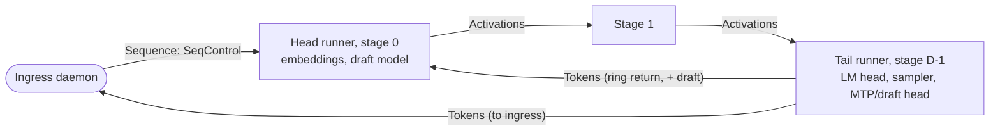

# RFC-0032: Distributed execution

- Status: Draft
- Area: distributed runtime
- Depends on: RFC-0001 (§2.3, §3.3, §5.4, §5.8, §5.10, §6, §7, §8), RFC-0010, RFC-0011, RFC-0012, RFC-0022, RFC-0023, RFC-0030, RFC-0031, RFC-0033, RFC-0040, RFC-0042, RFC-0043, RFC-0060, ADR-0600, ADR-0006, ADR-0008, ADR-0009, ADR-0010, ADR-0017, ADR-0019, ADR-0304, ADR-0305, ADR-0306, ADR-0310
- Date: 2026-10-19
- Revised: 2026-10-22 (§5.3: the algorithm table's α is the size-independent per-message cost; §5.5: the intra-node cost, for N members through host memory)

## Summary

This RFC specifies how one model instance runs across nodes, and how the cluster agrees on what should run where.

**The data plane.**
- **Ring.** Pipeline stages connect directly in a ring. The head embeds and starts each step. The tail samples and returns tokens to the head, and streams them to the ingress node.
- **Steps.** Steps are numbered by the head and processed in order at every stage. Several steps may be in flight at once in throughput mode.
- **Prefill.** Prefill is chunked and staggered across stages. The chunk size is chosen from a closed-form TTFT model.
- **Speculation.** Speculative verify windows cross each stage once per window, whichever stage drafts. KV invalidation is implicit in each frame's starting position.
- **Fast islands.** Inside an island that passes ADR-0006's gate, a stage may run cross-node tensor parallelism or expert parallelism.
  - For N ≤ 4, collectives are one-shot all-reduces.
  - Partial sums are reduced in fixed member order in F32, so every member holds bitwise-identical hidden states.
  - Every branch that changes collective structure is decided by the stage's primary and broadcast in a step descriptor.
- **Intra-node.** Multi-GPU tensor parallelism uses the same split and reduction rules over the provider's peer collectives.

**The control plane.**
- **Event log.** The cluster's state is an event log written by one coordinator. A pure `decide()` validates commands, a pure `apply()` folds events, and pure `reactions()` and `plan_actions()` turn state into work.
- **Durability and catch-up.** Entries are hash-chained and persisted on every node. Snapshots are taken every 4,096 entries or 15 minutes. Laggards and diverged nodes catch up from snapshots.
- **Election.** The coordinator is elected without quorum, and only among nodes whose certificate carries `COORDINATOR`. A lease is renewed by the coordinator's heartbeat. Claims are pre-votes, staggered by a fixed rank, and they abort if any reachable member still hears a live coordinator. Every node validates every log entry, including keyholder signatures on authority events (RFC-0034 §8.3). Originators journal their commands and re-submit them after term changes, so acknowledged events survive crashes and heals.
- **Terms.** Terms embed a node tag, so the two sides of a network split never mint the same plan epoch or instance ID.
- **Scheduling.** Slow re-placement runs on the coordinator. Fast per-request routing runs on the ingress node from its replica, using load digests gossiped on membership beats. The coordinator never sits on a request path.

## Motivation and goals / non-goals

Single-stream decode across nodes costs `t_tok = Σ_s t_s + D · t_hop` (cost model §3.7). A pipeline adds capacity, and adds speed only when it moves bytes onto faster memory. So the runtime must not add any time beyond the stages and the hops: no star through a coordinator, no end-of-step all-gather, no per-token control traffic. The surveyed systems did all of these (`multi-device-inference.md` §2.3, §2.6, §4.1, §13 items 1, 2, 11).

Tensor parallelism pays only when the effective per-collective latency stays below `α_eff,max ≈ 200–300 µs` (cost model §3.8). The back-solved cost on a surveyed RDMA cluster was 130–150 µs per collective, against 10–21 µs of wire latency. The difference is synchronisation and implementation, which this RFC designs out.

Goals:
1. Pipeline decode at SC-13: `t_tok ≤ 1.05 · (Σ_s t_s + D · t_hop)`.
2. Throughput mode at SC-15: ≥ 0.85 × `min(M, D) / (Σ_s t_s + D · t_hop)`, capped at `1 / max_s t_s`.
3. Cross-node TP and EP that reach SC-17 (`α_eff ≤ α_wire + S/β + 2 · t_switch`) on RDMA over Thunderbolt 5, and run only where SC-16's gate passes.
4. A coordinator change fails no in-flight request (SC-27, ADR-0009). Control traffic stays independent of token rate.
5. Every state transition is a pure, replayable function, unit-tested and property-tested.

Non-goals:
- Majority quorum (ADR-0009).
- Prefill/decode disaggregation across nodes in v1. The KV transfer cost makes it pay only on RDMA-class links (cost model §5.4). It is listed as an open question.
- Tensor parallelism across links that fail the gate, Wi-Fi in particular.
- Byzantine members (D4).

## Design

### 1. Scope and split with neighbouring RFCs

| Concern | This RFC | Elsewhere |
|---|---|---|
| Ring wiring, step semantics, frame semantics, sequence control | yes | byte layouts: RFC-0031; the step loop inside one runner: RFC-0012 |
| Prefill chunk choice | TTFT model and constraints | `batching.prefill_chunk` in the plan: RFC-0011; interleaving policy at the head: RFC-0012 |
| Speculative windows across stages | frame flow and placement | drafting, acceptance, sampler: RFC-0012 (ADR-0017) |
| Cross-node TP/EP, intra-node TP | splits, collectives, consistency, bring-up | the gate and island formation: RFC-0011; provider collectives: RFC-0040; per-family sharding rules: RFC-0043 |
| `ParallelismMode`, `HopPlan` | owner (RFC-0001 §15) | — |
| Event log, `ClusterState`, `decide()`, `apply()`, snapshots, election, terms | owner (RFC-0001 §15; see "Proposed amendments" in RFC-0030 for §5.13) | membership and admission variants: RFC-0030; recovery variants: RFC-0033; security variants: RFC-0034; placement variants: RFC-0011 |
| Two-phase scheduling integration | triggers, inputs, outputs, `plan_actions()` | the solver and `route()` algorithms: RFC-0011 |
| Recovery after stage loss | — | RFC-0033 |

### 2. Instance bring-up on the data plane

After `PlanCommitted`, each owner daemon's `plan_actions()` (§8.3) spawns or updates its runner (RFC-0001 §3.3). The data-plane part of `Loading` and `Warming`:

1. **Endpoints.**
   - At `Loading`, the runner binds its iroh endpoint and, where the plan's hop uses them, its RDMA QPs and shared-memory segments (RFC-0031 §5).
   - It reports them to its daemon. The daemon sends `RunnerEndpointOffer` to the daemons of the stage's predecessor, its successor, its island members, and, for the tail, every node that may be ingress (RFC-0030 §8.3).
2. **Channels.** Each runner opens:
   - its **outbound** Activations channel to `stages[(s+1) % D]`, or a Tokens channel when s is the tail;
   - its island Collective channels, where member i connects to members j > i and accepts from j < i (§5.6);
   - nothing else.

   It accepts its inbound channel. Accepts are asynchronous, so bring-up order never deadlocks.
3. **Sequence channels** are opened lazily: ingress to head by the ingress daemon at its first routed request, and tail to ingress by the tail at the first sequence that names that ingress (RFC-0031 §4.5).
4. **Warming.**
   - The runner measures `α_eff` through its real hop: GPU buffer → frame → wire → frame → GPU buffer, 200 round trips at the decode frame size, against `LinkCaps::alpha_eff` (RFC-0010 L2).
   - It joins the **instance canary**: the head sends a `Canary` frame holding a fixed teacher-forced sequence from the pack sidecar's reference digest, and the tail compares its outputs (RFC-0001 §3.3).
   - A hop measured above `replan.drift_threshold` of its planned cost reports `Drift`, but does not block `Ready`.
5. **Routable.** When every runner reports `Ready` and the canary passes, the coordinator records `InstanceRoutable { instance, epoch, context_length }`, where `context_length` is the plan's published KV reach (RFC-0011 amendment B7).

### 3. Pipeline ring execution

#### 3.1 Roles and channels



| Role | Inbound | Outbound | Holds |
|---|---|---|---|
| Head (`StageRole::HEAD`) | Sequence channels from ingress daemons; ring-return Tokens from the tail | Activations to stage 1 | `RowLookup` embeddings; the draft model when `DraftSource::DraftModel`; outbound activation history (RFC-0033) |
| Middle | Activations from s−1 | Activations to s+1 | its layers' KV; outbound history |
| Tail (`StageRole::TAIL`) | Activations from D−2 | ring-return Tokens to the head; Tokens to each ingress | LM head, sampler state, token-level stop sets and grammar masks; MTP or draft heads and their duplicated embedding rows (ADR-0017) |
| Head and tail (D = 1) | Sequence channels | Tokens to ingress | everything; no stage-to-stage channel |

Cancel, Release, Pause and Resume all enter at the head on the Sequence channel. Ingress therefore needs channels only to the head and from the tail.
- **Cancel and Release** ride the ring as `SEQ_CTRL` TLVs on the next frame (RFC-0001 §6.2), because every stage frees or persists the sequence's KV. With no frame due, because the sequence is paused or idle, the head emits an empty-payload `Activation` frame (`n_rows = 0`) carrying only the TLV.
- **Pause and Resume** stop at the head, whose scheduler drives every step (RFC-0012 §10.3, RFC-0001 §8.4 rule 3). A paused sequence is left out of the head's steps, so no stage sees frames for it. Its KV stays allocated and counted at every stage. Nothing rides the ring for either, so `SEQ_CTRL` codes 4 and 5 are never sent (RFC-0031 §6.3).

#### 3.2 Steps

- A **step** is one pass of one frame's rows through the ring. The head assigns `step` numbers.
- **Two lanes per hop**. Each Activations hop has a **decode lane** (`lane = 0`: decode, verify and canary frames) and a **prefill lane** (`lane = 1`: prefill chunks). They are separate channels with separate credits, and the prefill lane may ride `HopPlan::prefill_transport`.
  - A stage's dispatcher always takes a ready decode-lane frame before a prefill-lane frame. A decode frame therefore waits at most for the one prefill chunk already running at each stage, never behind queued chunks.
  - During recovery, replay steps on the `Replay` channels sit between the two: decode lane, then replay, then prefill lane (RFC-0012 §5.1, RFC-0033 §4.2). `Recover` frames go to the head's `HandshakeCore` or the stage's recovery handler, never into the step loop.
  - RFC-0012 owns how many chunks the head keeps outstanding.
- **Ordering is per sequence.** Each lane is one FIFO channel, so frames of one sequence on one lane arrive in step order. A sequence never has frames on both lanes at once, because its decode starts only after its last prefill chunk has returned from the tail. Every stage therefore processes each sequence's frames in step order.
  - Frames of different sequences may be processed out of global step order.
  - `StepOutOfOrder` (0x030C) fires only when one sequence's frames arrive out of order.
- **Strictly increasing per instance as assigned** (RFC-0001 §5.8). The head continues its counter across epochs that keep it. A *replacement* head starts at `1 + max(max_step)` reported by the surviving stages in the recovery handshake's REPORT entries (RFC-0031 §6.12; RFC-0033 §4.2). A brand-new instance starts at 1.
- **Steps in flight.** A single-stream decode has one step in flight: step k+1 needs token k. A prefill has up to `D` chunks in flight. Throughput mode has up to `batching.max_inflight_steps` (default D) steps over disjoint groups of sequences (§3.9). Activations credits are sized to match (RFC-0031 §7.1).
- **One `Token` frame per step** at the tail: the ring-return copy, plus one per ingress node with sequences in the step.
- A frame for a step the receiver has already processed is a duplicate, and RFC-0031's sequence numbers drop it first. A frame for an epoch the runner does not serve is dropped (RFC-0001 invariant 7).

#### 3.3 `HopPlan` extensions

`HopPlan` is owned here (RFC-0001 §15). Fields added under the extension rules:

```rust
pub struct HopPlan {
    // RFC-0001: link, transport, wire, predicted
    /// The (link, transport) of the prefill lane (§3.2), when its cost at S_pf beats the decode
    /// transport by > 2× (RFC-0031 §3). Decode never moves to it. None: the prefill lane uses the
    /// decode lane's transport.
    pub prefill_transport: Option<(LinkId, TransportKind)>,
    /// Token-return hops only: forward through an intermediate node's runner (§3.4).
    pub relay: Option<RelayVia>,
    /// Predicted p99 of α + S/β at batch 1; the drift detector compares the measured p99 with it.
    pub predicted_p99: Nanos,
}
pub struct RelayVia { pub node: NodeId, pub first: LinkId, pub second: LinkId, pub transport: TransportKind }
```

#### 3.4 Relayed token-return hops

Thunderbolt cables are point-to-point and unrouted (ADR-0011). With three Macs cabled in a chain A–B–C and stages A → B → C, the tail-to-head return C → A has no cable.
- Its options are another medium (Ethernet or Wi-Fi), or two RDMA hops through B: 2 × (10–25 µs) plus B's forwarding time, against about 100–250 µs on 2.5 GbE (cost model §2.5).
- The solver may set `relay = Some(B)` on the return hop. B's runner then opens a `Tokens` channel with `lane = 1` from C and another to A. Its net poller copies each Token frame across without involving the dispatcher. The frames are about 128 B and the copy is under 1 µs.
- Activation hops are never relayed, because that would add a stage-sized hop. The solver orders the ring so that activation hops have direct links.
- **The direct return to the head stays** (OQ-NET-09). The return carries one ≈ 128 B `Token` frame, so it costs α only: on 2.5 GbE about 85–275 µs against ≈ 154 ms per token in example (c1), about 0.1–0.2 % [estimate: 85–275 µs ÷ 154 ms]; on Wi-Fi 3–7 ms at the median, with the p99 the solver already costs. No standalone benchmark decides it: the SC-13 benchmark records the return hop's share as a column (DIST-E11-T15), and the S2 pipeline decomposition reports it with the other hop shares (DIST-E11-T19).

#### 3.5 Decode and speculative windows

**Plain decode.** The tail samples token t for sequence q at position p. It sends `Token { t }` to the head and to q's ingress at the same time, so delivery to the client is off the next step's critical path (RFC-0001 §6.2). The head embeds t and sends `Activation { Decode, rows: [q @ p+1] }`.

**Verify windows** (ADR-0017). Drafting runs where its inputs are (RFC-0001 §6.4):

| Drafter | Drafts at | Frame flow per window |
|---|---|---|
| `Mtp`, `DraftHead` | tail, after sampling | tail → head: `Token { accepted…, bonus, draft d1..dγ (+ tree) }`; head → …: `Activation { Verify, rows: [bonus, d1..dγ] }` |
| `DraftModel` | head, after receiving the accepted tokens | tail → head: `Token { accepted…, bonus }`; head drafts γ; head → …: `Activation { Verify, rows: [bonus, d1..dγ] }` |

- **One ring traversal per window.** A window of T = γ + 1 positions crosses each hop once. Its frame is `T · stride` bytes: 224 KiB for T = 8, hidden 7168, F32 (ADR-0017).
- **Implicit truncation.** A frame whose span for q starts at position p tells every stage to drop q's KV from p onwards before appending (RFC-0001 §6.4). Rejected positions need no message. `KvStore::truncate` runs at frame admission on each stage, before the step is computed.
- **Trees.** Spans carry `tree_offset` and `tree_nodes`, and the tree area holds parents (RFC-0031 §6.3). Stages fork KV per branch (`KvStore::fork`) and build attention masks from parents (RFC-0012). The tail accepts the longest exactly matching path. Families with recurrent layers verify chains of at most 4 tokens until RFC-0012 shows tree-capable snapshots (ADR-0017 item 6).
- **Window size** comes from the plan's `SpeculativeConfig::max_window`, sized by RFC-0011 from `(t_draft + Σ_s t_s(T) + D · t_hop(T)) / E[tokens]`. The tail may lower γ at run time when acceptance falls. It never raises it above the plan, because captured graphs and KV slots are sized for it.
- **Pipelining several windows** of one sequence around the ring at once is asynchronous speculation, an M3 extension owned by RFC-0012. The frame format already supports it: windows are independent steps with explicit start positions.

#### 3.6 Sequence control semantics

`SequenceControl` is owned here (RFC-0001 §5.8). Additions:

```rust
pub struct SequenceOpen {
    // RFC-0001 fields: seq, session, ingress, prompt, prefix, sampling, limits, exactness, priority.
    // `limits` gains `embed: Option<PoolingMode>` (RFC-0050 amendment A5): a prefill-only embedding
    // sequence whose tail returns an `EmbeddingResult` to ingress instead of tokens (RFC-0031 §6.14).
    /// The router's choices (RFC-0011 `RouteDecision`), applied by the head.
    pub prefill_chunk: u32,
    pub initial_window: Option<u16>,
    /// Some(i) when the client supplied the seed: the sampler key is (seed, i), not `seq` (§3.7,
    /// ADR-0107). The head copies it into `SequenceMeta::choice_index`.
    pub choice_index: Option<u16>,
    /// Continuation of a sequence after migration or recovery (RFC-0033 §5). `prompt` then
    /// holds the original prompt followed by every token already emitted to the client.
    pub resume: Option<ResumePoint>,
    pub trace: Option<TraceContext>,
    /// RFC-0060 amendment A4: a teacher-forced parity sequence. Accepted only from a node with
    /// `debug.parity_api` enabled; its teacher tokens and reference ids arrive on a Tap channel.
    pub parity: Option<ParityTapSpec>,
    /// The session's X25519 public key (RFC-0034 §13): every stage that saves
    /// this session's KV encrypts it to this key. The private half never leaves the ingress.
    pub session_pk: Option<[u8; 32]>,
}
pub struct ResumePoint {
    pub emitted: u32,          // tokens already delivered; counted against max_tokens; never re-emitted
    pub rng_counter: u64,      // the sequence's draw counter after the last emitted token (§3.7)
    pub cause: ResumeCause,    // Migration | Recovery | Rebalance
}

/// What travels downstream in the SEQ_META TLV on a sequence's first frame (RFC-0031 §6.3):
/// everything in SequenceOpen except the prompt tokens, plus the prompt length.
pub struct SequenceMeta {
    pub seq: SequenceId, pub session: Option<SessionId>, pub ingress: NodeId,
    pub prompt_len: u32, pub sampling: SamplingParams, pub limits: SequenceLimits,
    pub exactness: ExactnessPolicy, pub priority: Priority, pub resume: Option<ResumePoint>,
    pub prefix: Option<PrefixRef>,           // the head's prefix-cache or session hit (RFC-0022 §7, §8)
    pub parity: Option<ParityTapSpec>,       // the tail reads it (RFC-0012 §8)
    pub prefill_chunk: u32,                  // the router's chunk choice, applied by the head (RFC-0011 §13, amendment B6)
    pub initial_window: Option<u16>,         // the router's first verify window; None = the plan's default (B6)
    pub session_pk: Option<[u8; 32]>,        // copied from SequenceOpen; stages encrypt saved KV to it (RFC-0034 §13)
    pub choice_index: Option<u16>,           // Some(i) when the client supplied the seed: the sampler key uses i, not `seq` (§3.7)
}
```

- **Every stage** allocates the sequence's KV when `SEQ_META` arrives. It calls `KvStore::open`, then `KvStore::attach` with `SequenceMeta::prefix` when there is a prefix or session hit (RFC-0022). An attach that misses is reported as `PREFIX_MISS` (§3.10).
- **Parity sequences.** When `parity` is set, the ingress daemon (the parity driver's node) opens a `Tap` channel to the tail, and to the head if the head drafts, and streams `TapIds` ahead of the positions in flight (RFC-0031 §6.13). The tail returns tap blocks in `TokenEntry::tap` on the ingress copy only.
- **The tail** also learns the sampler parameters, the ingress node and, for resumed sequences, the emitted count and RNG counter. For an embedding sequence (`limits.embed`), the tail pools the final hidden states instead of running the LM head, and sends one `EmbeddingResult` to ingress.
- **Release** frees KV at every stage, or persists it when `persist = Some(session)` (RFC-0022), and frees the sending stages' activation history (RFC-0033).
- **Cancel** does the same with no persistence. The tail stops emitting at once. Any tokens in flight from earlier steps are discarded by ingress (RFC-0001 §6.2).

#### 3.7 Sampler continuity

Recovery (RFC-0033) and migration may move a sequence's tail to another runner, or replay it on another instance. Sampler keying:
- **Key.** Each random draw is a pure function of `(request_seed, SequenceId, rng_counter)`. When the client supplied the seed, the key's second component is the choice index (0 … n−1) instead of the `SequenceId`, so a repeated request reproduces its tokens on the same build, epoch and devices (ADR-0107; RFC-0012 §8). `SequenceMeta::choice_index` tells the tail which form applies.
- **Counter.** `rng_counter` is a per-sequence counter that increases by one for every draw the sampler makes, whatever the position. Speculative acceptance may consume several draws per position. The counter is not the position.
- **n > 1.** The choices of an `n > 1` request are distinct sequences with distinct `SequenceId`s and, when the client supplied the seed, distinct choice indices, so their streams differ either way.
- **Reporting.** `rng_counter` is reported in every `TokenEntry` (RFC-0031 §6.5). Ingress stores it in the transcript (§8.2), and it is accepted back in `ResumePoint` and `Reconcile`.
- **Continuation.** A recovered or migrated sequence keeps its `SequenceId`, `request_seed` and `choice_index`, and the new tail starts at the stored counter, so it continues the same stream.
- **Seed.** When the client gives no seed, ingress picks one at `SequenceOpen`.

RFC-0012 and ADR-0107 implement the sampler to this key (PLC follow-up). The counter is a u64 everywhere it is stored or sent: `TokenEntry` (RFC-0031 §6.5), `ResumePoint`, `Reconcile` and the transcript, matching ADR-0107. A 128K-token sequence with up to 64 draws per position needs about 8.4 × 10⁶ draws [derivation: 131,072 × 64], so the width rules out wrap-around rather than meeting a measured need.

#### 3.8 Chunked, staggered prefill

The head finds the longest cached prefix (RFC-0022), then splits the uncached suffix of length L into m = ⌈L/c⌉ chunks of c tokens. It sends the chunks back to back. Stage s starts chunk k+1 as soon as it has sent chunk k, so stage s+1 computes chunk k while s computes k+1. This is the staggered schedule: each stage runs s leading idle slots, then m chunks.

**TTFT model** [derivation, cost model §3.5 and §3.7]. For stage s, let `t_s(c)` be its time per chunk. That is compute-bound above the ridge batch, plus streamed weight bytes for groups whose `StreamSite::min_tokens ≤ c`. For hop h, let `t_h(c) = α_h + c · S_tok / β_h`. Then:

```text
TTFT(c) ≈ Σ_s t_s(c) + Σ_h t_h(c)                    (the first chunk crosses the whole ring)
        + (m − 1) · max( max_s t_s(c), max_h t_h(c) ) (the remaining chunks drain at the bottleneck)
        + t_sample
```

A hop hides behind compute when `t_h(c) ≤ max_s t_s(c)`, which holds for slow stages (cost model §4c). The bubble fraction is (D − 1)/(m + D − 1).

**Choice of c.** RFC-0012 §2 owns the set of captured prefill sizes (the prefill ladder plus the plan chunk), and RFC-0011 owns the chunk rule: `batching.prefill_chunk` per plan, and the per-request choice in `route()`, carried to the head in `SequenceOpen::prefill_chunk`. The model above is the cost they use. The distributed constraints a chunk must meet:
- `c ≥ n*` for any group the plan streams over PCIe at prefill (ADR-0006 item 7). Otherwise streaming does not pay and the group computes in place.
- The prefill slot memory, `6 × c · S_tok` per prefill channel side (RFC-0031 §Performance), must fit the network sub-arena.
- `c · S_tok ≤ max_frame` per part. Larger chunks are split into parts (RFC-0031 §6.3).
- Under cross-node EP, `c · S_tok ≤ max_frame` per owner, or `EpDispatch`/`EpCombine` are split into parts (RFC-0031 §6.8).
- In latency mode the interleave limit is RFC-0012's `sched.decode_stall_budget`. The prefill lane (§3.2) ensures a decode frame waits at most for the one chunk already running at each stage.

**No lossless activation compression in v1** (OQ-NET-10). ADR-0010's trigger is F32 prefill transfer above 25 % of TTFT on 2.5 GbE after chunked pipelining. The Tier 1 cases stay well under it: in example (c1) a 512-token F32 chunk is 16 MiB, ≈ 57 ms at 294 MB/s against ≈ 2.7 s of Strix compute per chunk, about 2 % and hidden after the first chunk; MoE between two fast GPUs is ≈ 56 µs of transfer per token against ≈ 220 µs of compute [estimates: 16 MiB ÷ 294 MB/s; MoE figure for Qwen3-235B-A22B at hidden 4,096 and ≈ 11B active parameters per stage on a 100 TFLOPS GPU]. A nightly row keeps measuring the share (DIST-E11-T06, RFC-0061), and BF16 wire certification halves it wherever a family passes (ADR-0010 item 5).

#### 3.9 Throughput mode

- With `Objective::Throughput`, the head groups live sequences into up to `max_inflight_steps` groups. It issues each group's next step as soon as that group's previous step has left the head, so several steps circulate at once.
- Each frame batches the group's rows with one span per sequence.
- Aggregate throughput approaches `min(M, D) / (Σ_s t_s + D · t_hop)`, bounded by `1 / max_s t_s(B_s)` at the bottleneck stage's batch (cost model §3.7, SC-15).
- Admission authority follows ADR-0106. Ingress gates on load digests (RFC-0030 §5.6). The head makes the binding decision with the per-stage headroom returned on the ring (§3.10; RFC-0012 §10.1).
- Speculation is off in throughput mode unless the solver predicts a gain (ADR-0017 item 8).

#### 3.10 Side-channel items and relays

Items that other RFCs place "on the side channel" (RFC-0001 §5.8) travel in `Activation` frames, which move downstream, and in ring-return `Token` frames, which move tail → head. RFC-0031 §6.3 and §6.5 fix the bytes. This table fixes who emits, who relays and who consumes:

| Item | Emitted by | Travels | Relay rule | Consumed by |
|---|---|---|---|---|
| `TOKEN_IDS` | head | downstream | forwarded only as far as the last stage that needs it: stages holding `RowLookup` groups, and the tail | those stages |
| `ROUTER_HINT` | stage s (RFC-0023 §8) | to s+1 only | never forwarded beyond s+1 | s+1's expert prefetch |
| `SEQ_META`, `SEQ_CTRL`, `TRACE`, `TRUNCATE` | head | downstream | forwarded unchanged | every stage |
| `DRAFT_CONF` | head | downstream | forwarded | tail |
| `PAGE_KEYS`, `PREFIX_EVICT` | head (RFC-0022 §7.4, §7.5) | downstream | each stage applies, then forwards | every stage |
| `PREFIX_PRESSURE`, `PREFIX_DROPPED` | any stage | downstream, then ring return | each later stage forwards it unchanged; the tail moves it to the next ring-return `Token` frame | head |
| `PREFIX_MISS` | any stage, on a sequence's first frame | downstream | forwarded; the tail converts all misses for the sequence into one `RESTART { from: min(have_tokens) }` | head (re-issues prefill from `from`) |
| `KV_HEADROOM` | every stage, on every outbound frame | downstream, then ring return | each stage replaces its own entry with RFC-0022's `KvHeadroom { tokens: [u32; 3] }`, admissible tokens per tier, refreshed from `KvStore::headroom()`, and keeps the others. The tail adds its own and copies the list to the ring-return frame | head: binding admission, which takes the minimum over stages per tier (RFC-0012 §10.1). The gossiped digest copy is for the dashboard only |
| `SESSION_SAVED` | any stage, once its session checkpoint segments and manifest are durable (RFC-0022 §8.1–§8.2) | downstream, then ring return | as `PREFIX_DROPPED`: each later stage forwards it unchanged, and the tail moves it to the next ring-return `Token` frame. An idle ring carries it on an empty frame (below) | head: when it holds one `SessionSaved` per stage within `kv.save_timeout` (30 s), its runner asks its daemon to submit `PinSession { session, instance, holders }`. Otherwise nothing is submitted and the partial save is left to retention (RFC-0022 §8.1) |

- **Freshness.** A headroom value is at most one ring traversal old when it reaches the head. When the ring is idle, no frames refresh it. The head then uses its last list, plus the gossiped load digests (RFC-0030 §5.6), and refreshes it on the next frame. An entry that is copied forward without having been refreshed carries `STALE`.
- **Idle relays.** An item that must move while no step is due, such as `PREFIX_EVICT` on an idle ring or a pending `PREFIX_DROPPED`, rides an empty-payload `Activation` frame (`n_rows = 0`). That is the same mechanism as `SEQ_CTRL` (§3.1). The tail answers it with an empty ring-return `Token` frame when it carries items for the head.
- **Capability gating.** Prefix items and headroom are sent only on channels that negotiated `PREFIX_ITEMS` and `KV_HEADROOM` (RFC-0031 §10).

### 4. Plan transitions on the data plane

RFC-0001 §7.3 defines the two strategies, make-before-break and break-before-make, for a changed shard. This section adds what happens on the data plane and the in-place variants that recovery needs.

#### 4.1 Classifying a node's change

`plan_actions()` (§8.3) compares the node's part of the old and new plans:

| Change for this node | Action | Runner state |
|---|---|---|
| none | — | — |
| budgets, prefetch windows, speculative settings, miss split, batching only | `ApplyPlanDelta` | stays `Ready` |
| same shard; different neighbour, hop transport, relay or stage index | `ApplyPlanDelta` with `DeltaItem::Relink` (§4.4) | stays `Ready`, briefly `Ready { degraded: Relinking }` |
| same shard plus additional layers on this node: a survivor absorbs a lost stage | `ApplyPlanDelta` with `DeltaItem::ExtendShard` (RFC-0033 §6) | `Ready { degraded: Absorbing }` while the new stage loads |
| shard changed otherwise | new runner for the new epoch; old runner `Drain` | per RFC-0001 §7.3 |
| node leaves the instance | old runner `Drain` | — |

`Relink` and `ExtendShard` are new `DeltaItem` variants. RFC-0001 §5.4 says any change to neighbours goes through drain-and-replace. That would discard the survivors' KV and activation history exactly when recovery needs them, so this RFC proposes an amendment.

#### 4.2 Make-before-break

The new epoch's runners load next to the old epoch's. Both epochs' frames share links and processes, which is safe because frames are epoch-tagged (RFC-0001 invariant 7). When the new epoch is routable, ingress sends new sequences there. Old sequences finish or migrate under RFC-0033 §5. The old runners drain, and their ledger reservations are released on `Stopped`.

#### 4.3 Break-before-make

The old epoch drains first, with sequences finished, KV-migrated, or ended with a retryable error at the deadline (RFC-0033 §5). Then the new runners load. Ingress holds new requests for the gap, bounded by each request's deadline. The plan states the expected gap (`PredictedCost::transition`), so the dashboard can show it before the user confirms a load.

#### 4.4 In-place relink

For a planned relink:
1. The head stops issuing new steps on the old epoch at a step boundary.
2. In-flight steps complete, and their tokens reach the head and ingress.
3. Every affected runner opens its new-epoch channels to its new neighbours, under the same credential, whose epoch range covers the new epoch (RFC-0034 §6).
4. The head runs the recovery handshake (RFC-0033 §4.2) in its no-loss form. It confirms each stage's committed positions per sequence, which normally all match.
5. Decode resumes on the new epoch with the next step number.
6. Old-epoch channels close after their last frames are acked.

An unplanned relink after a stage loss runs the same steps from step 3, with replay (RFC-0033 §4). The planned form costs one ring drain plus channel set-up: tens of milliseconds on LAN [estimate: one ring traversal plus 2 QUIC stream opens on warm connections].

#### 4.5 KV and session transfer transport

RFC-0022 §10 defines the `KvChunk` and makes this RFC responsible for its transport: the bulk class, below the data plane.

- **Runner to runner** (KV migration, RFC-0033 §5.2): the exporting runner opens a `Replay`-purpose channel to the importer, with Bulk priority, and sends `KvChunk` frames (RFC-0031 §6.11), layer by layer. Bulk pacing (RFC-0031 §7.5) keeps every live hop on the same link within its p99. Export follows RFC-0022's consistency rule: writable tail pages go only after the sequence is paused at a step boundary.
- **Store to runner** (session restore from another node, RFC-0022 §8.4): the blob plane, `BlobRequest { kind: SESSION_KV }` (RFC-0031 §6.10). The store writes the blob locally, and the runner restores from local disk.
- **Peer RAM to local** (expert groups homed on another node, RFC-0023, M3): a runner-to-runner `Bulk`-purpose channel with `TENSOR_GROUP` requests (RFC-0031 §6.10).

### 5. Tensor and expert parallelism

#### 5.1 Islands and members

- A stage with `CrossNodeTp` or `CrossNodeEp` runs on a **fast island**: nodes whose every member pair passed the gate of ADR-0006, `α_eff` mean and p99 below `α_eff,max`, measured through the device path (RFC-0010 L2).
- `StageAssignment::node` is the **primary**. It owns the stage's ring endpoints, receives the inbound frame, authors step descriptors and sends the outbound frame.
- `members[0]` is the primary. Member order is fixed by the plan and is the order of every deterministic reduction.
- An island member serves only that stage of that instance. It is never also a ring stage, because its timing then adds to two critical paths.

```rust
/// Owner: this RFC. How a layer's work is divided among members, in member order.
pub struct TpSplit {
    pub attn: SmallVec<[u16; 8]>,   // KV-head groups per member (GQA), or query heads per member (MLA)
    pub ffn: SmallVec<[u32; 8]>,    // FFN columns per member, in units of the family's tile (RFC-0043)
    pub experts: Option<SmallVec<[u32; 8]>>, // TP inside experts: columns per member per expert
}
pub enum CollectiveAlgo { OneShot, Ring }
/// Owner: this RFC. Expert owner per (MoE layer, expert) for CrossNodeEp; values index `members`.
pub struct ExpertOwnerMap { pub layers: Vec<(LayerIx, Vec<u8>)> }
```

Splits may be uneven and weighted by `W_eff`, at the legal granularity the family declares (ADR-0006 item 2; RFC-0043): whole KV-head groups for attention, a tile multiple of the quant block for FFN columns. The splits of surveyed runtimes were even only, and they rejected node counts that did not divide the head count (`multi-device-inference.md` §4.4). This design has no such restriction.

#### 5.2 Step descriptors: one author for every branch

Every member must execute the same sequence of collectives with the same shapes. If one member takes a different branch, for example a different routed expert, a different verify-window size or a different truncation, the collectives deadlock or sum the wrong data. Surveyed runtimes all-gathered task IDs, sampling state and eviction flags to keep ranks aligned (`multi-device-inference.md` §4.7). Here, one member decides:

1. The primary receives the inbound `Activation` frame and forwards it unchanged to each member as a `StepDescriptor` (RFC-0031 §6.8). The descriptor carries the step, the spans, the positions and therefore the implicit truncation, the window size, the tree, and the input hidden state.
2. Every decision that changes collective structure is made by the primary and broadcast: routed experts per row (`ROUTER_BCAST`), skipped rows, the end of a sequence. Members never compute such decisions locally, with one exception.
   - **The exception.** In an island whose members share one `DeviceClass` and the same provider op choice for the router, members compute the router locally. Startup verification gates this: at `Warming`, every member computes the router on the canary sequence, and the primary compares the results bitwise.
   - A mismatch disables local routing for the epoch.
   - This saves one α per MoE layer per token on homogeneous pairs, the common case of two identical Macs.
3. Local-only decisions that do not change collective shapes stay local: expert-cache admission, CPU/GPU miss split, prefetch. Each member owns its tiers (RFC-0001 invariant 4).

#### 5.3 Tensor-parallel layer schedule

Per layer, for the member set of size N, in the standard column-parallel then row-parallel layout:

```text
input x (replicated, bitwise identical on all members)
  attn:  q,k,v = x · W_qkv[member columns]              (own KV-head groups; own KV cache for those heads)
         o_part = attention(q,k,v) · W_o[member rows]
         x = x + ALLREDUCE(o_part)                        collective 1
  ffn:   h = act(x · W_gate[cols]) ⊙ (x · W_up[cols])
         x = x + ALLREDUCE(h · W_down[member rows])      collective 2
  moe (TP inside experts): experts from ROUTER_BCAST (or the verified local router);
         each member computes its column slice of each selected expert; one ALLREDUCE of the sum
```

- **KV.** With GQA, each member stores the KV of its own head groups. With MLA, the compressed latent is shared by every head, so each member stores the full latent cache. It is small: 68.6 KiB per token across the whole model (cost model §3.6).
- **Exactness of the reduction.**
  - Partials travel in F32, because the reference accumulates in F32 (ADR-0010 item 5, ADR-0019).
  - Every member sums the N partials in member-index order, with a reduction kernel that forbids reassociation and FMA contraction in the sum.
  - IEEE-754 addition in a fixed order gives identical results on every device, so all members hold **bitwise-identical** hidden states after each all-reduce. Their residual streams never drift apart.
  - BF16 partials exist only under `WIRE_COMPRESS` (approximate mode).

**Algorithms.**

| Algorithm | Used when | Time per all-reduce [cost model §3.8] |
|---|---|---|
| `OneShot`: each member sends its partial to every other member, and each sums all N in member order | N ≤ 4 and S ≤ `tp.oneshot_max` (1 MiB): every decode and verify window, and small prefill chunks | `α_eff + S/β` when the island is a full mesh of point-to-point links, so the N−1 sends go out in parallel on separate links; `α_eff + (N−1)·S/β` when they share one NIC |
| `Ring`: a reduce-scatter then an all-gather, in 2(N−1) steps of S/N | N > 4, or S > 1 MiB (prefill) | `2(N−1)·α_eff + 2(N−1)/N · S/β`. Each slice's final sum is computed once and then gathered, so results are still bitwise identical |

*Note, 2026-10-22 (DIST-E13-T12), a correction for the maintainers to confirm:* in the table above, `α_eff` stands for the size-independent per-message cost α = α_eff,probe − S₀/β. ADR-0310's revision of 2026-10-19 defines `α_eff` as the per-collective cost RFC-0010's L2 probe measures at the `h_model × 4 B` partial S₀, with S/β included, as the budget below also counts it. Read literally, the formulas would count the size term twice, and `Ring` would charge a full S/β per step instead of S/N. With α, they count it once. At S = S₀ on a full mesh, `OneShot` gives back `α_eff,probe`, which keeps ADR-0310's use of `α_eff` alone in the SC-16 gate and in cost tables. `syntropy-solver`'s `collective` module implements the table this way, and derives α from a probe with `alpha_from_probe`.

**The synchronisation path** is what SC-17 budgets, `α_eff ≤ α_wire + S/β + 2 · t_switch`, with S the partial's size:

```text
GPU: write o_part into a host-mapped registered slot; signal_host(doorbell)     (no host synchronise)
net poller (spinning): sees doorbell → posts N−1 sends (RDMA SEND / QUIC write)
net poller: on N−1 receive completions → writes host flag F = step·layer·phase
GPU stream: wait-on-value(F) → reduction kernel reads the N slots (Unified: in place; discrete: after H2D)
```

- No device synchronisation and no dispatcher round trip. The dispatcher enqueued the whole layer's launches, waits included, in advance as one captured graph (RFC-0012).
- On Apple silicon the slots are unified memory, so the hand-off costs only the doorbell and flag latencies.

#### 5.4 Expert-parallel layer schedule

With `CrossNodeEp`, attention, dense layers and shared experts run on the primary. Routed experts run on their owners (`ExpertOwnerMap`). Per MoE layer:

1. The primary computes the router, or uses the verified local router (§5.2), and groups selected `(row, expert, weight)` triples by owner.
2. To each remote owner with at least one selected expert, it sends an `EpDispatch` carrying the rows' hidden states and that owner's expert IDs and weights (RFC-0031 §6.8). The primary's own experts run concurrently.
3. Each owner runs its experts with its own expert cache and tiers (RFC-0023) and returns an `EpCombine`: per row, the weighted sum of its experts' outputs, in F32.
4. The primary adds the combines in member-index order to its local sum, then adds the residual.

Messages per token are at most 2 × (owners touched) per MoE layer. That is 2 per layer when the selected experts fall on one remote owner, which is about 116 per token for DeepSeek-V3, latency-bound like TP (cost model §3.9). The solver weighs this against TP inside experts. Each expert has exactly one owner, and replicas exist only as explicit plan entries for hot experts (ADR-0006 item 3, RFC-0001 invariant 11).

#### 5.5 Intra-node tensor parallelism

`IntraNodeTp { devices, split }` uses the same `TpSplit`, the same layer schedule, the same member-order F32 reduction, and the same step-descriptor rule, with the provider's `CollectiveOps` over NVLink or PCIe peer-to-peer (RFC-0040).
- **P2P is trusted only after a verified test copy in each direction** at `Warming` (ADR-0006 item 5). A pair that fails the test reduces through pinned host memory instead, and its cost is reported as `Drift` if it exceeds the plan.
- One dispatcher thread per GPU (RFC-0001 §8.2). The stage's primary dispatcher authors step descriptors in process. No network frames are involved.
- RFC-0012 owns the step-program integration.
- *Note, 2026-10-22 (DIST-E13-T12), an addition for the maintainers to confirm:* the cost of an intra-node all-reduce uses §5.3's `OneShot` and `Ring` formulas, with the device pair's measured α and β over the provider's `CollectiveOps` on a verified peer-to-peer link. Devices that reduce through pinned host memory follow §5.3's synchronisation path, where each member's reduction kernel reads all N slots. Each of N members copies its own partial to the host once, then reads the other N−1 from there over its own host link. So `OneShot` costs `α + S/β_d2h + (N−1)·S/β_h2d`, whatever the fabric, and each `Ring` step's S/N slice costs `S/(N·β_d2h) + S/(N·β_h2d)`. For a pair (N = 2), both reduce to S/β becoming `S/β_d2h + S/β_h2d`. The plan does not say whether a host-side sum is ever meant instead. That would cost `α + S/β_d2h + S/β_h2d` plus the sum's time, so it is left for the maintainers. `syntropy-solver`'s `collective` module prices both paths, and PLC-E4-T09's `IntraTp` nodes use it.

#### 5.6 Bring-up and failure inside an island

- **Order.** Member i connects to members j > i and accepts from j < i. `Warming` waits until all N−1 collective channels are open, or until `tp.bringup_timeout` (30 s).
- **Verification.** Each member then measures `α_eff` on its collective channels with 200 one-shot round trips at the decode partial size. A pair above `α_eff,max` fails `Warming` with `Drift` and reports the measurement, and the coordinator re-plans without the island (RFC-0011).
- **Failure.** A member lost mid-session stalls the stage. Recovery treats the whole island stage as lost (RFC-0033 §3.3): a TP stage's KV is split across members and cannot be partly replayed, and an EP owner's loss leaves experts with no owner.

### 6. The cluster event log

ADR-0009 fixes the model: an event-sourced single writer, typed commands and events, a pure `apply()`, snapshots and catch-up, and no tokens or per-request data in the log. This section specifies it.

#### 6.1 Entries and the hash chain

```rust
/// RFC-0001 §5.10: index, term, event. Added: `at_ms`, `cause`, `event_bytes` and `chain`.
pub struct LogEntry {
    pub index: u64,           // dense, increasing from 1
    pub term: u64,            // coordinator term that appended it (§7.2)
    pub at_ms: u64,           // coordinator wall clock at append; informational, never read by apply()
    pub cause: Option<CommandId>,   // the command that produced it; drives re-submission (§6.10)
    pub event: ClusterEvent,  // decoded view of event_bytes
    /// The event's CBOR exactly as the coordinator encoded it. Persisted, relayed and
    /// hashed verbatim; never re-encoded. A decoder of an older minor ignores fields it does not know,
    /// but the bytes, and so the chain, stay identical on every node.
    pub event_bytes: Bytes,
    /// BLAKE3(prev.chain ‖ index ‖ term ‖ cause ‖ event_bytes); index 0 has chain = BLAKE3(cluster_id).
    pub chain: Blake3,
}
```

- **Divergence check.** The chain makes divergence detectable in one comparison: two nodes agree on everything up to index i if and only if their `chain` values at i match. It is used in sync (§6.7), in split-brain heal (§7.5) and in the debug endpoint.
- **Not a security mechanism.** Security comes from `validate()` (§6.3) and the keyholder signatures that authority events carry (RFC-0034 §8.3).

#### 6.2 State

```rust
/// The whole cluster state; the fold of the log. Plain data; Clone; deterministic serialisation.
pub struct ClusterState {
    pub cluster: ClusterId,
    pub applied: (u64, u64),                          // (index, term) of the last applied entry
    pub chain: Blake3,
    pub feature_level: u32,                           // min over members (§6.4)
    pub coordinator: Option<CoordinatorRecord>,       // { node, term, elected_at_index }
    pub max_term: u64,                                // highest term ever seen in the log
    pub members: BTreeMap<NodeId, MemberRecord>,      // RFC-0030: status, incarnation, roles, admission generation,
                                                      // the keyholder-signed Approval and current certificate,
                                                      // flap history, feature level, NodeInfo
    pub revoked: BTreeMap<NodeId, u32>,               // node → highest revoked admission generation (RFC-0034 §8.1),
                                                      // each backed by its SignedRevocation
    pub api_keys: BTreeMap<KeyId, ApiKeyRecord>,      // cluster-wide API keys, hashes only (RFC-0034 §8.4)
    pub revoked_api_keys: BTreeSet<KeyId>,
    pub rotations: Vec<RotationStatement>,            // the cluster key's verified rotation chain (RFC-0034 §8.2)
    pub keyholders: BTreeSet<NodeId>,                 // backed by the signed KeyholderChanged chain from the bootstrap keyholder
    pub invites: BTreeMap<[u8; 16], InviteRecord>,
    pub pairing: BTreeMap<WindowId, WindowRecord>,
    pub graph: GraphState,                            // interfaces, edges, profiles, ledgers, Thunderbolt cables;
                                                      // `version` is the ResourceGraph's GraphVersion (RFC-0010)
    pub models: BTreeMap<ModelId, ModelRecord>,       // manifest digest, chunk-table root (ADR-0016), siblings,
                                                      // latest WorkloadReport per instance (§6.5)
    pub instances: BTreeMap<InstanceId, InstanceRecord>,
    pub orphans: BTreeMap<(InstanceId, PlanEpoch), BTreeSet<NodeId>>, // runners reported after a heal (§7.5)
    pub sessions: BTreeMap<SessionId, SessionRecord>, // persisted sessions only (RFC-0022)
    pub chunks: BTreeMap<(NodeId, ModelId), ChunkSetDigest>,
    pub config: ClusterConfig,                        // cluster-scoped keys (RFC-0001 §11.1)
    pub dedup: BTreeMap<NodeId, DedupWindow>,         // last applied CommandId counters per origin
    pub alloc: AllocState,                            // instance and plan-seq counters for the current term
}
// Every authority-derived field keeps the signed record that created it (RFC-0034 §8.3), so a
// snapshot can be validated without the log (§6.7).

pub struct InstanceRecord {
    pub model: ModelId,
    pub policy: InstancePolicy,
    pub current: Option<Arc<PlacementPlan>>,
    pub retiring: SmallVec<[Arc<PlacementPlan>; 1]>,  // epochs draining under make-before-break or recovery
    pub runners: BTreeMap<(NodeId, PlanEpoch), RunnerStateKind>,
    pub routable: Option<PlanEpoch>,
    pub recovery: Option<RecoveryRecord>,             // RFC-0033
    pub requested_at: u64,                            // log index
}
```

`ClusterState` is served whole, as CBOR or JSON, by the debug endpoint (RFC-0001 §13).

#### 6.3 Pure functions and the coordinator loop

```rust
/// Validates a command against state and returns the events to append, or a rejection.
/// Pure: no I/O, clock or randomness except `now_ms` and `entropy` passed in.
pub fn decide(s: &ClusterState, origin: NodeId, cmd: &ClusterCommand, now_ms: u64, entropy: [u8; 16])
    -> Result<SmallVec<[ClusterEvent; 4]>, CommandRejected>;

/// Checks an entry before anyone applies it: the appender is the coordinator elected at
/// the entry's term; the event's preconditions hold in `s`; and authority events carry the keyholder
/// signatures RFC-0034 §8.3 requires. Pure. Run by every node, the coordinator included.
pub fn validate(s: &ClusterState, appender: NodeId, e: &LogEntry) -> Result<(), Rejected>;

/// Folds one validated entry. Pure and total over validated entries.
pub fn apply(s: &mut ClusterState, e: &LogEntry);

/// Work the coordinator must start because of an event: solver runs, election follow-ups,
/// recovery (RFC-0033). Pure.
pub fn reactions(s: &ClusterState, e: &LogEntry) -> SmallVec<[Reaction; 2]>;

/// What this node's daemon should do to converge on `s`, given its runners' current states.
/// Pure. At most one action per instance per call, in priority order (§8.3).
pub fn plan_actions(s: &ClusterState, node: NodeId, local: &LocalRunners) -> SmallVec<[NodeAction; 4]>;
```

The coordinator loop runs on the daemon's `ctl` runtime:

```text
loop:
    (origin, cmd_id, cmd) = next command (from any node, own node included; relayed commands keep origin)
    if state.dedup[origin].seen(cmd_id): reply with the original result; continue
    match decide(&state, origin, &cmd, now_ms(), rng()):
        Err(r)  => reply CommandRejected(r)
        Ok(evs) => for e in evs: entry = append(e, cause = cmd_id); validate(...)?; apply(&mut state, &entry)
                   persist(entries, fsync = any event is durable-class)     // §6.6
                   replicate(entries)                                       // §6.7
                   await ack from ≥ 1 other COORDINATOR-eligible member, or `log.ack_timeout` (500 ms)
                   reply Ok { index, replicated: bool }                     // §6.10
                   for entry: for r in reactions(&state, &entry): spawn(r)  // e.g. solver task
```

**Revision note, 2026-10-22 (OQ-NET-33): which acks count toward `replicated = true`.**
- **The rule.** The ack the loop awaits must come from a `COORDINATOR`-eligible member other than both the coordinator and the command's originator. A command the coordinator originates itself still needs an ack from any other eligible member.
- **Why.** The originator's own ack adds no independent copy: its journal already guards the command (§6.10). DIST-E10-T08's model check found an 8-step trace in which that ack alone made a reply `replicated = true`, and the command was then lost with the coordinator's and the originator's disks.
- **The consequence.** In a two-node cluster, a follower's command is never `replicated = true`. The reply then says, truthfully, that only the coordinator and the originator hold it.

- **Long work stays out of `decide()`.**
  - `EnsureInstance` produces `InstanceRequested`. Its reaction runs the solver (RFC-0011) on a blocking thread over a snapshot of the inputs, then submits an internal `CommitPlan { instance, plan, solved_against: GraphVersion }` command.
  - `decide()` accepts `CommitPlan` only if the graph version is unchanged, or if every change since is one that RFC-0011's `plan_still_valid()` accepts. Otherwise it rejects, and the reaction re-solves.
  - So a plan is never committed against a graph that has moved under it.
- **Idempotency.** `CommandId = (origin NodeId, u64 counter)`. Counters are persisted per node with the boot counter. `DedupWindow` keeps the high-water mark plus the last 64 counters, so retried and relayed commands apply once.
- **Followers** run `validate()` and then `apply()` on every entry, `reactions()` for read-only purposes such as dashboard notifications, and `plan_actions()` for themselves.
  - **An entry that fails `validate()` is never applied.** The follower refuses all further appends from that coordinator at that term, reports `CoordinatorMisbehaved { term, index, reason }` to the other members, and treats the coordinator's lease as expired. A coordinator that forges an authority event therefore loses its followers, and an election follows (§7.3).
  - `validate()` is pure, so every honest node reaches the same verdict on the same entry.

#### 6.4 Feature levels

- Each build has a `feature_level: u32`, which increases whenever a new event or command variant, or a new field with behavioural meaning, is added. Each node reports it in its control `Hello` and in `NodeInfo`.
- `ClusterState::feature_level` is the minimum over admitted, non-revoked members, recomputed by `apply()` on membership events.
- `decide()` never emits a variant whose introducing level exceeds the cluster's level. Where a newer behaviour has no older encoding, the command is rejected with `FeatureLevelTooLow { needed, cluster }`, naming the nodes to upgrade.
- This is the mechanism behind ADR-0305's evolution rule.
- **Cluster configuration keys**. Each cluster-scope key in RFC-0054's schema carries its introducing feature level (`introduced_at`, RFC-0054 §2.3 step 9). A heal's re-proposals (§7.5 step 2) pass the same check, so a key re-proposed into a cluster whose level fell below `introduced_at` is rejected, not applied. `decide()` rejects a `SetClusterConfig` that sets a key above `ClusterState::feature_level`, with `FeatureLevelTooLow`. A node applying `ClusterConfigChanged` with a key its schema does not know keeps it opaque: stored, passed on in snapshots, never interpreted, and logged once as a warning.

#### 6.5 Catalogue

The authoritative list of variants and their owners. RFC-0001 §5.10 variants are marked †. Variants added by other RFCs are summarised. Their owner RFC defines validation and payload.

**Commands.**

| Command | Owner | `decide()` validates | Emits |
|---|---|---|---|
| `Admit`† | 0030 | proof (RFC-0030 §6) | `NodeAdmitted` (+ `InviteConsumed` \| `PairingWindowUsed`) |
| `Leave`† (with `reason`) | 0030 | origin = node | `NodeLeft` \| `NodeSleeping` |
| `Revoke`† | 0034 | origin holds KEYHOLDER; carries a `SignedRevocation` | `NodeRevoked`. Revoking a keyholder records only this; the revoking keyholder's daemon then starts the rotation (RFC-0034 §8.2; `decide()` never emits `ClusterKeyRotated`) |
| `ReportAlive`, `ReportFailed`, `ReportInterfaces`, `ReportEdgeDown/Up`, `CreateInvite`, `RevokeInvite`, `Open/ClosePairingWindow`, `RecordCert`, `Promote/DemoteKeyholder` | 0030 | RFC-0030 §8.1 | RFC-0030 §8.2 |
| `ReportProfile`† | 0010 | origin = profile.node | `GraphUpdated` when the solver-visible graph changes |
| `ReportLedger`† | 0001/0020 | origin = node | `GraphUpdated` |
| `RegisterModel`† | 0041 | manifest digest fetchable | `ModelRegistered` |
| `EnsureInstance`† | 0011 | model registered; policy valid; idempotent on (model, policy) | `InstanceRequested`, or nothing when an equivalent instance exists |
| `UnloadInstance`† | 0011 | instance exists | `InstanceUnroutable`, then `PlanRetired`, `InstanceRemoved` as runners stop |
| `RequestReplan`† | 0011/0033 | instance exists | none directly; reaction runs the solver |
| `ReportWorkload { instance, node, report: WorkloadReport }`† | 0023/0012 (consumer 0011) | origin = node; instance exists. `report` bundles RFC-0023's `ExpertWorkloadReport` with RFC-0012's acceptance, context and concurrency statistics. Senders report at most once per 60 s per instance, only on a material change, and at `Draining` (RFC-0001 §5.10) | `WorkloadUpdated` |
| `CommitPlan` (internal, coordinator only) | 0011 | graph version unchanged or `plan_still_valid()`; per-node budgets (RFC-0011) | `PlanCommitted` |
| `ReportRunner`† | 0001 | (instance, epoch) known, or recorded as orphan (§7.5) | `RunnerStateChanged`; `InstanceRoutable` when every runner is `Ready` and the canary passed |
| `ReportRunnerFailed`† | 0033 | — | `RunnerStateChanged { Failed }`; reaction: re-plan without the device after the restart budget is spent |
| `AnnounceChunks`† | 0041 | origin = node | `ChunksAnnounced` |
| `ProposeChunkIds { file, range, body, evidence: ChunkEvidence }` | 0041 | the shell fetches `body` by digest over the blob plane before `decide()`; every entry equals the committed table or fills an empty slot (RFC-0041 §6.3). `evidence` is one of RFC-0041 §6.3's `ChunkEvidence` forms, the same as RFC-0034 §10.1 items 1–3: `OriginHashes`, `Witnesses` (two `STAGE_HOST` signatures from distinct node keys) or `KeyholderVerified`. A locally imported file with no origin uses `KeyholderVerified` per RFC-0034 §10.1 item 4: from the import itself on a keyholder, otherwise after an approved `ApproveImport` request and the keyholder's streaming check | `ChunkIdsCommitted { file, range, body, evidence: Option<ChunkEvidence> }`, where `None` means provisional when the evidence is missing or does not verify. A later proposal of the same body with valid evidence upgrades the batch. A conflicting entry gets a rejection that makes the proposer refetch |
| `PinSession`†, `DropSession`† | 0022 | instance and holders exist | `SessionPinned`, `SessionDropped` |
| `SetClusterConfig`† | 0054 | schema-valid patch; cluster-scoped keys only | `ClusterConfigChanged` (+ `RequestReplan { Config { keys } }` reactions) |
| `ReportEdgeDemoted`, `ReportRecovery` | 0033 | RFC-0033 §8 | `EdgeDemoted`, `RecoveryStarted`/`RecoveryCompleted`, `InstanceDegraded` |
| `RotateClusterKey { statement }` | 0034 | the rotation statement verifies and its `old` is the current key (RFC-0034 §8.2) | `ClusterKeyRotated` |
| `CreateApiKey`, `RevokeApiKey` | 0034 | keyholder-signed; a revoked `key_id` is never re-created (RFC-0034 §8.4) | `ApiKeyCreated`, `ApiKeyRevoked` |
| `ReportNodeInfo { info }` | 0030 | origin = node; replaces mutable `NodeInfo` fields such as `power`, `labels`, `staged_build` (RFC-0052 A3) | `NodeInfoChanged` |

**Events** and what `apply()` does with them:

| Event | Owner | `apply()` effect |
|---|---|---|
| `NodeAdmitted`†, `NodeAlive`, `NodeSleeping`, `NodeLeft`†, `NodeFailed`†, `NodeRevoked`†, `NodeSuspected`†, `NodeFlapping`, `NodeConflict` | 0030 | member status and records; feature level recomputed; revoked generations, each with its `SignedRevocation` (RFC-0034 §8.1) |
| `CoordinatorElected`† | this RFC | `coordinator = { node, term }`; `max_term = max(max_term, term)`; reset `alloc` for the term |
| `GraphUpdated`†, `InterfacesChanged`, `EdgeStateChanged`, `TbBridgeLoop` | 0010/0030 | `graph`; bumps `GraphVersion` when solver-visible |
| `ModelRegistered`† | 0041 | `models` |
| `InstanceRequested`† | 0011 | creates the `InstanceRecord` |
| `PlanCommitted`† (RFC-0011 amendment B2) | 0011 | `PlanCommitted { plan_digest, summary }`. The plan travels inline when its RFC-0011 §11.2 encoding is at most 64 KiB; above that, the event carries the BLAKE3 digest and size, and the body travels on the blob plane (`BY_DIGEST`). `summary` (instance, `PlanEpoch`, each stage's node and layer range; RFC-0011 owns its fields) serves logs and the dashboard. For a by-digest plan, the shell fetches and verifies the body before handing the entry to `validate()`/`apply()`, as for `ChunkIdsCommitted`. Then the previous `current` moves to `retiring` (or is dropped if it never became routable), and `current = plan` |
| `ApiKeyCreated`, `ApiKeyRevoked` | 0034 | `api_keys`, `revoked_api_keys` |
| `NodeInfoChanged` | 0030 | `members[node].info` |
| `RunnerStateChanged`† | 0001 | `runners[(node, epoch)]` |
| `InstanceRoutable`†, `InstanceUnroutable`† | this RFC | `routable`. `InstanceRoutable { instance, epoch, context_length }` carries the plan's published `context_length` (RFC-0011 amendment B7), which ingress checks against prompt + `max_tokens` before routing (§8.2), so every replica has it without telemetry |
| `WorkloadUpdated { model, instance, report }`† | 0023/0012 (consumer 0011) | `models[model]`: the instance's latest `WorkloadReport` replaces its previous one. RFC-0011 assembles `WorkloadStats` per model from them (RFC-0011 amendment B5) |
| `PlanRetired`† | 0011 | removes the epoch from `retiring`; drops its runner records |
| `InstanceRemoved`† | 0011 | removes the record |
| `ChunksAnnounced`† | 0041 | `chunks` |
| `ChunkIdsCommitted` | 0041 | `models[..].chunk_tables`: committed batch digests per file, each with its `ChunkEvidence` (form and signatures) or marked provisional. Bodies are fetched by digest. Provisional batches are never served to peers for packing (RFC-0041 §6.3; RFC-0034 §10.1) |
| `SessionPinned`†, `SessionDropped`† | 0022 | `sessions` |
| `ClusterConfigChanged`† | 0054 | `config` |
| `InviteCreated`, `InviteConsumed`, `InviteRevoked`, `PairingWindow*`, `CertIssued`, `KeyholderChanged` | 0030 | admission records |
| `ClusterKeyRotated` | 0034 | `cluster` key history; old-key acceptance window |
| `OrphanRunner` | this RFC | `orphans` (§7.5) |
| `EdgeDemoted`, `RecoveryStarted`, `RecoveryCompleted`, `InstanceDegraded` | 0033 | `instances[i].recovery`, degradation flags |

Nothing in this catalogue is emitted per request, per token or per routine telemetry sample (RFC-0001 §5.10). The steady-state rate target is below 0.1 events per second on an idle cluster with no membership change (§Performance).

#### 6.6 Persistence and snapshots (ADR-0306)

Every node persists the log it has applied, so that a full cluster power-cycle restarts from disk, and so that a restarted node catches up from its own tail rather than a snapshot.

- **Segments.** Files `state/cluster/log/<first-index>.seg`. Each record is `len: u32 | crc32c: u32 | header CBOR (index, term, at_ms, cause, chain) | event_bytes`, with the event bytes stored exactly as received. Segments roll at 16 MiB.
- **Durability classes.**
  - Durable-class events are fsynced by the coordinator before it replicates them. Followers fsync them before acknowledging. The coordinator replies only after one other coordinator-eligible member has acknowledged, or `log.ack_timeout` passes (§6.3).
  - The durable-class events are `NodeAdmitted`, `NodeRevoked`, `ClusterKeyRotated`, `InviteCreated`, `InviteConsumed`, `CertIssued`, `KeyholderChanged`, `PlanCommitted`, `ClusterConfigChanged`, `ApiKeyCreated`, `ApiKeyRevoked` and `CoordinatorElected`.
  - An entry acknowledged by a second member survives the coordinator's crash, because the election winner pulls missing entries from the member with the longest chain (§7.3). The command journal (§6.10) covers the rest.
  - Everything else is group-committed every 100 ms, on the coordinator and on followers.
- **Snapshots.** Every 4,096 entries, or every 15 minutes if at least one entry was appended, each node writes `state/cluster/snap/<index>.snap` = `zstd(cbor(ClusterState))`, named and verified by BLAKE3 and written with an atomic rename. Each node keeps its 2 newest snapshots and the entries after the older one, and deletes older segments.
- **Restart.** Load the newest valid snapshot, replay the local segments after it while checking each record's CRC and the chain, then `Sync` with the coordinator (§6.7). A torn final record is truncated. A chain break in the middle of a segment discards the rest of the segment and syncs from the coordinator.

#### 6.7 Replication and catch-up

- **Append.** The coordinator streams `LogAppend { term, prev: (index, chain), entries }` to each follower on a dedicated control stream (RFC-0031 §9.1).
  - A follower whose last `(index, chain)` equals `prev` applies the entries and replies `LogAck { applied }`.
  - Otherwise it replies `LogAck` with its own last index, and the coordinator switches to `Sync`.
  - Followers that lag never slow the coordinator: per-follower queues are bounded, and a follower whose queue overflows is moved to snapshot catch-up.
- **Sync.** A node that starts, rejoins, resumes or sees a gap sends `Sync { last: (index, chain) }`. The coordinator replies with one of:
  - `Entries(from = index + 1)`, if it holds `index` with the same `chain` and has not truncated past it;
  - `Snapshot { digest, index }`, if the follower is behind the retained tail **or its chain differs at `index`** (divergence after a split, §7.5). The follower fetches the snapshot over `syntropy/blob/1` by digest (RFC-0031 §6.10), replaces its state and log, then syncs again for the tail.
- **Snapshot validation**. A snapshot replaces a node's state only after `validate_snapshot(snap, local)` passes. Like `validate()`, it is pure and runs on every node. It checks:
  - the digest, and that the snapshot's `chain` at `index` is the one the sender announced;
  - every authority-derived field against its signed record (RFC-0034 §8.3):
    - the keyholder set, as the signed `KeyholderChanged` chain from the bootstrap keyholder;
    - each member's `Approval` and certificate;
    - each `SignedRevocation`;
    - the `RotationStatement`s linking the current cluster key to the cluster ID's original key;
    - invites, as keyholder-signed records, with consumption derived from the approvals;
    - keyholder-authority configuration, with its keyholder signatures;
    - API-key records;
    - chunk tables, with their evidence;
  - the coordinator record's `ElectionProof` (§7.5).

  A snapshot that fails is refused. The node reports `CoordinatorMisbehaved`, treats the sender's lease as expired, and fetches the snapshot at the same index from another member, since any member serves snapshots by digest.
  - Availability fields (plans, graph, profiles, instances) are trusted at the coordinator tier, as log entries are (RFC-0034 §2).
  - Local deny-list entries and rotation statements are kept across the replacement, whatever the snapshot says (RFC-0034 §8.1–§8.2).
  - The cost is one Ed25519 verification per authority record, which is small next to fetching the snapshot.
- **Laggard detection is free.** Every membership beat carries the sender's `log_head` (RFC-0030 §5.2). A node more than `log.lag_sync` (256) entries behind the coordinator's head syncs at once.
- **Late joiners** receive a snapshot digest in their `JoinGrant` (RFC-0030 §6.7) and start from it. The survey shows clusters breaking when late-joiner catch-up was retrofitted after the fact (`multi-device-inference.md` §2.1). Here it is the first path a new node takes.

#### 6.8 Debug surface

`GET /v1/syntropy/debug/state` (RFC-0001 §13) returns the local node's `ClusterState`, with its `applied` index and `chain`. `syntropy cluster state --diff <node>` fetches two nodes' states and reports the first differing index by chain comparison. Every log entry can be pretty-printed with `syntropy cluster log [--from N]`.

#### 6.9 Protocol cores (sans-I/O)

The log, the election and the plan-transition orchestrator are written as RFC-0060 §2.2 **protocol cores**: deterministic state machines behind `ProtocolCore`, reading time only through `Clock` (`MonoTime`) and randomness only through `Entropy` (RFC-0060 amendment A1). The production shell is a tokio task that owns the core, feeds it messages and timer expiries, and executes its outputs over the control connections (RFC-0031 §9). The deterministic simulator drives the same cores from M2 (RFC-0060 §8). `decide()`, `apply()`, `reactions()` and `plan_actions()` (§6.3) are the pure functions the cores call. Cores add only state, timers and message handling around them.

```rust
// syntropy-cluster. Input and Output enums are public, so the simulator and fuzzers can drive them.
pub struct LogCore { state: ClusterState, log: LogTail, followers: FollowerTable, role: Role }
pub enum LogInput {
    Command { from: NodeId, id: CommandId, cmd: ClusterCommand },   // coordinator only
    Append { from: NodeId, term: u64, prev: (u64, Blake3), entries: Vec<LogEntry> },
    Ack { from: NodeId, applied: u64 },
    Sync { from: NodeId, last: (u64, Blake3) },
    SnapshotLoaded { index: u64, state: ClusterState },
    SolveDone { instance: InstanceId, plan: PlacementPlan, solved_against: GraphVersion },
    RoleChanged { role: Role, term: u64 },                         // from ElectionCore
    TimerFired(LogTimer),                                           // group commit, snapshot cadence, retries
}
pub enum LogOutput {
    Send { to: NodeId, msg: CtlMsg },
    Persist { entries: Vec<LogEntry>, fsync: bool },               // durable class → fsync before replies
    Reply { to: NodeId, id: CommandId, result: Result<u64, CommandRejected> },
    Applied { entry: LogEntry },                                    // the daemon's views and plan_actions read these
    StartSolve { instance: InstanceId, inputs: SolveInputs },      // the shell runs the solver on a blocking thread
    WriteSnapshot { index: u64 },
    SetTimer { timer: LogTimer, at: MonoTime },
}

pub struct ElectionCore { term: u64, coordinator: Option<(NodeId, u64)>, lease_deadline: MonoTime, claims: ClaimState }
pub enum ElectionInput {
    Beat { from: NodeId, coord: Option<CoordinatorBeat> },
    Claim { from: NodeId, term: u64, head: (u64, Blake3), rank: RankKey },
    ClaimReply { from: NodeId, reply: ClaimReply },
    MembersChanged { alive: Vec<(NodeId, RankKey)> },              // from MembershipCore (RFC-0030 §5.10)
    Resumed { slept: Nanos },                                       // from the shell's suspend detector
    Handover { to: NodeId },
    TimerFired(ElectionTimer),
}
pub enum ElectionOutput { Send { to: NodeId, msg: CtlMsg }, Broadcast(CtlMsg), RoleChanged { role: Role, term: u64 },
                          SetTimer { timer: ElectionTimer, at: MonoTime } }

pub struct TransitionCore { node: NodeId, local: LocalRunners }
pub enum TransitionInput { Applied(LogEntry), RunnerState { instance: InstanceId, epoch: PlanEpoch, state: RunnerState },
                           ActionDone { action: NodeAction, result: Result<(), Error> }, TimerFired(TransitionTimer) }
pub enum TransitionOutput { Do(NodeAction), Submit(ClusterCommand), SetTimer { timer: TransitionTimer, at: MonoTime } }
```

- **`now_ms` and `entropy` in `decide()`** come from the core's `Clock::unix_ms()` and `Entropy`. The value is recorded in `LogEntry::at_ms`, so replaying a log never reads a clock.
- **Lease and claim timing** (§7) uses `MonoTime` from `Clock::now()`. That must be a clock that keeps running through suspend (RFC-0030 §5.8). The shell detects a suspend and feeds `Resumed { slept }`, so the core's grace and lease logic see it explicitly.
- **The solver** runs outside the core: `StartSolve` hands the shell a snapshot of the inputs, and the result returns as `SolveDone`. In the simulator, solves are synchronous and deterministic (RFC-0001 §4.2 rule 5).

#### 6.10 Command journal and reconciliation

A coordinator can crash after replying and before any follower holds the entry. A heal can discard a whole branch. "No event is the only record of anything a node needs" (ADR-0009 item 7) is therefore enforced by originators, not only by the coordinator.

- **Journal.** Every node appends each command it submits to `state/cluster/journal`, fsynced before sending. This covers commands from the CLI, the dashboard, the API, configuration files and internal reactions. An entry stays in the journal until both conditions hold:
  1. an applied `LogEntry` with `cause = CommandId` exists in the log the node follows;
  2. that entry is older than `log.command_retention` (24 h) **or** is covered by a snapshot the node received from a coordinator at a later term.
- **Re-submission.** After every change of coordinator term, and after every snapshot replacement (divergence, §6.7), each node re-submits every journalled command whose `CommandId` is absent from its log. Dedup by `CommandId` (§6.3) makes this idempotent, and `decide()` rejects commands that no longer apply, for example a token already exhausted.
- **Configuration re-proposals** (RFC-0054 §2.3 steps 5–6). `ClusterState` keeps each cluster key's last-change `(index, term)`. `SetClusterConfig` carries, per key, `base: (index, term)`, the last change its submitter had seen. A re-proposal after a snapshot replacement also carries `fork: (index, term)`, the last entry the submitter's discarded log shared with the surviving log (found as below). `decide()` applies these rules:
  1. A patch without `fork` applies unless the key changed after `base`, which means a concurrent edit.
  2. A re-proposal with `fork` applies only if the key has not changed in the surviving log since the fork point, meaning its last-change index is at or before `fork.index`.
  3. A `fork` that the coordinator cannot confirm against its own chain, because it is older than the retained log, counts as a change.

  A rejected patch gets `ConfigConflict { key, current }`, and the surviving value stands. The submitting node and the coordinator both report the dropped change in `config show --resolved` and on the dashboard. A stale value therefore never silently overwrites a newer one.
- **Finding the fork.** Before a node replaces its log on divergence (§6.7), it locates the fork by chain comparison, the comparison `cluster state --diff` uses (§6.8):
  - it sends `ForkProbe { points }` on the log stream, with up to 32 `(index, chain)` pairs spaced exponentially back from its head;
  - the coordinator answers with the highest pair that matches its log;
  - the node probes the gap above that pair until the match and the first mismatch are adjacent.
  
  It stores the fork `(index, term)` with its journal and its RFC-0054 proposal ledger.
- **Keyholder records.** Signed revocations, issued certificates, rotation statements and API-key revocations are also kept permanently by the signing keyholder (RFC-0034 §8). They are re-submitted on the same triggers, so they outlive the journal's retention window.

**Reconciliation of every event type** (ADR-0009 item 7 requires one for each):

| Event | Recreated after a crash or a discarded branch by |
|---|---|
| `NodeAdmitted`, `InviteConsumed` | the rendezvous or approving keyholder's journalled `Admit`. A node admitted on a losing branch also re-admits itself with `AdmissionProof::Certificate` (RFC-0034 §5.4) |
| `NodeAlive`, `NodeLeft`, `NodeSleeping`, `InterfacesChanged`, `EdgeStateChanged` | facts re-reported by the node itself (RFC-0030 §6.5) |
| `NodeFailed`, `NodeSuspected`, `NodeFlapping`, `NodeConflict` | re-derived by membership from live observation; never re-submitted |
| `NodeRevoked`, `CertIssued`, `ClusterKeyRotated`, `KeyholderChanged`, `ApiKeyRevoked` | keyholder records, re-submitted permanently |
| `InviteCreated`, `InviteRevoked`, `PairingWindow*`, `ApiKeyCreated` | the keyholder's journalled command |
| `ClusterConfigChanged` | the submitter's journalled `SetClusterConfig`, and its RFC-0054 proposal-ledger entries accepted in the discarded range (§7.5 step 2), under the conflict rules above |
| `GraphUpdated`, `ReportProfile`/`ReportLedger` effects | facts re-reported by each node |
| `ModelRegistered`, `InstanceRequested`, `ChunkIdsCommitted`, `SessionPinned`/`SessionDropped` | the originator's journalled command (`RegisterModel`, `EnsureInstance`, `ProposeChunkIds`, `PinSession`/`DropSession`) |
| `PlanCommitted`, `PlanRetired`, `InstanceRoutable`/`InstanceUnroutable`, `InstanceRemoved` | re-derived: the coordinator re-plans from the recreated requests and the runners' re-reported states. Runners from a discarded branch become `OrphanRunner` (§7.5) |
| `RunnerStateChanged`, `ChunksAnnounced` | facts re-reported by each node |
| `CoordinatorElected` | the next election |
| `RecoveryStarted`/`RecoveryCompleted`, `InstanceDegraded`, `EdgeDemoted` | re-reported by the head's daemon and by runners (RFC-0033 §11) |
| `OrphanRunner` | re-derived from `ReportRunner` |

**What can still be lost** is a command whose originator lost its own disk, or whose branch was discarded more than 24 h after it was applied. The dashboard shows journal entries that were re-submitted and rejected, so an operator sees the rare loss.

### 7. Coordinator election and leases

ADR-0009 fixes the shape: an epoch-fenced lease, candidates ranked by an operator flag, then capability class, then whether the node hosts no stage, then lowest node ID, and no majority quorum, so that a single survivor elects itself. The stage tie-break keeps a coordinator that also hosts a stage from making that stage's recovery wait for an election (RFC-0033 §9.1). It also requires no preemption, no election on connection changes, back-off, and that a coordinator change never fails an in-flight request. ADR-0304 records the parameters below.

#### 7.1 The lease

- The coordinator's `Beat`s carry `CoordinatorBeat { term, index, lease_ms, proof: Blake3 }` (RFC-0030 §5.2). `proof` is the digest of its `ElectionProof` (§7.5). There is one beat per period to each member.
- A follower that receives a beat from **the node recorded in `CoordinatorElected` at that term**, with `term ≥ current_term`, sets `lease_deadline = now + lease_ms` on its **suspend-aware running clock** (RFC-0030 §5.8). Only local clock *rates* matter, never wall-clock agreement.
- A beat from any other node is ignored, unless its `proof` names an `ElectionProof` that the follower fetches (`Rpc::ElectionProof`, RFC-0030 §8.3), verifies, and finds winning under the heal order of §7.5.
- A restarted or resumed node never resumes as coordinator. It follows, or claims anew.
- `lease_ms` defaults to 4,000 on LAN, which is 4 missed periods. A coordinator whose path to a member is `Wan` uses 12,000 for that member.
- **Without quorum, the lease is a promise by followers, not a grant.** A follower promises not to elect while it still hears the coordinator. The coordinator needs no self-fencing for safety, because terms fence a deposed coordinator's writes (§7.4) and heal reconciles any split (§7.5).

#### 7.2 Terms that never collide

Without quorum, two sides of a split can both elect at once. Choosing `max_term + 1` on both sides would mint the same term, and therefore colliding `PlanEpoch`s and `InstanceId`s. Terms therefore embed the claimant:

```text
term = (counter << 24) | tag24(node)          counter = (last_elected_term >> 24) + 1
tag24(node) = u24(BLAKE3("syntropy-term-tag" ‖ node_id)[0..3])
```

- Terms order lexicographically by counter, then by tag, so "higher term wins" is a total order. This also realises ADR-0009's coordinator epoch `(term, coordinator node ID)` in one `u64`.
- **Counter rule**.
  - `last_elected_term` is the term of the last `CoordinatorElected` in the log.
  - A voter or follower accepts a claim, or a `CoordinatorElected`, only at `counter = (last_elected_term >> 24) + 1` in its own log.
  - A claimant whose log is behind gets `Stale` and catches up first.
  - No node can jump the counter, so it cannot win every later election or overflow the `u64`. The counter's 40 bits allow about 10¹² elections [derivation: 2⁴⁰].
- Two claimants share a term only if both claim with the same counter *and* their 24-bit tags collide. For a 64-node cluster that is about 1.2 × 10⁻⁴ per simultaneous split election [derivation: 64·63/2 pairs ÷ 2^24]. The heal check in §7.5 detects even that case through chain comparison.

**Identifiers derived from the term.**
- `PlanEpoch { term, seq }` with `seq` counting plans within the term (RFC-0001 §5.4).
- `InstanceId = ((counter & 0xFF_FFFF) << 40) | (tag24 << 16) | n16`, where `n16` counts instances allocated in the term (`AllocState`). A coordinator that exhausts `n16` starts a fresh term by self-election.

#### 7.3 Election

```text
on tick:
    if coordinator heard within lease, or in resume grace (RFC-0030 §5.8), or now < backoff_until: return
    cands = eligible members believed Alive (self included), sorted by rank_key
    rank_key(n) = ( operator_pref(n) desc,           cluster config: coordinator.prefer = [node...]
                    capability_class(n) desc,         3: mains + wired + desktop or server
                                                      2: mains + Wi-Fi only
                                                      1: battery
                                                      0: ineligible (iOS/Android by default, roles.may_coordinate = false,
                                                         INGRESS-only certificate, or every path from it is Wan)
                    hosts_no_stage(n) desc,           true if n hosts no stage in the committed plans when the lease
                                                      expired (OQ-NET-25; ADR-0009 revision of 2026-10-20)
                    node_id asc )
    if capability_class(self) == 0 or not cert(self).roles ∋ COORDINATOR: return
    wait position_of(self, cands) × claim_stagger (300 ms), aborting if a valid beat or a higher claim arrives
    t = make_term(last_elected_term)                       // counter rule (§7.2)
    broadcast Claim { term: t, node: self, head: (index, chain), rank: rank_key(self), sig }   // signed by self's node key
                                                                                             //
    gather replies for claim_window (500 ms):
        LeaseLive { coordinator, term }   → abort; backoff; route commands via that member (§7.6)
        Better { node, counter }          → abort (a claim at the same counter by a higher-ranked node was seen)
        Stale { last_elected }            → abort; sync the log first
        Ack { voter, sig }                → keep: a signed pre-vote over (t, self) (no quorum is counted)
    become coordinator:
        pull entries beyond own head from the member with the highest log_head whose chain extends ours
        append CoordinatorElected { election: SignedElection { node: self, term: t, prev: (index, chain),
                                    acks, lease_until_ms, sig } }        // durable-class; sig by self's node key
        collect Endorse { term: t, endorser, sig } from each follower's LogAck of that entry
        start beats with coord = Some(CoordinatorBeat{ t, index, lease_ms })

on Claim { t, y, sig } at a voter (a pre-vote: the voter's term does not change):
    if sig does not verify under y's node key, or not (cert(y) valid ∧ cert(y).roles ∋ COORDINATOR ∧ y not revoked)
                                                      → ignore (RFC-0034 §5.2)
    if counter(t) ≠ counter(last_elected_term) + 1   → reply Stale { last_elected_term }
    if current coordinator heard within lease        → reply LeaseLive { coordinator, current_term }
    if it has seen a claim at the same counter from a node with a higher rank_key → reply Better { that node, counter }
    else                                              reply Ack { voter: self, sig }   // signed; current_term is NOT changed
on LogAppend { term t, entries starting with CoordinatorElected { election: e } } where e.node = y:
    accept only if e.sig verifies, the claim checks above pass for (t, y), and the previous coordinator's
    lease has expired or it handed over to y (§7.7); then current_term = t, coordinator = y,
    and the LogAck carries Endorse { term: t, endorser: self, sig }
```

- **Partial partitions do not split or depose.** If C is unreachable from Y but reachable from Z, then Z answers `LeaseLive` and Y backs off. Y keeps following C, with its commands relayed through Z (§7.6). A claim succeeds only when no reachable member still hears a coordinator.
- **Aborted claims change nothing.** Voters adopt a term only when they accept the elected node's `CoordinatorElected`, never on `Ack`. A member that acked an aborted claim therefore still accepts the live coordinator's next beat.
- **Up to date.** The winner first pulls any entries the old coordinator replicated to others but not to it, after checking that their chain extends its own and that every entry passes `validate()`. Only then does it append. Entries the old coordinator appended but replicated to nobody are lost from the log. Their originators re-submit them from the command journal after the term change (§6.10).
- **No preemption.** A higher-ranked node that returns does not claim while the lease is live. A planned handover is explicit (§7.7).
- **Back-off.** After 3 elections within 60 s, `backoff_until` doubles from 1 s up to 30 s. Connection changes alone never start an election (ADR-0009 item 5).

#### 7.4 Fencing

- Every `LogAppend`, `CoordinatorBeat` and `CommandReply` carries the coordinator's term.
- A node accepts them only from the node recorded in `CoordinatorElected` at that term. It rejects any other, and answers with its current coordinator's `ElectionProof` (§7.5), never with a bare term number.
- A coordinator steps down only when it holds a verified `ElectionProof` that beats its own under the heal order (§7.5). It then stops appending and beating, becomes a follower, and syncs with the winner. Its unreplicated suffix is discarded by the validated snapshot path (§6.7).
- A bare term, an unsigned claim, or a proof that fails verification or names a node without `COORDINATOR` is ignored and logged as `ForgedTerm`. No member can depose a coordinator by answering an append with a fabricated term.
- Data-plane frames are fenced by plan epoch, not coordinator term. A runner keeps serving its current plan epoch across coordinator changes (ADR-0009 item 6), and that is what keeps in-flight requests alive (SC-27).

#### 7.5 Heal after a network split

During a split, each side may elect a coordinator, admit nodes, commit plans and start instances (ADR-0009 item 7).

**Election proofs**. A coordinator's `ElectionProof` contains:
- its `SignedElection`;
- its certificate;
- the signed `Ack`s and `Endorse`s it holds.

A proof verifies when:
- the election signature verifies under the elected node's key;
- that node's certificate is valid under RFC-0034 §5.4, carries `COORDINATOR`, and is not in the verifier's deny list;
- every `Ack` and `Endorse` verifies, from distinct members with valid, non-revoked certificates.

The coordinator keeps endorsements outside the log, and serves the proof with `Rpc::ElectionProof` (RFC-0030 §8.3).

**Heal order.** Every node compares two verified proofs by `(supported, counter, tag)`, highest first:
- `supported` is 1 when the proof carries at least one `Ack` or `Endorse` from a member other than the elected node;
- `counter` and `tag` come from the term (§7.2);
- equal counters and tags, a 24-bit tag collision, go to the lower node ID.

The order is total over verified proofs, so every node reaches the same verdict on its own. §7.2's counter rule governs claims within one log, not this comparison, so a heal works at equal counters.

Support comes first because counters alone can be inflated. An isolated `COORDINATOR` node can elect itself again and again. But while the real coordinator's lease is live, every voter answers `LeaseLive` and nobody follows the isolated node, so its proof stays unsupported and ranks below any supported coordinator. A lone survivor still elects itself (ADR-0009), and its proof becomes supported as soon as one member follows it.

When connectivity returns:

1. **Detect, compare, switch.**
   - Beats, or fencing replies, carry the other side's proof digest. Each node fetches and verifies that proof, and compares it with its own coordinator's by the heal order.
   - A node whose coordinator loses stops following it, and a losing coordinator stops appending and beating. Its lease does not protect it against a verified winning proof.
   - The node finds the fork with `ForkProbe` (§6.10), fetches the winner's snapshot, and adopts it only after `validate_snapshot()` passes (§6.7). It then endorses the winner's election.
   - The winner's branch stands whole. Every entry the losing branch appended after the fork is discarded, and comes back only by re-submission, judged against the winner's state.
2. **Facts are re-reported, and journalled commands re-submitted**, by every node on the losing side (§6.10):
   - `ReportAlive`, `ReportInterfaces`, `ReportProfile`, `ReportLedger`;
   - `ReportRunner` for each local runner;
   - `AnnounceChunks`;
   - every journalled command whose `CommandId` is absent from the winner's log, including configuration, invites, model registrations, instance requests, chunk proposals and session pins;
   - every RFC-0054 proposal-ledger entry whose accepted `(term, index)` lies after the fork on the discarded branch, even when its journal entry has aged out (a split longer than `log.command_retention`). Each is re-proposed with `fork` set and judged by §6.10's conflict rules;
   - keyholders' permanent records: signed revocations, issued certificates, rotation statements and API-key revocations (RFC-0034 §8).

   Nodes admitted on the losing side present their certificate, which is checked against the cluster key and not the log, and are re-admitted with `AdmissionProof::Certificate` (RFC-0034 §5.4).
3. **Orphan runners.** A `ReportRunner` naming an `(instance, epoch)` the winner does not know records `OrphanRunner { instance, epoch, node }`. Its ledger reservation still counts against capacity. Its live sequences keep running, because the data plane does not depend on the log.
   - The next re-plan for that model either **adopts** the orphans, by committing a plan whose shards equal theirs so they receive `Relink` or `ApplyPlanDelta`, or **drains** them with a deadline.
   - The merge itself never kills a runner (ADR-0009 item 7).
   - `InstanceId`s from the two sides cannot collide, because the terms differ (§7.2).

#### 7.6 Reaching the coordinator

- A node sends commands straight to the coordinator over its control connection.
- If that connection is down while some member still hears the coordinator (a partial partition), the node relays through that member with `Rpc::RelayCommand`, keeping the original `origin` and `CommandId`.
- Commands are retried with jittered back-off until they are acknowledged or their own deadline passes. Idempotency makes retries safe (§6.3).

#### 7.7 Planned handover

- On `syntropy stop`, an upgrade drain (RFC-0052) or `Leave`, a coordinator sends `Election(Handover { to })` to the best-ranked live member, then stops beating.
- The target claims at once, without waiting out the lease, at the next counter after `last_elected_term` (§7.2). The handover message is signed by the outgoing coordinator and counts as an `Ack`, so the handover election is supported (§7.5).
- A failed handover falls back to lease expiry.
- Typical gap [estimate]: one claim window, 0.5 s, instead of a lease, 4 s.

### 8. Two-phase scheduling

ADR-0008 item 6: slow re-placement runs between requests, and fast per-request routing runs on the ingress node. RFC-0011 owns both algorithms. This section fixes where they run, what they read, and how their output becomes work.

#### 8.1 Slow phase: re-placement on the coordinator

| Trigger (RFC-0001 §7.2) | Reaction |
|---|---|
| `InstanceRequested` | solve; `CommitPlan` |
| `NodeFailed`, `NodeLeft`, `NodeSleeping`, `NodeRevoked` touching an instance's plan | `RequestReplan { StageLost }`, immediate. RFC-0033 §6 sets the repair constraints: keep surviving shards, minimise moved bytes |
| `NodeAdmitted`, `NodeAlive` | deferred solve in the background; adopt only past hysteresis and payback (RFC-0001 §7.2), in an idle window in latency mode |
| `GraphUpdated` from drift | as for `NodeAdmitted` |
| `ReportRunnerFailed` with the restart budget spent | re-plan without the faulty devices |
| `ClusterConfigChanged` affecting instances | `RequestReplan { Config { keys } }`, naming the changed keys (RFC-0033 §6.1) |
| orphan runners after a heal (§7.5) | re-plan the model to adopt or drain them |

The solver's inputs are built from `ClusterState` alone, so every coordinator builds the same inputs:
- the `ResourceGraph` from `graph` (members `Alive` and not `flapping`, with profiles, ledgers and reservations), with ingress-only nodes excluded from stage hosting;
- the manifest, fetched by digest from any holder over the blob plane;
- the policy;
- the current plan, for move cost.

The solver is deterministic: single-threaded HiGHS with a fixed seed (RFC-0001 §4.2 rule 5). A coordinator change during a solve simply re-runs it.

#### 8.2 Fast phase: routing on the ingress node

RFC-0011 §13 owns the routing types and `route()`: `RoutingView`, `RouteDecision { instance, epoch, prefill_chunk, initial_window, predicted_ttft, admitted }`, and the chunk rule. This RFC supplies the inputs `RoutingView` reads on the ingress node:
- routable instances, from the replica;
- load digests, with their ages (RFC-0030 §5.6);
- ingress → head and tail → ingress hop α, from `LinkCaps`;
- session pins (RFC-0022);
- prefix hints.

The router's `prefill_chunk` and `initial_window` travel to the head in `SequenceOpen` (§3.6). The head may still queue the request under ADR-0106's binding admission decision (RFC-0012 §10.1). Target: `route()` ≤ 1 ms (SC-31).

- Routing never contacts the coordinator (RFC-0001 invariant 2).
- If no routable instance exists, ingress submits `EnsureInstance` and holds the request until `InstanceRoutable` arrives or the deadline passes (RFC-0001 §6.1 step 3).
- **The ingress node keeps each sequence's transcript** until it ends: the `SequenceId`, prompt tokens, emitted tokens, the `rng_counter` from the last `TokenEntry`, the seed, and the `choice_index` when the client supplied the seed (RFC-0001 §6.1 step 5; §3.7). That is what makes migration and head recovery possible (RFC-0033 §5).

#### 8.3 From state to work: `plan_actions()`

Each daemon runs a reconciliation loop: every 250 ms, and on every applied entry, it calls `plan_actions(state, self, local_runners)` and performs the returned actions. Actions are idempotent, and at most one is issued per instance per call, in priority order:

1. `Cancel` and `Stop` for instances that were removed, or for epochs that retired with no sequences left.
2. `Drain { reason, deadline, successor }` for epochs this node no longer serves.
   - **Orphan exception**. After a snapshot replacement, a local runner whose `(instance, epoch)` the state does not know is kept running and reported (`ReportRunner`). It is drained only after its `OrphanRunner` record has been applied and a later plan retires it, or after `orphan.adopt_deadline` (10 min) passes. A runner serving live sequences is never drained by the merge itself.
3. `ApplyPlanDelta { Relink | ExtendShard | budgets }` for unchanged shards (§4.1).
4. `Spawn` and `AssignPlan` for new runners. Within a fast island, member order applies (§5.6).
5. `FetchShard` priority changes. A replacement stage's fetch preempts background prefetches (RFC-0041).

The pattern of a pure planner emitting at most one action per tick comes from the surveyed event-sourced runtime (`multi-device-inference.md` §2.1). It keeps actions ordered and testable, and makes a crashed daemon resume where it left off.

### 9. Configuration

| Key | Scope | Default | Notes |
|---|---|---|---|
| `coordinator.lease_ms` / `coordinator.wan_lease_ms` | cluster | 4,000 / 12,000 | §7.1 |
| `coordinator.claim_stagger` | cluster | 300 ms | §7.3 |
| `coordinator.claim_window` | cluster | 500 ms | |
| `coordinator.backoff` | cluster | 3 elections in 60 s → 1 s, doubling to 30 s | |
| `coordinator.prefer` | cluster | `[]` | operator preference, highest first |
| `log.snapshot_every` | cluster | 4,096 entries or 15 min | §6.6 |
| `log.group_commit` | node | 100 ms | |
| `log.lag_sync` | cluster | 256 entries | §6.7 |
| `log.follower_queue` | node | 4,096 entries | beyond it, catch up by snapshot |
| `log.ack_timeout` | cluster | 500 ms | the coordinator waits this long for one eligible follower's ack before replying (§6.3) |
| `log.command_retention` | node | 24 h | journal retention after a command is applied (§6.10) |
| `orphan.adopt_deadline` | cluster | 10 min | §8.3 |
| `ring.max_inflight_steps` | instance | D (throughput); 1 per sequence (latency) | §3.2 |
| `ring.allow_token_relay` | cluster | true | §3.4 |
| `tp.oneshot_max` | cluster | 1 MiB | §5.3 |
| `tp.bringup_timeout` | cluster | 30 s | §5.6 |
| `tp.local_router` | cluster | `verify` | `verify` (local routing on homogeneous islands after the bitwise check) \| `never` |
| `actions.tick` | node | 250 ms | §8.3 |

Every key above is declared, with each scope it may be set at, in its owning crate's `#[derive(ConfigSection)]` section (RFC-0054 §10.3). The cluster-scope keys there also carry `introduced_at`. RFC-0054's registry is generated from those sections (§5.1). So instance-scope keys such as `ring.max_inflight_steps` appear in the registry and can be set per instance through `InstancePolicy.domain`, which the policy digest covers (RFC-0054 §4.5, §5.4).

### 10. Error codes

`Domain::Dist`, range 0x0300–0x03FF.

| Code | Name | Class |
|---|---|---|
| 0x0301 | `NotCoordinator` (with the known coordinator, for redirect) | `Transient` |
| 0x0302 | `StaleTerm` | `Transient` |
| 0x0303 | `FeatureLevelTooLow { needed, cluster }` | `Unsupported` |
| 0x0304 | `GraphMoved` (CommitPlan against a changed graph) | `Transient` |
| 0x0305 | `DuplicateCommand` (reply carries the original result) | — |
| 0x0306 | `LogDiverged` (follower must take a snapshot) | `Transient` |
| 0x0307 | `SnapshotUnavailable` | `Transient` |
| 0x0308 | `InstanceNotRoutable` | `Capacity` |
| 0x0309 | `IslandBringupTimeout` | `Timeout` |
| 0x030A | `IslandGateFailed` (α_eff above the threshold in Warming) | `Drift` |
| 0x030B | `RouterMismatch` (local router failed the bitwise check) | `Correctness` (local routing disabled; not fatal) |
| 0x030C | `StepOutOfOrder` | `Internal` |
| 0x030D | `NoIngressPath` (tail cannot reach the ingress node) | `Link` |
| 0x030E | `EntryRejected` (an entry failed `validate()`; the follower stops accepting that coordinator) | `Auth` |
| 0x030F | `ConfigConflict { key, current }` (the key changed after the patch's `base`, or, for a re-proposal, since its `fork`; §6.10) | `InvalidRequest` |

## Performance model and budgets

All figures are **[estimate]** or **[target]**. None are measurements. Hop costs come from RFC-0031 §Performance.

**Pipeline decode [target SC-13].** `t_tok ≤ 1.05 · (Σ_s t_s + D · t_hop)`. Example (c1), Llama-3.3-70B Q4 on an RTX 4090 PC followed by a Strix Halo over 2.5 GbE:
- Σ t_s = 153.8 ms (cost model §4c).
- Two F32 hops at 0.21–0.41 ms each.
- t_tok ≈ 154.2–154.6 ms, so about 6.5 tok/s, against the SC-13 floor of ≥ 6.1 tok/s.

The runtime's own additions are step bookkeeping at each stage, which is inside `t_fixed`, and the token return, which is one of the D hops. Both are already in the formula. Nothing else is on the path: no coordinator, no all-gather, no control-plane traffic.

**Speculative windows across stages [estimate].** Per-token cost = `(t_draft + Σ_s t_s(T) + D · t_hop(T)) / E[tokens]`, with `E = (1 − a^T)/(1 − a)`. On a MoE target, verifying T tokens reads the union of their experts. Example (b1), DeepSeek-V3 4-bit in two stages over Thunderbolt 5 RDMA, with MTP at γ = 1 and a = 0.85:

| Quantity | Value |
|---|---|
| Hot bytes per pass | 16.1 B × 0.5625 = 9.06 GB, unchanged by T |
| Routed bytes at T = 1 | 20.4 B × 0.5625 = 11.5 GB |
| Routed bytes at T = 2 | 11.5 GB × 1.97 (U(2), cost model §3.9) = 22.6 GB |
| Pass time ratio, memory-bound | 31.7 GB / 20.5 GB = 1.55× |
| E[tokens] | 1.85 |
| Net gain | 1.85 / 1.55 ≈ 1.19× |

The hops add 2 × (35–60 µs), which is negligible. This is why RFC-0011 picks short windows for tiered MoE (RFC-0001 §6.4). On a dense target the pass-time ratio stays close to 1 below the ridge batch, and the gain approaches E[tokens].

**Chunked prefill [estimate].** Example (c1), a 4,096-token prompt. The assumptions are stated because no measurement exists:
- 591 TFLOP total (cost model §3.5).
- The 4090 holds 45 % of the layers at 100 TFLOPS effective. This is an assumption: about 0.6 of the 165 TFLOPS dense FP16 tensor rate with FP32 accumulation.
- The Strix holds 55 % at 15 TFLOPS effective, as assumed in cost model §4c2.
- F32 hop at 294 MB/s.

| Chunk c | m | First chunk across the ring | Remaining chunks at the bottleneck (Strix) | TTFT |
|---|---|---|---|---|
| 4,096 | 1 | 2.66 + 0.46 + 21.7 s | — | ≈ 24.8 s |
| 512 | 8 | 0.33 + 0.06 + 2.71 s | 7 × 2.71 s | ≈ 22.1 s |

Chunking hides the 4090 stage and the hop behind the Strix's compute, which dominates. That finding drives open question 1.

**Cross-node TP [estimate; target SC-17].** Example (b1), DeepSeek-V3 TP = 2 on two M3 Ultras over Thunderbolt 5 RDMA:
- Weight reads take 24.1 ms per token (cost model §4b1).
- There are 122 all-reduces of a 28 KiB F32 partial (7,168 × 4 B).
- **Definition.** `α_eff` is the per-collective cost that RFC-0010's L2 probe measures at the `h_model × 4 B` partial: half the round trip, synchronisation and transfer time S/β included. The tables, the SC-16 gate and SC-17 use it alone and never add S/β again.

| α_eff | Communication per token | t_tok | tok/s |
|---|---|---|---|
| 40 µs | 122 × 40 µs = 4.9 ms | 29.0 ms | ≈ 34.5 |
| 65 µs (the SC-17 ceiling without S/β, at t_switch = 20 µs and α_wire = 25 µs; with S/β included, vision SC-17 bounds a 28 KiB partial at 2.5 GB/s to 31.5–76.5 µs) | 122 × 65 µs = 7.9 ms | 32.0 ms | ≈ 31.2 |
| 150 µs (back-solved from a surveyed cluster) | 122 × 150 µs = 18.3 ms | 42.4 ms | ≈ 23.6 |

- One node is ≈ 20.7 tok/s. The 40 µs row matches the cost model's (b1) table and the vision's SC-17 example.
- The exact-mode F32 partials are inside the measured α_eff. Against BF16 partials they cost about 122 × 5.75 µs ≈ 0.7 ms per token, 2 % [derivation: half of 28 KiB at 2.5 GB/s is 5.75 µs].
- A heterogeneous pair would add 58 router broadcasts, 58 × α_eff ≈ 2.3–3.8 ms. The verified local router (§5.2) avoids them on homogeneous pairs.

**Cross-node EP [estimate].** With the same pair, 2 × 58 MoE layers × α_eff, with α_eff measured at the dispatch and combine payload, gives ≈ 116 × (40–65 µs) ≈ 4.6–7.5 ms per token. That is comparable to TP. RFC-0011 chooses per stage from the measured α_eff, the owners' tier bandwidths and the expert-cache hit rates.

**Coordinator failover [target].**
- An unplanned loss is noticed when the lease expires, after 4 s. The best-ranked survivor claims at once, since its stagger at position 0 is 0, then waits a 0.5 s claim window and catches up in milliseconds. A new coordinator exists after ≈ 4.5–5 s.
- A planned handover takes ≈ 0.5 s.
- In-flight sequences see no effect in either case (SC-27). The only delays fall on commands that need the coordinator: new instances, re-plans, admissions.

**Log volume [target].**
- Below 0.1 events per second on an idle, stable cluster.
- About 10–30 events for one model load: `RegisterModel`, `InstanceRequested`, `PlanCommitted`, a few `RunnerStateChanged` per stage, and `InstanceRoutable`.
- Plan size in RFC-0011 §11.2's compact encoding (interned ID tables, then 8 B per tensor group): a DeepSeek-V3-class plan of about 15,900 groups is about 124 KiB of group records plus the tables [estimate: 15,900 × 8 B]; a Kimi K3-class plan is about 0.7 MiB (RFC-0011's estimate). Both exceed 64 KiB, so their `PlanCommitted` carries the digest and summary, with the body on the blob plane (§6.5). Small dense-model plans travel inline. A by-digest log entry is about 100 B.

**Routing [target SC-31].** `route()` takes ≤ 1 ms on the ingress node. Its inputs are in memory, and it performs no I/O.

## Alternatives considered

- **A majority-quorum replicated log.** A two-node cluster could not survive losing either node (ADR-0009). Rejected. The heal path (§7.5) is the price paid instead.
- **Randomised election timeouts, as quorum protocols use**, in place of rank-staggered claims. These are less predictable, because any node may win, and give more contested claims. Rank staggering gives the operator's preferred, mains-powered, wired node in the common case. Rejected.
- **Plain counter terms with a separate node field.** Clean, but it changes `PlanEpoch`'s shape, which would need an RFC-0001 amendment and add bytes to every frame. Embedding a 24-bit node tag in the `u64` keeps the type and makes collisions negligible (§7.2). Chosen.
- **All-gathering decisions across TP members every step**, as surveyed runtimes do. That is one more collective per step and still leaves divergent kernels possible. Primary-authored step descriptors and broadcasts cost one α per MoE layer at most, and zero on verified homogeneous islands. Rejected.
- **Ring all-reduce always.** It costs 2(N−1)·α against one α for one-shot. At decode sizes latency dominates (cost model §3.8). One-shot is used up to 4 members and 1 MiB.
- **Sampling on every stage after an all-gather** of the final hidden state. Rejected by ADR-0010.
- **Prefill/decode disaggregation in v1.** It is only viable where KV moves faster than the slow node computes (cost model §5.4). Deferred, see open question 1.
- **Gossip-based log dissemination.** Direct streams from the coordinator are simpler and lower latency at ≤ 16 members. Gossip would matter only for much larger clusters.

## Testing and validation

| Claim | Verification |
|---|---|
| `apply()` is total and deterministic | property tests (RFC-0060): random valid logs produce the same state hash on every replay; `apply` never panics on any log `decide()` can produce; state serialisation is byte-identical across runs |
| `decide()` invariants | property tests: single-use tokens; feature-level gating; `CommitPlan` rejected on a moved graph; dedup makes retried commands apply once |
| `plan_actions()` converges | property test: repeatedly applying the actions to a simulated node reaches a fixed point; never more than one action per instance per call; island member order respected |
| Cores run deterministically in the simulator | `LogCore`, `ElectionCore` and `TransitionCore` driven by RFC-0060's deterministic multi-node simulator from M2: seeded runs reproduce byte-identical logs, and the L6 property suites drive the public `Input` enums directly |
| Election safety and liveness | an explicit-state model of election, lease, replication and heal, written in Rust with a model-checking library and run in CI on 3–4 nodes with partitions and message loss. Properties: no two coordinators accepted by one node at the same term; after heal every node's chain converges; a lone survivor elects itself; a partial partition never yields two coordinators that a single node accepts; **an aborted claim never deposes a live coordinator**; **a node without `COORDINATOR` never becomes coordinator, and a forged authority entry is never applied by an honest node**; **a snapshot whose authority records fail verification is never adopted, and a revocation of the coordinator stops its followers even when the coordinator omits it from the log**; **a heal at equal counters converges; a bare or forged term, from any member, never deposes a coordinator; an unsupported self-election never deposes a supported coordinator**; **every command acknowledged with `replicated = true`, or kept in a live originator's journal, appears in the converged log** |
| SC-27: coordinator change fails no in-flight request | `testkit` simulated fabric: kill the coordinator, which hosts no stage, during 1,000 decoding sequences; assert zero failed sequences and continuous tokens. Also run with the coordinator hosting a non-head stage, where the expected outcome is stage recovery per RFC-0033 and no failure from the election itself |
| Split and heal | simulated split during load: both sides commit plans, start instances and admit nodes. After heal: one chain; orphan runners adopted or drained, never killed; no `InstanceId` collision |
| Catch-up | laggard beyond the retained tail takes the snapshot path; full cluster power cycle restores from disk with chains intact |
| Split execution is exact | parity harness (RFC-0060): teacher-forced top-1 and KL for 1, 2, 3 and 4-stage splits of each conformance family, F32 and BF16 wire, plain and speculative decode, against the single-node reference within RFC-0042 tolerances (ADR-0019) |
| TP/EP members stay bitwise identical | debug and CI builds hash the residual after every all-reduce on each member, and the primary compares hashes every 256 steps; heterogeneous-router injection test confirms the broadcast path |
| No deadlock in collectives | randomised step-descriptor sequences (window sizes, trees, cancels mid-step) on a simulated 4-member island |
| Performance | RFC-0061 gates: SC-13 on rig (c), SC-15 in throughput mode, SC-16/SC-17 on the two-Mac TB5 rig, routing ≤ 1 ms |

**Revision note, 2026-10-22 (DIST-E10-T08): the model check, run.** An explicit-state model of election, the lease, replication and heal (`crates/cluster/tests/election/`, checked with stateright by depth-first search) checks each property of the "Election safety and liveness" row as a named case. It runs them in 14 scenarios on 3 nodes and 12 on 4:
- splits that heal, with and without message loss;
- elections at equal counters, and a 24-bit tag collision;
- a partial partition, a lone survivor, and a claim aborted after an `Ack`;
- a byzantine coordinator that forges an authority entry and omits its own revocation, forged terms, and a byzantine snapshot;
- a claimant without `COORDINATOR`, and an isolated self-election;
- commands under crash-recover, and under the loss of nodes with their disks.

Splits, message loss, crashes, claims and elections are bounded per scenario. Each scenario must reach the situation it names, including a settled state wherever a liveness property is judged. The default tests check a bounded 3-node configuration, every scenario to exhaustion. `cargo xtask test election-model` runs the full configuration release-optimised and stops each scenario at 5 × 10⁷ generated states. Seventeen scenarios finish within that cap. Nine reach it, so for them the check explores up to the cap rather than exhaustively: `split-heal` on 3 and 4 nodes, `equal-counters` on 3 and 4, `tag-collision`, `stale-heal`, `byzantine-snapshot` on 4, and `commands-crash` on 3 and 4. The full run uses one thread, so a capped scenario explores the same states on every run. DIST-E10-T09 runs the suite on every change to `cluster`.

A scenario that expects a property to fail names the cause the plan predicts. A counterexample with any other cause fails the check. Two properties have expected failures:
- "No two coordinators accepted by one node at the same term" fails in `tag-collision`, caused by a 24-bit tag collision. Both sides of a split elect at one term, and at heal the lower node ID wins the tie, so a node switches coordinators within that term. §7.2 accepts this risk.
- "Every command acknowledged with `replicated = true` … appears in the converged log" fails in `stale-heal`, caused by a heal that rolls a node back past a command its own ack made `replicated = true`. A stale but supported proof deposes the node's unsupported self-election, though a supported election follows the stale one in the node's own chain (§7.5), and the command's originator, lost with its disk, cannot re-submit it. OQ-NET-34 holds the question, with the 15-step trace a default test replays, and DIST-E10-T10 model-checks the rule it recommends.

The model found one other cause of lost commands, the originator's own ack, and §6.3's rule as revised by OQ-NET-33 removes it. A default test replays its 8-step trace against the old rule. Under crash-recover the command property shows no counterexample: exhaustively in the bounded `commands-crash`, and up to the cap in the full ones. In `commands-lost`, where nodes are lost with their disks but the network never splits, it holds exhaustively.

The liveness properties are judged in quiescent states with the network whole, so the check finds a heal that stalls but not one that cycles for ever. Ties in the heal order would make a heal cycle, and they are checked directly.


## Rollout / milestones

| Milestone | Lands |
|---|---|
| M2 | first, before the election and heal code: an explicit-state model check of lease, pre-vote, signed proofs, replication and heal against §7, with every RT-DIST scenario as a named case, then run in CI on every change to `cluster` (DIST-E10-T08; OQ-NET-08); `LogCore`, `ElectionCore` and `TransitionCore` as sans-I/O protocol cores driven by the deterministic simulator (RFC-0060); side-channel relays for KV headroom, router hints and prefix-cache items (§3.10); parity `Tap` channels; ring pipeline: channels, steps, `Activation`/`Token`/`SeqControl` semantics, `SequenceOpen::resume` field (used from M3), chunked staggered prefill with the TTFT model; make-before-break and break-before-make; event log with `decide`, `apply`, `reactions`, `plan_actions`, hash chain, persistence, snapshots and sync; election with leases, tagged terms, fencing, heal with orphan records, relayed commands and planned handover; feature levels; routing integration with load digests; verify-window frames in the wire format (enabled in M3) |
| M3 | cross-node TP (one-shot and ring) and EP; intra-node TP with P2P verification; step descriptors and verified local router; in-place `Relink` and `ExtendShard` (with RFC-0033); relayed token-return hops; throughput mode with multiple steps in flight; orphan adoption by re-plan |
| M4 | validation above 16 members; prefill/decode disaggregation decision (open question 1); the optional quorum mode, only if the model checker or the simulator finds a heal that cannot be repaired |

**Note, 2026-10-22 (DIST-E10-T08).** "Every RT-DIST scenario" in the M2 row means each property in the Testing table's "Election safety and liveness" row, each a named case of the model check. The run on every change to `cluster` is DIST-E10-T09, which needs QUAL-E1-T07's change detection. Until then the default tests run a bounded 3-node configuration, and `cargo xtask test election-model` runs the full check.

## Open questions

1. **Prefill/decode disaggregation.** In example (c1), staggered prefill takes about 22 s for a 4K prompt, bounded by the Strix iGPU's compute (§Performance).
   - An alternative is for the RTX 4090 PC to hold a RAM copy of the Strix's 23.2 GB of layers and run the whole prefill there, streaming those layers over PCIe in 2,048-token micro-batches. Its cost [estimate]:

     | Component | Time |
     |---|---|
     | Compute: 591 TFLOP at 100 TFLOPS | ≈ 5.9 s |
     | Streaming: 2 × 23.2 GB at 24 GB/s | ≈ 1.9 s, overlapped with compute |
     | Shipping 55 % of the KV: 0.7 GB at 2.5 GbE | ≈ 2.4 s |
     | Total | ≈ 8–10 s |

   - That costs 23 GB of the PC's RAM.
   - Decide after M3 benchmarks whether to add a "prefill site" to the plan.
2. **Milestone for speculation across stages.** Resolved: ADR-0017 now says M3, matching RFC-0001 §16. The frame format carries verify windows from M2, and cross-stage speculation is enabled in M3.
3. **One-shot all-reduce on 3–4 Mac full meshes.** Whether 3 parallel Thunderbolt RDMA sends per node run concurrently, or serialise in the RDMA engine. If they serialise, the `(N−1)·S/β` form applies and the ring algorithm wins at a lower N. Measure in M3, and only if the raw-path probe keeps Mac tensor parallelism in M3 (RFC-0031 open question 1). Plan on the ring form for N ≥ 3 until it is measured.
4. **Kernel determinism behind the local router.** *Answered (OQ-NET-22): a design rule, not a spike.* Router kernels use fixed-order reductions, with no atomics and no split-K, and RFC-0040 flags them as deterministic. The router GEMV is tiny, so the rule costs nothing measurable. The 10,000-step hash re-check stays as a guard, and a conformance test runs each backend's router kernel twice on fixed inputs and requires bitwise-equal outputs (DIST-E13-T11, with COMP).
5. **Chunk tables in the log.** Resolved as RFC-0041 §6 specifies: `ProposeChunkIds { file, range, body, evidence }` and `ChunkIdsCommitted { file, range, body, evidence }` carry only digests of 4,096-entry batches plus their evidence signatures, about 82 events for a 1.4 TB model, and the bodies move by digest on the blob plane (§6.5).

## Proposed amendments to RFC-0001

1. **In-place relink and shard extension (§5.4 `PlanDelta`, §7.3).** RFC-0001 sends any change of neighbours through drain-and-replace. That discards the surviving stages' KV and activation history, which recovery after a stage loss depends on (RFC-0033). Proposal:
   - add `DeltaItem::Relink { stage, prev, next, hop }` and `DeltaItem::ExtendShard { stages }`;
   - change §7.3's first bullet to "unchanged shard: `ApplyPlanDelta`, including neighbour, transport and stage-index changes";
   - allow `Ready → Ready` on both, with `Ready { degraded: Relinking | Absorbing }` while they apply.
2. **`LogEntry` gains `at_ms` and `chain`** (§5.10). These are additions, listed because §5.10 defines the struct in full and the chain becomes part of sync semantics (§6.7).
3. **`PlanEpoch::term` semantics (§5.4).** Terms embed a 24-bit node tag (§7.2). Lexicographic ordering and "a newer coordinator's plan supersedes" are unchanged. The note should say that terms are unique per coordinator rather than consecutive integers.
4. **Ownership table (§5.13).** See RFC-0030 amendment 1. `ClusterCommand`, `ClusterEvent`, `LogEntry`, election and terms are specified here, matching §15.
5. **Head admission on fresh headroom (§8.4 rule 5).** This RFC supports RFC-0012's amendment C2. Every stage reports KV headroom on its outbound frames, and the tail returns the list to the head (§3.10). Rule 5 should say that the head makes the binding admission decision with these values, while ingress gates on the gossiped digest.
6. **Side-channel contents (§5.8).** `SideChannel` gains the prefix-cache items of RFC-0022 and `KV_HEADROOM`, and `SequenceOpen` gains `parity` (RFC-0060 A4). These are additions under the extension rules, listed because §5.8 enumerates the side channel's contents.
