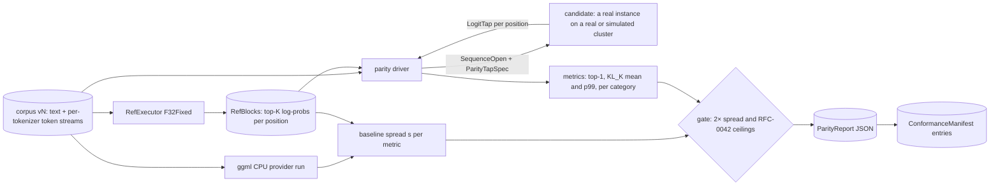

# RFC-0060: Testing and correctness

- Status: Draft
- Area: quality, performance assurance and release engineering
- Depends on: RFC-0001; ADR-0002, ADR-0003, ADR-0009, ADR-0011, ADR-0012, ADR-0013, ADR-0014, ADR-0015, ADR-0017, ADR-0019, ADR-0020; ADR-0600, ADR-0601, ADR-0602, ADR-0603
- Expanded by: RFC-0042 (tolerance tables), RFC-0043 (per-family fixtures and boundaries), RFC-0033 (recovery expectations for chaos scenarios), RFC-0062 (where and when each suite runs)
- Date: 2026-10-19
- Revised: 2026-10-20 (the publisher-reference check, the GPU reference, fixture access rules, the corpus and checkpoint licence rules, the fault-injection and fuzzing answers); 2026-10-21 (P-bench-1 and P-bench-2, §3.2); 2026-10-22 (the `test` build profile renamed `dev`, §1.3, §9; the production clock and entropy sources in `io`, §2.1, ADR-0022; `OpCert::rig` and derived certificates on Vulkan, §6.4, ADR-0405)

## Summary

This RFC defines how Syntropy proves that it computes the right thing. It covers every layer of testing below performance measurement, which is RFC-0061. The parts are:

- **A test pyramid** that runs in seconds on a laptop at the bottom and on the hardware lab at the top: static checks, unit tests, property and model-based tests, concurrency model checking, kernel conformance, the parity harness, deterministic multi-node simulation, real-hardware integration and chaos.
- **A reference executor** in `syntropy-testkit`. It drives the `graph` crate's reference forward pass in F32 with a fixed reduction order over weights dequantised exactly from the pack. An F64 mode serves as the high-precision reference for op-level conformance.
- **The parity harness** required by ADR-0019, built in M0. It runs teacher-forced over a versioned corpus and computes top-1 agreement and KL(P_ref ‖ P_cand) per position from stored top-K reference blocks. It also reports layer-level hidden-state error and the first divergence of free-running greedy decodes. Gates use the ADR-0019 rule: within 2× the reference-to-ggml spread and under RFC-0042's absolute ceilings.
- **Execution-path coverage.** Every exact-mode path the solver or scheduler can choose is a point in a path space (provider per op class, placement shape, wire dtype, speculative mode, KV and prefix-cache behaviour). Covering arrays sample that space per cadence. Passing paths are recorded in a build-embedded `ConformanceManifest`, which the solver, the family registry and the API read (ADR-0602).
- **A per-family conformance gate** that implements ADR-0003 §5. It runs on synthetic fixtures for every PR that touches a family, and on real checkpoints nightly.
- **A deterministic multi-node simulator** in `syntropy-testkit::sim`. It runs single-threaded on virtual time, drives sans-I/O control-plane cores and pollable runner dispatchers, and puts a simulated fabric (α, β, jitter, tail mixtures, loss, network splits) and fake devices, tiers and drives underneath them. A seed reproduces a run exactly (ADR-0600).
- **Chaos and fault injection** at two levels: deterministic faults in the simulator on every PR, and real faults on lab hardware (kills, power cuts, link flaps, netem, disk throttling and errors, memory pressure) nightly and per release candidate.
- **Fuzzing** of every parser of untrusted bytes, with roundtrip and differential oracles.
- **A cross-platform matrix** keyed to ADR-0020 tiers, and **deterministic synthetic fixtures** per family, with real checkpoints and reference outputs in a content-addressed fixture store (ADR-0603).

## Motivation and goals / non-goals

Syntropy creates more ways to be numerically and logically wrong than a single-device engine does:
- one layer split between GPU and CPU kernels;
- experts that move between devices while a sequence runs;
- heterogeneous stages around a ring;
- shape-dependent kernels in verify windows;
- a replicated control plane that must survive the loss of any node, including the coordinator.

The research found that engines mixing device types drift to "exact by flag, approximate by default" (`tiered-memory-inference.md` §17). It also found that home-cluster systems abort or stall when a stage dies (`multi-device-inference.md` §10.1, §13 item 16), and that claims ran ahead of code (§13 item 17). Every one of those failures is a missing test. This RFC makes each such property something a machine checks on every relevant change.

### Goals

1. **G1. Exactness is measured, never assumed** (D3, ADR-0019). Every exact-mode path has a parity report. A path without one is not offered in exact mode.
2. **G2. The parity harness exists before the first optimisation** (ADR-0019 §9). It is an M0 exit criterion (RFC-0001 §16).
3. **G3. Distributed bugs reproduce from a seed.** Membership, election, the event log, plan transitions, ring execution, replay and migration all run under a deterministic simulator. A failing seed becomes a permanent regression test.
4. **G4. Every architectural invariant in RFC-0001 §2.3 and every CI-enforced rule in ADR-0012 and RFC-0001 §4.2 has an automated check.** §3.6 maps each one to its check.
5. **G5. Every untrusted byte stream is fuzzed** (ADR-0001 item 4, ADR-0005).
6. **G6. Every hardware feature is tested against its fallback** on hardware that has the feature (ADR-0014 rule 4).
7. **G7. A family ships only through the conformance gate** (ADR-0003 §5–6), and the gate is cheap enough to run on every PR that touches the family's module.
8. **G8. Tests are cheap where they run most often.** The PR-required, hosted portion finishes within the budget in "Performance model and budgets". Hardware time goes to the paths that changed.

### Non-goals

- **Performance measurement and gates.** RFC-0061 owns them. This RFC supplies the parity half of every benchmark ("a speedup with a parity failure is not a result", RFC-0061).
- **CI scheduling, runner provisioning and release gating mechanics.** RFC-0062 owns them. This RFC states what each suite needs (hardware class, cadence, budget), and RFC-0062 decides how it runs.
- **Tolerance values.** RFC-0042 owns the dtype classes, the calibration that produces absolute ceilings, and the ceiling tables. This RFC owns how they are measured and applied.
- **Recovery semantics.** RFC-0033 owns what the system must do after each fault. This RFC owns the injection machinery and the oracles that check that behaviour.
- **Byte-identical output across devices.** It is not promised (ADR-0019 §8), so no test requires it, with one exception: inside the simulator every fake device runs the same deterministic CPU kernels, so bit-identity there is a valid oracle for distributed logic (§8.6).
- **Testing users' own hardware.** The warm-up canary (ADR-0015, RFC-0001 §3.3) is the runtime self-check. This RFC defines its reference digests (§5.8) but not its runtime behaviour.

## Design

### 1. Test pyramid and repository layout

#### 1.1 Layers

| Layer | What it checks | Where it runs | Determinism | Cadence (RFC-0062 maps these to jobs) |
|---|---|---|---|---|
| L0 static | fmt, clippy (`-D warnings`), `cargo-deny`, RFC-0001 §4.2 dependency rules, `forbid(unsafe_code)` placement, the `fault-injection` feature absent from release builds | hosted, any OS | exact | every PR |
| L1 unit | crate-local `#[cfg(test)]` tests, run under `cargo nextest` | hosted Linux, macOS, Windows | exact | every PR |
| L2 property and model-based | named properties (§3.2) with `proptest`; stateful model-based tests of the state machines (§3.3) | hosted | seeded; failures shrink to a minimal case that is saved | every PR at 256 cases per property; nightly at 16,384 |
| L3 concurrency and memory | `loom` models of the SPSC rings, the residency seqlock and the doorbell protocols; Miri over the non-FFI parts of the `unsafe` crates; ASan and TSan builds of the `unsafe` crates (a test-only nightly toolchain) | hosted Linux | exhaustive within loom's bound | PR when `ipc`, `tier`, `exec`, `io` or `net` change; nightly in full |
| L4 kernel conformance | every native op against the ggml provider and the F64 reference (§4) | CPU ops: hosted. GPU ops: lab rigs | seeded inputs | PR on `kernels-*` change, for the rig architectures; nightly for every architecture available |
| L5 parity | teacher-forced metrics end to end, layer-level error, greedy divergence (§5); path coverage (§6); family conformance (§7) | nano fixtures: hosted CPU. Real checkpoints: lab | deterministic for a given build and device | PR (smoke) on kernel, executor, sampler or wire change (ADR-0019 §9); nightly (standard); RC (calibration on the shipping set) |
| L6 simulation | deterministic multi-node runs with invariant checkers (§8) | PR: a standard 4-vCPU hosted Linux runner. Nightly: R-LABCPU, through the dispatcher | exact replay by seed | seeds per scenario derived from the measured cost per seed ("Simulator throughput"): PR capped at 64, nightly capped at 4,096 |
| L7 integration | real processes and real transports: single-node end to end through the API; multi-node on an emulated fabric (Linux network namespaces with netem); real multi-node in the lab | hosted (emulated); lab (real) | best effort | PR (emulated, on `net`/`cluster`/`api` changes); nightly (lab) |
| L8 chaos and soak | real faults on lab hardware (§9); 24 h soak with mixed workload | lab | best effort; every run logs its fault timeline | nightly (2-node pair); weekly (full lab); every RC |
| Fuzz | parsers and decoders of untrusted bytes (§10) | hosted Linux; one dedicated lab CPU host for long runs | corpus-driven | PR: 60 s per changed target; nightly: rotation, 1 h per target |

The pyramid is weighted toward its base on purpose. L0–L3 and L6 need no special hardware, so they carry most of the coverage of logic. L4–L5 and L7–L8 cover what only hardware can show: real numerics, real drivers, real thermal behaviour and real network stacks.

#### 1.2 Repository layout

```text
crates/testkit/                   syntropy-testkit (dev-dependency only, RFC-0001 §4.2 rule 9)
  src/refexec/                    reference executor: F32 fixed-order and F64 modes (§4.1)
  src/conformance/                op-level harness, shape and input generators (§4.2)
  src/parity/                     teacher-forced driver, metrics, reports, gates (§5)
  src/paths/                      execution-path space, covering arrays, certificates (§6)
  src/family/                     per-family conformance runner (§7)
  src/sim/                        deterministic simulator: world, fabric, fakes, checkers (§8)
  src/faults/                     FaultPlan, fault points, scenario files (§9)
  src/fixtures/                   synthetic model generator, fixture store client (§12)
  src/guards/                     counting allocator, lock and driver-call instrumentation (§3.6)
  src/golden/                     golden traces: routing traces, wire vectors, event logs
crates/*/tests/                   per-crate integration tests
fuzz/                             cargo-fuzz workspace; one target per parser (§10)
testdata/
  fixtures.toml                   fixture manifest: name → BLAKE3, size, source, licence (§12.3)
  corpus/                         parity corpus manifests, text only, versioned (§5.2)
  sim-regressions/                minimised failing seeds, replayed forever (§8.7)
  wire/vN/                        golden byte vectors per protocol version (RFC-0062 compatibility)
  chaos/                          chaos scenario files (§9.3)
xtask/                            `cargo xtask test <suite>`: the same entry points CI calls
```

Every CI job calls an `xtask` entry point, so every suite runs locally with the same command (RFC-0062). Large binary data never enters git. Fixtures and reference outputs live in the content-addressed fixture store (§12.3), and git holds only their manifests and generator seeds.

#### 1.3 Test build profiles

| Profile | Cargo features | Used by |
|---|---|---|
| `dev` | `fault-injection`, `debug-taps`, `guards`; debug assertions on | L1–L3, L6 |
| `test-release` | release optimisation, `fault-injection`, `debug-taps`, `guards`; debug assertions on | L4, L5 diagnosis and guard runs, L7 |
| `chaos` | release optimisation, `fault-injection` | L8 in the lab |
| `release` | neither test feature | shipping artefacts, every RFC-0061 measurement, and the gating parity runs of every RC |

- `fault-injection` compiles fault points (§9.2).
- `debug-taps` compiles intra-layer diagnostic tap points into step programs, for bisection (§5.6).
- `guards` compiles the hot-path guards (§3.5): lock and driver-call counters in the hot crates, and the counting allocator as the runner binary's global allocator. A cargo feature is used, not `cfg(test)`, because `cfg(test)` is set only while a crate's own unit tests compile, never when it is a dependency of the runner binary that L5 runs on real hardware.
- A release build containing any of these features fails the L0 check.
- *Renamed 2026-10-22 (#1556):* the first row was called `test`. It is cargo's `dev` profile, the name RFC-0062 §4.4 and `cargo xtask build --profile dev` use.

The teacher-forced logit tap (§5.5) is not a cargo feature. It ships in every build, because the warm-up canary already drives the same teacher-forced path in production (RFC-0001 §3.3). Runtime gating protects it: the node key `debug.parity_api` defaults to `false`, and the endpoint answers only on loopback binds. So release-candidate parity runs on the exact signed artefacts that will ship, not on a rebuild. Layer-output and stage-boundary taps (RFC-0040's `HiddenTap` parity variant), including the KV-prefix export `RefExecutor::layer_local` needs (§5.7), also ship in every build behind `debug.parity_api`. The runner builds them as a separate step-program variant, and only for a parity sequence that requests taps. The production step program is unchanged: with the gate off, captured-graph hashes match a build compiled without the tap variant, which the L5 suite checks. Parity runs that must match the shipping step program exactly (captured graphs, §6.1 dimension `capture`) use end-to-end metrics without taps.

### 2. Determinism foundations

Deterministic tests need production code built so that time, randomness, scheduling and I/O can be supplied from outside. Retrofitting that later is expensive, so the rules below bind every crate from M0. Each is checked mechanically (§3.6).

#### 2.1 Time and entropy are injected

```rust
// syntropy-core (proposed amendment A1)
/// Monotonic nanoseconds since an arbitrary origin, including time the host spent suspended,
/// so leases and failure timers see a suspend as elapsed time. Never compared across nodes.
pub struct MonoTime(pub u64);

pub trait Clock: Send + Sync {
    fn now(&self) -> MonoTime;
    /// Wall clock, for log stamps, lease expiry hints and Measured::at_unix_ms only.
    /// Protocol decisions never depend on it.
    fn unix_ms(&self) -> u64;
}

pub trait Entropy: Send + Sync {
    fn fill(&self, buf: &mut [u8]);
    fn u64(&self) -> u64 { let mut b = [0u8; 8]; self.fill(&mut b); u64::from_le_bytes(b) }
}

// syntropy-io (ADR-0022), in syntropy_io::os
/// Suspend-aware monotonic source: Linux and Android clock_gettime(CLOCK_BOOTTIME); macOS and iOS
/// mach_continuous_time; Windows QueryInterruptTime (not QueryUnbiasedInterruptTime, which
/// excludes sleep). Clocks that stop during suspend (CLOCK_MONOTONIC, mach_absolute_time) are never
/// used for `now`; the same module reads them only for RFC-0030 §5.8's suspend check.
pub struct SystemClock;
pub struct OsEntropy;             // getrandom

// syntropy-core
/// Hot-thread time source for `exec` and `obs` (rule T1). Used only as a generic parameter, never `dyn`.
/// The tick-to-`Clock` offset is re-sampled after every resume from suspend.
pub trait TickSource: Clone + Send + Sync {
    /// Raw ticks: the invariant TSC on x86-64, CNTVCT_EL0 on arm64, or the OS monotonic counter where
    /// neither is usable. In the simulator, the virtual clock of the node's device timeline (§8.4).
    fn ticks(&self) -> u64;
    /// A tick delta in nanoseconds, from the tick rate calibrated against `Clock` at startup.
    fn ticks_to_nanos(&self, ticks: u64) -> Nanos;
    /// The current instant on the `Clock` timeline, so step records and protocol events share one origin.
    fn now(&self) -> MonoTime;
    /// Maps a device timestamp (CUDA or HIP event, Metal GPU timestamp, Vulkan timestamp query;
    /// RFC-0040 §3.7) onto the tick timeline, through the device's latest sync sample.
    fn device_to_ticks(&self, device_ts: u64, sync: &DeviceClockSync) -> u64;
}

/// One correlated reading of a device clock and the host tick counter, taken by the device's provider,
/// with the device clock's rate. A sample older than the provider's resync interval is refreshed first.
pub struct DeviceClockSync { pub device_ts: u64, pub host_ticks: u64, pub device_hz: u64 }
```

- **Rule T1.** Code in `cluster`, `solver`, `sched`, `tier` (policy parts), `store` (scheduling parts), `api` (routing) and the runner's lifecycle machine reads time only through a `Clock` and randomness only through an `Entropy`.
  - **Hot-thread timing** in `exec` and `obs` goes through a `TickSource`, which is statically dispatched: a generic parameter, monomorphised to the TSC or OS monotonic clock in production at zero cost, and to the device timelines (§8.4) in the simulator. Its interface is the trait above, which RFC-0001 §5.14 declares. RFC-0012 §11 maps device timestamps through `device_to_ticks`, and RFC-0053 is asked to adopt the trait for `obs` (revised 2026-10-19). The reason is that these values do feed decisions: the per-step ring feeds online probe refinement and drift detection, and the dispatcher's pre-wake prediction uses recent arrival times.
  - **Hot counters** are keyed by a per-(node, role) context object passed to the dispatcher, not by thread-local storage, so nodes sharing the simulator's one OS thread do not merge their counters.
  - **The solver's wall-clock safety limit** is disabled in the simulator, where only its count-based work limits apply (ADR-0101). A firing of the wall-clock limit is a simulator failure.
- **Rule T2.** Key material (`NodeId` secrets, invite tokens, session IDs in production) always comes from `OsEntropy`. The simulator substitutes a seeded ChaCha20 stream. That substitution is possible only in `test` builds, because `SimEntropy` exists only in `testkit`.
- *Revised 2026-10-22 (ADR-0022):* `SystemClock` and `OsEntropy` are `syntropy-io` types, in `syntropy_io::os`, not `syntropy-core` ones. The suspend-aware clocks need an `unsafe` OS call and `OsEntropy` needs `getrandom`, which RFC-0001 §4.2 rules 1 and 8 keep out of `core`. The traits, `MonoTime`, `TickSource` and `DeviceClockSync` stay in `core`. Rules T1 and T2 are unchanged: key material still comes only from `OsEntropy`.

#### 2.2 Control-plane protocol logic is sans-I/O

Membership (SWIM), coordinator election and lease, event-log replication and catch-up, the per-daemon plan-transition orchestrator (RFC-0001 §7.3), the supervisor's restart policy (§3.4), and the recovery decisions of RFC-0033 are each written as a **protocol core**: a deterministic state machine with no sockets, no tasks, no sleeps and no clock reads.

```rust
// syntropy-core (proposed amendment A1)
pub trait ProtocolCore {
    type Input;    // inbound messages, timer expiries, local commands, peer-status changes
    type Output;   // outbound messages, timer requests, events to apply, effects for the shell
    fn handle(&mut self, now: MonoTime, input: Self::Input, out: &mut Outbox<Self::Output>);
    /// Earliest time at which the core wants a TimerFired input.
    fn next_deadline(&self) -> Option<MonoTime>;
}
pub struct Outbox<O> { items: SmallVec<[O; 8]> }
```

In production a thin **shell** owns the core inside a tokio task. The shell feeds it network messages and timer expiries and executes its outputs over iroh/QUIC. In the simulator the world's event queue is the shell (§8.2). The shells are small and are covered by L7 integration tests. The cores carry the logic and are covered exhaustively by L6. Owners: RFC-0030 (membership and admission: `MembershipCore`, `AdmissionCore`), RFC-0032 (election and lease, the event log and plan transitions: `ElectionCore`, `LogCore`, `TransitionCore`), RFC-0033 (recovery: `RepairCore`, `HandshakeCore`), RFC-0001 §3.4 (supervisor). Each owner keeps its core's `Input` and `Output` enums public, so the simulator and the fuzzers (§10) can drive them.

#### 2.3 Runner dispatchers are pollable

Each device dispatcher (RFC-0001 §8.2) exposes one non-blocking step of its loop:

```rust
// syntropy-exec (proposed amendment A3)
impl Dispatcher {
    /// Polls inbound rings, launches at most one step program, queues outbound frames and
    /// reaps completions. Never spins and never parks: the caller decides how to wait.
    pub fn poll_once(&mut self, now: MonoTime) -> PollOutcome;
}
pub enum PollOutcome { Progress, Idle { next_wake: Option<MonoTime> }, Fault(Error) }
```

The production thread wraps `poll_once` in the spin-then-park loop of ADR-0012. The simulator calls it when the device's virtual timeline says the dispatcher has work. The CPU compute pool gets the same treatment: `ComputePool::run_inline` executes a doorbell's work on the calling thread, which the simulator uses so that one OS thread runs every node. The I/O engine is a trait owned by RFC-0021, and the simulator implements it with `FakeIo` (§8.4).

#### 2.4 Deterministic iteration and hashing

- **Rule T3.** Crates reachable from a protocol core or the solver use `BTreeMap`/`BTreeSet`, or `syntropy_core::DetHashMap`, a `HashMap` with a fixed-key hasher. They never use `std::collections::HashMap` with `RandomState`. A clippy `disallowed-types` configuration on those crates enforces this.
- **Rule T4.** Nothing whose output reaches a plan, a log entry or a wire frame iterates over a hash container whose order depends on insertion history. Sorting at the boundary is the fix.
- *Note 2026-10-22 (QUAL-E3-T03):* one clippy config, `ci/clippy-determinism.toml`, carries the rule T3 types and the rule T1 clock and generator calls. Each covered crate holds a copy as its `clippy.toml`, because clippy reads its config from the crate's directory. The covered crates are:
  - those rule T1 names: `cluster`, `solver`, `sched`, `tier`, `store`, `api` and `runner`;
  - `exec` and `obs`;
  - for rule T3, the crates that hold the protocol cores and the solver (`cluster`, `daemon` for the supervisor, `solver`) and the crates their code calls into (`core`, `manifest`). The cores are sans-I/O, so the crates of their shells, such as `net`, are not reached.

  A lint covers a whole crate. A part outside a rule, such as `tier`'s OS-facing module, lifts it with a scoped `#[allow]` in a file that `xtask/src/determinism.rs` lists, and in `exec` and `obs` only the `TickSource` implementation may. The `determinism` step of `cargo xtask ci lint` checks the copies and the list.

#### 2.5 Deterministic kernels in tests

The CPU reference kernels and the native CPU provider's `deterministic` variants (ADR-0019 §8) use a fixed reduction order and no atomics. The simulator and every L2 property that compares numeric outputs select them. GPU kernels with atomics or split-K reductions are not run-to-run deterministic. They are judged only by parity metrics (§5), never by bit comparison.

### 3. Unit, property and model-based tests

#### 3.1 Conventions

- Tests run under `cargo nextest` with one process per test, so a crash or leaked global state in one test cannot affect another.
- **Hosted budget.** A unit test takes under 1 s on a hosted runner (target). Longer tests carry `#[ignore = "suite:<name>"]` and run in their named suite.
- No unit test opens a network socket other than loopback, touches a GPU, or writes outside its temporary directory. GPU-touching tests live in L4/L5 suites selected by runner labels (RFC-0062).
- Each property has a stable ID (`P-<crate>-<n>`). A failing case shrinks, and its seed goes into the crate's `proptest-regressions/` file, which is committed.
  - *Note 2026-10-22 (QUAL-E3-T05):* `ci/properties.toml` lists every property that has tests, with its crate and owning task. A property's tests are the test functions in its crate whose names start with its ID in snake case (`p_core_1_` for P-core-1).
    - They run on proptest's default configuration. That is what lets `PROPTEST_CASES` set the case count: unset, it is 256, the PR count, and nightly runs `cargo xtask test properties --cases 16384`.
    - A property lives under `src/`, where proptest saves seeds to `crates/<crate>/proptest-regressions/`, or in a `tests/<suite>/` directory with a `main.rs`, where it saves them to `tests/proptest-regressions/`.
    - The `properties` step of `cargo xtask ci lint` checks the registry against this table, the epic files and the tests. The `properties-removal` check in `pr-meta.yml` fails a property removed from the registry unless the PR description has a line `Removes <ID>: <reason>` (§3.2).
- **Statistical properties** (P-sched-2 and any later test with a false-positive rate) run outside proptest's case loop, in the `stat-props` suite: a fixed seeded case set, a family-wise α, no shrinking, and no entries in `proptest-regressions/`. The suite has its own budget (≤ 5 min nightly [target]), and a failure is re-run once with fresh seeds before it is reported. A chance rejection at α is expected, so only a repeated one counts.

#### 3.2 Named properties

| ID | Crate | Property | Generator | Oracle |
|---|---|---|---|---|
| P-core-1 | core | `PlanEpoch` order is total, and a higher `term` dominates any `seq` | arbitrary pairs | lexicographic definition |
| P-cluster-1 | cluster | `apply` is total and deterministic: the same log gives byte-identical `ClusterState` | random valid command sequences turned into events | state hash equality across two folds |
| P-cluster-2 | cluster | snapshot at index i plus replay of the tail equals the full replay | random logs, random i | state hash |
| P-cluster-3 | cluster | a duplicate `CommandId` produces no second event | sequences with injected duplicates | event count |
| P-cluster-4 | cluster | entries with a term below the current lease term are rejected (epoch fencing) | interleaved terms | rejection set |
| P-solver-1 | solver | every plan is valid: one `TierAssignment` per group; stage layer ranges cover `[0, n_layers)` exactly once, in ring order; head holds `RowLookup` embeddings and tail holds `Head`; every node's per-tier usage ≤ `usable`, KV, scratch and duplicated embedding/head included | random resource graphs (1–8 nodes, 1–4 devices each) × fixture manifests | `PlacementPlan::validate()` plus an independent byte recount |
| P-solver-2 | solver | determinism: identical inputs give a byte-identical plan | as P-solver-1 | serialised plan equality across two solves |
| P-solver-3 | solver | SC-14: if the model fits on one node, the chosen plan's predicted `t_tok` ≤ the best single-node plan's | graphs where at least one node fits the model | the solver run with each single node only |
| P-solver-4 | solver | SC-16: no `CrossNodeTp`/`CrossNodeEp` stage unless every member link's `α_eff` < `α_eff,max` | graphs with randomised `α_eff` | the cost model §3.8 formula |
| P-solver-5 | solver | an `Exact` plan has no lossy `HopPlan::wire`, no lossy `KvBudget::dtype` and BF16 wire only where the `ConformanceManifest` certifies it (§6.4) | random policies and manifests | plan scan |
| P-solver-6 | solver | the MILP incumbent's objective ≤ the DP warm start's objective | as P-solver-1, with the time limit raised | DP run on the same input |
| P-solver-7 | solver | the DP fallback returns a feasible contiguous plan whenever the brute-force enumerator finds one (SC-31) | small graphs (≤ 3 nodes, ≤ 12 layers) | exhaustive enumeration |
| P-tier-1 | tier | a slot under a live `ResidencyLease` is never evicted or rewritten | random lease/evict/admit interleavings | model (§3.3) |
| P-tier-2 | tier | progressive pinning never takes free memory below the RFC-0020 reserve (SC-11) | random pin budgets and simulated MemAvailable traces | fake OS memory model |
| P-tier-3 | tier | resolving a `TensorHandle` whose `generation` is stale fails; it never yields another slot's bytes | slot reuse sequences | reference slot table |
| P-kv-1 | tier (KV) | `truncate(to)` followed by `append` gives the same pages as a fresh sequence written to the same positions | random append/truncate/fork sequences | model (§3.3) |
| P-kv-2 | tier (KV) | the prefix key changes when any setting listed in RFC-0001 §5.9 changes; it never changes otherwise | random setting perturbations | field-by-field definition |
| P-io-1 | io | every completed read returns exactly the requested extent, including after short reads and `EAGAIN` resubmission | random extents over a file with injected short reads | `pread` of the same range |
| P-net-1 | net | decode(encode(f)) = f for every frame type and version | `arbitrary` frames | equality |
| P-net-2 | net | a frame whose epoch the runner does not serve is rejected before its payload is touched (invariant 7) | random epochs | rejection plus a no-payload-access probe |
| P-sched-1 | sched | speculative decoding with exact acceptance and a greedy sampler gives the same tokens as plain decoding (deterministic CPU kernels) | random draft quality, γ ∈ 1..8, tree shapes | plain decode token stream |
| P-sched-2 | sched | with stochastic sampling and a fixed seed, accepted-token frequencies match the target distribution | a fixed, seeded set of 16 cases (not proptest's case loop), 10⁵ draws each, on nano fixtures | χ² test per case at family-wise α = 10⁻³ (Bonferroni, 10⁻³/16 per case) against the target's sampler run without drafting |
| P-text-1 | text | incremental detokenisation concatenated equals full detokenisation | random token streams from fixture tokenizers | full decode |
| P-text-2 | text | a stop string spanning token boundaries is detected at the first token that completes it, and no character after it is emitted | random stop strings and tokenisations | character-level reference matcher |
| P-config-1 | config | precedence default < file < env < CLI; unknown keys rejected; request keys only narrow instance keys | random layer stacks | the RFC-0001 §11.1 rules |
| P-config-2 | config | exactness resolution (RFC-0001 §11.3) yields `Approximate` only when request, instance and cluster all allow it; the knob set is the intersection | arbitrary policy triples | the rule as a truth table |
| P-bench-1 | bench | a `BenchResult` reads back from its JSON unchanged, and the JSON passes the committed schema file (RFC-0061 §2.2) | arbitrary results: every record type, enum variant and `Option` arm, arbitrary Unicode text and finite floats of every class | equality, and the schema file |
| P-bench-2 | bench | two results are comparable exactly when their keys differ in no field but `build` (RFC-0061 §2.1) | arbitrary results; one key field replaced with a different value, with or without a different `build` | field-by-field key equality |

*Note 2026-10-22 (OQ-PRC-27):* P-core-2 and P-core-3 became P-tier-3 and P-config-2. `TensorHandle` resolution is `tier`'s (RFC-0001 §5.5, §5.13), and exactness resolution is built in `config` (PROD-E1-T10), so their properties live in those crates' suites. TIER-E1-T03 and PROD-E1-T10 own them, and QUAL-E3-T05 keeps P-core-1.

Each crate's RFC adds its properties to this table. A property removed from the table needs a reason in the PR description.

*Note 2026-10-22 (QUAL-E3-T05):* the same holds for `ci/properties.toml`, the registry of properties that have tests (§3.1). A property removed from it needs a line `Removes <ID>: <reason>` in the PR description. The `properties-removal` check enforces this in `pr-meta.yml`, not in `lint`, because it reads the description. Like `dco` and `pr-title` (RFC-0062 §12.3), it runs the base branch's `cargo xtask`, so a PR cannot change how its own removal is judged, it runs again when the description is edited, and it passes on a merge group.

#### 3.3 Model-based tests

Each stateful component listed below has a **reference model**: a deliberately simple implementation, often a `Vec` or `BTreeMap` with no performance concerns, written next to the test. A stateful property generates random operation sequences, applies them to both the real component and the model, and compares observable state after every operation.

| Component | Operations generated | Observables compared |
|---|---|---|
| Residency map and `CopyState` (`Inflight → Resident → Evicting`) | admit, complete I/O, fail I/O, lease, release, evict, epoch change | per-group copies and states; lease counts; the slot table |
| Expert cache slot table | access, admit, evict, budget shrink (`PlanDelta`) | resident set; the device slot table, which is never "hit" for a slot whose copy has not landed |
| KV store | open, append, truncate, fork, persist, release, spill, restore | pages per tier; committed token counts; page refcounts; free-pool size |
| Runner lifecycle | every IPC command in any order, plus injected failures per state | `RunnerState`; illegal transitions are rejected (RFC-0001 §3.3) |
| Device ledger | reserve, shrink, release, crash | per-device and per-tier totals; no negative or double-counted capacity |
| Event log with snapshots | append, snapshot, truncate below snapshot, catch-up | `ClusterState` hash; log index density |
| Prefix cache | insert, lookup longest match, evict | longest-match length (SC-20 oracle: tokens prefilled = tokens after the match) |

#### 3.4 Concurrency and memory-safety checks

- **`loom`** models, bounded to 3 threads and preemption bound 3, cover:
  - the SPSC ring (push/pop, wraparound, the cache-line-padded indices);
  - the seqlock that publishes `ResidencyMap` versions;
  - the doorbell protocol between the GPU writer (modelled as a thread) and the CPU pool, including spin-to-park transitions;
  - the lease and eviction handshake of `TierManager::lease`;
  - the `local_tokens` and `local_sequences` IPC rings.

  Each primitive's crate keeps its loom model next to it under `#[cfg(loom)]`.
- **Miri** runs the unit tests of `tier` (arenas), `ipc` (shared-memory layout) and `net` (frame codecs, shared-memory transport) with FFI stubbed. It catches undefined behaviour in the `unsafe` blocks that ADR-0001 confines to these crates.
- **Sanitizers.** A test-only job builds the `unsafe` crates and the CPU provider with AddressSanitizer and ThreadSanitizer on a pinned nightly toolchain. ADR-0001 forbids nightly compilers only for release builds.

#### 3.5 Hot-path guards

`syntropy-testkit::guards` provides the instrumentation that turns ADR-0012's invariants into assertions:

```rust
/// Counts heap allocations on the current thread. Installed as the runner binary's #[global_allocator]
/// when the `guards` feature is on, and in unit tests.
pub struct CountingAlloc;
pub fn alloc_count_this_thread() -> u64;

/// Wraps parking_lot / std locks used by hot crates (behind the `guards` feature) and counts acquisitions.
pub fn lock_count_this_thread() -> u64;

/// Counts synchronising driver calls (stream/device synchronise, blocking event waits),
/// reported by every KernelProvider's instrumentation shim in `guards` builds.
pub fn driver_sync_count(device: DeviceId) -> u64;

/// Asserts the steady-state step budget: zero allocations, zero locks shared with tokio,
/// zero synchronising driver calls, over `steps` decode steps after Warming.
pub fn assert_steady_state<F: FnMut()>(steps: u32, step: F);
```

These run in L5 on real hardware for each Tier 1 GPU backend and in L6 on fake devices. A failure is classed `Internal`: it is a bug, not a slow run.

#### 3.6 Invariant-to-check map

| Rule | Check | Layer |
|---|---|---|
| RFC-0001 §2.3 inv. 1: tokens and activations never cross the control plane | sim checker: the control-plane message types carry no `TokenFrame`/`ActivationFrame` payload; byte counts per plane per scenario | L6 |
| inv. 2: coordinator not on the request path | sim scenario: coordinator cut off by a network split for the whole run; requests still complete (SC-27) | L6, L8 |
| inv. 3: daemon never opens a GPU context | L0 link check (rule 4 below), plus an L7 test that runs the daemon under a driver shim that aborts on context creation | L0, L7 |
| inv. 4: one writer per piece of state | sim checker: writer identity recorded per residency entry, KV page and log index | L6 |
| inv. 5: tier manager owns every resident byte | L7: residency map bytes = RSS attributable to arenas ±5% (SC-11); no `mmap` of a hot tier (syscall trace on Linux) | L7 |
| inv. 6–7: plans immutable; frames epoch-checked | P-net-2; sim checker: no frame processed by a runner not serving its epoch | L2, L6 |
| inv. 8: exact by default | sim checker and L5 report: `ApproxFlags` empty on every token of an exact run | L5, L6 |
| inv. 9: hot threads never block on async code | §3.5 guards | L5, L6 |
| inv. 10: all compute through `KernelProvider` | L0: `exec` and `sched` depend on no `kernels-*` crate | L0 |
| inv. 11: one owner per group | P-solver-1 plus the sim checker over live residency | L2, L6 |
| RFC-0001 §4.2 rules 1–9 | `cargo xtask check-deps` over `cargo metadata` (RFC-0062) | L0 |
| ADR-0012 §6: no tokio in `exec`, the `io` engine or `kernels-*` | `cargo tree -e normal` check | L0 |
| ADR-0013: Linux suite with io_uring denied by seccomp | L7 job under a seccomp profile that denies `io_uring_setup` | L7 |
| ADR-0014 rule 4: feature parity against its fallback | §11.3 | L4, L5 |

### 4. Reference executor and kernel conformance

#### 4.1 The reference executor

ADR-0019 §1 defines the reference as "one device, F32 accumulation, a fixed reduction order, and weights dequantised exactly from the same pack". RFC-0001 §4.1 puts "the F32 reference forward pass" in `graph`. The two fit together as follows:
- `syntropy_graph::reference` (owned by RFC-0043) is a scalar interpreter of the graph IR. It defines what each family computes.
- `syntropy-testkit::refexec::RefExecutor` (owned here) drives that interpreter. It supplies weights, numeric mode, evaluation order and taps.

Production crates never link `RefExecutor`. They do link `graph::reference`: the runner calls it during `Loading` to compute the warm-up canary's digest when no published or cached one exists (§5.8, RFC-0041 §5.3). It is therefore production code. Its op coverage is checked against `RefExecutor(F64)` on every fixture in L4, and it is in the release's conformance scope.

```rust
pub enum RefMode {
    /// The ADR-0019 reference: F32 storage and accumulation; every reduction is pairwise
    /// over fixed 32-element blocks in index order; softmax subtracts the row max.
    F32Fixed,
    /// High-precision reference for op-level conformance and for calibrating F32Fixed:
    /// F64 storage, Neumaier-compensated summation, exp and log in F64.
    F64,
}

/// Where F32Fixed runs. The GPU path uses the same reduction order and `kernels::reference`'s
/// software transcendentals, and must be bit-identical to the CPU path on nano and micro fixtures.
pub enum RefDevice { Cpu, Gpu(u32) }

pub struct RefOptions {
    pub mode: RefMode,
    pub device: RefDevice,
    /// Off for the model-definition oracle (§7.2 check 9): declared activation quantisation is
    /// not applied, so the graph is compared with the publisher's F32 forward pass.
    pub activation_quant: bool,
}

pub struct RefExecutor { /* manifest, weight source, options, scratch */ }

impl RefExecutor {
    /// `weights` reads source or pack extents. Dequantisation uses RFC-0042's reference
    /// dequantisers. They define each block format's F32 value: element widening is exact, and
    /// MX (E8M0) scaling is exact; any other scale application (F32 or F16 scales, k-quant
    /// scale-and-offset forms) follows a specified F32 operation order (RFC-0042 §3.2–§3.3).
    pub fn new(manifest: &ModelManifest, weights: Box<dyn WeightSource>, mode: RefMode) -> Result<Self, Error>;

    /// Teacher-forced evaluation, layer-major: every position of `batch` goes through layer l
    /// before layer l+1's weights are dequantised. Resident memory is one layer's F32 weights,
    /// the hidden states of all positions, and that layer's KV.
    pub fn teacher_forced(&self, batch: &[TokenSeq], taps: &TapSpec, sink: &mut dyn RefSink) -> Result<RefStats, Error>;

    /// Layer-local evaluation: computes layers `layers` starting from a supplied hidden state
    /// (typically the candidate's tapped input). Used for sampled-layer parity on models too
    /// large for full reference runs (§5.7).
    pub fn layer_local(&self, layers: Range<LayerIx>, input: &HiddenBlock, kv_prefix: &RefKv, sink: &mut dyn RefSink) -> Result<RefStats, Error>;
}

pub trait RefSink {
    fn logits(&mut self, seq: u32, pos: u32, logits: &[f32]);          // full vocabulary, F32
    fn hidden(&mut self, seq: u32, layer: LayerIx, rows: &HiddenBlock);  // only for tapped layers
}
```

*Note 2026-10-22 (QUAL-E4-T14, where the types live):* the code block above shows the types without crate paths.
- `RefMode` and `RefDevice` live in `kernels::reference` (layer 1). `graph::reference` reads them, and so does the GPU reference in `kernels-cuda` (COMP-E14-T23); those two crates are peers in layer 2, so neither can hold them (RFC-0001 §4.2 rule 2).
- `RefOptions`, the `WeightSource` and `RefSink` traits, `TapSpec` and `HiddenBlock` live in `graph::reference`, beside the interpreter that uses them. That interpreter is production code (the warm-up canary), and `testkit` is a dev-dependency only (rule 9). A `WeightSource` returns F32 values, dequantised with RFC-0042's reference dequantisers, for a `WeightKey`: a `graph::ir::WeightRef` and, for a routed expert, its index.
- `RefExecutor`, `RefKv` and `RefStats` live in `testkit::refexec`, with the stub sources and sinks tests use.

Reference semantics that matter for parity:
- **Routing ties.** MoE top-k selection breaks score ties toward the lower expert index. RFC-0042 requires every provider to use the same rule, so a tie is never an inter-kernel divergence by construction. Near-ties are real numerics, and the metrics capture them.
- **Attention** materialises full score rows per head. There is no tiled or online softmax in the reference.
- **Sampling** is not part of the reference. The parity harness compares distributions. Sampler conformance is P-sched-1 and P-sched-2.
- **Recurrent layers** (Gated-DeltaNet- and Mamba-class) run their scans sequentially in position order.

**Cross-validation** (ADR-0019 §1). For each (model, pack quantization) on the conformance set, `RefExecutor(F32Fixed)` and the ggml CPU provider each run the corpus. The ggml run uses RFC-0042 §6.2's baseline for the scheme: the pack itself for GGUF types and plain floats; the exact ggml transcription for transcribable tensors (RFC-0042 §3.5); and a `widen.f32` copy for FP8, NVFP4 and non-transcribable `PackedInt`. For the `widen.f32` schemes the spread measures summation order only, so the floor `φ = F_m` from their first calibration applies, recorded as an ADR-0019 revisit event (ADR-0422 decision 2a). Their metrics against each other give the **baseline spread** `s(model, quant, metric)` that the gate uses (§5.4). `F32Fixed` is in turn checked against `F64` on nano and micro fixtures. If `F32Fixed` deviates from `F64` by more than the ggml CPU provider does, that is a reference defect, and it blocks the parity suite until fixed.

**The GPU reference** (ADR-0601 decision 7). On a CPU at the assumed `F_ref`, the calibration reference does not fit the 48 h rule once attention is counted ("Reference executor cost": a 0.6B-class model already needs 20–41 h for `calibration`), so only dense models of about 1B could calibrate, and the MoE ceilings would rest on dense evidence. `F32Fixed` therefore also runs on one GPU (`RefDevice::Gpu`): the same F32 storage, the same pairwise fixed 32-element reductions in index order, the same RFC-0042 dequantisers, with contraction off, F32 subnormals kept, IEEE-rounded division and square root, and `kernels::reference`'s software transcendental functions (RFC-0042 §6.2, COMP-E14-T23).
- **Cross-check.** On every nano and micro fixture, the GPU and CPU paths run the same corpus and must produce bit-identical logits. A mismatch is a reference defect, and nothing the GPU path computes gates until it is fixed.
- **Where.** It runs on the untimed agent GPU pool or on on-demand cloud GPU instances, never on a timed rig (ADR-0610 decision 4). The memory it needs is the layer-major footprint in "Reference executor cost": ≈ 5 GB for Llama-3.3-70B over one 32K document [estimate].
- **What it computes.** The RFC-0042 calibration reference (whose cost RFC-0042 recomputes with attention included from the measured GPU rate) and any (model, tier, category) part over the 48 h rule at the CPU's measured `F_ref`.
- **Provisional ceilings.** Until this method has produced the calibration for the MoE families, their ceilings are marked `provisional` in the M0 and M1 exit records.

#### 4.2 Op-level conformance

Every op a native provider registers (RFC-0040 `OpRegistry`) is tested on each device class it claims. Every test is a three-way comparison over identical inputs: candidate, ggml provider on the same device class where ggml has the op (else ggml CPU), and the `F64` reference.

```rust
pub struct OpCase { pub op: OpKey, pub shape: ShapeSig, pub inputs: InputRecipe, pub seed: u64 }
pub struct OpMetrics {
    pub rel_l2: f64,          // ‖y − y64‖₂ / ‖y64‖₂
    pub max_abs_scaled: f64,  // max |y − y64| / (rms(y64) + 1e-30)
    pub bit_equal: bool,
}
pub struct OpVerdict { pub cand: OpMetrics, pub ggml: Option<OpMetrics>, pub cand_vs_ggml: Option<OpMetrics>, pub pass: bool, pub reason: Option<String> }
```

**Pass rule** for op class c and dtype class d. The formulas are RFC-0042 §6.4's, cited here unchanged:
1. Against the F64 reference: `cand.rel_l2 ≤ ceiling_op(c, d)` and `cand.max_abs_scaled ≤ ceiling_op_max(c, d)`, where `ceiling_op = max over calibration cases of 2 · max(rel_l2(ggml, F64), ε_op)`, and ε_op is the p99 over cases of `rel_l2(F32Fixed reference with BF16-rounded inputs, F64)`.
2. Against ggml: the p99 over the op's cases of `rel_l2(cand, ggml)` ≤ `tol_op(c, d) = max(2 · p99 rel_l2(ggml, F32Fixed reference), ε_op)`.
3. Against `kernels::reference`: the p99 of `rel_l2(cand, kernels::reference)` ≤ `tol_ref(c, d) = tol_op(c, d)`. This is the comparison the executor's runtime spot check makes at `Warming` (RFC-0040 §6.2), so a kernel that passes here is not rejected on a user's machine for the same inputs.
4. **Bit-exact class.** These ops must produce identical bits, with no tolerance, on every provider RFC-0042 §6.4 lists for them: copies; row gather; standalone dequantisation of every weight format to F32 (GGUF block types including k-quant min terms and i-quant grids, FP8 of every scale kind, MXFP4, NVFP4 with its global scale, compressed-tensors integers) in `kernels::reference`'s operation order, with floating-point contraction off, F32 subnormals preserved and power-of-two scales built from exponent bits; exact dtype widening (E2M1, E4M3 and E5M2 to F16, BF16 or F32; F16 and BF16 to F32); BF16 narrowing with round to nearest even; KV page moves between tiers; the wire codecs of RFC-0042 §8.2; argmax and top-k index selection on identical scores (lower index wins ties). A scale applied inside a fused product, multiplying a partial sum, is not in this class and is toleranced with `tol_op`. So is a dequantiser on a provider that flushes F32 subnormals or cannot disable contraction for it; RFC-0042 §6.4 records those providers.
   - **Why contraction matters.** Formats with a min term (Q2_K, Q4_K, Q5_K) compute `d·sc·q − dmin·m`. A compiler that contracts this into one fused multiply-add rounds once instead of twice.
   - **Native providers** therefore compile every bit-exact-class translation unit with contraction disabled: `--fmad=false` for CUDA and HIP, `-ffp-contract=off` or `#pragma clang fp contract(off)` for C++, and fast math off for Metal (`-fno-fast-math`, or its safe math mode). Rust CPU code never contracts implicitly. The kernel build records the flag per translation unit, the kernel-cache key includes it (RFC-0062 §5.1), and L0 fails a bit-exact-class unit built without it.
   - **ggml ops** in these classes count as bit-exact only where their translation units are built with contraction off. Otherwise the op moves to the toleranced class with `tol_op`. RFC-0042 lists the bit-exact ops per provider.

If the ggml provider itself fails rule 1 against `F64`, the case is marked `reference-defect`. The candidate is then judged on rules 1 and 3 only, and a tracking issue is opened automatically. A known ggml defect therefore never fails a correct native kernel, and it never certifies a wrong one.

**Shapes.** Generated per op from two sources:
- **Model-derived shapes.** The manifests of every fixture (§12) give the real hidden sizes, head counts and dims, expert widths and counts, and vocabulary sizes.
- **Edge shapes.** Each tiled dimension takes values from {1, 2, 7, 31, 32, 33, 63, 64, 65, 127, 4095, 4096, 4097} wherever the op allows them. Token counts take {1, 2, 3, 4, 5, 8, 9, 16, 17, 64, 512, 2048}, which includes every verify-window size γ+1 ∈ 2..9 (ADR-0017). Attention context takes {1, 15, 16, 17, 255, 4096, 32768}, plus 131072 nightly. Sliding-window ops add {w−1, w, w+1}. MoE ops add: zero tokens routed to an expert; every token routed to one expert; every expert used once.

**Inputs** (`InputRecipe`):
- **Activations:** N(0,1); Student-t with ν = 3, scaled to unit variance (heavy tails); rows with one channel at 1000× the rest (outlier channels); all-zero rows.
- **Quantized weights:** random blocks with full-range scales, zero scales, maximum scales, and subnormal FP16 scales.
- **Attention:** logits arranged to produce near-ties and saturated softmax rows, with scores up to ±80.
- **Real tensors,** nightly: slices sampled from fixture checkpoints, so tests see the statistics real models have.

A failure report carries the op key, the shape, the seed and the three metric sets, and `cargo xtask conformance repro <case-id>` re-runs exactly that case.

**Output.** Every passing (provider, device class, op key, shape class) becomes an `OpCert` entry in the `ConformanceManifest` (§6.4). RFC-0040's per-device selection considers only certified ops. An op without a certificate for a device class is never selected on that class, even if `query` returns `Some`, unless a derived certificate applies (§6.4). The executor falls back to the next provider that holds a certificate, normally ggml (RFC-0001 §10.2, degradation path 1). An uncertified kernel is an unverified path, not an approximate knob, so approximate mode does not unlock it either.

### 5. Parity harness

#### 5.1 Flow



The reference side (blocks and spread) is computed once per (model, pack quantization, corpus version, reference-executor version) and stored in the fixture store (§12.3). Every candidate run reuses it. Candidates are real Syntropy instances driven through the same API and data plane users get, so the harness tests the shipping path and not a test double.

#### 5.2 Corpus

The corpus is versioned (`parity-corpus-v1`, …) and stored as text with a per-item licence record. Token streams are derived per tokenizer and cached in the fixture store. Every item is under a licence that permits redistribution (OQ-FID-17): public domain, CC0, CC-BY (with its attribution file kept), MIT, Apache-2.0 or BSD. CC-BY-SA, CC-BY-NC and outputs of hosted commercial model services are excluded. The `tool` category is generated from templates licensed CC0 or MIT. Items generated from templates are marked as such, and QUAL-E5-T01 verifies each source at its pinned revision. S-01 and S-03 use the same corpus, so this is settled first in M0.

| Category | Content | Why |
|---|---|---|
| `chat` | multi-turn conversations rendered with each family's chat template | the default workload; exercises template-specific special tokens |
| `code` | source files and diffs in ≥ 8 languages | low-entropy positions, long identifiers |
| `long` | single documents of ≥ 32K tokens (some of 128K in `standard` and `calibration`) | KV paging, sliding-window edges, RoPE extrapolation, ADR-0019's long-context requirement |
| `tool` | tool-call JSON, function schemas, structured output | the research found 2-bit quants that break JSON and tool calls; near-deterministic positions where any divergence matters |
| `multi` | text in ≥ 8 languages including CJK, Arabic, Hindi and Cyrillic scripts | tokenizer coverage; rare-token rows of the embedding and head |
| `stress` | repeated tokens, long runs of whitespace, the maximal-length token, every special token | edge rows and masking |

This table is the one RFC-0042 §5.5 and this RFC both cite. Sizes count **scored** positions. A **sequence** is one corpus item: a conversation, a file, a document. Long documents are prefilled in full, but only their last 128, 256 or 784 positions are scored, by tier. So `long` reaches its size through more documents, not more positions per document, and its sequence bootstrap rests on at least 32 of them (revised 2026-10-19; RFC-0042 §5.5 follows this table).

| Tier | Scored positions per category | Sequences per category | `long` category | Decode positions per category | Used by |
|---|---|---|---|---|---|
| `smoke` | 4,096 | ≥ 32 | 32 documents of 32K tokens, last 128 positions of each scored | 256 | every PR that triggers parity (RFC-0042's per-change CI size); a screen, with no power target (§5.4) |
| `standard` | 8,192, or §5.4's power minimum if larger | ≥ 32 | 32 documents, 30 of 32K and 2 of 128K tokens, last 256 positions of each scored | 1,024 | nightly; family conformance on real checkpoints; RC path arrays |
| `calibration` | ≥ 50,000 | ≥ 64 | 64 documents, 62 of 32K and 2 of 128K tokens, last 784 positions of each scored | 2,048 | RFC-0042 calibration (ADR-0422); release candidates on the shipping set |

Each sequence also has **decode segments**: ranges of scored positions evaluated with one decode step per position instead of chunked prefill (§5.5). Prefill and decode are separate code paths with separate kernels, and both must be covered.

A corpus version is frozen once published. A change creates vN+1, and the baseline spread and the RFC-0042 ceilings are recomputed for it (ADR-0601).

The sources are listed in `testdata/corpus/SOURCES.toml` (QUAL-E5-T01, 2026-10-21). Each entry has its pinned revision, file hashes, licence, the licence file read at that revision, provenance, and the selection rule QUAL-E5-T22 implements. CC-BY sources have their attribution files in `testdata/corpus/attribution/`. Code and template repositories are pinned to their last commit before 2021-06-01, before large-model code-generation services were public. Every category has a primary source:

| Category | Primary | Secondary |
|---|---|---|
| `chat` | Taskmaster-1, -2 and -3 (CC BY 4.0, 2019–2020) | — |
| `code` | ten repositories in ten languages: Rust, C (public domain), Go, Python, Java, C++, TypeScript, JavaScript, Ruby, C#; each under MIT, BSD-3-Clause, Apache-2.0 or public domain | — |
| `long` | PG-19 test and validation books (Apache-2.0; public-domain texts), train books as a reserve; only books whose creators died before 1956, dated from the Project Gutenberg catalogue's offline RDF archive and Wikidata (both CC0) | — |
| `tool` | project frames over schemas and instances from the JSON Schema Test Suite (MIT) | tool names and descriptions from public-apis (MIT) |
| `multi` | Aya Dataset original annotations (Apache-2.0) | MASSIVE 1.1 (CC BY 4.0, 2022) |
| `stress` | generated per tokenizer by the project | — |

A source is excluded when its own collection rules allow hosted-model output, edited or not. That rules out crowd-written assistant conversations collected under a rule against pasting such output *without editing*. Aya's original annotations were collected under a rule that excludes model-generated text outright. Compliance with that rule cannot be checked from the data, so `multi` also has MASSIVE, released in April 2022. Human transcription of speech and human localization are not read as excluded, even where a speech-recognition or translation service may have made a first draft; `SOURCES.toml` records that reading for each source it affects.

#### 5.3 Reference blocks

Storing full-vocabulary logits is too large: 152K vocabulary × 4 B = 608 KB per position, or ≈ 30 GB for one `standard` run of 49,152 scored positions [estimate]. The reference therefore stores a **RefBlock** per scored position. Every value that a later subtraction could cancel is stored in F64.

```text
RefBlock (fixed 2,592 bytes for K = 256, M = 64; little-endian)
  0     u32   argmax token id (ties to the lower id)
  4     f32   top-1 minus top-2 logit margin
  8     f64   logsumexp over the full vocabulary, computed in F64
  16    f64   log r = logsumexp over V∖T minus the total logsumexp, computed in F64 (never 1 − Σ p)
  24    f32   entropy of P_ref in nats (for stratification)
  28    u16   K
  30    u16   M
  32    [K] { u32 token id, f32 logit }   top-K of P_ref, descending; the reference's own F32 logits
  2080  [M] { u32 token id, f32 logit }   tail sample: M ids drawn with replacement from V∖T, each with
                                          probability p_ref,j / r; seeded by (ModelId, corpus position)
```

The tail sample is drawn in proportion to the reference's own probabilities, which the reference has in full when it builds the block. Uniform draws would weight every sampled term by |V∖T| / M ≈ 2,370 at a 152K vocabulary and would rarely hit the ranks just below K, where most of the tail's mass sits (revised 2026-10-19).

Blocks are written in position order, in 64 KiB frames compressed with zstd. Each file has a header naming the `ModelId`, the pack quantization, the corpus version, the `RefExecutor` version and mode, K and M. Sizes before compression [estimate]:
- `smoke`: 2,592 B × 24,576 ≈ 64 MB per (model, quant);
- `standard`: ≈ 127 MB for 49,152 positions;
- `calibration`: ≈ 778 MB for 300,000 positions.

#### 5.4 Metrics and the gate

All metric arithmetic is in F64, from logits, never from stored probabilities or masses. Per scored position t:
- `log p_i = z_i − lse_ref` for the reference logits z at T and at the tail sample S;
- `log q_i = y_i − lse_cand` for the candidate's logits y at the same ids;
- `log s = lse_cand(V∖T) − lse_cand`, which the tap returns, computed at the tail in F64 (§5.5).

```text
top1_t     = [argmax_cand(t) == argmax_ref(t)]
KL_K(t)    = Σ_{i∈T} p_i · (log p_i − log q_i)  +  r · (log r − log s)               (r = exp(log r))
KL_tail(t) = (r / M) · Σ_{j∈S} (log p_j − log q_j)  −  r · (log r − log s)            (S drawn ∝ p_ref; unbiased for KL − KL_K)
```

- **`KL_K`** is the KL divergence between the coarse-grained distributions, with every token outside T merged into one bucket. By the data-processing inequality it is a lower bound on KL(P_ref ‖ P_cand). A non-finite `log s` or `log q` is a harness error, never clamped.
- **`KL_tail`** estimates the part of the divergence that `KL_K` hides, r · KL(P_ref|tail ‖ P_cand|tail), so `KL_K + KL_tail` is an unbiased estimate of the full KL. Every sampled term carries the same weight r / M. A tail row the candidate inflates moves `log s`, which `KL_K` sees, and the sampled terms; a row it deflates adds little KL by definition, since its terms are weighted by p_ref, so L4's LM-head and embedding conformance (§4.2) owns such rows.
- **Tightness (M0 obligation, ADR-0601).** On nano, micro and one real checkpoint per family, exact KL from full logits must satisfy |KL − KL_K| ≤ max(0.01 · KL, 0.01 · C_kl_mean(d)), at the mean and at p99, per category. This bound is relative plus absolute, so it stays well defined as KL → 0. A planted defect that corrupts LM-head rows outside every position's top-K must be caught: the inflating variant by `KL_K` or `KL_tail`, the deflating variant by L4 ("Testing and validation" item 1).

Reported per run, overall and per category:
- `top1`, `kl_mean`, `kl_p99` of `KL_K`, and the mean of `KL_tail`;
- the same metrics restricted to **non-tie positions** (reference margin above `τ_tie` = 0.05 nats), as a diagnostic;
- **first divergence** of a free-running greedy decode of 256 tokens from each `chat` and `code` prompt: informative only, never gated (ADR-0019 §2).

**Thresholds.** These are RFC-0042 §6.2's, from its calibration run on the `calibration` tier (≥ 50,000 scored positions per category), not from the run being judged:
- `τ = max(2 · S, φ)` pooled and `max(3 · S_c, φ)` per category, with S the reference-versus-ggml spread;
- the class ceilings `C_*(d)`;
- floors `φ_*(d)` that default to 0 (ADR-0019's rule);
- a calibration category with zero observed top-1 disagreements uses the rule-of-three upper bound 3/n_c for `S_c`, so its threshold is never 0.

A release with no published ceiling for a dtype class it supports is blocked (ADR-0019 §3), and RFC-0062's release checklist checks that.

**Decision rule** (revised 2026-10-19). The run's metrics are estimates from a finite corpus, and positions within one sequence are correlated. A candidate fails a metric only when the evidence shows it is above its limit `L = min(τ, C)`. A one-sided test against L rejects exactly when separate tests against τ and C at the same α′ would reject one of them, and it halves the number of tests.
- **top-1:** with X disagreements in n scored positions, and the design effect `deff` per category that calibration measures from sequence clustering, the candidate fails when the one-sided exact binomial p-value `P(Bin(n/deff, L_top1) ≥ X/deff)` is below α′.
- **`kl_mean` and the mean of `KL_tail`:** the candidate fails when the one-sided (1 − α′) lower confidence bound of its mean is above `L_kl_mean`. The bound comes from a bootstrap that resamples whole sequences, with at least 20/α′ resamples, so the α′ quantile rests on at least 20 of them.
- **`kl_p99`:** the same sequence bootstrap gives a lower confidence bound on the 99th percentile. Per-category p99 is gated in every tier, because every tier holds ≥ 4,096 scored positions per category.
- **α is spent hierarchically.** α = 0.01 per report: 0.005 split evenly over the 4 pooled tests (α′ = 1.25 × 10⁻³), and 0.005 over the 24 per-category tests, 6 categories × 4 metrics (α′ ≈ 2.1 × 10⁻⁴).
- **Power target [target].** At `standard` and `calibration`, the tiers that gate nightlies and releases, a candidate whose true metric is 2 L fails with probability ≥ 95%, pooled and in every category. `smoke` is a screen with no power target. Its report prints, per category, the multiple of L it would catch with 95% probability.
- **Minimum sizes per category**, derived from the power target:
  - **sequences:** m_c ≥ 32 in every tier, and ≥ 64 in `calibration`;
  - **top-1:** n_c ≥ deff_c · n₁(L_c), where n₁ is the smallest n at which the exact binomial test at α′ rejects a true rate of 2 L_c with probability ≥ 0.95. For small L the normal approximation is `n₁ ≈ ((z_{1−α′} · √(L(1−L)) + z_{0.95} · √(2L(1−2L))) / L)²`;
  - **KL means:** m_c ≥ ((z_{1−α′} + z_{0.95}) · σ_c / L_c)², with σ_c the between-sequence standard deviation of the per-sequence mean, measured in calibration. `kl_p99`'s power is checked by resampling calibration data with a planted 2× shift.
- **Worked example** [illustrative: S_c = 0.2%, so L_c = 0.6%; deff = 1]. Per category, n₁ = 6,198 by exact search (5,667 by the approximation). `standard`'s 8,192 meets it while deff_c ≤ 1.32 and gives power 0.99 at 2 L_c. `smoke`'s 4,096 gives power 0.74 at 2 L_c and reaches 0.95 at 2.3 L_c. Pooled (L = 0.4%, α′ = 1.25 × 10⁻³), n₁ = 7,793 against `standard`'s 49,152. At L_c = 0.1%, n₁ = 37,841, so tight dtype classes need larger `standard` categories.
- **Sizes are re-derived** at M0 and for every corpus version. Calibration computes n₁, deff_c and σ_c per (dtype class, category). A `standard` category below its minimum grows in the next corpus version, by more sequences rather than more positions per sequence. Until then its report and the release notes state the effect it can detect with 95% probability.
- **Reading of ADR-0019.** "Within 2× the spread" is read as "not shown above 2× the spread at the report's α". With the power target, a candidate at twice its limit is rejected with probability ≥ 95%. ARCH, which owns ADR-0019, is asked to confirm this reading.
- **False-reject target.** At most 1% of reports reject a candidate whose true metrics equal the baseline spread [target]. Calibration checks this over ≥ 100 runs of correct-but-different candidates: native CPU kernel variants with other fixed reduction orders, and the planted 1-ULP bias of "Testing and validation" item 2.

#### 5.5 Driving a candidate: teacher-forced taps

The driver opens a sequence on a real instance with a `ParityTapSpec` (proposed amendment A4):

```rust
// syntropy-core / net additions (owners: RFC-0012 semantics, RFC-0031 layout)
pub struct ParityTapSpec {
    pub stream: TeacherStreamId,         // corpus tokens, delivered to the tail (and the head's drafter if any)
    pub mode: ForceMode,
    pub tap: TapMode,
}
pub enum ForceMode {
    /// Positions [0, n) as chunked prefill with the plan's chunk size.
    Prefill,
    /// Positions [0, p) as prefill, then [p, n) one decode step per position.
    Decode { prefill_len: u32 },
    /// As Decode, with verify windows of γ+1. A synthetic drafter proposes the teacher token
    /// with probability `accept` and a different token otherwise, so windows exercise full
    /// acceptance, partial acceptance and KV truncation. The seed fixes the pattern.
    Verify { prefill_len: u32, gamma: u16, accept: f32, seed: u64 },
}
pub enum TapMode {
    /// The tail writes full F32 logits into a shared-memory region the driver maps.
    /// Only when the driver runs on the tail's host.
    FullLocal,
    /// The driver streams the reference top-K ids and tail-sample ids (§5.3) for upcoming
    /// positions to the tail over a data-plane channel of purpose Tap. The tail returns, per
    /// position, the candidate's logits at those ids, its logsumexp and its logsumexp over V∖T
    /// (both computed in F64), its argmax and its top-2 margin.
    Gather { k: u16, tail: u16 },
}
```

At the tail, `ForceMode` replaces sampling. The token that goes back around the ring is the teacher token, so every stage sees exactly the decode or verify traffic it would see in service. The tap returns results in `TokenEntry::tap` (amendment A4). The endpoint that accepts a `ParityTapSpec` is `POST /v1/syntropy/parity` on the native API. The node config key `debug.parity_api` enables it; it defaults to `false` and answers on loopback binds only (§1.3).

**Crate** (revised 2026-10-22). The block's "core / net" means `syntropy-core`. `ParityTapSpec`, `ForceMode`, `TapMode` and `LogitTap` live there, because the tail in `exec` and the driver both build against them, and RFC-0001 §4.2 rule 3 keeps compute crates such as `exec` off `net`. `net` carries them on the wire without defining them.

#### 5.6 Layer-level error and bisection

Any build with `debug.parity_api` set returns layer-output and stage-boundary hidden states when the parity request asks for them (§1.3). `debug-taps` builds add intra-layer taps for bisection. The report then carries `rel_l2(h_cand, h_ref)` per tapped layer, per category. When a gate fails, `cargo xtask parity bisect` re-runs the failing case with taps on every layer and reports the first layer whose relative error jumps by more than 4× over the previous layer. It then runs that layer's ops through op-level conformance (§4.2) with the captured inputs, which turns an end-to-end failure into a single op case in most runs.

#### 5.7 Models too large for full reference runs

Families that advertise a context longer than 128K also get a sampled-layer `long` slice up to their advertised maximum, and positions beyond `FamilyCert::max_ctx` are labelled beyond the certified context (`beyond_certified_from`, RFC-0050 §10).

A full reference over some (model, tier, category) parts exceeds the 48 h rule of "Performance model and budgets": the `long` category of 70B-class and DeepSeek-V3-class models, and most of the corpus for 1T-class models. Those parts use, per ADR-0019's consequences:
1. **End-to-end on the parts within budget**, with full references (for 1T-class models, at least the non-`long` categories of `smoke`).
2. **Layer-local parity on sampled layers.** For layer set S, `RefExecutor::layer_local` recomputes each layer in S from the candidate's own tapped input hidden state and KV prefix. It compares the layer output (rel_l2) and, for the last layer in S, the logits (top-1 and KL_K). S holds every 8th layer, plus every layer adjacent to a change in layer kind (dense to MoE, sliding to global, linear to full attention), plus the first and last layers. This measures each layer's local error under real inputs without running the whole reference. The taps it needs ship in release builds behind `debug.parity_api` (§1.3), so layer-local results gate the release artefacts themselves, not a special build.
3. **The layer-local gate** (revised 2026-10-19). RFC-0042 §7's layer-sampled mode and this section use one procedure. A window [a, b) is recomputed by `RefExecutor::layer_local` from the candidate's tapped hidden state at a and its KV prefix, and compared with the candidate's own output at b. The gate uses single-layer windows, b = a + 1, at every a in S. The window of the last layer in S runs on through the final norm and the LM head.
   - **Metrics**, per sampled layer and category: the mean and the p99 over scored positions of `rel_l2 = ‖h_cand(a+1) − h_ref(a+1 | h_cand(a))‖₂ / ‖h_ref(a+1 | h_cand(a))‖₂`. For the last window, also top-1 agreement and `KL_K` of its logits.
   - **Thresholds.** `τ_ll = max(2 · S_ll, φ_ll)` per (layer kind, dtype class, category, statistic). S_ll is the same statistic for RFC-0042 §6.2's baseline against the reference, under the same procedure, on the calibration models' `calibration` tier. The layer kinds are those S is built from: dense FFN, MoE FFN, full attention, sliding-window attention, linear attention, and the head window. φ_ll defaults to 0 under φ's revisit rule (§5.4), and τ_ll never exceeds the class ceilings RFC-0042 §5.2 supplies for it.
   - **Transfer** of calibration-model spreads to a larger model of the same layer kind is an assumption. It is checked on the large model's own within-budget parts (item 1): where the baseline's layer-local spread there is larger, that value replaces S_ll. A layer kind that no calibration model has takes S_ll from those parts alone.
   - **Decision.** As in §5.4: a candidate fails only when the sequence-bootstrap lower bound is above τ_ll (or, for the head window's top-1, when the exact binomial test rejects), with ≥ 32 sequences per category and α = 0.01 per report, Bonferroni-split over the layer-local tests. These results are part of the parity report and gate the release for the parts ADR-0601 decision 6 lists.

#### 5.8 Warm-up canary digests

The runner's canary (RFC-0001 §3.3) needs a `ReferenceDigest` for its model:

```rust
pub struct ReferenceDigest {
    pub canary_tokens: SmallVec<[u32; 32]>,   // fixed, from the corpus `chat` set, per tokenizer
    pub top1: SmallVec<[u32; 32]>,
    pub margin: SmallVec<[f32; 32]>,           // positions with margin < τ_tie are not checked for top-1
    pub top8: Vec<[(u32, f32); 8]>,            // log-probs, for a KL_8 bound
    pub produced_by: RefProvenance,            // Published { corpus, refexec } | Local { build, at_unix_ms }
}
```

- **Source, in order of preference** (RFC-0041 §5.3): a digest published in the project's digest index for that `ModelId` (fetched with the manifest); otherwise the store's cached `refdigest` record; otherwise one computed during `Loading` with `graph::reference` in F32Fixed semantics, layer-major over the 32 canary tokens, from the bytes being made resident plus one budgeted sequential read of `Nvme`-homed groups. On a multi-node plan this is a pipelined reference pass along the ring. Each node computes its own layer range during its `Loading` and sends the 32-token boundary hidden states to the next stage over the bulk plane. The digest is stored per (model, quantization) as the `refdigest` side record (RFC-0041 §5.2), not in a pack sidecar. The tail finishes the pass and publishes the digest to the store, and no node reads weights outside its shard.
- **Cost** (RFC-0041 §5.3): `t_canary = Σ_k F_k / F_ref,k + max_k B_nvme,k / W_read,k`, serial across stages k. The target is that it finishes before `Warming` would otherwise end. If it does not, `Warming` waits, and the wait is reported as first-start cost. **Estimate** for a 671B MoE with 37B active parameters: 32 × 2 × 37 × 10⁹ ≈ 2.4 TFLOP, so ≈ 12–24 s of compute at an assumed 100–200 GFLOPS of F32 CPU throughput, plus the NVMe term for its `Nvme`-homed groups.
- **Canary pass:**
  - top-1 matches the digest at every position whose margin is ≥ τ_tie;
  - the canary statistic, the **mean over the checked positions** of the 8-bucket coarse-grained KL (KL_8), is ≤ `C_canary(d)`. That is a canary-specific ceiling which RFC-0042 publishes from calibration: the 99.9th percentile of that 32-position mean over correct candidates. It is not the corpus-wide `C_kl_p99`, which describes a different statistic.
- **Before M1**, when neither digests (this section) nor packs (RFC-0041) exist, the `Warming` canary step is skipped. The runner reports `canary: not-run` in its state and in response metadata.

  This check is far coarser than the gate. Its job is to catch a broken device, driver or pack on the user's machine, not to certify a kernel.

#### 5.9 Report

```rust
pub struct ParityReport {
    pub schema: u16,
    pub build: BuildId, pub commit: GitSha,
    pub model: ModelId, pub quant: QuantClass, pub dtype_class: DTypeClass,
    pub corpus: CorpusVersion, pub reference: RefProvenance,
    pub path: ExecPath,                         // §6.1
    pub rig: Option<RigId>,                     // RFC-0061 lab inventory; None in simulation
    pub overall: Metrics, pub by_category: BTreeMap<Category, Metrics>,
    pub baseline: Metrics, pub thresholds: Thresholds,
    pub layers: Option<Vec<(LayerIx, f64)>>,    // rel_l2 per tapped layer
    pub greedy_first_divergence: Vec<Option<u32>>,
    pub verdict: Verdict,                       // Pass | Fail { metric, category } | ReferenceDefect
    pub duration_s: f64,
}
```

Reports are JSON, one per (path, model, quant, rig), uploaded with the CI run and indexed by commit. RFC-0061 joins them to benchmark results by (commit, rig, path), so every published speed figure carries its fidelity (ADR-0019 consequences).

### 6. Execution-path coverage and certification

ADR-0019 §4 requires every exact-mode path the solver or scheduler can choose to pass, and classifies paths by measurement. That needs two things: a precise description of a "path", and a way to cover a combinatorial space without running all of it.

#### 6.1 The path space

```rust
pub struct ExecPath {
    pub family: ArchFamily,
    pub quant: QuantClass,
    pub providers: BTreeMap<OpClass, ProviderId>,   // after per-op selection on each device class
    pub placement: PlacementShape,
    pub miss_split: MissSplitKind,                   // InPlaceOnly | WithCopyShare
    pub wire: WireDType,                             // F32 | BF16 (only for multi-stage or TP shapes)
    pub spec: SpecKind,                              // Off | Mtp{γ} | DraftHead{γ} | DraftModel{γ} | Tree{shape}
    pub concurrency: u8,                             // 1, or 4 sequences sharing steps
    pub prefix: PrefixKind,                          // Cold | PrefixHit | SessionResume
    pub kv_tier: KvTierKind,                         // Hot | SpilledPinned | SpilledNvmeRoundTrip
    pub prefill_chunk: ChunkKind,                    // BelowNStar | AtOrAboveNStar (streamed)
    pub capture: bool,                               // graph capture on or off
    pub deterministic: bool,                         // ADR-0019 §8 option (M3)
    pub force: ForceKind,                            // Prefill | Decode | Verify
}
pub enum PlacementShape {
    SingleVram, SingleUnified, CpuOnly,
    EipSplit,            // dense layers split across Vram and HostPinned with CPU execute-in-place
    ExpertTiered,        // experts over Vram cache / HostPinned / Nvme home
    Pp2, Pp3,            // ring pipelines across 2 and 3 nodes
    IntraNodeTp2, CrossNodeTp2, CrossNodeEp2,
    DegradedMultiStage,  // several stages of one instance on one node (RFC-0001 §3.2)
}
```

**Transport is not a dimension.** The wire codec is in the bit-exact class (§4.2), and every transport moves the codec's bytes unchanged, which P-net-1 and the L7 transport tests check. A parity result for `Pp2` over QUIC therefore holds over RDMA, TCP or shared memory. Hardware feature versus fallback is handled per feature in §11.3, because each pair needs hardware that has the feature.

#### 6.2 Covering arrays

The full product of the dimensions in §6.1 runs to many thousands of combinations per family and quantization. Most numerical interactions involve two or three factors, for example "BF16 wire × verify window" or "KV spilled to NVMe × prefix hit". So coverage is combinatorial:

| Cadence | Strength | Scope | Where |
|---|---|---|---|
| PR (on kernel, executor, sampler or wire changes) | the **shipping set** only: for each fixture, the plan the solver actually chooses on each Tier 1 rig, plus `Decode` and `Verify` force modes | `smoke` corpus | the rig(s) whose backend the change touches; nano fixtures in simulation |
| Nightly | strength 2 (every pair of dimension values appears in at least one tested path) per (family, quant class) | `smoke` on paths, `standard` on the shipping set | simulation (numeric mode) for multi-node shapes; each Tier 1 rig for its single-node shapes; R-TB5 every night for `Pp2` and `CrossNodeTp2` over RDMA, and the S2 cluster every second night for `Pp2` and `Pp3` (RFC-0062 §3.4) |
| Release candidate | strength 3 on Tier 1 rigs; strength 2 on Tier 2 (ADR-0020) | `standard`; `calibration` on the shipping set | the whole lab |

- **Generation.** Arrays come from a greedy in-parameter-order generator with constraints. Examples: `wire = BF16` only with multi-stage or TP shapes; `SingleUnified` only on unified-memory rigs; `DraftModel` only where the fixture has a draft model; `CrossNodeTp2` only for families with a sharding strategy (ADR-0003).
- **Determinism.** The generator is seeded by (release line, family), so a given RC always tests the same paths. It also never drops the shipping set.
- **Simulation numerics.** Multi-node shapes in simulation run real numerics on the CPU provider (§8.4). That covers the logic of a split (frames, KV truncation, replay) with exact arithmetic. The lab pairs cover the same shapes on real backends.

#### 6.3 Classification

- A path that fails its gate is approximate (ADR-0019 §4). Its certificate is withheld, so the solver never chooses it in exact mode (§6.4).
- A fix must restore the certificate. Labelling the path approximate to ship it is a product decision that needs an ADR-0019 knob, and only knob-shaped behaviours qualify.
- A path that is untested because the covering array did not include it is **uncertified**, not approximate. It may still be used if every factor pair it contains is certified (strength-2 inference).
  - **A pair is certified** only if it occurs in at least one passing path of the current certificate set **and in no failing path**. A failure makes every pair and triple of the failing path suspect until bisection (§5.6) localises the cause. Until then, no path containing a suspect pair is allowed.
  - This is the coverage assumption combinatorial testing rests on, and it is stated here so it is a known risk.
  - An uncertified path that the solver actually chooses on any lab rig is added to the shipping set, so it is tested directly from the next nightly on.
- **Who enforces what.** Plan-time dimensions (providers, placement shape, miss split, wire, speculative mode, capture) are checked by the solver when it commits a plan. Run-time dimensions cannot be: whether a request hits the prefix cache or resumes a session (`prefix`), whether KV spills to NVMe (`kv_tier`), how many sequences share a step (`concurrency`), and verify windows (`force`). Each plan therefore carries the set of run-time values certified for its plan-time path, and the run-time owners refuse the others for that instance:
  - the scheduler disables prefix reuse, session resume, speculation or batching beyond the certified concurrency (RFC-0012);
  - the tier manager disables KV spill to the uncertified tiers (RFC-0022).

  Each refusal is reported as a degradation in the response's fidelity metadata (RFC-0050), never as a silent fallback to an uncertified path.

#### 6.4 `ConformanceManifest`

Certificates are data that the runtime reads (ADR-0602):

```rust
// syntropy-core (proposed amendment A2). Loaded at daemon start; signed with the release key.
pub struct ConformanceManifest {
    pub schema: u16,
    pub build: BuildId,
    pub corpus: CorpusVersion,
    pub ceilings: CeilingTableVersion,                    // RFC-0042 table these results were judged against
    pub families: Vec<FamilyCert>,
    pub ops: Vec<OpCert>,
    pub wire: Vec<WireCert>,
    pub paths: Vec<PathCert>,
    pub knobs: Vec<KnobCost>,
}
pub struct FamilyCert { pub family: ArchFamily, pub code: Blake3, pub quants: SmallVec<[QuantClass; 8]>,
                        pub splits: bool, pub tp: bool, pub tiers: TierShapes }
pub struct OpCert     { pub provider: ProviderId, pub class: DeviceClass, pub op: OpKey,
                        pub kernel: Blake3, pub source_key: Blake3 /* ADR-0623 SourceKey */, pub shapes: ShapeClassSet,
                        pub rig: Option<RigDevice> /* ADR-0405: the device and driver the op was certified on */ }
/// The rig device's identity: `PciInfo`'s vendor and device IDs, else `DeviceInfoExt::api_ids`
/// (RFC-0010 §1.2), and its driver. `OpCert::rig` is required for Vulkan-domain ops, which V1 reads, and set wherever the rig has PCI or API IDs. It is None for a CPU device and for a GPU with neither, such as an Apple GPU, until OQ-KB-22 decides what identifies a Metal rig.
pub struct RigDevice  { pub ids: ApiIds, pub vk_driver: Option<VkDriverId>, pub driver: String }
pub struct WireCert   { pub family: ArchFamily, pub phase: Phase /* Prefill | Decode */, pub dtype: WireDType, pub numerics: Blake3 }
pub struct PathCert   { pub family: ArchFamily, pub quant: QuantClass, pub path: ExecPathClass, pub numerics: Blake3, pub report: Blake3 }
pub struct KnobCost   { pub knob: ApproxKnobs, pub family: ArchFamily, pub quant: QuantClass, pub numerics: Blake3,
                        pub top1: f64, pub kl_mean: f64, pub kl_p99: f64, pub report: Blake3 }
```

- **`PathCert`s for 8-bit activations** (RFC-0042 §4.3 rule c, from M1). A kernel that quantises activations to 8 bits on a `PackedInt` tensor that RFC-0042 §3.5 cannot transcribe exactly to a ggml type has no ggml baseline that runs the same arithmetic. It is selectable in exact mode only on paths with a `PathCert`. The default for such tensors is widening with F32 activations, which needs no extra certificate.
- **Content-keyed certificates.**
  - `FamilyCert::code` is the BLAKE3 of the family module's source files and of the shared blocks it uses, computed by `graph`'s build script.
  - `OpCert::kernel` is the provider-defined kernel identity of RFC-0040 §10.2: the BLAKE3 of the compiled object for compiled kernels, which RFC-0062's kernel object cache computes, and the source-plus-toolchain-plus-ISA hash for the Rust CPU provider, which has no per-kernel object.
  - `numerics` on `PathCert`, `WireCert` and `KnobCost` is the BLAKE3 over the kernel keys of every op the path used, the `FamilyCert::code`, and the source hashes of `exec`, `sched`, the `net` codec and the KV store modules, which are computed by build scripts.

  A certificate stays valid for any build in which those bytes are unchanged. A nightly build that touches only `api` reuses the previous certificates. A change to one kernel invalidates that kernel's `OpCert`s and the path, wire and knob certificates whose `numerics` includes it. A change to `exec` or `sched` invalidates every path certificate.
- **Derived certificates.** These cover Tier 1 NVIDIA targets that no lab rig can execute (`sm_75`, `sm_90` and `sm_100` in the RFC-0061 §6.2 lab). An op on such a device class X, with no `OpCert` for X, may be selected in exact mode when all three conditions hold:
  1. an `OpCert` exists for the same provider, `OpKey` and shape class on another device class, with the same `source_key`;
  2. the binary for X is compatible with the certified one under CUDA's same-major rule, or is JIT-compiled for X from identical PTX;
  3. on first load, the warm-up canary (§5.8), run with the derived op selected, matches the reference digest.

  Output served this way is labelled `exact (derived certification)` in API metadata and the dashboard (RFC-0050, RFC-0051). If the canary fails, the op drops to the next provider that holds a full certificate for X, normally ggml. If none does, the path is classified approximate (§6.3) and is never used for exact requests. ADR-0610 adds R-TURING for `sm_75`, so `sm_75` certificates become full ones from M1, and an H100- and B200-class canary on on-demand cloud instances on every RC from the first M1 RC (ADR-0610 decision 8); `sm_90` and `sm_100` stay derived between RCs.
- **Derived certificates on Vulkan** (ADR-0405, V1; added 2026-10-22). On a Vulkan-domain provider (the native Vulkan provider or ggml's Vulkan backend), each driver compiles the SPIR-V into its own machine code at pipeline creation. A different GPU model or driver build can therefore change floating-point contraction or accumulation order inside one `DeviceClass`. An `OpCert` for such a provider is a full certificate only on the device and driver its `rig` records. On any other device or driver of the same class, or one whose identity is unknown, the op may be selected in exact mode only when all three conditions hold:
  1. the `OpCert` matches in provider, class, `OpKey` and shape class, as above;
  2. in place of condition 2 above, which has no Vulkan analogue, the device loads identical SPIR-V: the same `source_key` and the same `kernel` (the hash of the SPIR-V module), from the same shader-variant set as the rig;
  3. the first-load canary matches the reference digest, as above.

  The label, the fallback and the approximate classification are those of NVIDIA's derived certificates. An `OpCert` whose `rig` is `None` never certifies a Vulkan-domain op. QUAL-E6-T04 records `rig` and QUAL-E6-T23 implements the rule. Whether the same rule covers Metal across OS releases, which finish compiling the library at pipeline creation, is open (OQ-KB-22).
- **Consumers.**
  - `graph`'s family registry refuses a family whose `FamilyCert` is missing or whose `code` hash differs. This is ADR-0003's fail-closed rule.
  - RFC-0040's op selection uses `OpCert`s (§4.2).
  - RFC-0011's solver uses `WireCert` for `HopPlan::wire` (BF16 only where certified for that family and phase, ADR-0019 §5), `FamilyCert::splits` and `tp` for the shapes it may choose, and `PathCert`s (§6.3).
  - RFC-0050 and RFC-0051 show per model and backend whether it is certified.
  - `KnobCost` supplies the measured price of every approximate knob that ADR-0019 §6 requires before the knob is offered.
- **Production and signers.**
  - CI aggregates `ParityReport`s into a manifest. An RC's manifest comes from the RC's own runs on its exact artefacts (§1.3), plus carried-over entries recorded with the build they were measured on (RFC-0062 §9.2).
  - **Three signers.** The daemon accepts:
    - **release key:** manifests shipped with `beta` and `stable` artefacts;
    - **nightly key:** manifests shipped with `nightly` artefacts;
    - **CI test key:** held in a CI-only environment and accepted by any build profile, but only while `debug.parity_api` or `debug.bench_api` is set and every API listener of the daemon (HTTP and the local socket) is bound to loopback (RFC-0054 §7.1). Cluster transport listeners, control plane and data plane, may be on the LAN, so multi-node L5 runs on PR† and nightly builds can still form a cluster. It exists so that PR† and nightly pipelines can run L5 parity and benchmarks on native kernels before a release or nightly manifest exists.
  - **Pipeline order** for PR† jobs and nightly:
    1. L4 op conformance and the family checks that need no instance (§7.2 checks 1, 2, 8) produce `OpCert`s and `FamilyCert`s.
    2. An **interim manifest** is built from them and signed with the CI test key.
    3. L5 parity runs under the interim manifest and produces `PathCert`s and the remaining family checks.
    4. The **final manifest** is signed with the CI test key (PR†) or the nightly key (nightly).
    5. Benchmarks run under the final manifest, so `pr-quick` and the nightly set measure the native code under test, not the ggml fallback.
  - Fork-derived runs use manifests signed by the CI test key from fork-sourced results, and those results are tagged `untrusted` (RFC-0062 §3.3).
  - **Without a valid manifest** for its profile, a build refuses exact-mode service except on ggml ops, plus the CPU provider's native ops for the ops ggml cannot run (RFC-0040 §6.2), on single-device shapes and the F32 wire. It labels everything "uncertified".
  - A developer build may pass `--uncertified`, with the same labelling. Neither case is ever offered as a supported configuration.
  - **M0 scope.** The manifest lands in M0 with `OpCert` and `FamilyCert` (and the signers above). `PathCert`, `WireCert` and `KnobCost` follow in M1–M3. RFC-0040's `OpCert`-gated selection and RFC-0043's family refusal therefore work from M0.

### 7. Per-architecture conformance gate

ADR-0003 §5 lists what a family must pass. This section makes the gate executable. RFC-0043 owns what each family module supplies, and this RFC owns the runner and the verdict.

#### 7.1 Inputs per family

| Input | Supplied by | Notes |
|---|---|---|
| Family module (census rules, KV formula, legal boundaries, segment builder, optional TP sharding) | RFC-0043 | its source hash keys the `FamilyCert` |
| Synthetic fixtures `nano` and `micro` for the family | generator in §12.1, with a family spec from RFC-0043 | structure-true: every layer kind, attention variant and MoE feature the family has |
| At least one real checkpoint (the smallest public size of the family), in each quant class the family ships | fixture store (§12.3) | licence recorded; gated models only with a project account's acceptance |
| Reference blocks and baseline spread for each real checkpoint × quant | §4.1, §5.3 | recomputed on corpus or reference version change |
| Model-definition oracle data for the conformance checkpoint: golden logits for a fixed prompt set and residual-stream L2 norms at a few layer boundaries, with the tolerance `τ_def` (RFC-0042 §7.1) | produced offline in F32 by the publisher's own reference implementation, pinned by commit, on weights dequantised by `kernels::reference` (ADR-0602 decision 8; COMP-E16-T13) | content-addressed in the fixture store (§12.3); regenerated only when the checkpoint, the publisher's commit or the dequantiser version changes. The publisher's code is third-party code, so the job that runs it is sandboxed, with no network, secrets or write token |

#### 7.2 Checks

A family passes conformance at a given Syntropy build when every check holds on every fixture:

1. **Census.**
   - Every tensor in the file is classified; none is left unclassified.
   - Σ bytes over the census equals the file's tensor bytes.
   - Each `TensorGroup` holds exactly the tensors ADR-0003's grouping rule names.
   - Head and embedding tables are classified `Head` and `RowLookup`.
2. **KV formula.**
   - `KvFormula::stored` and `read_per_step` equal the bytes the KV store actually allocates and reads, measured with the tier manager's counters on the fixture, for contexts {1, 17, 4096} and every window edge.
   - Recurrent layers' fixed state matches `Fixed { elems_per_seq }`.
3. **Single-device parity** (ADR-0003 §5.1). The §5.4 gate passes on `SingleVram`, `SingleUnified` and `CpuOnly` on the rigs that have them, in `Prefill`, `Decode` and `Verify` modes for each verify-window size the family's speculative support uses.
4. **Split parity** (ADR-0003 §5.2). The family is split into 2 and 3 stages on the simulated fabric, numeric mode, at the boundary set B below, and the gate passes. On lab pairs, the same holds for `Pp2` at the first and middle boundaries of B: on R-TB5 every night, on the S2 cluster every second night, and on R-PAIR10 weekly, which follows the composite slots of RFC-0062 §3.4.
5. **Tier parity** (ADR-0003 §5.3). The gate passes for weights in `Vram`, in `HostPinned` with CPU execute-in-place (`EipSplit`), and behind the `Nvme` home (`ExpertTiered` for MoE families; for dense families the NVMe placement is tested once even though the solver avoids it in latency mode).
6. **Every provider** (ADR-0003 §5.4). Every provider that claims an op the family uses is selected in turn, by pinning the op's provider through `InstancePolicy::tensor_overrides`, and the single-device check passes.
7. **TP sharding.** If the family declares a strategy, `IntraNodeTp2` on the dual-GPU rig and `CrossNodeTp2` in simulation pass the gate. Without a strategy, the solver's refusal to place the family with TP is checked by P-solver-4's generator.
8. **Segment builder.** For every legal boundary a and every b > a, the segment `[a, b)` builds for both shape classes and every verify-window size. This runs on `nano` only (≤ 8 layers, so every pair), as a build-only check.
9. **Publisher reference** (ADR-0602 decision 8; RFC-0043 §9.2 owns the gate, COMP-E16-T14). Checks 1–8 compare candidates with Syntropy's own family graph: the reference executor, the ggml baseline and the candidate all run it, so a RoPE-scaling, norm or routing error in the family module would pass every one of them and ship labelled "exact". This check compares the graph itself with the model's publisher. `RefExecutor` in `F32Fixed`, with declared activation quantisation off, runs the conformance checkpoint over the oracle's prompts, and its logits and residual-stream norms must fall within `τ_def` of the golden data (§7.1). A failure names the first layer boundary that departs, which §5.6's bisection localises to an op.

   No `FamilyCert` is issued without it, and a passing certificate records it (`FamilyCert::golden`) together with the longest context the family is certified for (`FamilyCert::max_ctx`). It runs from M0a, when the parity harness becomes a gate (RFC-0001 §16), and re-runs on every change that alters the family's code hash.

**Boundary set B.** For `nano` fixtures, every legal boundary. For `micro` and real checkpoints:
- the first and last legal boundaries;
- the middle one;
- every legal boundary adjacent to a change of layer kind;
- for 3-stage splits, a strength-2 covering set over (first cut, second cut) drawn from those values.

Kind changes are the boundaries where state other than the residual stream is most likely to be mishandled: MLA latents, recurrent state, sliding-window KV.

#### 7.3 Cadence and cost

| Trigger | Fixtures | Checks | Where |
|---|---|---|---|
| PR touching the family's module, a shared block it uses, or the census or KV code | `nano`, `micro`; the certifying checkpoint for check 9 | all, with `smoke` | hosted CPU (nano); one Tier 1 GPU rig (micro); check 9 on R-LABCPU over the oracle's prompt set (RFC-0042 §7.1) |
| Nightly | real checkpoints | 1–6 with `standard`; 7 weekly | lab |
| RC | real checkpoints | all, `standard`; `calibration` on the shipping set | lab |

A family whose real-checkpoint conformance fails nightly keeps its last `FamilyCert` only while the module's `code` hash is unchanged. Once the module changes, the certificate is gone until a pass. A family can therefore never ship in a state it has not passed.

#### 7.4 Experimental families

ADR-0003 §6 allows an uncertified family on one device behind a developer flag. Such runs still execute the harness on demand (`syntropy debug parity --family X`, `debug.parity_api = true`). The report is shown to the user beside the "experimental" label, so someone trying an uncertified family sees its measured fidelity rather than nothing.

### 8. Multi-node simulator

`syntropy-testkit::sim` runs a whole cluster inside one OS thread on virtual time (ADR-0600). It exists so that distributed behaviour can be tested exhaustively, and so that a failure reproduces from a seed on any laptop: membership, election, the event log, plan transitions, ring execution, speculative windows, replay, migration and degraded modes.

#### 8.1 What runs inside

| Component | In the simulator | Real or fake |
|---|---|---|
| Membership, election, event log, plan-transition orchestrator, supervisor policy, recovery decisions | their protocol cores (§2.2) | real code |
| `cluster::apply`, solver, per-request routing | called directly | real code |
| Runner lifecycle machine, scheduler, executor dispatchers, tier manager, expert cache, KV store | real code, driven through `Dispatcher::poll_once` (§2.3) and `ComputePool::run_inline` | real code |
| Kernel providers | `FakeKernelProvider` in `Numeric` or `Digest` mode (§8.4) | fake |
| I/O engine | `FakeIo` | fake |
| `Transport` and `Channel` | `SimTransport` over `SimFabric` (§8.3) | fake |
| Probe | `FakeProbe`: profiles from the fake specs with measurement noise | fake |
| Store, Hub, P2P transfer | `FakeStore`: chunk inventories, holder bandwidths, failures | fake |
| Daemon↔runner IPC | in-memory channels with the real message types (`RunnerHost::InProcess`, RFC-0001 §3.1) | real types, fake carrier |
| API, tokenizer, HTTP | `FakeClient` submits token-level `SequenceOpen`s through the real ingress routing code | fake front end |
| tokio shells, iroh, sockets, OS threads | absent | — |

The tokio shells and the real network stacks are covered by L7 (§8.9) and L8 (§9). Everything that decides anything is covered here.

#### 8.2 World and event loop

```rust
pub struct SimWorld {
    pub clock: SimClock,                          // implements Clock; advanced only by the loop
    rng: ChaCha20Rng,                             // from the scenario seed; the only randomness
    queue: BinaryHeap<Reverse<Scheduled>>,
    pub nodes: BTreeMap<NodeId, SimNode>,
    pub fabric: SimFabric,
    checkers: Vec<Box<dyn Checker>>,
    trace: TraceHasher,                           // BLAKE3 over every processed event
}
struct Scheduled { at: MonoTime, tiebreak: u64, seq: u64, ev: SimEvent }
pub enum SimEvent {
    Deliver   { link: LinkId, channel: ChannelKey, frame: SimFrame },
    Datagram  { link: LinkId, bytes: Bytes },     // gossip; may be lost or reordered
    Timer     { node: NodeId, core: CoreId, token: u64 },
    Dispatch  { node: NodeId, device: DeviceId },
    IoDone    { node: NodeId, ticket: IoTicket, result: IoResult },
    Client    { action: ClientAction },
    Fault     { action: FaultAction },             // §9.1
}

impl SimWorld {
    pub fn from_scenario(s: &Scenario, seed: u64) -> Self;
    pub fn run_until(&mut self, t: MonoTime) -> RunOutcome;   // stops early on a checker violation
    pub fn trace_hash(&self) -> Blake3;
}
```

The loop pops the earliest event and advances the clock to its time. It hands the event to the node and component it targets, schedules everything the handler emits, and then runs every checker against the new state. Events at the same instant are ordered by `tiebreak`, drawn from the RNG when the event is scheduled. Different seeds therefore explore different interleavings of simultaneous events, which is where most distributed races live, while one seed always replays one interleaving.

#### 8.3 Simulated fabric

```rust
pub struct LinkModel {
    pub alpha: Dist,                 // one-way latency per message
    pub beta: BytesPerSec,           // goodput
    pub jitter: Dist,                // added per message
    pub loss: f64,                   // per packet; affects datagrams directly, reliable channels via PTO
    pub reorder: f64,                // datagrams only
    pub mtu: u32,
    pub up: bool,
    pub per_packet_overhead: Nanos,
}
pub enum Dist {
    Const(Nanos),
    Uniform { lo: Nanos, hi: Nanos },
    LogNormal { median: Nanos, sigma: f64 },
    /// A body with a rare heavy tail, e.g. home Wi-Fi: median 5 ms, p99 ≈ 250 ms.
    Mixture { p_tail: f64, body: Box<Dist>, tail: Box<Dist> },
    Trace(Arc<[Nanos]>),             // replay of a recorded α series
}
```

**Reliable channels** (`Channel` semantics, RFC-0001 §5.8):
- **Delivery time.** A frame of S bytes sent at t on an up link is delivered at `max(t + α + S/β + ⌈S/mtu⌉·per_packet_overhead + jitter, last_delivery_on_channel)`. FIFO order is preserved.
- **Loss.** A packet lost with probability `loss` delays its frame by one QUIC probe timeout, `PTO = srtt + max(4·rttvar, 1 ms) + max_ack_delay` with `max_ack_delay` = 25 ms (the QUIC default), using the link's running α statistics.
- **Back-pressure.** Credit-based, with the window RFC-0031 specifies. A sender out of credit gets `WouldBlock`, and the time it waits is recorded as `credit_stall`, as in production.
- **Link down.** Frames in flight are dropped and the channel reports a `Link` error after the transport's failure timeout. That is what production sees when a QUIC connection or RDMA queue pair dies.

**Datagrams** (gossip) are dropped with probability `loss`, reordered with probability `reorder`, and never retransmitted.

**Network splits** are sets of links marked down, possibly asymmetric: A→B down while B→A stays up.

**Presets.** The presets below are built from the measured ranges in `hardware-and-performance-model.md` §2.5. They are presets for tests, not Syntropy measurements, and scenarios may override any field.

| Preset | α | β | Loss | Tail |
|---|---|---|---|---|
| `lan_2_5g` | LogNormal(median 150 µs, σ 0.3) | 2.35 Gb/s | 0 | none |
| `lan_10g` | LogNormal(median 100 µs, σ 0.3) | 9.4 Gb/s | 0 | none |
| `wifi6_home` | Mixture(body LogNormal(median 5 ms, σ 1.0), p_tail 0.02, tail Uniform(200, 300 ms)). This gives p50 ≈ 5 ms, p90 ≈ 18 ms and p99 ≈ 250 ms, matching the §2.5 ranges | 400 Mb/s | 10⁻³ | yes |
| `tb5_rdma` | LogNormal(median 15 µs, σ 0.2) | 2.5 GB/s | 0 | none |
| `tb_ip` | LogNormal(median 250 µs, σ 0.3) | 9 Gb/s | 0 | none |
| `wan_invite` | LogNormal(median 25 ms, σ 0.5) | 50 Mb/s | 10⁻³ | p_tail 0.01 at 4× median |
| `shm` | Const(2 µs) | 20 GB/s | 0 | none |

#### 8.4 Fake devices, tiers and drives

`FakeKernelProvider` implements the full `KernelProvider` trait in one of two modes:
- **`Numeric`.** Buffers are real host memory, and every op runs the CPU provider's deterministic kernels. Fixtures are `nano` or `micro`. Every node in the scenario computes identical arithmetic, so the token stream is a strict oracle (§8.6).
- **`Digest`.** Buffers hold no bytes. Each is a 64-bit digest plus a shape and a byte length. Capacity accounting uses the declared byte lengths, so a scenario can "load" DeepSeek-V3-class models of hundreds of GB across eight virtual nodes with no real memory, and test placement, admission, OOM paths, fetch, replay volume and protocol behaviour at real scale.
  - **Digests are defined over graph-IR values, not kernel launches.** For each IR value a step produces (a layer's output hidden state, a KV append, a sampled token), the fake computes `BLAKE3(IR node id, layer, positions, input value digests)`, truncated to 64 bits. Partial sums, CPU/GPU halves of a split layer, copied or in-place expert misses, chunked prefill and TP/EP shards all map to the same IR value. Every correct plan therefore yields the same digests, whatever its decomposition.
  - **Granularity is configurable:** per op for nano and micro fixtures; per layer, the default for `FullShape`; or per stage-step for protocol-only scenarios. A step then costs O(layers) or O(1) hashes, not O(ops).
  - **Data-dependent inputs are scripted:**
    - routing comes from a golden routing trace (§12.4), or from a seeded synthetic routing with configured skew where no trace exists. A trace holds one record per pass, and it is replayed by this rule (revised 2026-10-21). A one-token pass gives its token's experts exactly. A longer pass is replayed as recorded when the scenario's plan runs the same passes as the recording. When the plan groups tokens differently, with other chunk, batch or window sizes, each token of the recorded pass gets a seeded assignment of k distinct experts whose per-expert counts equal the record's, and the regrouped passes take their unions from those assignments. Per-token expert IDs are not recorded: they stay in device memory (RFC-0040 §3.4), and reading them would need a device-to-host transfer outside the step's no-synchronisation path;
    - tokens are teacher tokens from the corpus streams;
    - speculative acceptance is a seeded Bernoulli(a) per drafted token;
    - stop and EOS positions come from the workload's scripted lengths.

    The expert cache, misses, prefetch and NVMe demand reads are therefore driven by realistic routing at full model scale.

**Timing.** Each launch advances its device's virtual timeline by

```text
t_launch = Σ_tiers bytes_read / W_eff(device, tier, kernel class) + flops / F_eff(device, op class, dtype) + t_fixed_share
```

multiplied by a jitter factor drawn from LogNormal(1, σ_dev). The `W_eff`, `F_eff` and `t_fixed` values come from the fake device spec and are the same numbers `FakeProbe` reports, with noise. Simulated step times therefore follow the cost model (RFC-0001 §14), and scenarios can introduce drift: a W that falls over time (thermal), a co-tenant taking a share, or a slow straggler.

**`FakeTier`** models capacity, the pin limit, and a `MemAvailable` trace that drives `MemoryPressure` events (RFC-0001 §10.3).

**`FakeIo`** implements RFC-0021's engine trait with an NVMe model:
- burst rate, and a sustained rate reached through a thermal state;
- the temperature rises with throughput and decays at idle;
- the rate steps down at a throttle threshold;
- throughput scales with queue depth and request size, following the shape in `hardware-and-performance-model.md` §2.4;
- a per-request latency distribution;
- injected errors: `EIO`, short reads, and torn pack writes.

**`FakeClient`** generates workload:
- Poisson or closed-loop arrivals;
- prompt and generation length distributions;
- sessions with shared prefixes (the S4 agent pattern);
- cancellations;
- slow readers that trigger `Pause`/`Resume`;
- stop strings.

#### 8.5 Scenarios

```toml
# testdata/sim/pp3-stage-loss.toml
name = "pp3-stage-loss-mid-decode"
numeric = "digest"                 # or "numeric" with a nano/micro fixture
model = "fixture:deepseek-v3-class/full-shape"   # census and sizes of the real model, digest buffers
seeds = { pr_cap = 64, nightly_cap = 4096 }   # counts are derived ("Simulator throughput") and recorded here by CI
virtual_duration = "120s"

nodes = [
  { id = "pc",   devices = ["gpu:ada-24g", "cpu:ddr5-2ch-128g"], nvme = "gen4-990pro-class" },
  { id = "mac",  devices = ["gpu:apple-max-128g-unified"],       nvme = "apple-internal" },
  { id = "halo", devices = ["gpu:strix-halo-128g-unified"],      nvme = "gen4-generic" },
]
links = [ { between = ["pc", "mac", "halo"], preset = "lan_2_5g" } ]
workload = { kind = "closed_loop", streams = 2, prompt = { dist = "uniform", lo = 256, hi = 4096 }, gen = 256 }
faults = [
  { at = "after:decode_tokens>=64", action = "kill_runner", target = "stage:1" },
  { at = "t+30s", action = "link_flap", target = "pc<->halo", down = "2s" },
]

[expect]
checkers = ["safety", "exactly_once_tokens", "sc28_resume", "no_approx_in_exact"]
resume_within = "formula:sc28"     # t_detect + t_solve + S_delta/β_fetch + t_replay, from RFC-0033
```

Device and drive names refer to spec presets in `testkit/sim/presets/*.toml`. Each preset cites the measured or published figures from the research notes that it encodes.

#### 8.6 Checkers

Checkers run after every event (safety) or at scenario end and at milestones (liveness). Each failure carries the seed, the event index and the trace prefix.

| Checker | Property | Source |
|---|---|---|
| `single_coordinator` | at most one node holds a valid lease per term; no two nodes append at the same index with different entries | ADR-0009 |
| `log_prefix` | a committed entry never changes, on any node, after any failover | ADR-0009 |
| `epoch_monotonic` | each node's adopted `PlanEpoch` never decreases; no runner processes a frame for an epoch it is not serving | RFC-0001 inv. 6–7 |
| `capacity` | per node, per tier, live usage ≤ `usable`, including KV, scratch and the expert cache | SC-11, RFC-0001 §9 |
| `single_owner` | every tensor group has exactly one owner, plus only the plan's explicit replicas | RFC-0001 inv. 11 |
| `planes` | no token or activation bytes on the control plane | RFC-0001 inv. 1 |
| `exactly_once_tokens` | each client receives each position's token exactly once, in order, with no gaps, across replays, migrations and plan changes; emitted tokens are never retracted | RFC-0001 §7.5, §10.2 |
| `no_approx_in_exact` | `ApproxFlags` is empty on every token of an exact sequence | D3 |
| `numeric_oracle` | `Numeric` mode, plans whose decomposition matches the single-device plan (single device, and `Pp2`/`Pp3` at the same prefill chunk size): the client's token stream is bit-identical to a single-device run of the same fixture, seed and sampler. Other shapes (`EipSplit`, `ExpertTiered`, different prefill chunking, TP/EP) change reduction order, so they get §5.4 parity against the single-device run. `Digest` mode: the IR-value digests match for every correct plan | §8.4 |
| `sc25_join_detect` | a previously paired node is admitted within 2 heartbeats of finishing its probe; a new node is admitted within 2 heartbeats of the approval of its pairing confirmation (ADR-0302), scripted as a `FakeClient` operator action; a dead node is declared within 3 missed heartbeats | SC-25 |
| `sc27_coord_change` | a coordinator change fails zero in-flight requests | SC-27 |
| `sc28_resume` | after a non-head stage loss with surviving capacity, every affected sequence resumes with no client-visible error within the RFC-0033 bound | SC-28 |
| `predicted_vs_simulated` | with jitter off, simulated `t_tok` ≤ 1.05 × the plan's predicted `t_tok`. Simulated time uses the cost model's own terms, so a larger gap means the scheduler serialised work the plan assumed overlaps | SC-3, SC-13 |
| `no_flap` | membership churn of one link produces at most one re-election and no re-placement inside the anti-flap window | RFC-0030 |
| `feature_level_gate` | with version-capped nodes, the coordinator never emits an event variant or accepts a config key above the cluster's minimum `feature_level`; unknown config keys are stored and forwarded opaquely | RFC-0032 §6.4, RFC-0054 §2.3 |

#### 8.7 Seeds, shrinking and the regression corpus

1. A failing (scenario, seed) is **shrunk** automatically by delta debugging:
   - over the fault list: remove faults while the failure persists;
   - over the workload: fewer streams, shorter prompts;
   - over virtual duration.
2. The minimal case is written to `testdata/sim-regressions/<checker>-<hash>.toml` with its seed. The fix's PR must include it.
3. Every file in `sim-regressions/` runs on every PR. Each runs in well under a second of wall time (target), so the corpus grows without growing PR time materially.

#### 8.8 Determinism self-check

Nightly, every scenario runs a sample of its seeds twice in separate processes and compares `trace_hash`. The second copy runs under deliberate CPU contention (a stress process on the same cores), so timing-dependent divergence shows up. A mismatch means non-determinism leaked into simulated code: a `RandomState` hash map, a wall-clock read, an unseeded RNG, or thread-dependent iteration. It fails the nightly with the first diverging event index.

#### 8.9 Emulated fabric (L7)

Some behaviour only real stacks show: QUIC handshakes and congestion control, iroh hole punching and relays, kernel socket buffers, process spawn and IPC, and signal handling. The emulated fabric covers them:
- Each node is a real `syntropy serve` in its own Linux network namespace.
- The namespaces are joined by veth pairs through a bridge, with `tc netem` (delay, jitter, loss, reorder) and a `tbf` rate limit per direction.
- Scenario files are the same TOML as §8.5 with `backend = "netns"`. The link presets map to netem parameters, and faults map to `ip link set down`, netem changes, `SIGKILL` and `SIGSTOP`.

Runs are not deterministic. The same checkers run on the event logs and client transcripts collected at the end. On hosted runners the nodes use the CPU provider and `nano`/`micro` fixtures. In the lab the same harness runs on real GPUs over the real LAN (§9).

### 9. Chaos and fault injection

Faults are injected at three levels, from cheapest to most realistic:
- **in the simulator**, as `SimEvent::Fault`, deterministic, every PR;
- **through fault points** compiled into `dev` and `chaos` builds (§9.2), on any OS;
- **from outside the process** on lab hardware: signals, power, network impairment, block-layer faults.

RFC-0033 owns what the system must do after each fault. This section owns how each fault is produced and how the outcome is checked.

#### 9.1 Fault catalogue

| ID | Fault | Simulator | Lab injection | Expected outcome (owner) |
|---|---|---|---|---|
| F-01 | kill a non-head stage's runner mid-decode | `kill_runner` | `SIGKILL` / `TerminateProcess` on the runner | supervisor restart; sequences resume by replay or re-prefill (RFC-0033, SC-28) |
| F-02 | kill a whole node mid-decode | `kill_node` | smart-PDU outlet off (host power loss) | `NodeFailed`, re-plan with survivors, resume (RFC-0033) |
| F-03 | kill the coordinator | `kill_node` on the lease holder | `SIGKILL` of its daemon; PDU off | new lease; zero failed requests (SC-27) |
| F-04 | kill the head stage | `kill_node` on stage 0 | PDU off | re-prefill from ingress transcript (RFC-0001 §7.5) |
| F-05 | kill the ingress node | `kill_node` | PDU off | its sequences end; the tail cancels around the ring; no leaked KV |
| F-06 | link flap (down for d, then up) | `link_flap` | Linux: `ip link set down`; other OSes: switch port disable through the switch API, or the impairment bridge (§9.3) | transport failover or reconnect; re-plan only past `link.failover_timeout` (RFC-0031) |
| F-07 | link degradation (α × k, added loss, β cap) | `link_degrade` | `tc netem` / `tbf` on the impairment bridge | drift detection, deferred re-plan under hysteresis (RFC-0001 §7.2) |
| F-08 | network split, symmetric or one-way | `split` | bridge filtering rules | at most one coordinator per term; no split-brain writes (ADR-0009) |
| F-09 | Wi-Fi-style tail spikes | `wifi6_home` preset, scaled | netem delay distribution on the bridge | p99-costed plan; no re-election storm (RFC-0030 anti-flap) |
| F-10 | NVMe throttling | `FakeIo` thermal model | Linux cgroup v2 `io.max`, `dm-delay`; a Gen5 drive without a heatsink for real thermal throttling; macOS: the Disk Mount Conditioner (`dmc`, with `sudo`) on lab Macs; Windows: a slow drive in a USB enclosure; io-engine fault points as well (OQ-PRC-09) | drift, replan or prefetch adaptation; SC-7 measured at the throttled rate |
| F-11 | NVMe read errors, short reads, torn pack writes | `FakeIo` errors | `dm-flakey`/`dm-error` on a scratch volume; fault points elsewhere | `Integrity`: refetch or rebuild the pack; corrupt bytes never served (RFC-0001 §10.1) |
| F-12 | corrupt chunk in transit | `FakeStore` bit flip | fault point in the bulk receive path | BLAKE3 mismatch, refetch from a distinct source |
| F-13 | GPU sticky error / device lost | `FakeKernelProvider` fault | fault point at `launch` and `health` in each provider; on NVIDIA rigs, a test-only kernel built only with the `fault-injection` feature raises a sticky error on the real driver path (OQ-PRC-08) | runner fails with class `Device`; restart; repeated failures re-plan without the device |
| F-14 | runner hang / stall | dispatcher stops polling | `SIGSTOP` on the runner | supervisor kill after `runner.liveness_timeout` or the stall rule (RFC-0001 §3.4) |
| F-15 | daemon crash or in-place update with live runners | `kill_daemon` | `SIGKILL` of the daemon, and an in-place update, under each real service manager (systemd unit, launchd agent or daemon, Windows service, Windows logon task) | runners detect loss by IPC end-of-file or heartbeat silence, serve remote-ingress sequences in orphan mode, and are re-adopted within `runner.orphan_grace` when `ipc_protocol` matches; otherwise they drain and exit within `runner.orphan_grace + recovery.drain_deadline` (RFC-0052 §6.5) |
| F-16 | memory pressure | `FakeTier` MemAvailable trace | Linux cgroup v2 `memory.high`; macOS `memory_pressure` simulation; Windows ballast process | memory-pressure ladder (RFC-0001 §10.3); no OOM kill (SC-11) |
| F-17 | suspend and resume of a node | `pause_node` (the node handles no events; on resume its clock has advanced by the pause, as a suspend-aware clock does) | OS suspend with timed wake (`rtcwake`, `pmset`, Windows power API) | stall guards, lease fencing, no stale coordinator writes (RFC-0030) |
| F-18 | slow client | `FakeClient` slow reader | throttled client socket | `Pause`/`Resume`; the ring never slows (RFC-0001 §8.4 rule 3) |
| F-19 | malformed frames from an admitted node | fuzzed `SimFrame`s (§10) | fault point that corrupts outbound frames | `Integrity` or `InvalidRequest` on that channel; no panic; the sender is reported |
| F-20 | version skew during a rolling upgrade, including a network split and heal between nodes on different releases | version-capped nodes: the same build with its advertised `wire_minor`, `feature_level` and capabilities capped to an older release's declared values (RFC-0062 §10.3) | lab nodes on releases N−1 and N | admission at the shared protocol level, or a clear refusal; after heal, the cluster converges at the minimum `feature_level`; config keys above that level rejected, unknown keys carried opaquely (RFC-0054 §2.3, RFC-0032 §6.4) |

#### 9.2 Fault points

```rust
// syntropy-obs (compiled only with the `fault-injection` cargo feature; otherwise expands to nothing)
#[macro_export]
macro_rules! fault_point {
    ($name:literal) => { $crate::faults::check($name, &$crate::faults::Ctx::here()) };
    ($name:literal, $ctx:expr) => { $crate::faults::check($name, &$ctx) };
}
pub enum FaultEffect { None, Error(ErrorClass), Delay(Nanos), Corrupt { bytes: u32 }, Panic, Hang }

/// Loaded from SYNTROPY_FAULT_PLAN (a TOML file) at process start, or pushed over IPC in tests.
pub struct FaultPlan { pub rules: Vec<FaultRule> }
pub struct FaultRule {
    pub point: String,             // e.g. "io.submit", "net.channel.send", "kernels.cuda.launch"
    pub when: Trigger,             // Always | Nth(n) | Probability(p, seed) | After(MonoTime) | Window{from,to}
    pub filter: Option<CtxFilter>, // node, device, link, sequence
    pub effect: FaultEffect,
}
```

Every point is named `<crate>.<component>.<operation>`. Each crate's RFC keeps a list of its points, and every point has at least one test that fires it, enforced by a coverage counter the chaos suite checks. Fault points sit on the error paths that matter: I/O submission and completion, channel send and receive, connection setup, kernel launch and device health, allocation, pinning, IPC send, store chunk receive, pack write and atomic rename. With the feature off, the macro compiles to nothing, which L0 checks on release builds (§1.3).

#### 9.3 Lab chaos

- **Orchestration.** `cargo xtask chaos run <scenario> --lab` drives the lab:
  - the smart PDU's outlets, for F-02 to F-05;
  - the managed switch's port state;
  - per-node agents, which send signals, apply cgroup limits, run OS suspend, and load `SYNTROPY_FAULT_PLAN`.
- **The impairment bridge.** One Linux host bridges the lab's data-plane VLAN between nodes, so netem and filtering apply to Windows and macOS nodes as well as Linux ones. Every fault is timestamped into the run's fault timeline.
- **Oracles.** The run's event logs, client transcripts and per-step telemetry are collected and checked by the same checkers as §8.6. That includes `exactly_once_tokens`, the SC-25, SC-27 and SC-28 bounds, and `no_approx_in_exact`.

| Suite | Contents | Cadence |
|---|---|---|
| `chaos-pair` | F-01, F-03, F-06, F-07, F-10, F-14, F-16 on the 2-node 10 GbE pair | every second night, alternating with the S2 cluster suites in the lab's composite slot (RFC-0062 §3.4) |
| `chaos-lab` | every F-ID that the lab can inject, on the full lab cluster (RFC-0061 rigs), each scenario 3 times | weekly and every RC |
| `soak` | 24 h, mixed workload (agent sessions, chat, throughput mode), daemons running under their real service managers, faults at one per 20 min drawn from F-01, F-06, F-07, F-10, F-15, F-16 and F-18, and one in-place daemon update from the previous release | every RC |

**Soak pass criteria** (targets):
- no runner restart without a matching injected fault;
- daemon and runner RSS growth under 1% per hour after the first hour;
- pinned and VRAM usage returning to the plan's figures after each recovery;
- no sequence older than its deadline still live;
- every checker green.

M3's exit criterion "the chaos suite of RFC-0060 passes (node kill mid-generation completes the request)" means `chaos-lab` passes F-01 and F-02 with the request completing (RFC-0001 §16).

### 10. Fuzzing

ADR-0001 item 4 requires that all untrusted bytes are parsed in safe Rust and fuzzed. ADR-0005 adds two source parsers and two quantization-metadata conventions. Every parser below has a `cargo-fuzz` (libFuzzer) target in `fuzz/`, with structure-aware inputs from `arbitrary` where the format has structure.

#### 10.1 Targets

| Target | Input | Trust boundary | Extra oracle |
|---|---|---|---|
| `gguf_header` | GGUF header, KV metadata and tensor-info table | model files from the Hub or disk | differential: tensor names, types, shapes and offsets agree with ggml's own GGUF reader on every input both accept; when exactly one rejects an input, that is reported for review rather than counted as a failure |
| `safetensors_header` | 8-byte length, JSON header, dtype and offset table | model files | offsets lie within the file and do not overlap; dtype sizes × shapes = lengths |
| `quant_metadata` | compressed-tensors and FP8/MXFP4/NVFP4 scale metadata | model files | scheme parses to exactly one `QuantScheme` |
| `pack_sidecar` | pack sidecar manifest | local disk; may be corrupt after a crash | mismatch → `Integrity`, never a wrong extent |
| `tokenizer` | tokenizer definition files | model repos | encode∘decode roundtrip on accepted vocabularies |
| `chat_template` | chat templates (template language parser and renderer) | model repos | rendering terminates within a step budget; no host access |
| `grammar` | JSON Schema and grammar inputs to the token-mask compiler | API clients | the compiled mask accepts every string the reference matcher accepts on generated samples |
| `api_json` | OpenAI, Anthropic and native request bodies | API clients | rejects with `InvalidRequest` and a shape-correct error body |
| `config_toml` | config files and `ConfigPatch` | operators; the event log | unknown keys rejected (P-config-1) |
| `frames` | `ActivationFrame`, `TokenFrame`, `SequenceControl`, KV transfer and weight-chunk frames, every protocol version | admitted nodes, which may run buggy or mismatched builds | decode∘encode = id on accepted frames; payload never read beyond its declared length |
| `control_msgs` | `ClusterCommand`, `LogEntry`, snapshots, gossip datagrams | admitted nodes; gossip from the LAN before admission | apply on an accepted event never panics; unadmitted senders rejected before deserialising bodies |
| `invite_token` | invite tokens and admission proofs | anyone who can reach the node | rejection is `Auth`; constant-time comparison path exercised |
| `ipc_msgs` | daemon↔runner command frames | same IPC protocol major (the `Hello` check), but a crash or an adopted older build can leave garbage | rejection, never UB in the shared-memory reader |
| `module_manifest`, `update_manifest` | backend-module and update manifests (RFC-0052) | the update server | signature checked before parse of the body; parse errors are `Integrity` |
| `protocol_cores` | arbitrary sequences of `Input`s to each sans-I/O core (§2.2) | admitted nodes and timing | the core's own invariants (asserted in debug builds) and the §8.6 safety checkers on a one-node or two-node harness |

#### 10.2 Properties every target asserts

- No panic, abort or undefined behaviour.
- **Bounded allocation:** total allocation ≤ 4 × input length + 1 MiB unless the format declares a larger size. Declared sizes are checked against the actual input or file length before allocating.
- **Bounded time:** 1 s per input (libFuzzer `-timeout=1`).
- **Classified errors:** every rejection returns an `Error` whose class is `Integrity`, `InvalidRequest`, `Auth` or `Unsupported`, never `Internal`.

#### 10.3 Corpus and cadence

- **Seed corpora** come only from project-synthetic fixtures (generated GGUF and safetensors files of every family, generated frames of every version) and from requests recorded from the corpus, never from headers cut out of third-party checkpoints, so they can be public (OQ-PRC-18; ADR-0603 decision 8). Each target's corpus is minimised nightly and stored in the fixture store.
- **PR:** each target whose crate changed runs for 60 s (path-filtered, RFC-0062). **Nightly:** a rotation gives every target 1 h on a dedicated lab CPU host.
- A crash produces a minimised reproducer, committed as a regression test in the owning crate together with the fix.
- **From M1, ClusterFuzzLite** runs in GitHub Actions on the model parsers and on the certificate, token, beacon and frame codecs (OQ-PRC-18), in addition to the nightly rotation. At M4 the targets are packaged for OSS-Fuzz, and the project applies after 1.0 (RFC-0062 Open question 8).

### 11. Cross-platform test matrix

#### 11.1 Suites per platform

ADR-0020 fixes each platform's tier and CI promise. This table states which suites satisfy that promise. RFC-0062 maps each cell to runners and workflows. "PR†" means every PR that touches `kernels-*`, `exec`, `tier`, `io` or `net` (ADR-0020's path filter), or carries the hardware label.

| Platform (ADR-0020) | Tier | L0–L2 build, unit, property | L3 | L4 ops on hardware | L5 parity on hardware | L7 integration | L8 chaos |
|---|---|---|---|---|---|---|---|
| Linux x86_64 + NVIDIA | 1 | PR (hosted) | PR / nightly | PR† (rig archs); nightly all archs | PR† smoke; nightly standard; RC calibration | PR (emulated); nightly (lab) | pair every second night; weekly; RC |
| macOS arm64 Metal | 1 | PR (hosted) | nightly | PR† (both Mac rigs) | PR† smoke; nightly; RC | nightly (lab, incl. the TB5 RDMA pair) | weekly; RC |
| Windows x86_64 + NVIDIA | 1 | PR (hosted) | nightly | PR† | PR† smoke; nightly; RC | nightly (lab) | weekly; RC |
| Linux / Windows / macOS CPU-only | 1 | PR (hosted) | PR (Linux) | PR on hosted runners for x86-64-v2/v3 and arm64; lab AVX-512 host PR† | PR smoke (hosted, nano and micro); nightly on the AVX2 and AVX-512 hosts | PR (emulated) | via the shared rigs |
| Linux + ROCm | 2 | PR (hosted build in the ROCm container) | — | weekly; RC | weekly; RC | weekly | RC |
| Any OS + Vulkan | 2 | PR (hosted build) | — | weekly; RC | weekly; RC | weekly | — |
| Linux arm64 GB10-class | 2 | PR (hosted arm64 build) | — | weekly; RC | weekly; RC | weekly | — |
| Linux arm64 Pi 5-class | 2 | PR (hosted arm64) | — | weekly; RC (CPU ops) | weekly; RC (nano, micro, smallest real dense) | weekly | — |
| AMD Strix Halo | 2 | PR (hosted build) | — | weekly; RC | weekly; RC | weekly | RC (part of the scenario (c) cluster) |
| RDMA RoCE pair; multi-GPU host | 2 (feature) | — | — | weekly | weekly (`CrossNodeTp2`, `IntraNodeTp2`) | weekly | RC |
| Android, iOS | 3 | nightly cross-build | — | when hardware is available | when hardware is available (nano, CPU) | — | — |
| Intel SYCL, CUDA 12 legacy, WebGPU, Windows 10 | 3 | nightly build | — | when hardware is available | when hardware is available | Windows 10: nightly IOCP suite on a VM | — |

A failure follows ADR-0020's release-gating column. Tier 1: any failure blocks the release. Tier 2: a build or parity failure blocks that backend module. Tier 3: a parity failure withdraws that artefact.

#### 11.2 Platform-specific suites

| Suite | What it pins down | Where |
|---|---|---|
| `io-engines` | every engine of ADR-0013 against the `pread` oracle (P-io-1), alignment rules, `O_DIRECT` and `F_NOCACHE` semantics, registered buffers, cancellation | Linux (`UringDirect`, `PreadPool`), Windows (`IoRing`, IOCP), macOS (`MacNoCache`, `MacMapped`) |
| `io-seccomp` | the full Linux L5 smoke with `io_uring_setup` denied by seccomp: the engine falls back to `PreadPool` with no user action (ADR-0013) | hosted Linux and the Linux NVIDIA rig |
| `pinning` | per-OS pinning adapters (RFC-0020): Linux memlock and cgroup limits; Windows working-set and range locking; macOS wiring | hosted plus every Tier 1 rig; a WSL2 instance on the Windows rig for the ≈1 GiB `cudaHostAlloc` cap |
| `unified` | `Unified` tier detection, GPU allocation cap, no PCIe term in the plan (ADR-0014) | Mac rigs, Strix Halo, GB10 |
| `wired-limit` | Syntropy reads the macOS GPU wired limit and never writes the sysctl without opt-in (RFC-0001 §9.2) | Mac rigs |
| `rdma-tb5` | queue-pair setup, failover to QUIC on cable pull, the memory-region limit reported in the research | two TB5 Macs |
| `win10-iocp` | the Tier 3 Windows 10 path: no IoRing, IOCP only | Windows 10 VM |
| `cpu-isa` | the CPU provider on each ISA level it dispatches to (x86-64-v2, AVX2, AVX-512, AMX; NEON, dotprod, i8mm, SME2), forced through `features.disable` | hosted x86 and arm64; lab hosts for AVX-512, AMX and SME2 |

#### 11.3 Feature-versus-fallback parity

ADR-0014 rule 4 admits a feature only with "a parity test of the feature against its fallback on CI hardware". For every row of ADR-0014's feature matrix, the suite runs on a rig that has the feature:
1. the parity smoke with the feature enabled;
2. the same with `features.disable = ["<feature>"]`, which forces each fallback in the chain in turn.

Each run must pass the §5.4 gate against the reference on its own. In addition, the feature path and each fallback must agree with each other within RFC-0042's `tol_op` at op level, so a fallback is never a different numerical contract. The rig assignment follows the feature matrix: FP4 tensor cores on the Blackwell rig, FP8 on Ada and Blackwell, Metal 4 tensor ops on the recent Mac and `simdgroup_matrix` on the floor Mac, cooperative matrix on the Vulkan rigs, AMX on a Sapphire Rapids-class host, SME2 on the M4- or M5-class Mac, CUDA graphs against stream launches on every NVIDIA rig, and so on. A feature whose rig has been unavailable for more than 30 days is handled the way ADR-0020 handles a platform without CI hardware: it is disabled by default (a kill-switch default, ADR-0014 rule 4) until its parity passes again, and the release notes say so.

### 12. Test data and model fixtures

#### 12.1 Synthetic fixtures per family

`syntropy-testkit::fixtures::generate` builds models deterministically from a seed, so git holds only generator specs:

```rust
pub enum SizeClass {
    /// ≤ 8 layers, hidden 64–256, ≤ 16 experts, byte-level tokenizer (vocab 256 + specials).
    /// Runs on a hosted CPU in milliseconds per position. Every PR.
    Nano,
    /// The family's real head dims, expert width and tokenizer (so the embedding and head have the
    /// real vocabulary), with fewer layers (8–12) and experts (≤ 64): 0.3–2 GB at Q4.
    /// Exercises real kernel tiling. PR on GPU rigs.
    Micro,
    /// The full model's census and shapes with no weights. Digest-mode simulation only (§8.4).
    FullShape,
}
pub struct FamilySpec { /* layer pattern, attention kinds, MoE layout, MTP heads: supplied by RFC-0043 */ }
pub fn generate(spec: &FamilySpec, size: SizeClass, seed: u64, quants: &[QuantClass]) -> Result<Fixture, Error>;
pub struct Fixture { pub gguf: Vec<(QuantClass, PathBuf)>, pub safetensors: Option<PathBuf>, pub tokenizer: PathBuf, pub manifest: ModelManifest }
```

- **Weight statistics.** Weights are drawn from zero-mean normals scaled by fan-in. Norm gains, routers and the LM head scale are then calibrated against the `smoke` corpus. The target is a mean next-token entropy of 1.5–3 nats, with at most 20% of positions inside the near-tie margin `τ_tie`. Without this, random models produce near-uniform logits on which top-1 agreement means nothing. Each fixture's entropy and near-tie share are recorded in its manifest entry.
- **Quantization.** An F32 original is quantized to every quant class the family ships (Q4_K-class and Q8_0 GGUF blocks, MXFP4, NVFP4, FP8, BF16) with RFC-0042's deterministic quantizers. A given seed always gives byte-identical files.
- **Structure-true.** Each fixture contains at least one of every layer kind, attention variant, MoE feature (shared expert, latent MoE, router bias), MTP head and recurrent block its family has, so census, KV-formula and boundary checks see every case (§7.2).

#### 12.2 Real checkpoints

Each v1 family (ADR-0003) needs at least one real checkpoint, small enough for nightly runs, plus the cost-model scenario models for release candidates and RFC-0061. **The licence rule** (OQ-MF-04; ADR-0603 decision 4): nightly fixtures are ungated checkpoints under an OSI-approved licence; Llama-family checkpoints are lab-only; fixtures are quantised from the original weights with RFC-0042's quantizers. The picks below follow that rule. Confirming each pick (availability, licence on the model card at the pinned revision) is a desk check in QUAL-E7-T06 before that family's conformance work starts.

| Family | Nightly checkpoint (candidate) | RC / benchmark checkpoints (from the cost-model scenarios) |
|---|---|---|
| Llama/Mistral/Qwen dense | Qwen3-0.6B (Llama-3.2-1B lab-only) | Llama-3.3-70B Q4_K_M, lab-only (scenarios a, c1) |
| Gemma-class sliding/global | a Gemma 4 E-class model | — |
| DeepSeek-V3/V4-class MLA + MoE | Moonlight-16B-A3B (DeepSeek-V3 architecture: MLA + MoE) | DeepSeek-V3 Q4_K_M and Q2_K (scenarios b1, b2) |
| Kimi-class | Moonlight-16B-A3B (DeepSeek-V3-architecture MoE) | Kimi-K2-class native INT4 (scenario b1, lab Macs only) |
| Qwen-MoE / Qwen hybrid | Qwen3-30B-A3B; a Qwen hybrid Gated-DeltaNet checkpoint | Qwen3-235B-A22B Q4_K_M (scenario c3) |
| gpt-oss-class | gpt-oss-20b (MXFP4) | gpt-oss-120b |
| GLM-class | GLM-4.7-Flash, once its MIT licence is confirmed on the model card | — |

Where a family's newest variant has no small checkpoint (for example DeepSeek-V4-class compressed attention), the `micro` synthetic fixture covers it nightly, and the full checkpoint runs on the lab's large-memory Mac per RC under §5.7's sampled-layer rules.

#### 12.3 Fixture store

```toml
# testdata/fixtures.toml
[[fixture]]
name    = "qwen3-0.6b/q4_k_m"
blake3  = "…"                # content address; also the cache key
bytes   = 0                  # filled by the import tool
source  = { hub = "…", revision = "…", file = "…" }
licence = "apache-2.0"
gated   = false
used_by = ["conformance:qwen-dense", "parity:smoke"]

[[reference]]
model   = "qwen3-0.6b/q4_k_m"
corpus  = "parity-corpus-v1/standard"
refexec = "refexec-1/F32Fixed"
blake3  = "…"                # RefBlocks file (§5.3)
baseline_report = "…"        # ggml-CPU ParityReport (§4.1)
```

- **Storage.** A project-owned S3-compatible bucket holds every object under its BLAKE3. Runners keep a local LRU cache with a size cap.
- **Fetching.** `cargo xtask fixtures fetch <set>` fetches and verifies. A hash mismatch is fatal: the test never runs on bytes it did not expect.
- **Gated models.** These are fetched with a project Hub credential that exists only on lab runners. Hosted runners and fork PRs never see it (RFC-0062). Fork PRs run on nano fixtures and ungated checkpoints only.
- **Access** (from M0). The bucket is private. Public read is granted object by object, only to project-synthetic fixtures and to fixtures under a permissive licence, each with its licence file published beside it. Everything else, gated objects and Llama-family files included, is readable only with the lab credential, and is never redistributed. Draft heads are not produced in v1, so the bucket holds none.
- **Retention.** References and fixtures cited by any release's `fixtures.toml` are kept indefinitely. Others are kept for 180 days after their last reference.

#### 12.4 Golden data

| Data | Content | Used by |
|---|---|---|
| Routing traces | per pass and MoE layer, the pass's token count and its distinct experts with their token counts, and from M1a its predicted experts, from lab runs of real MoE checkpoints over the corpus (revised 2026-10-21, below); about 2 KB per one-token pass for 61 layers × top-8 [estimate: 61 × 8 entries × 4 bytes], plus 8 bytes per predicted entry | SC-8 and SC-9 policy tests and prediction recall and precision (RFC-0023), simulation workloads |
| Wire vectors | byte-exact frames for every message type and protocol version | P-net-1, the `frames` fuzz seeds, RFC-0062 compatibility tests |
| Event-log snapshots | one snapshot plus log tail per release | upgrade and compatibility tests (RFC-0062) |
| Lab profiles | each rig's measured `CapabilityProfile` | simulation presets (§8.4), solver regression suites (RFC-0061) |
| Request-arrival traces | per request: arrival time, prompt and generated lengths, prefix and session structure, and concurrency, with no prompt or output text. Recorded from the lab's own workload runs and from opt-in sessions of a maintainer on the lab cluster | `FakeClient` workloads (§8.4), queueing studies such as RFC-0012's prefill-share question, throughput-mode scenario design (RFC-0061) |

**Routing traces** (revised 2026-10-21). A trace holds one record per pass and MoE layer, not per token, because the recorder reads what the router writes: each distinct expert of the pass once, with the number of the pass's tokens that chose it (`RouteSlot`, RFC-0023 §2). The router's per-token choices stay in device memory (RFC-0040 §3.4). A one-token pass, such as a decode step of one sequence, gives that token's expert IDs exactly. A longer pass, such as a prefill chunk, a verify window or several decode rows, gives the union with per-expert counts. That is what the expert cache sees, because a pass reads each expert once (RFC-0023 §5.1, §11). A consumer that indexes routing by (layer, position), such as §8.4's fake devices or RFC-0023's union-curve check, gets exact per-token routing only from one-token passes. The format and its reader live with the recorder in `tier`, because no production crate depends on `testkit` (RFC-0001 §4.2 rule 9).

**Predicted sets** (added 2026-10-21). From M1a, a record also holds the pass's `PredSlot` entries for that layer (`ahead`, `expert`, `score`; RFC-0023 §2), copied from the doorbell together with `route`. Recording runs compute predictions on every MoE stage, including stages whose experts all sit in their fastest tier, where TIER-E10-T01 otherwise turns prediction off. Recall and precision per family and depth can then be measured offline (RFC-0023 Testing, "Prediction"). A record without predictions holds an empty list, so traces recorded before M1a read the same way.

**Request-arrival traces** (the golden-data class behind QUAL-E7-T13).
- **Recorded.** Per request: arrival time; prompt and output lengths in tokens; prefix and session structure (which earlier request a prompt extends, and the shared-prefix length); and concurrency, meaning the sequences in flight at arrival.
- **Never recorded.** Prompt text, output text, tokens, tool arguments, model inputs of any kind, and user or host identifiers. The recorder writes only the fields above, and a schema check rejects any trace with another field.
- **Who may contribute.** The lab's own workload runs, recorded automatically, and a maintainer, opting in per session on the lab cluster. Nothing is collected from users' installations, in line with RFC-0001 §12 rule 4 (no telemetry by default). A contributor can withdraw a trace by its ID, and it is deleted from the store.
- **Retention.** Traces follow the fixture store's rule (§12.3). A trace cited by any release's `fixtures.toml` is kept indefinitely, and any other trace is kept for 180 days after its last reference.

#### 12.5 Regenerating references

A change to `RefExecutor` semantics, to RFC-0042's reference dequantisers or to the corpus bumps a version. The `reference-regen` job then runs on the lab CPU host:
1. It recomputes the reference blocks and baseline spreads.
2. It writes a diff report: old against new reference, per model, with both checked against `F64`.
3. It opens a PR that updates the hashes in `fixtures.toml`.

A regenerated reference that moves further from `F64` than the old one is rejected. References change only when they become more accurate or cover more.

### 13. Flakiness, quarantine and failure triage

- **No automatic retries for deterministic suites.** L1–L3, L6 and L5 on deterministic kernels are reproducible by construction, so a retry only hides a bug. A failure in them is a failure. The only exception is the `stat-props` suite (§3.1), whose tests have a stated false-positive rate. It re-runs once with fresh seeds, and only a repeated rejection counts.
- **Infrastructure versus test failures.** Lab jobs classify each failure before reporting:
  - `infra` covers the runner lost, the fixture fetch failed, the device missing from enumeration, or the PDU or switch API erroring. These are retried once on another rig of the same class, then reported to the maintainers, since fixing a rig is a **Maintainer action** (ADR-0021 §4).
  - `test` covers a real assertion failure. It is never retried.

  The classification comes from the harness's own exit codes, not from log scraping.
- **Quarantine.** A non-deterministic test (L7, L8) that fails and then passes on the same commit may be quarantined by a maintainer. Quarantine takes a test out of the gates, so an agent may propose it but not apply it (ADR-0021 §5).
  - Quarantine needs a tracking issue, and expires after 14 days, when the test re-enters the required set automatically.
  - Quarantined tests still run and report, and the release checklist lists them (RFC-0062).
  - Parity gates and SC checkers cannot be quarantined.
- **Failure attribution.** A failing job names the crate and its area from the path that failed (RFC-0062), so the issue reaches the right area's tasks. A failing simulation seed, op case or parity case carries the exact repro command in its first log line.

## Performance model and budgets

Every figure here is a **[target]** or an **[estimate]** with its derivation. None is a measurement. Where an estimate depends on an unmeasured rate, the rate is listed in Open questions with the spike that measures it.

### Time budgets per cadence [target]

| Cadence | Budget | Composition |
|---|---|---|
| PR, hosted required checks | ≤ 15 min wall at p50, ≤ 25 min at p95 | separate parallel jobs (RFC-0062 §2.3): L0 ≈ 3 min; L1+L2 on three OSes ≈ 8 min; L5 nano parity ≈ 5 min; L6 PR seeds and the regression corpus ≈ 5 min; fuzz 60 s per changed target. L3 (loom, Miri, sanitizers), when triggered, is its own job of ≤ 15 min, off the 15-minute p50 path |
| PR† hardware jobs (path-filtered) | ≤ 20 min wall per rig | op conformance for the rig's architectures ≤ 10 min, using cached F64 outputs; parity smoke on micro fixtures and the shipping set ≤ 10 min |
| Nightly | ≤ 6 h wall per lab rig, the sum of its roles (RFC-0061 §6.4); ≤ 2 h hosted | strength-2 path arrays, `standard` parity, L6 seeds derived and capped at 4,096 (1 h on R-LABCPU), the fuzz rotation, `chaos-pair` and the S2 suites on alternate nights, the R-TB5 suites every night |
| Release candidate | ≤ 48 h wall end to end | strength-3 arrays on Tier 1, `calibration` on the shipping set, `chaos-lab`, the 24 h soak |

### Reference executor cost [estimate]

Reference blocks are computed once per (model, quant, corpus version, reference version) and reused by every candidate run, so this cost is not paid per PR or per night.

```text
FLOPs ≈ 2 · N_act · P  +  Σ_docs 2 · n_layers · d_attn · L²        (cost model §3.5)
t_ref ≈ FLOPs / F_ref,   with F_ref = sustained F32 throughput of the reference on the lab CPU host
```

F_ref is unmeasured. The estimates assume 100–200 GFLOPS sustained, from vectorised fixed-order pairwise sums on a current many-core desktop or workstation CPU.

Tokens prefilled per tier, from §5.2. The non-`long` items are scored in full. `long` documents are prefilled in full and scored on their last 128, 256 or 784 positions.
- `smoke`: 5 × 4,096 = 20,480 non-long tokens + 32 × 32,768 = 1,048,576 long tokens, ≈ 1.07e6 in total;
- `standard`: 40,960 + (30 × 32,768 + 2 × 131,072) = 40,960 + 1,245,184, ≈ 1.29e6;
- `calibration`: 250,000 + (62 × 32,768 + 2 × 131,072) = 250,000 + 2,293,760, ≈ 2.5e6.

Enlarging `long` to 32 and 64 documents raised these from ≈ 1.5e5, 5.0e5 and 2.2e6. `calibration` keeps two 128K documents, not four, which holds its `long` part under the 48 h rule for the small calibration models.

| Model | Corpus part | FLOPs | t_ref at 100–200 GFLOPS |
|---|---|---|---|
| Qwen3-0.6B-class (N_act 0.6B; 28 layers, d_attn 2048) | `standard`, all categories | 1.54e15 linear + (30 × 1.23e14 + 2 × 1.97e15) attention ≈ 9.2e15 | ≈ 13–25 h |
| Qwen3-0.6B-class | `calibration`, all categories | 3.05e15 + (62 × 1.23e14 + 2 × 1.97e15) ≈ 1.46e16 | ≈ 20–41 h |
| Llama-3.3-70B (N_act 69.5B; 80 layers, d_attn 8192) | `smoke`, non-long categories | 2.85e15 | ≈ 4–8 h |
| Llama-3.3-70B | `smoke`, `long` category | 1.46e17 + 32 × 1.41e15 ≈ 1.9e17 | ≈ 265–530 h |
| Llama-3.3-70B | `standard`, non-long categories | 5.7e15 | ≈ 8–16 h |
| DeepSeek-V3 (N_act 36.5B) | `smoke`, non-long categories | 1.5e15 (attention not included) | ≈ 2–4 h |

**Rule:** §5.7's sampled-layer mode applies per (model, tier, category) whenever the one-off reference run for that part is estimated above 48 h at the low end of F_ref. On these estimates:
- small calibration models get full references for every tier;
- 70B dense and DeepSeek-V3-class models get full references for the non-`long` categories of `smoke` and `standard`, and sampled layers for `long`;
- 1T-class models follow the same rule row by row.

**Memory** for layer-major evaluation is one layer's F32 weights, plus the hidden states of the batch, plus that layer's KV. For Llama-3.3-70B over one 32K document: one layer ≈ 0.87B params × 4 B ≈ 3.5 GB; hidden states 32,768 × 8,192 × 4 B = 1 GiB; one layer's KV 32,768 × 2 × 8 × 128 × 4 B = 256 MiB. Total ≈ 5 GB [estimate], so any lab host can run it.

### Candidate run cost [estimate]

A `smoke` candidate run prefills ≈ 1.07e6 tokens, 98% of them in the 32 `long` documents, and runs 1,536 decode positions (256 per category), whose time is `1,536 × t_tok`.

On the micro fixtures (≤ 2 GB at Q4) t_tok is a few ms on every Tier 1 GPU, so the run takes minutes at most. On Llama-3.3-70B in scenario (a):
- decode: t_tok ≈ 359 ms (cost model §4a) gives ≈ 9.2 min;
- prefill: 1.07e6 tokens at the ≈ 700–1,000 tok/s implied by scenario (a)'s 4–6 s TTFT for 4K tokens takes ≈ 18–26 min, plus the extra attention cost of 32K contexts, which is not estimated here.

That is why PR† runs use micro fixtures and the smallest checkpoints, and 70B-class runs are nightly.

### Storage [estimate]

- RefBlocks: 2,592 B per scored position (§5.3). That is ≈ 64 MB per `smoke`, ≈ 127 MB per `standard` and ≈ 778 MB per `calibration` reference, before zstd.
- For about 10 models × 3 quant classes: ≈ 3.8 GB per corpus version for `standard`. `calibration` references exist only for RFC-0042's calibration models (at least three families per dtype class): ≈ 12 GB for 15 (model, quant) pairs.
- Cached F64 op outputs and fuzz corpora add a few GB more.

### Simulator throughput

- **Targets, measured at M2 before seed counts are fixed:** events/s and IR digests/s per hosted core in `Digest` mode, and wall time per seed for each scenario.
- **Estimate for the §8.5 scenario** with per-layer digests:
  - 2 streams × ≈ 20 tok/s × 120 s ≈ 4,800 token-steps; × 61 layers ≈ 2.9e5 digest computations, plus ≈ 7.4e4 events;
  - at an assumed 1–3 µs per digest or event, including the real executor, tier-manager and expert-cache work behind it, that is ≈ 0.4–1.1 s per seed [estimate];
  - per-op digests would cost 16–40× more, because a DeepSeek-V3-class layer runs ≳ 40 ops per token.
- **Work that is not per event:**
  - **Solver results are memoised** by input hash. Solves are deterministic under count-based limits (ADR-0101), so the cache is exact, and a scenario family pays for each distinct solve once.
  - **Checkers are incremental:** each looks only at the entities the event changed, never a full-state scan.
- **Seeds per cadence are derived** from the measurement and the budget: `seeds = budget × cores / (scenarios × measured cost per seed)`, capped at 64 (PR) and 4,096 (nightly).
  - **PR example:** at 1 s per seed and 30 scenarios, a 5-minute job on a standard 4-vCPU hosted runner allows 300 × 4 / 30 = 40 seeds per scenario, below the cap of 64. A larger, billed runner would need a `ci/cost.toml` entry with its reason (RFC-0062 §3.1), and none is planned (revised 2026-10-19).
  - **Nightly example:** the nightly simulation runs for 1 hour on R-LABCPU, an untimed lab host, through the dispatcher. At 1 s per seed and 30 scenarios that is 120 seeds per scenario per core, so the 4,096 cap is reached at ≈ 34 cores. R-LABCPU's core count is set from the measured cost (ADR-0610).
  - The derived values are recorded in each scenario file and revisited when the measured cost changes.
- **Numeric mode** is slower by the cost of the CPU kernels. Its scenarios use `nano` fixtures, where a decode step is well under 1 ms of real compute.

### Fuzzing

About 15 targets × 1 h nightly = 15 core-hours. One 16-core lab host runs the rotation in ≈ 1 h wall.

### What the gates cost users

Nothing at runtime. Test machinery is compiled out of release builds (§1.3), except the parity tap and the canary. The tap is off unless `debug.parity_api` is set. The canary costs one teacher-forced pass of 32 tokens at `Warming`, plus `t_canary` during `Loading` when no published or cached digest exists (§5.8), whose target is to finish before `Warming` would otherwise end.

## Alternatives considered

1. **Only real multi-process tests on emulated or real networks, with no deterministic simulator.** This tests the real stacks, but failures don't reproduce, runs are slow (real time), and rare interleavings are found only by luck. Kept as L7/L8, rejected as the main distributed test layer (ADR-0600).
2. **Simulate whole daemons by running their tokio tasks on a paused-time, single-threaded runtime with a simulated network.** This tests more real code than sans-I/O cores. But determinism then depends on the async runtime's internal scheduling and on its random `select!` branch order, the runner's hot threads are not tokio at all, and a hidden wall-clock read anywhere breaks replay. Rejected as the main layer. Under ADR-0600 it remains possible for daemon-level tests of the shells, should L7 prove too slow.
3. **Byte-identity tests across backends.** These are unattainable at useful speed, and ADR-0019 rejects them. Bit-identity is used only where it is a valid oracle: in the simulator with identical CPU kernels, and for the bit-exact op class.
4. **Perplexity or task-benchmark parity as the gate.** Coarse and slow, and it hides tail divergence at individual positions (ADR-0019 option 2). Perplexity deltas are reported in RFC-0042's quant-quality tables, not used as a gate.
5. **Storing full-vocabulary reference logits.** Exact KL, but ≈ 40 GB per `standard` reference per model (§5.3). Rejected for top-K blocks with a provable lower bound and an M0 check of its tightness (ADR-0601).
6. **Recomputing the reference in every candidate run.** No storage, but it multiplies reference cost by the number of paths × cadence: hours per path on 70B-class models (see "Performance model and budgets"). Rejected.
7. **Exhaustive path coverage, or random sampling of paths.** Exhaustive is infeasible. Random sampling gives no pair guarantee and differs run to run. Seeded covering arrays plus the always-tested shipping set were chosen (ADR-0602).
8. **Compiling certificates into the binary.** One artefact, but certificates must come from testing the exact artefact, which a rebuild would change. A signed sidecar manifest with content-keyed certificates was chosen (ADR-0602).
9. **Storing fixture checkpoints in Git LFS.** Simple, but it puts gigabytes into every clone's reach, and LFS bandwidth quotas would bind CI. Rejected for a content-addressed bucket with a manifest in git (ADR-0603).
10. **Random-weight fixtures without entropy calibration.** Near-uniform logits make top-1 agreement meaningless, so a kernel bug could pass. Rejected (§12.1).

## Testing and validation

The test system is itself code that can be wrong. A gate that never fails is worthless, and so is a simulator that is secretly nondeterministic. These checks validate it.

1. **Planted defects.** `testkit/planted/` holds patches, each introducing one known bug. A weekly `planted-defects` job applies each patch to a branch and runs the layer expected to catch it. A planted defect that goes undetected is a coverage bug, filed as an issue against this RFC in the QUAL area.

   | Planted defect | Must be caught by |
   |---|---|
   | RoPE base off by 1% | L4 (attention, long contexts); L5 `long` category |
   | KV not truncated after a rejected verify position (off by one) | P-sched-1; L5 `Verify` mode |
   | BF16 narrowing truncates instead of rounding to nearest even | L4 bit-exact class |
   | grouped MoE kernel drops the last expert when the token count is a multiple of the tile size | L4 MoE edge shapes; L5 |
   | router weights not renormalised after top-k on a family that renormalises | L5 |
   | sliding window off by one at the window edge | L4 window edges; L5 `long` |
   | runner accepts frames from a retired epoch | P-net-2; simulator `epoch_monotonic` |
   | coordinator writes after its lease term ended | simulator `single_coordinator`, `log_prefix` |
   | replay re-emits the last token before the failure | simulator `exactly_once_tokens` |
   | pinning budget ignores the cgroup limit | P-tier-2; `pinning` suite |
   | `RandomState` hash map iterated in `apply` | the determinism self-check (§8.8) |
   | BF16 wire enabled for a family without a `WireCert` | P-solver-5 |
   | the canary compares against the wrong digest | L7 runner bring-up test |
   | LM-head rows outside every position's top-K inflated by a fixed logit offset | L5 `KL_K` or `KL_tail` (§5.4) |
   | the same rows deflated | L4 LM-head conformance (§4.2) |
   | **module level** (`llama`): a wrong RoPE or YaRN scaling factor | check 9, publisher reference (§7.2); no other layer can, because the reference runs the same graph |
   | **module level** (`llama`): a tied output head left untied | check 9 |
   | **module level** (`qwen_moe`): routing weights not renormalised after top-k | check 9 |
   | **module level** (`qwen_moe`): a wrong attention scale | check 9 |

   The module-level rows sit behind a test-only feature and run from M0a for the M0 families, because check 9 gates `FamilyCert` from then (COMP-E16-T14 lists them).

2. **Gate sanity.**
   - The ggml CPU provider run as a candidate must pass its own gate trivially.
   - `RefExecutor(F32Fixed)` judged against `F64` must sit inside the ggml spread (§4.1).
   - A candidate with a planted 1-ULP-per-op bias must still pass, because the gate must not reject legitimate rounding.
   - A planted defect must fail it.
3. **`KL_K` tightness.** As §5.4: an exact-KL comparison at M0 on nano, micro and one real checkpoint per family, then repeated on every corpus version.
4. **Simulator determinism and fidelity.**
   - The trace-hash self-check (§8.8).
   - A fidelity check at M2: the §8.5 scenario family run with `lan_2_5g` presets in simulation, and on the lab's 2.5 GbE cluster with the same plans. The comparison covers per-hop α distributions, step times and recovery timelines, which must agree within 20% at p50 (target). A larger gap means the presets or the fake device timing need recalibration from lab profiles (§12.4).
5. **Fault-point coverage.** Every named fault point fires at least once per weekly `chaos-lab` and nightly simulation run. A counter report lists any that did not.
6. **Op-case coverage.** The conformance runner reports, per provider and device class, the fraction of registered `OpKey`s that have at least one passing case at a model-derived shape. The target is 100% of ops used by any certified family.

## Rollout / milestones

Milestones follow RFC-0001 §16 (M0–M4).

| Milestone | Lands |
|---|---|
| **M0** | Test layout, profiles and `xtask` entry points; L0–L2 foundations with the core, cluster, solver and config properties; `loom` models of the SPSC ring; hot-path guards. `RefExecutor` (F32Fixed and F64); op conformance for the CPU and CUDA native providers against ggml; corpus v1 (`smoke`, `standard`); RefBlocks and the `KL_K` tightness check; the parity driver with `ForceMode::{Prefill, Decode}` and `TapMode::FullLocal`; gate and `ParityReport`; nano and micro fixtures for one dense and one MoE family; fixture store; fuzz targets for GGUF, safetensors, config and API JSON. a minimal `ConformanceManifest` (`OpCert`, `FamilyCert`) with the three signers and the PR†/nightly pipeline order of §6.4; from M0a, the parity harness as a gate and the publisher-reference check 9 with its module-level planted defects; `F32Fixed` on a GPU, bit-identical to the CPU path on nano and micro, with the MoE ceilings `provisional` in the exit record until it has calibrated them. **M0 exit (RFC-0001 §16): parity passes for both families.** |
| **M1** | Model-based tests for residency, the expert cache, KV and the runner lifecycle; `io-engines`, `io-seccomp`, `pinning`, `unified`, `wired-limit` suites; feature-versus-fallback parity for every M1 feature (FP8, FP4, CUDA graphs, Metal 4, AMX, AVX-512, SME2, VMM); Metal op conformance; `ForceMode::Verify` and spec-versus-non-spec parity (P-sched-1, P-sched-2); KV paging, prefix-cache and session parity; sampled-layer mode; routing traces for SC-8 and SC-9; canary digests (§5.8); `ConformanceManifest` extended with `PathCert` and `KnobCost`; family conformance for the M1 MoE families; the `pack_sidecar`, `quant_metadata`, `tokenizer`, `chat_template` and `grammar` fuzz targets; ClusterFuzzLite on the parsers and codecs (§10.3); the sticky-error kernel on R-ADA and the `dmc` check on R-MACF (§9.1); MoE ceilings calibrated with the GPU reference, or still `provisional` in the M1 exit record. |
| **M2** | Sans-I/O cores in place (amendment A1) and the deterministic simulator: world, fabric, presets, `Digest` and `Numeric` modes, checkers, shrinking, the regression corpus, the determinism self-check; `TapMode::Gather`; `WireCert` and BF16 wire parity per family; strength-2 path arrays nightly; split parity in family conformance; emulated fabric (netns + netem); `chaos-pair` on the lab pair; `frames`, `control_msgs`, `invite_token` and `protocol_cores` fuzz targets; simulator fidelity check. |
| **M3** | Full fault catalogue in the simulator and `chaos-lab` in the lab, with the 24 h soak (**M3 exit: chaos suite passes**); `CrossNodeTp2`, `CrossNodeEp2` and `IntraNodeTp2` parity; every v1 family through conformance; approximate-knob cost reports for every ADR-0019 knob; `deterministic` option tests; HIP and Vulkan op conformance and parity; strength-3 arrays for RCs; the planted-defect job. |
| **M4** | Tier 2 suites at their weekly cadence and Tier 3 when hardware is available (§11.1); `win10-iocp`; version-skew chaos (F-20); continuous fuzzing packaging; quarantine policy enforced by tooling; every SC row that RFC-0060 checks (SC-11, SC-14, SC-16, SC-20, SC-25, SC-27, SC-28, SC-29) green on its rig or in simulation. |

## Open questions

1. **F_ref, the reference executor's sustained F32 throughput** on the lab CPU host, assumed 100–200 GFLOPS, and now also on the GPU reference (§4.1). It sets which models need sampled layers (§5.7) and, since the calibration reference moved to a GPU, how large R-LABCPU must be. Spike in M0, on a candidate host before R-LABCPU is sized: run `RefExecutor` on Qwen3-0.6B-class and 8B-class fixtures in both modes and measure (QUAL-E5-T08).
2. **K for RefBlocks.** Is K = 256 enough for `KL_K` to be within 1% of exact KL on large-vocabulary models with flat tails? Settled by the M0 tightness check (§5.4).
3. **The per-category factor** (3× its category baseline) and τ_tie = 0.05 nats are starting defaults. Calibrate on the M0 families and record the result in ADR-0601.
4. **Corpus sourcing.** *Answered (OQ-FID-17).* The licence list and exclusions are in §5.2; the `tool` category is template-generated under CC0 or MIT. QUAL-E5-T01 picked the sources and verified each at its pinned revision on 2026-10-21: `testdata/corpus/SOURCES.toml`, summarised in §5.2.
5. **Real-checkpoint roster** (§12.2). *Answered (OQ-MF-04).* The licence rule and the picks are in §12.2, including GLM-4.7-Flash for the GLM class; each pick, and the Qwen-hybrid checkpoint, is confirmed as a desk check in QUAL-E7-T06.
6. **Ceiling floors φ.** Will any dtype class need a non-zero floor (ADR-0019's revisit clause) once tensor-core kernels are measured against a spread that may be near zero for 8-bit and BF16? Settled by RFC-0042's M0 calibration.
7. **GPU fault injection on real hardware.** *Answered (OQ-PRC-08).* Yes, without a vendor facility: a test-only kernel, built only with the `fault-injection` feature, raises a sticky error on the real driver path. Hardware Xid faults stay on provider fault points. QUAL-E9-T10 is a 1-day confirmation on R-ADA in M1.
8. **Disk throttling on macOS and Windows.** *Answered (OQ-PRC-09).* Buy no enclosure. Use macOS's Disk Mount Conditioner (`dmc`, which needs `sudo`) on lab Macs and a slow drive in a USB enclosure on Windows; QUAL-E9-T11 is a 1-day `dmc` check on R-MACF in M1.
9. **Simulator fidelity.** Is the 20% p50 agreement with the lab (Testing and validation, item 4) achievable with the preset approach, or do presets need to be fitted from lab traces per rig? Measured at M2.
10. **Strength-2 inference for uncertified paths** (§6.3) is a coverage assumption. Does a nightly strength-3 array on one Tier 1 rig find interactions that strength 2 missed? If it does, raise the default strength. Review after the first two RCs.
11. **`long` prefill on PR† rigs.** *Answered (OQ-FID-19).* R-ADA fits the ≤ 10-minute PR† parity budget and R-MACF does not. On R-MACF, PR† runs score `long` on the shipping set's micro fixture only, and the nightly `smoke` path arrays carry the rest; QUAL-E5-T10 confirms the R-ADA side with its M0 measurement.

## Proposed amendments to RFC-0001

- **A1. Time, entropy and sans-I/O protocol cores** (§2.1, §2.2).
  - Add `MonoTime`, `Clock`, `Entropy` and `ProtocolCore`/`Outbox` to `syntropy-core`.
  - Add architectural invariant 12: "Control-plane protocol logic (membership, election, the event log, plan transitions, supervisor policy, recovery decisions) is written as sans-I/O protocol cores. They read time only through `Clock` and randomness only through `Entropy`."
  - Without it, the deterministic simulator (G3) cannot exist, and every core's RFC (RFC-0030, RFC-0032, RFC-0033), with the agents implementing it, needs to build to it from the start.
- **A2. `ConformanceManifest`** (§6.4).
  - Add the type to `syntropy-core`, loaded and signature-checked by the daemon at start.
  - Add to §5.7: op selection considers only ops with an `OpCert` for the device class.
  - Add to §5.4: `HopPlan::wire` may be BF16 in exact mode only with a `WireCert`.
  - This makes ADR-0019 §4 ("classification is by measurement") an interface rather than a policy statement.
- **A3. Pollable dispatchers** (§2.3). Add `Dispatcher::poll_once` and `ComputePool::run_inline` to `exec`'s public surface. The production threads in RFC-0001 §8.2 become loops over these calls.
- **A4. Teacher-forced taps** (§5.5).
  - Add `SequenceOpen::parity: Option<ParityTapSpec>` and `TokenEntry::tap: Option<LogitTap>`, both with serde defaults.
  - Add `Tap` to `ChannelSpec::purpose`.
  - Add the node key `debug.parity_api` (default `false`, loopback only) to RFC-0054's schema.
  - The warm-up canary (§3.3) becomes a user of the same mechanism.
- **A5. Where the reference lives** (§4.1). Clarify RFC-0001 §4.1: `graph` holds the reference interpreter (`graph::reference`) that defines family semantics, and `testkit` holds `RefExecutor`, which drives it with exact dequantisation, fixed reduction order and taps. This reconciles §4.1 with ADR-0019 §1's wording.
- **A6. Test-only features.** Add to §4.2: the cargo features `fault-injection`, `debug-taps` and `guards` may be declared by any crate. `release` artefacts must not enable them, and the L0 check enforces this. `fault_point!` lives in `syntropy-obs`.
