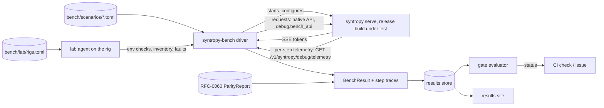

# RFC-0061: Benchmarking and performance regression

- Status: Draft
- Area: quality, performance assurance and release engineering
- Depends on: RFC-0001 (§13, §14, §16), RFC-0060, RFC-0010, RFC-0053; ADR-0004, ADR-0008, ADR-0013, ADR-0017, ADR-0019, ADR-0020; ADR-0610, ADR-0611, ADR-0612
- Expanded by: RFC-0062 (when and where benchmark jobs run), every domain RFC (its microbenchmarks, §9)
- Date: 2026-10-19
- Revised: 2026-10-20 (the hardware test matrix, the agent GPU pool, the field-test cohort, the M1-exit thesis checkpoint, baseline naming and publication timing); 2026-10-21 (the `trust` field and the result record as built, §2.2); 2026-10-22 (§4.3's ADR-0017 row names loaded draft heads, as ADR-0017's revised item 7 does; the grid at RC, the two ID forms, model references and the version check, §4.1; the success-criteria table generated from `bench/sc-map.toml`, §4.2)

## Summary

This RFC defines how Syntropy measures speed, how it decides that speed has regressed, and what it may claim in public.

- **Metrics with exact definitions:**
  - TTFT, TPOT and inter-token latency, single-stream decode tok/s, prefill tok/s, and aggregate tok/s with per-sequence floor attainment;
  - the per-term decomposition of every decode step from the RFC-0001 §13 telemetry ring, so a regression is attributed to a term, not just observed.
- **A benchmark key.** Every result carries scenario, model and quantization, prompt and generation lengths, concurrency, objective, fidelity, speculative setting, topology and interconnect, rig fingerprint, OS and driver, and commit. Results without a full key are not results.
- **A measurement protocol.** Warm-up, steady state, cold and sustained (thermal) variants, repetition counts, interleaved A/B runs, and an environment capture that rejects runs taken in a dirty state.
- **A scenario catalogue** that implements every success criterion in `00-vision-and-scope.md` §7 (SC-1 to SC-32), each with its rig, metric and pass formula.
- **Roofline efficiency reporting.** Achieved against the probe-measured bound (`t_model`, SC-3) and against the spec-sheet bound (SC-4), with the unexplained remainder shown per term.
- **The reference hardware lab.** Named rig classes tied to ADR-0020's CI hardware and to the cost model's worked examples, each with the property it covers and the milestone that first needs it (ADR-0610), plus on-demand cloud instances for coverage that needs correctness only. Its physical operation is maintainer work (§6.4). An untimed GPU pool for agents' kernel work sits outside it, and an opt-in field-test cohort adds measurements from real homes (§6.5).
- **A comparison protocol** against the best available baseline engine on the same hardware under identical conditions, described generically per D5 (ADR-0612).
- **Regression gates.** Interleaved A/B on PR† jobs, nightly trend detection with automatic bisection, and a release gate that enforces SC-32, all with noise-derived thresholds (ADR-0611).
- **Microbenchmarks per subsystem**, gated where they sit on the decode critical path.
- **Publishing rules.** No number without a commit, a reproducible bundle and a paired fidelity report. Targets stay labelled as targets.

## Motivation and goals / non-goals

The survey found decode regressions of about 16–20% shipped between nearby releases of one engine. It found paper numbers that went 4–5× stale within weeks, headline claims ahead of the code, and benchmark bars whose stated quantization could not fit the stated machine (`tiered-memory-inference.md` §18, `multi-device-inference.md` §13 item 17). Syntropy's product promise is quantitative: within a few percent of the bound the hardware allows (`00-vision-and-scope.md` §1.3, SC-3, SC-4). A quantitative promise needs a quantitative process behind it, or it degrades exactly the way the survey observed.

### Goals

1. **G1. Every SC row is measurable.** Each SC row in `00-vision-and-scope.md` §7 has a scenario, a rig, a metric and a pass formula (§4).
2. **G2. Regressions are caught where they are introduced.** PR† jobs catch large regressions before merge. Nightly trend detection catches small ones within two nightlies and bisects them to a commit or a commit range. The release gate catches anything that slipped through (SC-32).
3. **G3. Efficiency, not just speed.** Each result reports how far it sits from the bound its own hardware allows, term by term. That shows where the remaining time is, and whether a "speedup" came from doing less work.
4. **G4. Comparisons are fair and reproducible.** Same hardware, same model bytes, same tokens, same thermal state, interleaved runs, and each engine's documented best configuration (§7).
5. **G5. No claim without data.** Every public number traces to a commit, a raw-data bundle and a parity report (§11).
6. **G6. Hardware time is spent where it matters.** Short, interleaved PR† runs on the rigs a change touches; long and sustained runs nightly and per RC.

### Non-goals

- **Correctness.** RFC-0060 owns it. This RFC requires a paired parity result for every benchmark run (§3.6) and does not judge numerics itself.
- **CI mechanics** (workflows, runner registration, scheduling). RFC-0062 owns them.
- **User-facing `syntropy bench`.** RFC-0051 owns the CLI. It calls this RFC's harness, so user-run numbers use the same definitions and key, but they are never mixed into the lab's results store.
- **Datacenter-scale throughput benchmarks.** Throughput mode is benchmarked at household scale (`00-vision-and-scope.md` §3.3), up to 32 concurrent sequences.

## Design

### 1. Metrics and definitions

#### 1.1 Timestamps

Every request in a benchmark records these instants:

| Symbol | Where | Event |
|---|---|---|
| `c_send` | client | last byte of the request written |
| `s_recv` | ingress daemon | request body fully parsed |
| `s_open` | ingress daemon | `SequenceOpen` handed to the head (ring or IPC) |
| `s_first` | ingress daemon | first token-bearing SSE event written to the socket |
| `c_first` | client | first token-bearing SSE event received |
| `c_k` | client | arrival of the event carrying token k (k = 1..n_gen) |
| `s_last`, `c_last` | both | arrival of the final token event |

The benchmark client runs on the ingress host over loopback unless a scenario measures the client path itself (S3, invite links). This keeps client-network variance out of the core metrics. Server timestamps come from the daemon's `Clock`, and client timestamps from the client's monotonic clock. The two are never subtracted from each other.

#### 1.2 Primary metrics

| Metric | Definition | Unit | Notes |
|---|---|---|---|
| TTFT | `c_first − c_send` | s | includes queueing; `ttft_server = s_first − s_recv` is reported beside it |
| TPOT | `(c_last − c_first) / (n_gen − 1)` | s/token | over accepted tokens; speculative bursts are averaged |
| Decode rate | `1 / TPOT` | tok/s | the headline single-stream number (D2) |
| ITL | `c_k − c_{k−1}` for k ≥ 2 | s | p50, p90, p99, max. With speculation, tokens in one burst have ITL ≈ 0, so ITL is also reported per **token event** (burst) |
| Prefill rate | `n_prefilled / t_prefill`, with `t_prefill` from the per-step telemetry (first prefill chunk enters the head → last chunk leaves the tail) | tok/s | `n_prefilled` excludes prefix-cache and session hits (SC-20) |
| End-to-end latency | `c_last − c_send` | s | — |
| Aggregate rate | Σ generated tokens / wall time over the steady window (§3.3) | tok/s | throughput mode |
| Floor attainment | fraction of sequences whose own decode rate ≥ `per_sequence_floor_tps` | % | throughput mode (RFC-0001 §11.3) |

#### 1.3 Step-level metrics (from the telemetry ring)

The per-step telemetry ring (RFC-0001 §13) gives the benchmark the server's view of each step, so every result decomposes into the terms of RFC-0001 §14:

```text
measured, per stage s and step:
  B_{s,tier}      bytes read per tier                    → W_ach(s,tier) = B / t_kernel(s,tier)
  t_kernel        kernel time per tier and op class
  t_miss          expert-miss time (CPU in place, NVMe demand reads)
  t_switch_total  device hand-offs inside the stage
  t_wait_in       wait for the inbound frame
  t_hop           send to receive per ring hop
  t_sample        sampler at the tail
derived per token:
  t_fixed_ach     = t_step − Σ t_kernel − t_miss − t_switch_total − t_wait_in    (per stage)
  remainder       = t_tok − (Σ_s (Σ_tier t_kernel + t_miss + t_switch_total + t_fixed_ach) + Σ_hops t_hop + t_sample)
```

Also reported:
- expert-cache hit rate per tier and layer group;
- the share of NVMe misses issued before their layer's router ran (SC-8);
- NVMe throughput and drive temperature;
- `credit_stall` time per hop;
- speculative acceptance rate `a` and mean tokens per verify window;
- peak bytes per tier per node (SC-11).

#### 1.4 Lifecycle and cluster metrics

| Metric | Definition | SC |
|---|---|---|
| Probe time | daemon start → `ReportProfile` sent, quick probe set only | SC-22 |
| Pack + load time | `Packing` entered → `Warming` entered, for a shard of S bytes; download time separate | SC-23 |
| Time to routable | `EnsureInstance` → `InstanceRoutable` | — |
| Rejoin time | a previously paired node's probe finished → `NodeAdmitted` applied on the joiner, in heartbeats | SC-25 |
| New-join time | approval of a new node's pairing confirmation (ADR-0302) → `NodeAdmitted` applied on the joiner, in heartbeats | SC-25 |
| Failure detection | last heartbeat from a killed node → `NodeFailed` committed, in heartbeats | SC-25 |
| Solve time | slow re-placement, and per-request routing | SC-31 |
| Resume time | stage loss → next token delivered for each affected sequence | SC-28 |
| Session restore | `SequenceOpen` with session → first token, against the formula | SC-19 |

#### 1.5 Energy

Where the platform exposes it without elevated privilege, the harness samples device power: NVML on NVIDIA, RAPL energy counters on Linux x86 where readable, and the platform's battery discharge rate on laptops. It reports joules per generated token. Energy is reported, never gated, and a missing source reports "not available" rather than an estimate.

### 2. Benchmark identity and result schema

#### 2.1 The key

Two results are comparable only when their keys are equal in every field except `build`. The regression gates compare across builds, so `build` is the one field allowed to differ.

```rust
// syntropy-bench
pub struct BenchKey {
    pub scenario: ScenarioId,            // e.g. "decode.single.dense70b.q4km" (§4)
    pub scenario_version: u16,           // bumped on any change to the scenario definition
    pub model: ModelId, pub quant: QuantClass,
    pub prompt_tokens: u32, pub gen_tokens: u32,
    pub concurrency: u16,                // sequences in flight
    pub objective: Objective,            // Latency | Throughput { floor }
    pub fidelity: ExactnessPolicy,       // Exact unless the scenario measures a knob
    pub spec: SpecSetting,               // Off | Auto | Force(config)
    pub prefix: PrefixSetting,           // Cold | Warm (cache or session hit expected)
    pub topology: TopologyId,            // nodes and their roles in the plan
    pub interconnect: InterconnectId,    // e.g. "2.5GbE-switch-A", "TB5-RDMA-direct", "none"
    pub rig: RigFingerprint,             // §6.3; changes on any hardware, firmware, BIOS-setting or OS-image change
    pub thermal: ThermalProtocol,        // Cold | Sustained { preload_s }
    pub expert_cache: CacheStart,        // Learned | Cold (§3.2); MoE scenarios only
    pub build: BuildId,                  // version, commit, profile, target, toolchain hash
}
```

`RigFingerprint` is a BLAKE3 over the rig inventory record (§6.3):
- CPU model and microcode;
- DIMM population and speed;
- GPU model, VBIOS and driver;
- NVMe model, firmware and slot (CPU- or chipset-attached);
- the BIOS settings that move performance (memory profile, power limits, SMT, resizable BAR);
- OS image version and kernel;
- the power plan.

A change to any of these starts a new **baseline epoch** for that rig. Results across epochs are shown, but never compared by a gate.

*Revised 2026-10-22 (QUAL-E15-T01):* the fingerprint covers the whole §6.3 record, not only the list above. The rig's NICs and their firmware, the negotiated PCIe link of each device and the room-temperature sensor ID count too, as do the rig's ID and the record's schema version, so a change to any field of the record starts a new epoch. The hash is BLAKE3 over a canonical encoding of the parsed record: keys sorted, each list sorted, and no file path, line ending or map iteration order in it. A value is one line of text with no control character, so no line ending can reach the encoding through a multi-line string. The same record therefore gives the same fingerprint on every operating system, and reordering a list or reformatting the file does not start an epoch. `syntropy-bench` defines the record and the encoding, and `syntropy-bench rigs check` validates `bench/lab/rigs.toml` in `lint`.

#### 2.2 The result record

```rust
pub struct BenchResult {
    pub schema: u16,
    pub key: BenchKey,
    pub started_unix_ms: u64,
    pub repetitions: Vec<RepResult>,             // raw, every repetition kept
    pub summary: Summary,                        // medians, bootstrap 95% CIs, ITL percentiles
    pub terms: TermBreakdown,                    // §1.3, predicted against measured per term (§5)
    pub bounds: Bounds,                          // t_model (probe) and t_peak (spec), §5
    pub plan: PlanDigest,                        // epoch, stages, tier assignment summary, predicted t_tok
    pub parity: ParityRef,                       // the RFC-0060 ParityReport for this build, rig and path
    pub env: EnvCapture,                         // §3.5
    pub config_hash: Blake3,                     // resolved config (RFC-0054), secrets excluded
    pub baseline_engine: Option<BaselineRun>,    // §7, comparison scenarios only
    pub verdict: Option<GateVerdict>,            // §8, set when a gate evaluated this result
    pub trust: Trust,                            // trusted | untrusted, set by the writer of record (§10.3)
}
pub struct RepResult {
    pub ttft_s: f64, pub tpot_s: f64, pub itl_s: Vec<f32>, pub prefill_tps: f64,
    pub aggregate_tps: Option<f64>, pub floor_attainment: Option<f32>,
    pub steps: StepTraceRef,                     // per-step telemetry, stored beside the record
    pub energy_j_per_token: Option<f64>,
}
```

Results are JSON. Per-step traces are stored beside them in a columnar file, compressed. Both go to the results store (§10.3).

**The record as built** (revised 2026-10-21, QUAL-E12-T01). `syntropy-bench` implements §2.1 and §2.2 with the differences below. `crates/bench/schema/bench-result.v1.schema.json` gives the full wire form.
- **`trust`.** `BenchResult` carries `trust: Trust`, `trusted` or `untrusted`. The writer of record sets it, never the run. A `lab.yml` job on an untainted rig writes `trusted`. The trusted ingestion job writes `untrusted` on every fork-derived result. Every other producer, including a user's `syntropy bench` run, writes `untrusted` (§10.3).
- **Every field is written.** A field whose value may be absent is written as `null`, never omitted, so a missing field always fails validation. An unknown field fails too.
- **Steps not collected.** `StepTraceRef` has a `not_collected` form, for runs made before per-step telemetry exists and for runs that collect none. `TermBreakdown` then has no rows, and the times in `Bounds` stay `null` until computed.
- **Dense scenarios** record `expert_cache: learned`, the §3.2 default. The field has no effect on them.
- **Policy types follow their owner.** The key's `Objective` and `ExactnessPolicy` carry the fields RFC-0054 §4.1 and §4.2 add: `target_concurrency`, `ttft_ceiling` and the knob `params`. RFC-0042 has not defined the parameter types yet, so each knob's parameters are stored in the form its `approximate.<knob>` key takes (RFC-0054 §5.4): a name, or a table of values. An approximate policy names at least one knob, because RFC-0054 §7 resolves an empty knob set to `Exact`. The key's identifier and policy types are `syntropy-bench`'s own wire forms of the RFC-0001 §5 types, with the same field names; issue #1502 tracks converting from the `core` types as they land.
- **Versions.** `schema` is 1. A change to the record bumps it. Readers keep reading every earlier version, because release and nightly results are kept indefinitely (§10.3).

### 3. Measurement protocol

#### 3.1 Prompts and generation

- **Prompt set.** Prompts come from `bench-prompts-v1`, a versioned set drawn from the same licensed sources as the parity corpus (RFC-0060 §5.2), split into `chat`, `code`, `long` and `agent` (multi-turn with a shared prefix). For each model's tokenizer, the harness builds prompts of exactly `prompt_tokens` tokens by concatenating set items and cutting at a token boundary. The same model therefore always sees the same token sequence for a given key.
- **Generation.** Greedy (temperature 0) with `ignore_eos = true`, so every repetition generates exactly `gen_tokens` tokens. It uses the benchmark field of `POST /v1/syntropy/generate`, `bench: { ignore_eos: true, gen_tokens: N }` (RFC-0050 §13.6), which is accepted only on loopback with `debug.bench_api` set. Speculative scenarios use natural prompts and greedy decoding, so the acceptance rate reflects content, and `a` is reported.
- **Prefix state.** `Cold` scenarios prepend a per-repetition nonce of 8 tokens, drawn from the prompt set, so no repetition hits the prefix cache or a previous repetition's session. `Warm` scenarios (SC-19, SC-20) run the agent pattern: turn n+1 extends turn n's full context.

#### 3.2 Warm-up and steady state

- After `InstanceRoutable`, one warm-up request of the scenario's shape runs and is discarded.
- **MoE expert-cache state** is part of the key:
  - `learned` scenarios (the default) start from a frequency profile produced by running the prompt set's training split for 1,000 generated tokens, persisted in the pack sidecar as in production;
  - `cold-cache` scenarios start from the uniform prior.

  Both matter: the first is steady-state service, and the second is what a user sees on first load.
- **`Sustained` thermal protocol.** The workload runs for `preload_s` (default 600 s) before measurement starts. Steady state is then confirmed by a drive-temperature slope under 0.5 °C/min, and GPU and CPU package temperatures within 2 °C, over the last 120 s. If not, preload extends up to 2 × `preload_s`. A run that never stabilises is reported as `unstable-thermal`, not dropped. NVMe throttling is a real user condition (cost model §2.4), so tiered-MoE and NVMe scenarios always run `Sustained`.

#### 3.3 Repetitions and statistics

| Scenario class | Repetitions | Statistic |
|---|---|---|
| Single-stream decode | 10 | median TPOT; bootstrap 95% CI of the median (10,000 resamples) |
| TTFT at ≥ 8K prompt tokens | 5 | median TTFT; CI as above |
| Throughput mode | 3 steady windows of ≥ 120 s each, after a ramp until `concurrency` sequences are in flight | median aggregate rate; floor attainment over all windows |
| Lifecycle (probe, load, join, solve, resume) | 5 | median and max |

- No repetition is discarded as an outlier. Only whole blocks flagged dirty by the environment capture (§3.5) are discarded and re-run.
- The coefficient of variation across repetitions is reported. A scenario whose CV on its rig exceeds 3% in three consecutive nightlies is flagged for investigation, because noise that large makes the gate band (§8) too wide to be useful.

#### 3.4 Interleaving

Whenever two builds or two engines are compared, they run on the same rig in repeated **ABBA blocks**, with the instance reloaded between blocks. ABBA cancels linear drift in the rig's state, such as thermal creep or background aging. **The unit of analysis is the block pair**: one A block and its adjacent B block. Each ABBA contributes two pairs.

| Comparison | Design | Block pairs | Repetitions per block (k) |
|---|---|---|---|
| PR† gate | ABBA × 3 | 6 | 2 |
| Release gate, baseline comparisons | ABBA × 4 | 8 | 3 |
| Bisection step | ABBA × 3, the PR† design; for `Sustained` series one 600 s preload per step, then ABBA × 3 inside it | 6 | 2 (1 for `Sustained`) |

- **Estimate.** For each pair the harness takes the log ratio of the two blocks' median metric. The estimate r̂ is the mean of the pair log ratios, expressed as a relative change.
- **Test.** An **exact one-sided sign-flip permutation test** over the pairs (2^pairs sign assignments) decides whether r̂ is distinguishable from zero. With 6 pairs the smallest attainable p is 1/64, and with 8 pairs 1/256, so α = 0.05 is reachable in every design above, bisection steps included. No bootstrap is used at these sample sizes.

#### 3.5 Environment capture and cleanliness

Before every block, the lab agent (§6.4) checks the conditions below and records them in `EnvCapture`:

| Check | Required state |
|---|---|
| Power source | mains; laptop rigs at ≥ 80% charge |
| Power plan / CPU governor | the rig's recorded setting (normally `performance`) |
| Other processes | none above 2% of one core over 10 s, except the OS's own services on the lab image's allow-list |
| Memory paged out to disk | none (Linux, Windows); macOS memory pressure "normal" |
| Temperatures at block start | GPU, CPU and NVMe within 5 °C of the rig's recorded idle values (`Cold`), or steady as in §3.2 (`Sustained`) |
| Page cache | dropped for scenarios that measure cold loads |
| Network | the lab data-plane VLAN carries no traffic other than the scenario's (NIC counters sampled) |
| OS background work | updates paused for the window; search indexing off on lab volumes |

A failed check aborts the block with a reason, retries up to 3 times after a cool-down, and then marks the run `dirty`. A dirty result is stored but never gates or publishes. `EnvCapture` also records driver, firmware, kernel and microcode versions, the GPU clock behaviour actually observed, and the resolved config hash.

#### 3.6 Fidelity pairing

Every benchmark result references an RFC-0060 `ParityReport` for the same build, rig and path class:
- **When none exists:** for models up to `micro` size and the smallest real checkpoints, the harness runs the parity `smoke` corpus on the same loaded instance before measuring, through the parity tap. For larger models, it uses the nightly report for that build.
- **When the parity verdict is `Fail`:** the result is stored with `invalid: fidelity`. It cannot gate, publish or become a baseline.

A speedup with a parity failure is not a result (ADR-0019 consequences).

### 4. Scenario catalogue and success-criteria mapping

#### 4.1 Scenario naming and the standard grid

Scenario IDs are `<class>.<mode>.<model>.<quant>[.<variant>]`, for example `decode.single.llama70b.q4km.cap64g` or `tiered.single.dsv3.q4km.sustained`. Each scenario is a TOML file under `bench/scenarios/` that fixes everything in `BenchKey` except rig and build. The rig list is a field. Any change to the file bumps `scenario_version`.

| Dimension | Values | Cadence |
|---|---|---|
| Prompt tokens | 128, 2,048, 8,192, 32,768 | 128 and 2,048 on PR†; all nightly |
| Generated tokens | 128 (PR†), 512 (nightly, RC) | — |
| Concurrency (throughput mode) | 1, 2, 4, 8, 16, 32 | nightly |
| Speculative | Off; Auto | both nightly; PR† uses the plan's default |
| Thermal | `Cold`; `Sustained` for NVMe and tiered MoE | nightly; RC |

**The grid at RC, ID forms and model references** (revised 2026-10-22). At RC the grid runs the nightly points. A `Sustained` scenario runs nightly and at RC only.

§4.2 and §9 also use IDs with no model or quant segment, such as `life.probe`, `cluster.rejoin` and `kern.gemv.dense.<backend>.<quant>`. So an ID takes one of two forms:
- A scenario that names a model uses the form above, and its `<quant>` segment equals the file's `quant`.
- A scenario that runs no model, and a §9 microbenchmark, has 2 to 6 segments.

Every segment is lowercase letters, digits and `_`. The first is one of the classes `syntropy-bench` lists: §4.2's scenario classes, §9's prefixes, and §4.3's `feat` and `compare`.

A scenario names its model by its `fixtures.toml` checkpoint ID (RFC-0060 §12.3), because `BenchKey.model` is a `ModelId` content digest that only the census computes. The runner resolves the ID when it loads the checkpoint. A scenario that runs no model has no value for `BenchKey`'s required `model` and `quant` fields; that gap in QUAL-E12-T01's schema is open (issue #1559).

`syntropy-bench scenarios check`, which the `lint` job runs, checks each file against these rules and against the rig IDs of §6.2. It also checks the version rule against a base commit: `git merge-base HEAD origin/main`, unless `--base` names another. A file absent at the base that the base's history once held, such as a retired scenario added back, is checked against its last version in that history, so a re-added scenario can't reuse a version with a different definition. The check fails when it can't find the base, or when a shallow clone hides the history a re-added file needs.

#### 4.2 Success criteria

Rig IDs refer to §6.2. "Sim" means the RFC-0060 simulator and "prop" an RFC-0060 property. All thresholds are the **[target]** values of `00-vision-and-scope.md` §7.

The table is generated from `bench/sc-map.toml` (revised 2026-10-22). To change it, edit the map and run `syntropy-bench scenarios render --write`. The Status column names every task that delivers each row's measurement, one per milestone or set of rigs, and says from the files in `bench/scenarios/` whether the row's scenarios exist yet:
- *pending*: no scenario file matches the row yet;
- *not a scenario file*: an RFC-0060 property, chaos or parity result, or the release gate, measures the criterion.

<!-- BEGIN GENERATED: sc-table -->
| SC | Scenario(s) | Rig(s) | Measured | Pass | Status |
|---|---|---|---|---|---|
| SC-1 | `kern.gemv.dense.*`, `kern.moe.grouped.*`, `kern.cpu.eip.*` (§9) | R-ADA (AVX2 host), R-BW (AVX-512 host), R-WIN, R-MACF, R-ULTRA-A, R-HALO | η = W_ach / W_peak per kernel class; CPU: W_ach / probe all-core read | ≥ 0.80 dense on `Vram`/`Unified`; ≥ 0.63 grouped MoE; ≥ 0.75 CPU in place | pending; QUAL-E13-T02, QUAL-E13-T03, QUAL-E13-T20 |
| SC-2 | `decode.single.llama1b`, `.llama8b`, `.llama70b` at Q4 on each rig; intercept of `t_tok` against bytes | every Tier 1 GPU rig | fitted `t_fixed`; telemetry `t_fixed_ach` | `t_fixed ≤ 0.2 · 3.79 GB / W_probe` | pending; QUAL-E13-T02, QUAL-E13-T03, QUAL-E13-T20 |
| SC-3 | every `decode.single.*` scenario | all | `t_tok` against `t_model` (§5.1) | `t_tok ≤ 1.05 · t_model` | pending; QUAL-E13-T02, QUAL-E13-T03, QUAL-E13-T20 |
| SC-4 | `decode.single.llama70b.q4km.cap64g` (scenario a); `.llama70b.q4km` and `tiered.single.dsv3.4bit` on R-ULTRA-A | R-ADA, R-ULTRA-A | decode rate against `t_peak` (§5.1) | ≥ 0.67 (split across `Vram` and DRAM); ≥ 0.76 (one tier); ≥ 0.60 (MoE in `Vram`/`Unified`) | pending; QUAL-E13-T02, QUAL-E13-T03, QUAL-E13-T20 |
| SC-5 | `tiered.single.dsv3.q4km.sustained` (scenario b2) | R-ADA (128 GB) | `t_tok`, measured h | `t_tok ≤ 1.10 · t_overlap(h)` | pending; QUAL-E13-T03 |
| SC-6 | `prefill.nstar.sweep`: chunk n ∈ {1, 2, 4, …, 64} on a RAM-homed layer range | R-ADA, R-BW | chosen path per n; time of both paths, forced by pins | the chosen path is the faster one at every n, except within ±1 chunk of the measured crossover | pending; QUAL-E13-T03 |
| SC-7 | `io.nvme.expert.*` (§9); telemetry of b2 | R-ADA, R-BW (Gen5) | expert-read GB/s | ≥ 0.85 × probe sustained rate at the same size and queue depth | pending; QUAL-E13-T03 |
| SC-8 | b2 telemetry | R-ADA | share of NVMe misses issued before their layer's router ran | ≥ 50% | pending; QUAL-E13-T03 |
| SC-9 | `cache.policy.trace.*`: offline replay of RFC-0060 routing traces | any CPU host | hit rate per policy and capacity | ≥ max(cache fraction, LRU at equal capacity) on every trace | pending; QUAL-E13-T03 |
| SC-10 | `prefill.single.llama70b.q4km.cap64g` at 4K and 32K prompts | R-ADA, R-BW | H2D GB/s during streamed prefill; micro-batch size | ≥ 0.90 × probe pinned rate; micro-batch ≥ `n_hide` where VRAM allows | pending; QUAL-E13-T03 |
| SC-11 | every scenario (peak bytes per tier); the RFC-0060 matrix (OOM kills) | all | predicted against measured peak per tier per node | within 5%; zero OOM kills | pending; QUAL-E13-T03, QUAL-E13-T20 |
| SC-12 | `net.hop.*` (§9), runner to runner through the real rings | R-PAIR10, the S2 cluster, R-TB5 pair | added time per hop | ≤ `α_probe + S/β_probe + 2 · t_switch(probe)` | pending; QUAL-E13-T06, QUAL-E13-T10 |
| SC-13 | `pipeline.single.llama70b.q4km.s2` (scenario c1) | S2 cluster on 2.5 GbE | `t_tok` against `Σ_s t_s + D · t_hop` | ≤ 1.05× | pending; QUAL-E13-T06 |
| SC-14 | prop P-solver-3; `pipeline.vs.single.*`: forced single-node plans against the chosen plan | sim; S2 cluster | predicted and measured `t_tok` | chosen ≤ best single-node, both predicted and measured | pending; QUAL-E13-T06 |
| SC-15 | `throughput.pipeline.llama70b.q4km.s2` at concurrency 1–8 (scenario c2) | S2 cluster | aggregate rate | ≥ 0.85 × `min(M, D) / (Σ_s t_s + D · t_hop)`, capped at `1 / max_s t_s` | pending; QUAL-E13-T16 |
| SC-16 | prop P-solver-4; the probe's `α_eff` on each lab link | sim; R-TB5 pair, R-PAIR10, R-ROCE | TP/EP chosen only when the gate holds | gate formula holds for every committed plan | not a scenario file; QUAL-E13-T07 |
| SC-17 | `net.collective.allreduce.tb5` (§9) | R-TB5 pair | `α_eff` per collective | ≤ `α_wire + 2 · t_switch` | pending; QUAL-E13-T07, QUAL-E13-T18 |
| SC-18 | `prefill.single.llama70b.q4km.cap64g` at 4K (scenario a step 4) | R-ADA | TTFT | ≤ 1.15 × the formula + queueing | pending; QUAL-E13-T03 |
| SC-19 | `agent.session.restore.*` | R-ADA, R-ULTRA-A | resumed TTFT | ≤ `1.25 · KV_bytes / W_read(tier) + t_prefill(new tokens)` | pending; QUAL-E13-T03, QUAL-E13-T20 |
| SC-20 | `agent.prefix.*` | R-ADA, R-ULTRA-A | tokens prefilled per turn | exactly the tokens after the longest cached-prefix match | pending; QUAL-E13-T03, QUAL-E13-T20 |
| SC-21 | `spec.*` pairs (Off against Auto): dense 70B with draft model; DeepSeek-class with MTP | R-ADA, R-ULTRA-A | realised speedup against the predicted, with measured `a` | ≥ 0.85 × predicted; speculation off whenever predicted < 1 | pending; QUAL-E13-T03, QUAL-E13-T20, QUAL-E13-T21 |
| SC-22 | `life.probe` | every rig | quick-probe time | ≤ 15 s | pending; QUAL-E13-T03, QUAL-E13-T20, QUAL-E13-T06 |
| SC-23 | `life.packload.llama70b.q4km` | R-ADA (Gen4), R-BW (Gen5) | `t_pack + t_load` | ≤ `1.25 · (2S/W_read + S/W_write)` | pending; QUAL-E13-T03, QUAL-E13-T20 |
| SC-24 | `life.install.clean` on clean VM images per Tier 1 OS (RFC-0052 owns the script) | hosted VMs; R-MACF | steps, typed inputs, time to first token | one command, one model choice, no config file, no typed address | pending; QUAL-E13-T04 |
| SC-25 | `cluster.rejoin`, `cluster.newjoin` (scripted pairing approval), `cluster.detect`; sim checker | S2 cluster; sim | heartbeats to admit (from probe for a rejoin, from approval for a new node) and to detect | ≤ 2; ≤ 3 | pending; QUAL-E13-T06 |
| SC-26 | `cluster.invite.offlan` (RFC-0060 L7 with timing) | lab + an off-site node through a relay | join success, time | joins with one token, no port forwarding | pending; QUAL-E13-T07 |
| SC-27 | RFC-0060 chaos F-03 | lab; sim | failed in-flight requests | 0 | not a scenario file; QUAL-E13-T06 |
| SC-28 | RFC-0060 chaos F-01, F-02 with timing | lab | resume time against the RFC-0033 formula | within the formula; no client-visible error | not a scenario file; QUAL-E13-T07 |
| SC-29 | RFC-0060 parity, every release | Tier 1 | parity verdicts | all pass; approximate settings visible in API, CLI and dashboard | not a scenario file; QUAL-E5-T10 |
| SC-30 | every `decode.single.*`, `pipeline.*`, `tiered.*` scenario | reference rigs | `|t_pred − t_meas| / t_meas` | ≤ 0.15 | pending; QUAL-E13-T05 |
| SC-31 | `solver.regress.*` (§9) | any CPU host | slow-solve time (≤ 8 nodes), routing time, DP feasibility | ≤ 2 s; ≤ 1 ms; feasible whenever one exists | pending; QUAL-E13-T05, QUAL-E13-T15 |
| SC-32 | the release gate (§8.4); publishing rules (§11) | Tier 1 rigs | per-scenario deltas against the previous release | no reference benchmark outside its noise band; every published number fully keyed | not a scenario file; QUAL-E14-T05 |
<!-- END GENERATED -->

#### 4.3 Benchmarks that foundation ADRs depend on

Several foundation ADRs name a measurement that would reopen them. Each such measurement runs as a scenario, and its result is attached to the ADR's revisit clause in the nightly report:

| ADR | Revisit trigger | Scenario | Cadence |
|---|---|---|---|
| ADR-0004 | an MLX-based path is ≥ 15% faster than Syntropy's Metal decode on Apple | `compare.apple.decode.*` under §7, with an MLX-based engine as the baseline | after M2, per RC |
| ADR-0008 | the DP fallback is within 5% of the MILP's objective and measured decode in every case | `solver.regress.dp_vs_milp` on recorded lab graphs and the cost-model scenarios | nightly |
| ADR-0011 | LAN QUIC's α at p50 is > 50 µs worse than kernel TCP on the same link | `net.hop.quic_vs_tcp` | nightly on R-PAIR10 |
| ADR-0012 | a tokio-hosted dispatcher is within 2% on `t_fixed` and p99 step time | `exec.dispatcher.ab` (an experimental build flag) | once at M1, then per RC |
| ADR-0013 | `UringDirect` is within 5% of `PreadPool` in throughput and within 20% in CPU time per GB at expert sizes | `io.engine.uring_vs_pread` | nightly on Linux rigs |
| ADR-0014 | each feature against its fallback, for speed | `feat.<feature>.vs_fallback` | nightly on the rig with the feature |
| ADR-0017 | loaded draft heads, wide trees and pipelined speculation are enabled by default only after a gain on Tier 1 | `spec.<mode>.<family>` pairs | nightly from M3 |

### 5. Roofline and model-efficiency reporting

#### 5.1 Three times per token

Every decode result carries three per-token times. All three use the bytes the telemetry actually measured per tier (`B_meas`), not the plan's bytes, so a run that reads fewer bytes than the plan predicted cannot look more efficient than it is. Byte prediction accuracy is checked separately (SC-11).

```text
t_meas  = measured TPOT                                                    (§1.2)
t_model = Σ_s [ Σ_tier B_meas(s,tier) / W_probe(s,tier,kernel class)
               + n_switch,s · t_switch(probe) + t_fixed(probe, s) ]
        + Σ_hops ( α_probe + S_hop / β_probe ) + t_sample                    (SC-3; cost model §3.2, §3.7)
t_peak  = Σ_tier B_meas(tier) / W_peak(tier) + t_fixed,SC-2                  (SC-4; cost model §3.4)
```

- For tiered MoE scenarios the harness also computes `t_overlap(h)` from SC-5 with the measured hit rate.
- With speculative decoding, each time is per accepted token: the verify-window cost divided by the measured tokens per window.

Reported ratios:
- **model efficiency** `t_model / t_meas` (≥ 1/1.05 passes SC-3);
- **peak efficiency** `t_peak / t_meas` (compared with SC-4's X);
- **unexplained remainder** `(t_meas − t_model) / t_meas`;
- **prediction error** `(t_pred − t_meas) / t_meas`, where `t_pred` is the plan's `PredictedCost` (SC-30).

#### 5.2 Per-term breakdown

| Term | B_meas | W_probe | W_ach = B / t_kernel | η_kernel = W_ach / W_probe | t predicted (plan) | t model (probe) | t measured | Δ measured − model |
|---|---|---|---|---|---|---|---|---|
| stage 0, `Vram`, `DenseGemv` | … | … | … | … | … | … | … | … |
| stage 0, `HostPinned`, CPU in place | … | … | … | … | … | … | … | … |
| stage 0, expert misses (`t_miss`) | … | — | — | — | … | … | … | … |
| stage 0, hand-offs, `t_fixed` | — | — | — | — | … | … | … | … |
| hop 0→1 | S_hop | β_probe | — | — | … | … | … | … |
| … | | | | | | | | |
| unexplained remainder | | | | | — | 0 | … | … |

The harness emits this table for every result and flags each row where measured exceeds model by more than 10%. That is the drift threshold of RFC-0001 §14 rule 2, and it tells the reader which component (RFC-0001 §14's "owning component" column) has the regression.

#### 5.3 The spec database

`bench/specs/` holds the peak figures `t_peak` needs, one TOML record per device or memory configuration, each with its source:
- vendor specification pages and whitepapers for GPU memory bandwidth, PCIe and Thunderbolt rates;
- the formula `channels × 8 B × MT/s` for DRAM, with the DIMM population read from the rig inventory;
- vendor-documented fabric limits where they are narrower than DRAM, for example per-CCD read bandwidth on AM5 parts. Here the SC conventions take the narrowest element as `W_peak`.

The records reuse the verified figures in `hardware-and-performance-model.md` §2, and add rows only from vendor documentation. A spec record never comes from a measurement. A probe result below 50% of its spec record flags the rig as misconfigured (`00-vision-and-scope.md` §9, principle 2), and the run is marked `dirty`.

#### 5.4 Roofline views

For each scenario the results site (§10.4) draws:
- **A roofline per device.** Achieved bytes/s and FLOP/s per kernel class, against arithmetic intensity, under the `W_peak`, `W_probe` and `F_peak` ceilings. Decode kernels should sit on the bandwidth roof, and prefill and verify kernels move toward the compute roof as the batch passes the ridge point (cost model §3.1).
- **A stacked bar of the per-term times** for each build over the last 90 nightlies, so a regression shows up as one term growing.

### 6. Reference hardware lab

#### 6.1 Principles

1. **The lab reproduces the plan's own scenarios.** The cost model's worked examples, (a), (b1), (b2) and (c), are the scenarios the vision document's targets were derived from. Running them on matching hardware turns each estimate into a measurement against the same formula.
2. **The lab covers ADR-0020's CI hardware** for Tier 1 on every PR† and Tier 2 weekly. Each rig plays several roles where the hardware allows, to keep the standing cost down.
3. **Consumer hardware, configured as users configure it.** No clock locking, no exotic tuning. BIOS settings are recorded and held fixed (§6.3), because a benchmark compares builds, not tuning sessions.
4. **Rigs are cattle with names.** Each rig has an inventory record, a fingerprint and a pinned OS image, and is re-imaged rather than repaired in place.

#### 6.2 Rigs (ADR-0610)

| Rig (first needed) | Hardware (class) | OS | Roles |
|---|---|---|---|
| **R-ADA** (M0) | Ada-class 24 GB (`sm_89`, RTX 4090 class), with a spare GPU of the same class kept for it because it plays six roles; Intel desktop CPU without AVX-512 (Core Ultra 200-class); 2 × 64 GB DDR5-6000 (2 channels); Gen4 NVMe (990 PRO-class) in a CPU-attached slot; 10 GbE and 2.5 GbE NICs; a RoCEv2-capable NIC | Linux | Tier 1 CUDA (Ada, sm_89, FP8); scenario (a) under a 64 GB memory cgroup; scenario (b2) with 128 GB; the AVX2 CPU-only host; R-PAIR10 and R-ROCE member; S2 cluster member |
| **R-BW** (M0) | RTX 5090 32 GB; AMD dual-CCD desktop CPU with AVX-512 (Ryzen 9 9950X-class); 128 GB DDR5; Gen5 NVMe in a CPU-attached slot, plus a second Gen5 drive without heatsink for thermal-throttling runs; 10 GbE; a RoCEv2-capable NIC | Linux | Tier 1 CUDA (Blackwell, sm_120, FP4/FP8); the AVX-512 CPU-only host; Gen5 storage scenarios; R-PAIR10 and R-ROCE member |
| **R-WIN** (M1) | Ada- or Blackwell-class consumer GPU; 64–128 GB DDR5; Gen4 NVMe | Windows 11 (plus a WSL2 instance) | Tier 1 Windows NVIDIA; Windows CPU-only (GPU disabled); IoRing and IOCP; WSL2 pinning limits; NVIDIA-on-Vulkan (Tier 2) |
| **R-MACF** (M0) | Apple M1- or M2-class, 16 GB | macOS (current and previous major) | Tier 1 Metal floor; `simdgroup_matrix` fallback path; macOS CPU-only (Metal disabled); clean-install tests |
| **R-MBP** (M1) | MacBook Pro, M4 Pro-class, 48 GB (the current M5 Pro generation meets it) | macOS | scenario (c) member; laptop thermal and battery behaviour; energy per token; SME2 (M4-class CPU) |
| **R-ULTRA-A** (M1), **R-ULTRA-B** (M2) | Ultra-class Mac Studios (M5 Ultra generation, 1.2 TB/s), Thunderbolt 5, RDMA enabled; R-ULTRA-A with 512 GB of unified memory. R-ULTRA-B joins only if the TB5 raw-path probe on R-MINI passes; otherwise cross-node TP on Macs is simulation-only. If the lab's Ultra has 256 GB, scenario (b1)'s single-node case is measured on a model that fits, such as Qwen3-235B-A22B Q4 | macOS 26.2+ | recent-Mac Tier 1 rig (Metal 4 tensor ops, and M5-class GPU accelerators if M5-generation); scenario (b1): DeepSeek-V3-class 4-bit on one node, TP = 2 and PP = 2 over RDMA (R-TB5 pair); Kimi-class across two nodes |
| **R-HALO** (M2) | AMD Strix Halo, 128 GB | Linux (ROCm where listed, else Vulkan); Windows (Vulkan) on a second volume | Tier 2 Strix Halo; scenario (c) member, whose GPU stage at M2 runs on the ggml-only `vulkan` module labelled a Tier 2 preview, and is CPU-side until that module exists; `Unified` tier on AMD |
| **R-AMD** (M3) | Linux host with one RDNA3 card (RX 7900 XTX-class), one RDNA4 card (RX 9070 XT-class) and the Intel Arc card | Linux | Tier 2 ROCm and AMD-on-Vulkan; RDNA4 FP8 |
| **R-ARC** (M3) | the Intel Arc discrete card, installed in the R-AMD host | Linux | Tier 2 Intel-on-Vulkan; Tier 3 SYCL when tested. Windows-on-Arc stays build-only |
| **R-GB10** (M3) | GB10-class system | Linux arm64 | Tier 2 GB10, CUDA aarch64 with a `Unified` tier |
| **R-PI5** (M3) | Raspberry Pi 5-class board, 8–16 GB | Linux arm64 | Tier 2 Pi-class CPU node |
| **R-DUAL** (M3) | one Linux host with two NVIDIA GPUs with working peer access: such as two RTX 3090s with an NVLink bridge (current GeForce 40-series drivers disable peer access) | Linux | Tier 2 intra-node TP (`IntraNodeTp2`), with and without the bridge; timed `sm_86` |
| **R-TURING** (M0) | a Turing (`sm_75`) card in a small Linux host | Linux | weekly CUDA 13 floor conformance; the lab's only small-VRAM CUDA measurements |
| **R-AM5-4D** (M1) | a single-CCD AM5 desktop with four DIMMs, on R-BW's platform | Linux | typical-user desktop memory configuration; states the CPU and DIMMs beside each number |
| **R-MID12** (M1) | a 12 GB-class NVIDIA desktop GPU with 32 GB of RAM | Windows or Linux | the machine most users own |
| **R-LAPX** (M1) | an x86 laptop | Windows or Linux | typical laptop |
| **R-MINI** (M1) | one Mac mini paired with R-MBP, or two Mac minis, with TB5 and on Apple's RDMA-capable list | macOS | the TB5 raw-path RDMA probe that decides whether R-ULTRA-B joins and whether SC-17 stays in M3 |
| **R-LABCPU** (M0) | many-core CPU host, single-tenant bare metal provided on demand; core count and RAM set from QUAL-E5-T08's measurement, because the calibration reference runs on a GPU | Linux | CPU `F32Fixed` reference runs and cross-checks on nano and micro fixtures (RFC-0060 §4.1), the nightly L6 simulation (1 h, RFC-0060 "Simulator throughput"), fuzz rotation, solver regression suite, results-site builds; never a timed benchmark rig |

Composite rigs:
- **S2 cluster**: R-ADA + R-MBP + R-HALO on a 2.5 GbE switch, and on a Wi-Fi 6/6E access point for the Wi-Fi variants. This is the vision document's S2 and the cost model's scenario (c).
- **R-PAIR10**: R-ADA + R-BW over 10 GbE. The 2-node 10 GbE pair of ADR-0020, and the chaos pair (RFC-0060 §9.3), every second night.
- **R-ROCE**: the same two hosts over their RoCEv2 NICs, marked `trusted_fabric`. The RoCE pair of ADR-0020, weekly.
- **R-TB5**: R-ULTRA-A + R-ULTRA-B over a direct TB5 cable with RDMA enabled.

AMX (ADR-0014) has no rig above. Its feature-versus-fallback parity runs on an on-demand cloud instance with a Sapphire Rapids-class CPU, for correctness only. No AMX performance number is gated.

**NVIDIA architectures without a timed rig.** `sm_75` has R-TURING, with GitHub's hosted GPU runner checked in M0 as a backup. `sm_90` and `sm_100` get an H100- and B200-class conformance canary on on-demand cloud instances on every RC from the first M1 RC, and derived certification (RFC-0060 §6.4) between RCs. v1 contains no kernel built only for `sm_90a` or `sm_100a`.

**The untimed agent GPU pool** (ADR-0610 decision 4) is not part of the lab. Agents use it for kernel iteration, for the GPU calibration reference (RFC-0060 §4.1) and, on its NVIDIA host booted into Windows with the native driver, for WDDM probes from M0's first day. It never runs a timed block or a gate job, sits on its own VLAN and dispatcher queue, and no agent run that has read untrusted input reaches it.

**Typical-user scenario.** R-AM5-4D, R-MID12 and R-LAPX carry predicted rows for the machines most users own, so the launch story states what those machines get. The vision's scenario list owns the scenario itself.

#### 6.3 Inventory and fingerprints

`bench/lab/rigs.toml` holds one record per rig:
- CPU model and microcode; DIMMs (count, size, speed, slots);
- GPU model, VBIOS and driver;
- NVMe model, firmware and slot attachment;
- NICs and firmware;
- the BIOS settings that move performance (memory profile, power limits, SMT, resizable BAR, PCIe link width and generation as negotiated);
- OS image ID and kernel; the power plan;
- room-temperature sensor ID.

The lab agent verifies the live rig against the record before every block. A mismatch, for example a driver auto-updated or a DIMM running at a lower speed after a BIOS reset, aborts the run as `dirty: inventory`. A deliberate change goes through a PR to `rigs.toml`, which starts a new baseline epoch (§2.1). The nightly report lists every epoch change.

#### 6.4 Operations

- **Images.** Each rig boots a pinned OS image built from a declarative definition kept in the repository's `lab/` directory, with drivers pinned. Driver upgrades are deliberate image bumps and run the full nightly before and after on the same build, so a driver regression is attributed to the driver.
- **Lab agent.** A small daemon on each rig runs the §3.5 checks, the inventory check and the fault actions of RFC-0060 §9.3. It reports to the CI runner on that rig (RFC-0062).
- **Exclusive use.** A rig runs one job at a time. Timed benchmark blocks never share a rig with builds or parity runs. Composite suites (R-PAIR10, the S2 cluster, R-TB5) hold leases on every member rig at once, through the lab dispatcher's reservation service (RFC-0062 §3.4). The agent also refuses to start a timed block if another job's process is alive.
- **Per-rig nightly budget** is the sum of the rig's roles inside its 6 h window [targets]. The composite slots are RFC-0062 §3.4's: slot A alternates nights between `chaos-pair` on R-PAIR10 and the S2 cluster suites, and slot B runs R-TB5 every night, at the same time as slot A (revised 2026-10-19).

  | Rig | Own parity | Own benchmarks | Composite slot (2 h) | Nightly total |
  |---|---|---|---|---|
  | R-ADA | ≤ 1.5 h | ≤ 2.5 h | slot A every night (member of both R-PAIR10 and the S2 cluster) | ≤ 6 h |
  | R-BW | ≤ 1.5 h | ≤ 2.5 h | slot A on `chaos-pair` nights | ≤ 6 h, or ≤ 4 h on S2 nights |
  | R-MBP | ≤ 1.5 h | ≤ 2.5 h | slot A on S2 nights | ≤ 6 h, or ≤ 4 h on `chaos-pair` nights |
  | R-HALO | weekly (Tier 2, RFC-0062 §2.4) | weekly | slot A on S2 nights | ≤ 2 h, on S2 nights |
  | R-ULTRA-A, R-ULTRA-B | ≤ 1.5 h | ≤ 2.5 h | slot B every night | ≤ 6 h |
  | every other rig | ≤ 2 h | ≤ 4 h | none | ≤ 6 h |

  Bisection steps (§8.4) run ahead of nightly chunks and take time from the same window.
- **Availability.** Target 95% weekly availability per Tier 1 rig. A rig down for more than 30 days triggers ADR-0020's demotion rule for the platforms it alone covers.
- **Ownership.** Maintainers operate the lab, and are the accountable people wherever ADR-0020 calls for a "named maintainer" for a platform the lab covers (ADR-0021 §8). Each Tier 1 rig keeps a spare-parts plan: a second GPU of the same class, or an agreed fallback rig.
- **Physical operations are Maintainer actions** (ADR-0021 §4). Installing and cabling rigs, setting up cable-pull and power-cut fault injection, manual re-imaging, swapping in spares and repairs are done by maintainers. AI agents operate the lab only through the dispatcher, the reservation service and each rig's lab agent daemon (RFC-0062 §3).
- **The room** (ADR-0610 decision 3). A lockable room with power and cooling sized for every rig at full load at once, a recorded ambient of 22–26 °C [target] and a ≥ 1 Gbps link with outbound-only rules. R-ADA, R-BW and R-MACF are needed from M0's third week, when the host-overhead, host-path, NVMe and CPU-kernel measurements run on them.
- **Wi-Fi** (OQ-PRC-13). The lab AP sits on a 6 GHz channel. Wi-Fi scenarios stay report-only through 1.0, and no shielded enclosure is bought.
- **Off-site node** (ADR-0610 decision 9). A cloud VM with all inbound traffic blocked at the provider's firewall joins by invite on the nightly schedule; from M3 a lab node on a cellular modem adds the carrier-grade NAT case, which forces the relay path.
- **Refresh** (ADR-0610 decision 10). One prior generation per Tier 1 vendor stays until its platform leaves Tier 1. A new generation's rig joins once that generation is generally available. A rig is retired when its platform is demoted, or after a quarter below 95% availability, which the weekly availability report flags.

#### 6.5 Field-test cohort

The lab cannot reproduce real homes. Home NVMe throttling (OQ-HW-03), Wi-Fi tail latency (OQ-NET-03, -07) and the share of connections that need a relay come from an opt-in field-test cohort.
- **Coverage.** 20–30 households [target] covering Windows gaming PCs, Linux with NVIDIA, MacBooks, at least one Mac Studio or Ultra, Wi-Fi homes, mixed clusters, and Strix Halo or GB10 machines. That gives the Wi-Fi prior about 10 homes per Wi-Fi generation.
- **Timing.** The standalone network probe reaches the cohort in mid M1 and runs in homes for at least 4 weeks; the single-device product follows at the first M1a RC.
- **Reports are sent by hand** (ADR-0510): `syntropy bench --report` results and probe exports, after the existing redaction (RFC-0053 §7). Nothing is collected automatically. A report states what it contains before it is sent, and a participant's reports are deleted on request.
- **Reports are untrusted input.** Agents analyse them only as tier-U runs (RFC-0062 §12.5): schema-validated, scanned for fields the redaction should have removed, stored tagged `community-reported` under a random per-participant ID, and never mixed with lab results or used as a gate or baseline (§11.1 rule 9) (QUAL-E12-T19).

### 7. Comparison protocol against a baseline engine

Syntropy's claim is about what the user's hardware can deliver. The fair comparison is therefore against the best thing the same user could run on the same hardware today. Per D5 this plan does not name other inference systems. Benchmark records name the baseline precisely, so the run can be reproduced (§7.6).

#### 7.1 Selecting the baseline

For each (rig, model class), the **baseline engine** is the fastest engine that meets all of these conditions:
1. it is publicly released, and the run uses a tagged release rather than a development branch;
2. it runs on the rig's OS and GPU backend;
3. it can load the scenario's model file unchanged, or a conversion whose bytes per token are within 2% of it (§7.2).

**Selection run.** Once per release cycle, and when a candidate engine ships a new major or minor release, every eligible candidate runs `decode.single.<model>.<quant>` at 2,048 prompt and 128 generated tokens under §7.2–§7.3. The fastest becomes the baseline for that (rig, model class) until the next selection. The selection results are kept, so a baseline change is visible and explained.

#### 7.2 Identical conditions

| Condition | Rule |
|---|---|
| Hardware and OS | same rig, same OS image, same baseline epoch (§2.1), same thermal protocol |
| Model bytes | the same file. If the baseline cannot read it, its nearest format with bytes per token within 2%, labelled `format-adjusted`. Otherwise no comparison is published |
| Tokens | identical prompt token IDs through the baseline's token-level interface where it has one. Otherwise text that the model's own tokenizer maps to the same token count ±1, with the count recorded |
| Generation | greedy, the same `gen_tokens`, EOS ignored, the same context-window setting |
| Caching | prefix caching off in both, except `Warm` scenarios, where both use it |
| Concurrency and objective | identical |
| Order | ABBA blocks (§3.4) with a cold restart of each engine per block |
| What is timed | steady-state TTFT, TPOT and aggregate rate after load. Load time is compared as its own metric, never folded into decode figures |

#### 7.3 Configuration fairness

- **The baseline.** It runs in its documented recommended configuration for the hardware: how many layers it places on each device, thread counts, batch sizes, attention options. On top of that, the harness runs a bounded sweep of at most 20 configurations over the performance options its documentation lists, and the best wins. The sweep is recorded.
- **Syntropy.** It runs its defaults, with no tuning.

The asymmetry favours the baseline on purpose. A Syntropy result that holds up under it is not an artefact of tuning effort.

#### 7.4 Fidelity fairness

Each engine's fidelity is reported beside its speed:
- **Syntropy** runs exact mode, and its `ParityReport` is attached (§3.6).
- **The baseline.** If its defaults include approximations, such as expert skipping, reduced top-k, lossy KV or lossy activation transfer, it runs twice:
  - with its defaults, labelled `baseline-default (approximate: <list>)`;
  - with its closest exact settings, labelled `baseline-exact`.
- Where the baseline exposes per-position top-n log-probabilities, the harness runs the RFC-0060 `smoke` corpus through it and reports top-1 agreement and a top-n coarse-grained KL against the same reference blocks. These are labelled with n, because top-n with n < K is a looser bound.
- **The headline comparison is Syntropy exact against `baseline-exact`.** Syntropy exact against `baseline-default` is shown next to it with both fidelity figures. A like-for-like approximate comparison, with the same knobs on both sides, is shown only where both engines support the same knob.

#### 7.5 Scope

- **Single device:** every Tier 1 rig, with the cost-model scenario models, plus the ADR-0004 Apple comparison (§4.3).
- **Multi-device:** compared against a baseline only where one supports the same topology on the same hardware. Otherwise the comparison is "Syntropy on the cluster against the best baseline on the best single machine of that cluster", labelled exactly so. That is the real alternative a user without Syntropy has.

#### 7.6 Records

`BaselineRun` stores:
- the engine's name, release version and commit;
- the exact command line and configuration files;
- the sweep results;
- the model file hash, or the conversion command and the converted file's hash;
- the fidelity settings and measured fidelity;
- the raw timings.

All of it goes into the raw-data bundle (§11.2), so a third party can reproduce the run. Public reports name the baseline engine under §11.1 rule 11. The plan documents never do (D5).

#### 7.7 The M1a-exit thesis checkpoint

Every SC row measures Syntropy against the hardware bound or its own model, so nothing else tests the value claim: that Syntropy beats what the same user could already run on the same machine. ADR-0612 decision 8 makes that a gate, and it pilots OQ-PRC-03.
- **Early read at the M0b exit (S-10).** A throwaway harness runs dense in-VRAM decode on R-ADA against the selected baseline under §7.2–§7.4, to see whether executor overhead rather than the kernels is the gap. It informs and gates nothing (QUAL-E14-T16).
- **The checkpoint at the M1a exit.** A selection run (§7.1) for scenarios (a) and (b2) on R-ADA, then Syntropy exact against `baseline-exact` in the release design (ABBA × 4 with k = 3, §3.4). It passes when Syntropy's decode rate is ahead on scenario (a) or (b2), with the sign-flip test's p < 0.05 in Syntropy's favour (QUAL-E14-T17).
- **An M1a exit criterion.** If it fails, M2's scope is re-planned before M2 work starts.
- **Release gate.** From the first M1a RC, `rc-gate` repeats the comparison on the RC's artefacts and fails when the condition does not hold, unless a maintainer waives it in writing with the measurement attached, copied into the release notes (RFC-0062 §9.3).
- **Rig (c) at M2.** The S2 cluster joins the comparison under §7.5's labelling (QUAL-E14-T09).

### 8. Regression gates

#### 8.1 Gated metrics

| Metric | Bad direction | Minimum band `b_min` |
|---|---|---|
| Single-stream decode rate | down | 2% |
| TTFT | up | 2% |
| Aggregate rate; floor attainment | down | 3% |
| Per-term `W_ach` per tier and kernel class; `t_fixed_ach`; per-hop added time | `W_ach` down; times up | 3% |
| Peak bytes per tier per node | up | 1% |
| Probe time; pack + load time; time to routable | up | 5% |
| Hot-path microbenchmarks (§9.1, gated rows) | per row | 3% |

Not gated: energy, ITL max, and metrics of scenarios whose CV flag (§3.3) is set. Those are reported only, until the noise is fixed.

#### 8.2 Noise bands

There are two bands, one per use:

```text
b_gate  = max(b_min, 3 · s_AA),  s_AA = sample SD of r̂ over the last 8 weekly A/A runs of the same scenario, rig and epoch   PR† and release gates
b_trend = max(b_min, 3 · σ̂),  σ̂ = 1.4826 · MAD(residuals of the last 20 nightly medians around their rolling 5-run median)   nightly trend only
```

- **`b_gate`** is the noise of the paired estimate r̂ itself. It comes from the weekly A/A runs (§"Testing and validation" item 1), which use the gate's own design. Until 4 A/A runs exist in an epoch, the gate is report-only for that series.
- **`b_trend`** is the noise between nightly medians and is used only for level-shift detection. MAD keeps one bad night from widening it. Until 20 nightlies exist in an epoch, `b_trend = max(b_min, 5%)`.
- **Driver image bumps** (a new baseline epoch) are frozen during an RC window, so the release gate never runs on a fresh epoch's report-only bands.

The bands of every gated series are shown on the results site, so a reader can see what "within noise" means for that rig.

#### 8.3 PR† gate

- **Selection.** On a PR whose paths require hardware (`hw_required`, RFC-0062 §2.2), each touched rig runs its `pr-quick` scenario set: at most 10 minutes of timed blocks, chosen per rig to cover its Tier 1 role.
- **Comparison.** Merge base against PR head, ABBA × 3 with k = 2 (§3.4). The merge base's artefacts come from the per-commit store (RFC-0062 §2.1 `post-merge.yml`), which holds `pr`-profile builds only (RFC-0062 §4.4), or are built by the PR job in that profile if missing.
- **Fail** when `r̂ > b_gate` in the bad direction **and** the sign-flip test gives p < 0.05.
- **Override.** A maintainer may apply the label `perf-regression-accepted` with a written reason in the PR body, for example a correctness fix that must cost time. No agent can apply it, since a gate override needs a maintainer (ADR-0021 §5). The override is recorded in the result and listed in the release notes.

#### 8.4 Nightly trend detection and bisection

- Nightly, every scenario in the nightly set runs on main's head. Each gated series is checked for a level shift: the median of the last 3 nightlies against the median of the 10 before them. A shift beyond `b_trend` flags the series. A step change is visible after two nightlies.
- **Bisection.** A flagged series starts an automatic bisection over the commit range between the last good nightly and the first flagged one.
  - Every main commit's rig-architecture artefacts are kept for 30 days in the `pr` profile, from M1 by `post-merge.yml` and from M2 by the merge queue (RFC-0062 §2.1, §2.5), so nothing is rebuilt. Nightlies are `release`-profile builds, so a bisection never compares a candidate with a nightly artefact (revised 2026-10-19).
  - **Like with like.** The good endpoint G is the `pr` artefact of the last good nightly's commit, from the same store. Every candidate is that commit's `pr` artefact.
  - **Step 0 confirms the shift in the `pr` profile.** The first flagged nightly's commit runs against G. Trend detection always flags shifts seen on `release`-profile nightlies. So if the step rule below does not call this commit bad in the `pr` profile, the shift is specific to the `release` profile (LTO or codegen units), and the fallback always applies in that case. The bisection then rebuilds G and each candidate in the `release` profile on hosted runners, rig architectures only, at one hosted build per step, and repeats step 0 on those builds. If the shift still does not reproduce, it reports "not reproduced" and names no commit.
  - **Steps.** Each step runs **the flagged scenario's own protocol** (preload, length, thermal state) in the bisection design of §3.4: ABBA × 3 with k = 2, or, for `Sustained` series, one preload followed by ABBA × 3 with k = 1. Steps are chained jobs of at most 60 minutes, at nightly priority (RFC-0062 §3.4).
  - **Step rule.** A candidate is bad when its cumulative r̂ against G is beyond `b_step` in the flagged direction and the sign-flip p < 0.05; otherwise it is good. `b_step = max(b_min, 3 · s_AA)`, with `s_AA` from A/A runs in the bisection design. That is the PR† `b_gate` for `pr-quick` series, and the weekly A/A rotation for the others ("Testing and validation" item 1). A series with fewer than 4 A/A runs in that design uses `b_trend` [assumption: nightly-to-nightly noise is at least the within-session paired noise; the rotation checks it].
  - **Confirmation.** The named commit runs once more against its parent in the same design. If that run does not call it bad, or no single commit's own difference from its parent does while the cumulative difference does, the bisection reports a **distributed regression**: the commit range, and the per-term rows that moved.
  - It opens an issue naming the commit or range, the PR authors, the scenario and the per-term breakdown row that moved. That row names the owning component (RFC-0001 §14).
- Improvements beyond `b_trend` are flagged the same way (§8.6).

#### 8.5 Release gate (SC-32)

- **Comparison.** For each Tier 1 rig, the `release-gate` set runs the RC against the previous release's artefacts, ABBA × 4 with k = 3, in the same baseline epoch. The set has one scenario per SC row that rig serves, plus the `pr-quick` set. If the rig's epoch has changed since the last release (outside the RC freeze), the previous release's artefacts are re-run on the new epoch, since they are kept indefinitely.
- **Blocking.** The release is blocked by any regression with `r̂ > b_gate` and sign-flip p < 0.05 on a Tier 1 rig. A maintainer may waive one in writing in the release PR (**Maintainer action**), with the measurement attached and a reason. The waiver is copied into the release notes. This is the "waived in writing" clause of RFC-0001 §16 M4.
- **Tier 2** regressions are tracked and listed in the release notes as known gaps, not blocking (ADR-0020).
- **Absolute targets.** From M4, the RC must also pass every absolute SC formula of §4.2 on its rig. Before M4, the absolute formulas are milestone exit criteria (RFC-0001 §16), reported per RC without blocking.

#### 8.6 Suspicious improvements

A gated metric that improves by more than max(3b, 15%) in one step does not move the baseline until a maintainer acknowledges it. Before the request reaches them, the review agent checks, and they confirm, that:
- the paired parity report still passes;
- the measured bytes per tier have not fallen without a plan change explaining it;
- the scenario still generated `gen_tokens` tokens.

Broken benchmarks usually look like improvements: work skipped, EOS honoured, a cache that was not cold. This rule stops them from silently raising the bar that later regressions are judged against.

### 9. Microbenchmarks per subsystem

Microbenchmarks isolate one term of the cost model, so a regression shows up before it is diluted in end-to-end time. Each subsystem RFC owns its rows and may add more. This RFC owns the harness, the naming and which rows gate.

#### 9.1 Catalogue

| ID prefix | Owner | What | Metric | Gated |
|---|---|---|---|---|
| `kern.gemv.dense.<backend>.<quant>` | RFC-0040 | dequant-GEMV at every fixture's real shapes, buffer larger than the last-level cache | W_ach, η against probe and peak (SC-1) | yes |
| `kern.moe.grouped.<backend>.<quant>` | RFC-0040 | grouped expert kernel with the residency slot table, top-k from routing traces | W_ach, η (SC-1) | yes |
| `kern.attn.<kind>.<backend>` | RFC-0040 | GQA, MLA, sliding, sparse, linear-attention scans at contexts 1K–128K | bytes/s of KV and weights; time | yes (decode shapes) |
| `kern.cpu.eip.<isa>.<quant>` | RFC-0040 | CPU in-place GEMV over `HostPinned`, NUMA-pinned | W_ach against the probe's all-core read (SC-1) | yes |
| `kern.prefill.gemm.<backend>.<dtype>` | RFC-0040 | GEMM at prefill shapes | F_ach against F_peak | no |
| `exec.tfixed.<backend>` | RFC-0012 | 1-layer × n tiny forward; intercept fit; graph replay against stream launches | `t_fixed` (SC-2) | yes |
| `exec.doorbell.<backend>` | RFC-0012 | GPU→CPU doorbell and CPU→GPU wait-on-value round trip | ns, p50/p99 | yes |
| `exec.dispatcher.ab` | RFC-0012 | the ADR-0012 revisit A/B (§4.3) | `t_fixed`, p99 step | no |
| `sched.sampler` | RFC-0012 | sampling with and without grammar masks at real vocabulary sizes | µs per token | yes |
| `tier.pin.<os>` | RFC-0020 | progressive pinning rate and desktop-responsiveness probe | GB/s pinned; max input latency during pinning | no |
| `tier.lease` | RFC-0020 | lease/release overhead per launch | ns | yes |
| `cache.policy.trace.<policy>` | RFC-0023 | offline replay of routing traces at capacities 5–50% | hit rate against LRU and against the cache fraction (SC-9); prediction coverage (SC-8) | SC-9 rule |
| `io.nvme.expert.<engine>` | RFC-0021 | expert-sized reads (1–48 MiB) at QD 1–16, sustained after preload | GB/s against probe sustained (SC-7); CPU time per GB | yes |
| `io.engine.uring_vs_pread` | RFC-0021 | the ADR-0013 revisit comparison | throughput, CPU per GB | no |
| `io.h2d.<backend>` | RFC-0020/0021 | pinned and pageable H2D at 64 MiB; staged streaming pipeline | GB/s against probe (SC-10) | yes |
| `net.hop.<transport>` | RFC-0031 | 64 B, 16 KiB, 1 MiB and 64 MiB frames sent **runner to runner** through the real path: device buffer → dispatcher → net ring → wire → net ring → dispatcher → device buffer, with the net task's polling and parked states reported separately | added time over α + S/β (SC-12), split into the hand-off rows of RFC-0031's Z table; `credit_stall` | yes |
| `net.hop.p99_under_bulk` | RFC-0031, RFC-0033 | decode ITL p99 and per-hop α p99 of a live decode sequence while the same runner pair carries (a) an activation-history replay or KV migration on the bulk connection, and (b) a long prefill on the prefill lane | decode ITL p99 and hop α p99 against the plan's predicted hop p99 (RFC-0001 §8.4 rule 6) | yes |
| `net.hop.quic_vs_tcp` | RFC-0031 | the ADR-0011 revisit comparison | α p50/p99 | no |
| `net.collective.allreduce.<transport>` | RFC-0032 | all-reduce at decode sizes, N = 2 and 4 | `α_eff` (SC-16, SC-17) | yes on R-TB5 |
| `net.codec` | RFC-0031 | frame encode and decode | ns per frame, GB/s | yes |
| `kv.page`, `kv.prefix`, `kv.restore` | RFC-0022 | page append and truncate; longest-prefix lookup; session restore from each tier | ns; ns; GB/s against SC-19 | yes |
| `solver.regress.*` | RFC-0011 | recorded lab resource graphs, cost-model scenarios and synthetic 2–8-node graphs | solve time (SC-31); objective; DP-against-MILP gap (ADR-0008) | solve time yes |
| `solver.route` | RFC-0011 | per-request routing over 1–16 instances | µs (SC-31) | yes |
| `cluster.apply`, `cluster.snapshot` | RFC-0030 | apply throughput; snapshot and catch-up time for logs of 10⁴–10⁶ entries | events/s; s | no |
| `store.chunk` | RFC-0041 | BLAKE3 verification and chunk assembly | GB/s | no |
| `api.overhead` | RFC-0050 | HTTP parse → `SequenceOpen`; SSE emission per token; detokenisation | µs | yes |
| `text.tokenize` | RFC-0050 | tokenisation at 1K–128K-token prompts | tokens/s | no |
| `probe.duration` | RFC-0010 | the quick probe set per rig (SC-22) | s | yes |

#### 9.2 Harness rules

- **CPU microbenchmarks** use a statistical benchmarking harness (a criterion-class Rust crate) with fixed warm-up, a minimum sample count and an outlier report. They run pinned to a performance core on the lab rigs. Their numbers are never taken from hosted runners, whose neighbours are unknown.
- **GPU microbenchmarks** time with the provider's own events (`KernelProvider::record` pairs), never host wall-clock around a launch. They report the median of at least 100 launches after 10 warm-ups.
- **I/O microbenchmarks** read the model file itself, or a scratch file of the same size on the same volume, with the engine's direct-I/O flags. They never write to the lab rig's system volume. Sustained variants follow §3.2.
- Every microbenchmark result uses the same `BenchKey` and `BenchResult` schema, with `scenario` set to its ID, so it goes through the same gates (§8).

### 10. Harness architecture and results store

#### 10.1 Components



- **`syntropy-bench`** (crate `bench`, RFC-0001 §4.1) is a client of the daemon. It never links runtime crates for timing purposes, so it measures what a user's client would. It reads scenarios, starts or attaches to a daemon built in the `release` profile, applies the scenario's configuration through the native API and config files, runs blocks under §3, and pulls the per-step telemetry for the run.
- **The lab agent** is described in §6.4.
- **The gate evaluator** is a pure function of the results store and the gate rules in §8. It runs in CI and locally (`cargo xtask bench gate`), and gives the same answer on the same data.

`syntropy bench` (RFC-0051) wraps the same driver for users. Its results carry the full key, but are written to the user's local directory and never to the lab store.

#### 10.2 Daemon requirements

| Requirement | Why | Owner |
|---|---|---|
| `GET /v1/syntropy/debug/telemetry?instance=…&since=…` (gated by `debug.telemetry_api`, loopback only; RFC-0050 §13.6), which streams the per-step telemetry ring records for a time window | the per-term breakdown (§1.3, §5.2) | RFC-0053 |
| `debug.bench_api` (node scope, default `false`, loopback only) enabling `bench: { ignore_eos, gen_tokens }` on `POST /v1/syntropy/generate` | deterministic generation lengths (§3.1) | RFC-0050, RFC-0054 |
| the plan's `PredictedCost` per term in `GET /v1/syntropy/debug/state` | prediction error (SC-30) and the breakdown's "predicted" column | RFC-0011, RFC-0053 |
| a resolved-config hash in the same endpoint | `BenchResult::config_hash` | RFC-0054 |

#### 10.3 Results store

- **Layout.** An append-only object store bucket (the same project storage as RFC-0060's fixture store, under a separate prefix) holds one JSON `BenchResult` and its step-trace file per run, keyed by `(rig, scenario, commit, started_unix_ms)`.
- **Index.** An SQLite index file is rebuilt from the objects. It is never the source of truth, so a corrupt index is deleted and rebuilt.
- **Retention.**
  - Release and RC results, and their step traces: indefinitely.
  - Nightly results: indefinitely; step traces for 180 days.
  - PR† results: 90 days.
  - `dirty` and `invalid` results: 30 days, for debugging.
- **Access.** Two writers hold a scoped credential: `lab.yml` jobs on untainted rigs, and the trusted `workflow_run` ingestion job on hosted runners (RFC-0062 §3.3). Results from fork-derived runs are stored tagged `untrusted`: shown on their PR, never gating `main`, never a baseline, never published. Reads are public for release and nightly results (§11). For PR runs they are restricted to maintainers and the project's own agents and CI jobs.

#### 10.4 Results site

A static site, generated nightly from the index and published with the project's docs, shows:
- per rig and scenario series with noise bands and epoch boundaries;
- the per-term stacked bars and rooflines of §5.4;
- the SC table of §4.2 with each row's latest value and its pass or fail against target;
- baseline comparisons (§7) with both fidelity figures;
- release-to-release deltas.

Every number on the site links to its `BenchResult` and its raw-data bundle.

### 11. Publishing rules

These rules apply to every performance number the project publishes: README, documentation, release notes, the results site, posts and talks.

#### 11.1 Rules

1. **No hand-typed numbers.** Published figures are generated from the results store by `cargo xtask bench publish <selection>`. Documents include the generated fragment, with each number linking to its result. A number that is not in the store cannot be published.
2. **Every number carries its key**, in the same table or caption:
   - commit and version;
   - rig hardware summary;
   - model and quantization;
   - prompt and generated tokens, and concurrency;
   - interconnect;
   - thermal protocol;
   - fidelity (exact, or approximate with its knobs) with the parity summary;
   - date.

   This implements principle 10 of `00-vision-and-scope.md` §9.
3. **Labels.**
   - "Measured" applies only to results-store numbers.
   - "Estimate" applies to cost-model arithmetic, with its derivation linked.
   - "Target" applies to SC values.
   - A table that mixes kinds labels each cell, and no number is promoted from estimate to measured without a result behind it.
4. **Comparisons follow §7, or are not made.**
   - The project never compares its own measurement with a number someone else published.
   - Baseline comparisons show both engines' fidelity, the baseline's version, and whether its configuration came from its documentation or the sweep.
5. **No extrapolation.** A figure for hardware the lab does not have is an estimate, labelled, with its formula.
6. **Staleness.** A published number becomes stale when it is more than two releases old, or when its rig's baseline epoch has changed. The site then marks it stale automatically, and the docs build fails until the fragment is regenerated or the number removed. The release pipeline regenerates README and docs fragments per release.
7. **No capability claim ahead of code.** "Runs on X" or "supports Y" requires a passing RFC-0060 suite for that platform or feature in the same release (RFC-0060 §11). The docs build checks platform claims against the conformance manifest and the CI matrix results.
8. **No placeholders.** A release whose docs or notes contain a placeholder performance value (`TBD`, `TODO`, `XX tok/s` and similar) is blocked by the release checklist (RFC-0062).
9. **User-run results stay with users.** Numbers from `syntropy bench` on users' machines are never aggregated into project claims without the user's explicit consent and their full key. Even then they are labelled "community-reported" and never mixed with lab results.
10. **Corrections.** A published number later found wrong is corrected with a dated erratum beside it, never by a silent edit.
11. **Naming baselines** (ADR-0612 decision 7). A public report names a baseline only with its exact version and configuration; with no logos or trade dress; with a line saying names belong to their owners and imply no endorsement; with only figures this pipeline generated, the raw-data bundle attached; in factual wording with no disparaging adjectives; and after the baseline's maintainers have been invited to check the configuration 14 days before the first publication that names that baseline. Plan documents stay name-free (D5).
12. **When numbers go public** (ADR-0612 decision 7). Syntropy-only nightly numbers are public from M2, when the results site exists. Nightly comparisons against baselines stay private until M4, when the release gate is calibrated and enforced. The publisher's configuration enforces both (QUAL-E14-T13).

#### 11.2 Raw-data bundle

Each published selection has a downloadable bundle containing:
- the `BenchResult` JSON and step traces;
- the `EnvCapture` and rig inventory record;
- the scenario file and resolved config;
- the `ParityReport`;
- for comparisons, the `BaselineRun`;
- a `REPRODUCE.md` generated from the key, with the exact commands, artefact hashes and model file hashes.

The bundle is content-addressed and its hash is printed next to the published figure.

## Performance model and budgets

The decode, prefill and hop formulas this RFC measures against are those of RFC-0001 §14 and `hardware-and-performance-model.md` §3, restated in §5.1. This section budgets the benchmarking itself. Every value is a **[target]** or an **[estimate]** with its derivation. None is a measurement.

### Lab time per cadence [target]

| Cadence | Timed benchmark budget per rig | Notes |
|---|---|---|
| PR† | ≤ 10 min of timed blocks | plus instance loads; parity is a separate RFC-0060 job on the same rig, ≤ 10 min |
| Nightly | ≤ 4 h (≤ 2.5 h on rigs in composite suites, §6.4) | RFC-0060's nightly parity and the composite slot share the rig's 6 h window |
| RC | ≤ 12 h per rig | release-gate set in ABBA × 4 with k = 3 (§3.4), sustained scenarios, baseline comparisons |

### What fits in those budgets [estimate]

- **`pr-quick` on R-ADA.**
  - An 8B dense model at Q4 is ≈ 4.9 GB. At W_eff ≈ 800 GB/s that is ≈ 6 ms per token, plus a `t_fixed` of ≈ 1 ms (the SC-2 target is ≤ 0.95 ms), so 128 tokens ≈ 0.9 s and a 2,048-token prefill ≈ 0.2 s.
  - One repetition is therefore ≈ 1.2 s. ABBA × 3 with k = 2 is 24 repetitions (≈ 29 s) plus 12 loads at a few seconds each: ≈ 65 s per scenario.
  - About 9 scenarios fit in 10 minutes.
- **Scenario (a) at 512 generated tokens** (cost model §4a: ≈ 2.8 tok/s): ≈ 183 s per repetition, so ≈ 30 min for 10 repetitions. At 128 tokens it is ≈ 46 s per repetition. Scenario (a) therefore runs nightly and per RC, never on PR†. The RC's ABBA × 4 with k = 3 at 128 tokens is 48 × 46 s ≈ 37 min, plus 16 loads.
- **Scenario (b2) `Sustained`** (cost model §4b2: ≈ 2.4–4.6 tok/s at h = 0.8–0.9): 600 s preload plus 10 × 512 tokens at 111–213 s each ≈ 30–46 min per variant.
- **Bisection.** Trend detection needs two nightlies after the change, and the range starts at the last good nightly, so it spans 2–3 days of `main`. At ≈ 30 commits a day [assumption] that is ≈ 60–90 commits, or ⌈log₂ 90⌉ = 7 steps, plus step 0 and the confirmation run: 9 runs.
  - For a `pr-quick` scenario a step (ABBA × 3, k = 2) is ≈ 65 s, as above, so ≈ 10 min per flagged series.
  - For a scenario (b2) `Sustained` series a step is 600 s of preload plus 12 blocks × 1 × 111–213 s ≈ 32–53 min, which fits one 60-minute chunk. Nine runs take ≈ 4.8–7.9 h, which is one to two nights of that rig's window. Displaced nightly chunks move to the next night.
  - If step 0 falls back to the `release` profile, each step adds one hosted `release`-profile build (no measured figure yet; QUAL-E16-T02).

### Storage [estimate]

- **Step traces** at ≈ 256 B per stage-step record (RFC-0001 §13 fields), for 50 nightly scenarios × 10 repetitions × ≈ 640 steps × ≤ 3 stages: ≈ 250 MB per rig-night uncompressed.
- **Across ≈ 10 rigs** for the 180-day trace retention: ≈ 440 GB uncompressed. Columnar compression of these highly repetitive records should cut that several-fold; to be measured at M1.
- **`BenchResult` JSON** is a few hundred KB per run, and negligible.

### Overhead on the system under test [target]

- Telemetry collection must not move what it measures. The per-step ring is always on in production (RFC-0001 §13), so benchmarks add only the debug-endpoint drain, which runs on the daemon's control runtime, never on a hot thread.
- **A/A rule:** the decode rate with the drain active and with it disabled differs by less than `b_min` (2%) on every Tier 1 rig. This is checked at M0 and after every telemetry schema change.

## Alternatives considered

1. **Gate against historical baselines only, with no A/B runs.** Half the cost, but rig drift (thermal paste aging, OS background changes) and epoch changes make a stored baseline an unreliable comparator for small effects. Used for nightly trend detection. Rejected for the PR† and release gates, which need paired runs (ADR-0611).
2. **Fixed percentage thresholds** such as "fail on 5%". Simple, but too loose on quiet rigs (desktop GPU decode often varies well under 1% run to run) and too tight on noisy ones (laptops under thermal management). Noise-derived bands with a floor were chosen (ADR-0611).
3. **Cloud GPUs instead of a lab.** No standing hardware cost. But datacenter GPUs, virtualised NVMe and unknown neighbours measure nothing that the product's users own. The cost model's scenarios need consumer DRAM channel counts, CPU-attached NVMe under thermal load, Apple unified memory and Thunderbolt RDMA. Rejected for timed benchmarks. Kept for correctness-only feature coverage such as AMX (§6.2).
4. **Locking GPU and CPU clocks** to cut noise. Lower variance, but it measures a configuration users don't run, and it hides boost and thermal behaviour that decides real decode speed. Rejected. A rig may lock clocks for a diagnostic run, labelled as such.
5. **Microbenchmarks only.** Cheap and precise, but they miss interactions: DMA traffic slowing the CPU pool, prefetch contending with demand reads, hop latency under load. End-to-end scenarios with per-term breakdowns are required. Microbenchmarks localise.
6. **Comparing against other projects' published numbers.** Free, but conditions are unknown and often unreproducible, the failure the survey documented (`multi-device-inference.md` §13 item 17). Rejected (§11.1 rule 4).
7. **Tuning Syntropy per rig for comparisons, as the baseline is tuned.** It would make comparisons symmetric. But users run defaults, and per-rig tuning would turn benchmark results into a tuning contest. Rejected: Syntropy runs defaults, and the baseline gets its documented best plus a sweep (§7.3).

## Testing and validation

1. **A/A runs.** Weekly, each rig runs its `pr-quick` set with the same build as both A and B, in the PR† design, which is also the bisection design. A weekly rotation adds one other nightly-gated series per rig in the bisection design, so every series accumulates the A/A history `b_step` needs (§8.4); a `Sustained` series costs ≈ 32–53 min per run [estimate, as in "What fits"]. The PR† gate's false-positive rate over a rolling 8 weeks must be ≤ 1% per rig (target). A rig above that gets a wider `b_min` and an investigation.
2. **Planted regressions.** Weekly, each Tier 1 rig runs `pr-quick` with known slowdowns that need no product hooks:
   - graph capture disabled through `features.disable`, which raises `t_fixed`;
   - a memory-bandwidth co-tenant consuming a calibrated 5% of the probe's DRAM bandwidth;
   - one compute-pool core taken by a pinned CPU co-tenant.

   The gate must detect each with ≥ 95% power at its measured magnitude whenever that magnitude is ≥ 2b. The per-term breakdown must attribute it to the right row (`t_fixed`, `W_ach` on `HostPinned`, CPU in-place time).
3. **Accounting identity.** In every result, the per-term times plus the remainder equal the measured `t_tok`, and the harness rejects results where they do not. On a micro fixture with a known plan, the remainder must be ≤ 5% (the SC-3 budget) before the breakdown is trusted on a rig.
4. **Gate evaluator properties.** The evaluator is pure. Property tests cover the sign-flip test's size and power on synthetic data with known effect sizes, band computation, epoch separation, and the rule that `dirty` and `invalid` results never gate.
5. **Spec database lint.** Every `bench/specs` record has a source URL and a vendor or standard origin. A record without one fails CI.
6. **Inventory drift drill.** Once per quarter, a spare rig's BIOS memory profile is deliberately changed. The agent must refuse to run and report `dirty: inventory`.

## Rollout / milestones

| Milestone | Lands |
|---|---|
| **M0** | R-ADA (with its spare GPU), R-BW, R-MACF, R-TURING, the lab controller and R-LABCPU online, the first three from M0's third week; the untimed agent GPU pool's first devices (ADR-0610 decision 4); the baseline early read at the exit (§7.7); `syntropy-bench` driver, `BenchKey` and `BenchResult` schemas, repeated ABBA blocks with the sign-flip test, descriptive bootstrap statistics, Linux environment capture; the telemetry drain endpoint and `debug.bench_api`; the results store and index; R-ADA online with its inventory record; R-ADA's spec-database record and the decode per-term breakdown (needed by SC-3 and SC-4); scenarios for SC-1 (dense CUDA and CPU), SC-2, SC-3 and SC-4 (all-`Vram`); PR† `pr-quick` on R-ADA in report-only mode; parity pairing; the A/A overhead check. **M0 exit (RFC-0001 §16): single-tier decode meets SC-4 for the all-`Vram` case on the CUDA rig.** |
| **M1** | R-WIN, R-MBP, R-ULTRA-A, R-MINI and the typical-user machines online; the R-TURING floor job and the per-RC data-centre canary; field-test probe data from mid M1 (§6.5); the thesis checkpoint at the exit and its release gate from the first RC (§7.7); macOS and Windows environment capture; scenarios (a) and (b2), SC-5 to SC-11 and SC-18 to SC-23; per-term breakdown and spec database; nightly trend detection and automatic bisection; the PR† gate enforced once each series has 20 nightlies; the M1 microbenchmark rows; the ADR-0012 and ADR-0013 revisit benchmarks; A/A and planted-regression runs. |
| **M2** | S2 cluster (with R-HALO, its GPU stage on the ggml-only `vulkan` preview), R-PAIR10 and, if the TB5 probe passed, the R-TB5 pair (with R-ULTRA-B); Syntropy-only nightly numbers public; rig (c) in the baseline comparison; SC-12 to SC-15, SC-25 and SC-27 timings; network microbenchmarks; the results site; the first baseline selection run and single-device comparisons (§7); the ADR-0011 benchmark; Wi-Fi variants (non-gating, Open questions). |
| **M3** | R-ROCE, R-DUAL, R-AMD with the Arc card (R-ARC), R-GB10, R-PI5 and the cellular off-site node, with Tier 2 at weekly cadence; SC-16, SC-17, SC-26 and SC-28; throughput-mode floors; the ADR-0004 Apple comparison; ADR-0017 per-family speculative gates; the b1 TP scenarios. |
| **M4** | Nightly comparisons public; the release gate enforced including the absolute SC formulas; the publishing pipeline, staleness checks and raw-data bundles; every SC row green on its rig or waived in writing (RFC-0001 §16 M4 exit). |

## Open questions

1. **Lab composition and site.** *Answered.* ADR-0610's test matrix lists each rig, the property it covers and the milestone that first needs it; §6.4 gives the room's requirements. This also closes OQ-PRC-01.
2. **Naming baselines in public reports.** *Answered.* Yes, under §11.1 rule 11's conditions. Plan documents stay name-free (D5).
3. **Ultra-class memory.** *Answered.* R-ULTRA-A has 512 GB on the M5 Ultra generation, so scenario (b1) runs on one node; R-ULTRA-B joins only if the TB5 raw-path probe passes. If the lab's Ultra has 256 GB, scenario (b1)'s single-node case is measured on a model that fits 256 GB.
4. **AMX performance.** *Answered.* AMX stays correctness-only on an on-demand cloud instance.
5. **Laptop noise.** Can R-MBP hold a 2–3% band under macOS thermal management with the §3.2 sustained protocol, or do laptop scenarios need longer blocks or report-only status? Measured at M1 (QUAL-E13-T13; OQ-PRC-12).
6. **Wi-Fi reproducibility.** *Answered (OQ-PRC-13).* Wi-Fi scenarios stay report-only through 1.0, with no shielded enclosure, and the lab AP sits on a 6 GHz channel (§6.4). QUAL-E13-T14 still records the M2 noise series.
7. **Energy on macOS without privileges.** Is there an unprivileged per-process energy source good enough to report joules per token, or is macOS energy limited to battery-discharge estimates on R-MBP? Spike at M2 (QUAL-E12-T14; OQ-PRC-14).
8. **Off-site node for SC-26.** *Answered.* A cloud VM with all inbound traffic blocked, plus a lab node on a cellular modem from M3 (§6.4).
9. **When nightly numbers go public.** *Answered.* Syntropy-only numbers from M2; comparisons from M4 (§11.1 rule 12).
10. **Lab refresh policy.** *Answered.* One prior generation per Tier 1 vendor plus three rules (§6.4; ADR-0610 decision 10).

## Proposed amendments to RFC-0001

- **B1. Telemetry record fields** (§13). The per-step record lists bytes per tier, expert hits and misses, kernel time, inbound wait and hop time. For the §14 decomposition to be measured rather than inferred, it also needs:
  - `t_miss` (expert-miss time, split into CPU in place and NVMe demand);
  - `t_switch_total`;
  - `t_sample` (tail only);
  - `credit_stall` per outbound hop;
  - accepted tokens per verify window;
  - the step's prefill or decode token count.

  Proposed: add them to the record definition, so RFC-0053 owns their encoding and every stage emits them from M0.
- **B2. Telemetry drain** (§13, debug surface). Add `GET /v1/syntropy/debug/telemetry` beside `/debug/state`. It streams the per-step records for an instance and time window, gated by `debug.telemetry_api` and loopback only (RFC-0050 §13.6).
- **B3. Benchmark switch** (§11.1). Add the node-scoped key `debug.bench_api`: default `false`, loopback only. It enables `bench: { ignore_eos, gen_tokens }` on `POST /v1/syntropy/generate` (RFC-0050 §13.6). This parallels RFC-0060's `debug.parity_api`.
