# RFC-0062: CI/CD and release engineering

- Status: Draft
- Area: quality, performance assurance and release engineering
- Depends on: RFC-0001 (§4, §5.6, §5.8, §16), RFC-0060, RFC-0061, RFC-0040, RFC-0052, RFC-0034; ADR-0001, ADR-0002, ADR-0005, ADR-0014, ADR-0018, ADR-0019, ADR-0020, ADR-0021; ADR-0620, ADR-0621, ADR-0622, ADR-0623, ADR-0624
- Revised: 2026-10-20 (the dispatcher and release Apps, environment rules, fork-run timing, `cargo vet` from M1, build and sign separation, security releases, vulnerability handling, the organisation baseline, agent pipeline security, recurring operations, storage retention); 2026-10-22 (§4.4: the `release` panic strategy from RFC-0040 §10.4, and the first profile named `dev` in RFC-0060 §1.3 too)
- Expanded by: RFC-0052 (installers and the update client consume the artefacts and manifests this pipeline produces), RFC-0034 (key hierarchy behind the signing steps)
- Date: 2026-10-19

## Summary

This RFC defines how Syntropy's code becomes tested, signed, versioned artefacts, and what CI costs.

- **Cost-conscious CI on GitHub Actions.** Every workflow has path filters and per-PR concurrency cancellation. Hosted runners do builds and hardware-independent tests. Self-hosted lab rigs (RFC-0061 §6) run hardware jobs only when a change touches the paths that need them, when a maintainer labels a PR, on a schedule, or for a release candidate. There are no always-on heavy jobs. Hardware rigs never compile: they receive prebuilt artefacts.
- **A build matrix keyed to ADR-0020 tiers.** It covers targets, backends, toolchains (CUDA 13 primary, CUDA 12 legacy, ROCm, Metal, Slang→SPIR-V, Rust `std::arch`) and which artefacts each tier gets. PR builds compile only the GPU architectures the lab rigs have. Nightly and release builds compile the full list.
- **A content-addressed kernel object cache.** It is keyed by kernel source, includes, toolchain and flags, per GPU architecture, so kernel compilation, which dominates CI cost (ADR-0001), is paid once per kernel change (ADR-0623).
- **Reproducible builds.** The core Linux binary is bit-reproducible, verified nightly by two independent builds. Provenance attestations cover every artefact.
- **Signing in a protected release environment.** macOS Developer ID and notarisation, Windows Authenticode, Ed25519 signatures on manifests and modules, and the signed `ConformanceManifest` of RFC-0060. Signing keys never touch self-hosted runners.
- **Versioning.** One product SemVer, managed by release-please from conventional commits, held in `version.txt`, with crate versions frozen. Breaking markers need explicit approval, and tags are never created by hand (ADR-0621).
- **Process security.** A disclosure policy and private reporting from the first public commit, an expedited path for security releases (§13), a hardened organisation and repository baseline (§12.6), and agent runs whose reach follows what they read (§12.5, ADR-0624).
- **Release channels** `nightly`, `beta` and `stable`. Promotion copies bits and never rebuilds, and every gate of RFC-0060, RFC-0061 and ADR-0020 is checked on the exact artefacts.
- **A compatibility policy** for the wire protocol, control-plane log, pack format, session blobs, on-disk state and APIs. It covers versioned protocol levels, a support window for rolling upgrades, and golden vectors checked forever (ADR-0622).
- **Dependency management.** Renovate auto-merges minor and patch updates that pass CI and, from M1, that `cargo vet` covers, and holds majors. Correctness-reference and toolchain dependencies (ggml, HiGHS, iroh, CUDA, ROCm) never auto-merge. Checks cover `cargo-deny`, the non-Rust licence manifest, DCO and the RFC-0001 §4.2 dependency rules.

## Motivation and goals / non-goals

Kernel builds dominate CI cost (ADR-0001). Hardware runners are a standing cost (ADR-0020). Real-hardware correctness and performance on every relevant change is nonetheless a Tier 1 promise. The survey also found platforms listed as supported without CI that then shipped regressions, and decode regressions shipped between nearby releases (ADR-0020 context; RFC-0061). This RFC spends CI where it buys correctness and keeps everything else cheap.

### Goals

1. **G1. Fast, cheap PR feedback.** Required hosted checks within RFC-0060's 15-minute p50 budget. No hardware job runs unless the change can affect what it tests.
2. **G2. Every Tier 1 promise has a job behind it.** Each ADR-0020 matrix row maps to named jobs and cadences (§2.4).
3. **G3. Build once, test the exact bits, ship the same bits.** Hardware jobs and releases consume artefacts built once. Promotion between channels never rebuilds. The signed artefacts are the ones RFC-0060's RC parity and RFC-0061's release gate ran on.
4. **G4. Supply-chain integrity.** Reproducible core builds, provenance attestations, signatures on everything a node downloads, and keys isolated from untrusted code.
5. **G5. Predictable versions and compatibility.** SemVer driven by conventional commits. A stated support window for mixed-version clusters, and rolling upgrades within it.
6. **G6. Dependencies stay current without surprises** (D7). Small updates flow automatically. Big or numerics-relevant ones are held for explicit approval, from a maintainer where §12.3 requires it, and get a full parity run.

### Non-goals

- **Installer formats, the update client, service integration and module download.** RFC-0052 owns them. This RFC produces and signs what they consume.
- **The signing-key hierarchy and threat model.** RFC-0034 owns them. This RFC fixes where in the pipeline keys are used, and under which protections.
- **What the suites test.** RFC-0060 and RFC-0061 own that. This RFC schedules and runs them.
- **Publishing crates to crates.io.** Syntropy ships a binary. Crates are `publish = false` (ADR-0621).

## Design

### 1. Pipeline overview

```mermaid
flowchart LR
  pr[PR opened or updated] --> ch[changes: affected-job set from the diff and the crate graph]
  ch --> hosted[hosted: L0, builds, L1-L3, L6 seeds, fuzz smoke, nano parity]
  hosted --> art[(PR artefacts: rig archs only)]
  art -->|hw_required, through the lab dispatcher| hw[lab rigs: op conformance, parity smoke, pr-quick bench]
  hosted --> gate[ci-gate: one required check]
  hw --> gate
  gate --> mq[merge queue: hosted checks again on the merged result]
  mq --> main[main]
  main -->|post-merge hw_required, through the dispatcher| phw[lab rigs: post-merge hw statuses, gate release promotion]
  main --> night[nightly: full archs, all tiers, full suites]
  night --> chn[(nightly channel)]
  main --> rp[release-please PR]
  rp --> rc[RC pipeline on the release PR head: full build, sign, RC gates on the signed bits]
  rc -->|all gates green, PR merged| tag[tag vX.Y.Z by release-please]
  tag --> beta[(beta channel)]
  beta -->|soak, then manual promotion: copy, no rebuild| stable[(stable channel)]
```



- **One entry point.** Every CI step is `cargo xtask ci <job>`, so any job runs locally with the same command, and the workflow YAML stays thin: checkout, toolchain setup from pinned images, cache restore, xtask, artefact upload. Composite actions in `.github/actions/` hold the shared setup.
- **Pinned environments.** Linux build jobs run in container images defined in `ci/images/` and referenced by digest. macOS and Windows jobs install toolchains from pinned versions recorded in `ci/toolchains.toml`. Renovate updates both (§11).
- **Artefacts flow forward.**
  - PR builds upload artefacts that the hardware jobs download.
  - The merge queue's build of each main commit (rig architectures only) goes to the project's artefact bucket, keyed by commit and kept 30 days, so RFC-0061's bisection never rebuilds. Nightly full-architecture builds are kept 30 days as well.
  - RC builds are signed in place and become the release artefacts unchanged.

### 2. Workflows, triggers and path filters

#### 2.1 Workflows

| Workflow | Triggers | Concurrency | Purpose |
|---|---|---|---|
| `pr.yml` | `pull_request`, `merge_group` | `pr-<number>`, cancel-in-progress; merge groups are not cancelled | `changes`, hosted jobs, `ci-gate`; never a lab job (§3.2) |
| `lab.yml` | `workflow_dispatch` from the lab dispatcher only | per lease | every job that runs on a rig (§3.2) |
| `hw-command.yml` | `issue_comment` (`/hw run <sha>`) | per PR | checks that the commenter is a maintainer, and checks the head SHA, then requests a fork hardware run; never checks out PR code (§3.3) |
| `build-untrusted.yml` | `workflow_dispatch` from the lab dispatcher | per request | builds a fork's reviewed SHA with `main`'s build definition, `permissions: {}`, no secrets, read-only caches (§3.3) |
| `post-merge.yml` | `push` to `main` | per commit, no cancel | from M1: rig-architecture artefacts for every `main` commit, kept 30 days for bisection and as PR† A-sides; from M2 the merge queue's builds replace it (§2.5); from M2 it also asks the dispatcher for the commit's `hw_required` hardware jobs, whose statuses gate release promotion (§2.5) |
| `nightly.yml` | schedule (daily, 02:00 UTC), `workflow_dispatch` | `nightly`; a new run waits for a running one, and a pending one is replaced | full-architecture builds for every tier; RFC-0060 nightly suites, with the nightly L6 simulation on R-LABCPU through the dispatcher; RFC-0061 nightly set; fuzz rotation; reproducibility check; the nightly channel |
| `weekly.yml` | schedule (Sunday), `workflow_dispatch` | `weekly`, as above | Tier 2 hardware suites; `chaos-lab`; A/A and planted-regression runs; planted-defect job; AMX cloud parity |
| `release-please.yml` | `push` to `main` and `release/*` | per branch, no cancel | maintains the release PR and creates the tag, with the release App's token, never `GITHUB_TOKEN` (§8.2) |
| `release.yml` | the release PR updated (label `autorelease: pending`); tag push by release-please; `workflow_dispatch` (promote) | `release-<version>`, no cancel | the RC pipeline, publishing to beta, promotion to stable (§9) |
| `bisect.yml` | `workflow_dispatch` (started by the nightly evaluator) | `bisect-<series>` | RFC-0061 §8.4 bisection over kept artefacts |
| `tuf-timestamp.yml` | schedule (daily), `workflow_dispatch` | `tuf-timestamp`, no cancel | re-signs the TUF timestamp metadata before its 1-day expiry (§7) |
| `reference-regen.yml` | `workflow_dispatch` | `refregen` | RFC-0060 §12.5 |

Renovate runs as the hosted Renovate app, so dependency scanning uses no Actions minutes. Its PRs then run `pr.yml` like any other PR.

*Note, 2026-10-22 (QUAL-E1-T06).* `dco` and `pr-title` run in `pr-meta.yml`, a workflow of their own, on `pull_request` (`opened`, `synchronize`, `reopened`, `edited`, `labeled` and `unlabeled`) and `merge_group`, in the concurrency group `pr-meta-<number>`. `pr-title` has to run again on label and edit events (§12.3). In `pr.yml`, such a run would also post a `ci-gate` with every hosted job skipped, and a skipped job passes (§2.5), so a label event could replace a failing gate with a passing one. For the same reason both jobs check in full on every PR event. Both build `xtask` without a cache: code the PR runs in any other job can write a cache entry under the PR's ref, and a restored build could hold an `xtask` built from the PR. `pr.yml` runs on `opened`, `synchronize` and `reopened`. A changed base does not re-run it, so `pr-title` fails on the `edited` event that changes the base, until a push re-runs `pr.yml` against it. A later event other than a push re-runs `pr-title` and clears that failure while `ci-gate` still stands for the old base. That gap closes with the merge queue (M2), which runs `ci-gate` on each merged result.

*Note, 2026-10-22 (QUAL-E1-T19).* `pr-meta.yml` also runs `dep-diff` (§12.3). A third workflow, `dep-approval.yml`, runs on `issue_comment` (`created`, `edited` and `deleted`). When a PR comment holds a dependency approval, it re-runs that PR's latest `dep-diff` job. Like the fork command workflow, it is defined on `main` and never checks out PR code (§12.4). Its token can re-run jobs and nothing else.

#### 2.2 The affected-job set

The first job of `pr.yml`, `changes`, runs `cargo xtask ci changes --base <merge-base>` and outputs the jobs to run as JSON. Downstream jobs read it from `needs.changes.outputs` and skip themselves when not listed. Workflow-level `paths:` filters are not used for required work, because a workflow skipped that way leaves its required checks pending.

*Note, 2026-10-22 (QUAL-E1-T06).* `ci-gate` and `changes` judge a PR from the base branch, as `dco` and `pr-title` do (§12.3). Each checks out the base commit (`pull_request.base.sha`, or `merge_group.base_sha`), builds that `xtask` with no cache, and runs its command there. `pr.yml`'s own jobs still build and test the PR. Otherwise a PR could edit the evaluator to pass whatever its jobs did, or make `changes` list nothing, so that every job skips and the gate passes.
- `ci-gate` does this from QUAL-E1-T06. `changes` does it from QUAL-E1-T07, which applies the base's `ci/jobs.toml` and rules engine to the PR's diff.
- A change to either evaluator takes effect when it merges. The PR that makes the change is judged by the base's version.
- `pr.yml` tells "the base has no `ci-gate` job" from "the gate failed" by the exit code of the base's `cargo xtask`: 2 for a usage error, which an unknown job is. Only the PR that adds the job, #1577, may then be judged by its own evaluator, once. Every other base without the job fails the gate and must rebase.
- The workflow file itself comes from the PR's merge ref. A PR that edits `pr.yml` can still choose its own evaluator, which is why a change to `.github/` needs a maintainer's approval (§12.3).

```toml
# ci/jobs.toml (excerpt): rules evaluated by `cargo xtask ci changes`
[job.hosted-test]
when = "closure"                              # the reverse-dependency closure of changed crates
[job.sim-pr]
when = "closure"
crates = ["cluster", "solver", "sched", "exec", "tier", "net", "runner", "daemon", "testkit"]
[job.hw-cuda]                                  # op conformance + parity smoke + pr-quick bench
when = "direct"                                # direct path match only, not the closure
paths = ["crates/kernels/**", "crates/kernels-*/**", "crates/exec/**", "crates/sched/**", "crates/tier/**",
         "crates/io/**", "crates/net/**", "crates/graph/**", "crates/manifest/src/census/**", "crates/manifest/src/kv/**",
         "crates/testkit/src/refexec/**", "crates/testkit/src/parity/**", "crates/testkit/src/conformance/**",
         "third_party/ggml/**", "ci/images/cuda*/**", "rust-toolchain.toml"]
lock_deps = ["<CUDA bindings crate>", "<ggml bindings crate>"]   # a Cargo.lock change to these also triggers
[job.hw-metal]
when = "direct"
paths = ["crates/kernels/**", "crates/kernels-*/**", "crates/exec/**", "crates/sched/**", "crates/tier/**",
         "crates/io/**", "crates/net/**", "crates/graph/**", "crates/manifest/src/census/**", "crates/manifest/src/kv/**",
         "crates/testkit/src/refexec/**", "crates/testkit/src/parity/**", "crates/testkit/src/conformance/**",
         "third_party/ggml/**", "rust-toolchain.toml"]
[job.fuzz-smoke]
when = "direct"
map = "fuzz/targets.toml"                      # target → the parser source paths it covers
[job.docs]
when = "direct"
paths = ["docs/**", "plan/**", "*.md"]
```

- **Hosted jobs** use the crate-graph closure, which is cheap and complete. A change to `core` runs every hosted test.
- **Hardware jobs** use direct path rules taken from ADR-0019 §9 (kernels, executor, sampler, wire) and ADR-0020 (`kernels-*`, `exec`, `tier`, `io`, `net`), plus every `kernels-*` crate (the CPU provider gates `EipSplit` and the CPU-only Tier 1 row), the whole `graph` crate, the census and KV modules of `manifest`, the reference, parity and conformance modules of `testkit`, and the vendored ggml. A `core`-only change therefore does not occupy the lab; nightly covers it. `changes` outputs the matched hardware jobs as `hw_required`.
- **Requests.** For same-repository PRs the dispatcher runs `hw_required` automatically. For fork PRs, a `/hw run <sha> [<backend>…]` from a maintainer requests it, or more (§3.3).
- **Docs-only changes** run only `docs` and L0.

#### 2.3 Job catalogue

| Job | Runner | When | Contents (RFC-0060 / RFC-0061) | Budget [target] |
|---|---|---|---|---|
| `changes` | hosted Linux | always | the affected-job set | < 1 min |
| `lint` | hosted Linux | always | fmt, clippy, `cargo-deny`, `xtask check-deps`, `forbid(unsafe)` placement, release-feature check, licence manifest, DCO, PR title (§12) | ≤ 3 min |
| `build-<target>` | hosted Linux, macOS, Windows | closure | the `pr` cargo profile (§4.4) per Tier 1 target, with rig GPU architectures only (§4.3); a `test-release` build for L4 on Linux | set from M0 measurements (QUAL-E16-T02), target ≤ 8 min warm |
| `hosted-test-<os>` | hosted Linux, macOS, Windows | closure | L1 and L2 | ≤ 8 min |
| `hosted-l3` | hosted Linux | closure includes `ipc`, `tier`, `exec`, `io` or `net` | loom models, Miri, and the ASan and TSan builds (RFC-0060 §3.4) | ≤ 15 min, outside the 15-min p50 critical path |
| `hosted-parity-nano` | hosted Linux | closure | L5 nano parity smoke on the CPU provider | ≤ 5 min |
| `sim-pr` | hosted Linux, standard runner (4 vCPUs) | closure includes a simulated crate | L6 PR seeds, derived per RFC-0060 "Simulator throughput" and capped at 64 per scenario, and the regression corpus | ≤ 5 min |
| `emulated-fabric` | hosted Linux | closure includes `net`, `cluster`, `api`, `daemon`, `runner` | L7 netns + netem scenarios | ≤ 8 min |
| `fuzz-smoke` | hosted Linux | a target's parser changed | 60 s per affected target, in parallel | ≤ 3 min |
| `cross-build-t2t3` | hosted Linux | closure includes `kernels-*`, `io` or `net` | build-only checks for ROCm, Vulkan, arm64, Android NDK and iOS targets (§4) | ≤ 10 min |
| `hw-cuda-ada`, `hw-cuda-bw`, `hw-cuda-win`, `hw-metal-floor`, `hw-metal-ultra`, `hw-cpu-avx512` | lab rigs, through `lab.yml` (§3) | listed in `hw_required`, or requested by `/hw run` | op conformance for the rig architecture; parity smoke on the shipping set; `pr-quick` ABBA bench | ≤ 20 min per rig |
| `ci-gate` | hosted Linux | always, last | on `pull_request`: fails if any listed job failed or was cancelled, or if a job in `hw_required` has no passing `hw/<job>` status on the PR head ("hardware run required"); on `merge_group`: hosted jobs only, plus the `hw:queue` members' statuses (§2.5); skipped hosted jobs pass | < 1 min |

*Note, 2026-10-22 (QUAL-E1-T06).* The first `pr.yml`:
- `changes` lists `lint`, `build` and `hosted-test` on every run, until QUAL-E1-T07 computes the affected-job set (§2.2).
- `build-<target>` runs `cargo xtask ci build`, which builds the `dev` profile until QUAL-E16-T21 adds the `pr` profile. On Linux it also runs `cargo xtask ci build-test-release`.
- `hosted-test-<os>` runs `cargo xtask test unit`.
- `hosted-l3` and `hosted-parity-nano` are in `ci-gate`'s `needs` but not listed, so they show as skipped, because their suites do not exist yet (planned: QUAL-E3-T09/T10 and QUAL-E5-T06). Each fails if it is listed before then.
- `ci-gate` runs the base branch's `cargo xtask ci ci-gate` (§2.2 note), which reads each job's result from the `needs` context. Beyond the row above, it fails when `changes` did not succeed, when a job `changes` listed was skipped, and when `changes` lists a job that `ci-gate` does not wait for. It runs even in a cancelled run, because a skipped `ci-gate` would report success. Its summary names the tasks that add the planned jobs' suites.
- The hosted runners are pinned by label: `ubuntu-24.04`, `macos-26` and `windows-2025`.

#### 2.4 Platform promises to jobs

| ADR-0020 row | PR | Nightly | Weekly | RC |
|---|---|---|---|---|
| Linux x86_64 + NVIDIA (Tier 1) | `build-linux`, `hosted-test-linux`, `hw-cuda-ada`†, `hw-cuda-bw`† | full-arch build; parity standard; nightly bench set; `chaos-pair` every second night (§3.4) | `chaos-lab` | everything at RC strength |
| macOS arm64 Metal (Tier 1) | `build-macos`, `hosted-test-macos` (CPU only: hosted macOS runners are reported to expose no Metal device), `hw-metal-floor`†, `hw-metal-ultra`† | parity, bench, the TB5 RDMA pair every night (§3.4) | `chaos-lab` | as above |
| Windows x86_64 + NVIDIA (Tier 1) | `build-windows`, `hosted-test-windows`, `hw-cuda-win`† | parity, bench, the WSL2 pinning suite | `chaos-lab` | as above |
| CPU-only, three OSes (Tier 1) | hosted builds and tests on each OS; `hw-cpu-avx512`† | the AVX2 and AVX-512 hosts | — | as above |
| ROCm, Vulkan, GB10, Pi 5, Strix Halo (Tier 2) | `cross-build-t2t3` | build plus hosted unit tests | hardware parity and bench | hardware parity and bench (gating per ADR-0020) |
| RoCE pair, multi-GPU (Tier 2 features) | — | — | R-ROCE, R-DUAL suites | as weekly |
| Android, iOS, SYCL, CUDA 12 legacy, WebGPU, Windows 10 (Tier 3) | — | builds; the Windows 10 IOCP suite on a VM | hardware when available | builds published as experimental |

† When `hw_required` lists them (§2.2). For fork PRs, from M1b only, after a `/hw run <sha>` on the head SHA from a maintainer (§3.3).

#### 2.5 Required checks and the merge queue

The required-check set differs by event, so that no required check ever waits for a status that cannot arrive.

| Event | Required checks | What `ci-gate` evaluates |
|---|---|---|
| `pull_request` (PR head) | `ci-gate`, `dco`, `pr-title` | every hosted job of the affected-job set, **and** a passing `hw/<job>` status on the PR's current head SHA for each job in `hw_required`. This applies to fork PRs too (ADR-0020 Tier 1 row, ADR-0019 §9) |
| `merge_group` (queue batch) | `ci-gate`, `dco`, `pr-title` | **hosted jobs only**, on the merged result. Hardware was already required on each member PR's head. The one exception: for members a maintainer has labelled `hw:queue`, the `hw/<job>` statuses on the merge-group commit (below) |
| post-merge (`main` commit) | none (not a merge gate) | the dispatcher runs the commit's `hw_required` hardware jobs on rigs and posts `hw/<job>` statuses on the `main` commit |

*Note, 2026-10-22 (QUAL-E1-T19).* `dep-diff` joins the required checks on `pull_request` and `merge_group`, next to `ci-gate`, `dco` and `pr-title`. It must stop a PR that adds a dependency nobody approved (§12.3), and it has to run again when a maintainer approves the PR's new dependencies in a comment, which `ci-gate` does not. On `merge_group` it reports success, as `dco` and `pr-title` do.

- **`ci-gate`** is the only check that aggregates conditional jobs, which keeps the required set stable as jobs come and go. Hardware jobs report back as commit statuses `hw/<job>`, which `lab.yml` posts on the SHA it tested. On a PR, `ci-gate` re-evaluates when they arrive.
- **Post-merge hardware results gate release promotion, not merges.**
  - `rc:start` is refused while any `main` commit since the previous release has a failing or missing post-merge `hw/<job>` status for its `hw_required` set, unless a later commit's run of the same job passes and an issue records the cause.
  - A post-merge failure opens an issue against the commit and starts bisection if the failure is a performance regression (RFC-0061 §8.4).
- **A maintainer may ask for hardware on a merge group** by applying the `hw:queue` label to a member PR, for risky kernel or executor changes. The dispatcher starts that PR's `hw_required` jobs on the merge-group commit as soon as the group forms, and `ci-gate` waits for their statuses. If they do not arrive within the queue's timeout, GitHub ejects the batch, which can be re-queued, so a missing run cannot deadlock the queue. This label is their request about code that has already passed the gates and the review agent and is in the queue. It is not a trigger for unreviewed fork code, which §3.3 handles with `/hw run`.
- **Review before merge** (ADR-0021 §5). Besides these checks, every PR, a contributor's included, needs an approving review from the independent review agent, which is never the agent that wrote the change. A maintainer's approval is also needed for exactly the list in §12.3: security-critical paths, CI and release configuration, agent instruction and configuration files, new model families, new direct dependencies, and any change where a gate is waived or cannot check. The review agent flags ungated changes with the `gate:uncovered` label, which only the review agent or a maintainer can set, so the review agent never approves an ungated change alone. Only a maintainer may remove that label, or a waiver or override label. The review agent can add `gate:uncovered` but never remove it, and the merge check refuses a PR whose label history shows a removal by anyone else (§12.3). Kernels, the solver and the rest of `net` and `cluster` merge on the gates and the review agent. Renovate's automatic merges (§11.1) stay on the gates alone, limited from M1 to versions that `cargo vet` covers (§11.4). No change merges on its author agent's say-so.
- **The merge queue.** `main` uses GitHub's merge queue with batches of up to 5 PRs. In a `merge_group` run, `changes` computes the union over the batch, and the hosted jobs run on the merged result. The queue's builds, in the `pr` profile, are the per-commit artefacts kept for bisection (§1).

### 3. Runner fleet and hardware-job security

#### 3.1 Hosted runners

Standard GitHub-hosted runners run every PR job that needs no special hardware: Linux x64 and arm64, macOS arm64 and Windows x64, on current images pinned by label. The repository is public, so standard hosted runners carry no per-minute charge. Their wall-clock time still counts against RFC-0060's budgets. Larger hosted runners, which are billed per minute, are used only where a measured build time would otherwise exceed its budget. The first candidate is the nightly full-architecture CUDA build (§4.3). Each use needs a line in `ci/cost.toml` with the measured minutes and the reason.

Hosted macOS runners are reported to expose no Metal device. So hosted macOS jobs build the Metal provider and its shader libraries, and run CPU tests. Metal execution happens only on lab rigs.

#### 3.2 Lab runners and the lab dispatcher

Rigs are bare-metal machines with real GPUs, so a job that runs untrusted code can persist on them. GitHub's own guidance warns that self-hosted runners in public repositories can be persistently compromised by untrusted workflow code. The design below therefore does not trust any workflow file a PR can edit, any credential stored on a rig, or the rig's state after it has run fork-derived code.

- **The lab dispatcher.** A small trusted service is the only thing that puts work on a rig. It is a workflow defined on `main` (`lab.yml`), plus a GitHub App held in the `lab-dispatch` environment on hosted runners.
  - **The App** (revised 2026-10-20) is owned by the GitHub organisation and managed by two maintainers, so the lab's only entry point does not hang on one account. It is installed on this repository only, with Actions write (to dispatch `lab.yml`), Commit statuses write (`hw/<job>`), Contents read, Metadata read, and the organisation's Self-hosted runners write, so JIT configurations are minted at organisation level into a runner group limited to this repository, and no repository Administration write is needed. Its private key lives only in `lab-dispatch`, mints installation tokens that last one hour, and is rotated every 90 days and whenever a delegate changes. The organisation's plan must offer extra organisation runner groups and hosted GPU runners.
  - It receives requests: from `ci-gate`'s `hw_required` output (§2.5) for same-repository PRs, for `main` commits after merge and for merge groups with an `hw:queue` member; from a command by a maintainer for fork PRs (§3.3); and from the nightly, weekly, release and bisect workflows. A request from `pr.yml` is untrusted data: the dispatcher accepts only job names from its allow-list and a SHA that it checks against the PR's current head, and every lab job then runs as `lab.yml` dispatched on `main` (§3.3 item 6).
  - It reserves the rigs a job needs (§3.4).
  - It mints a **just-in-time runner configuration** for each reserved rig through the REST API's JIT-config endpoint. The configuration carries a per-run random label (`lab-run-<uuid>`). The lab controller (item 7 of §3.3) delivers it to the rig's agent over a per-rig authenticated channel: mutual TLS with a per-rig client certificate that is held in the rig's TPM where it has one, and pinned to that rig in the dispatcher. One rig's agent can neither receive nor request another rig's configuration (revised 2026-10-19).
  - It then dispatches `lab.yml` with `runs-on: [self-hosted, lab-run-<uuid>]` and the inputs (artefact run ID, head SHA, suite).
- **Single-use credentials.** A JIT runner accepts exactly one job and then deregisters. No registration token, App key or PAT is ever stored on a rig. Each JIT configuration is single-use and minted off-rig.
- **No other workflow can reach a rig.** A queued job that requests `syntropy-lab` or any rig label without the current run's random label matches no runner.
  - The lab runner group is restricted to this repository, and, where the GitHub plan offers workflow restrictions on runner groups, to `lab.yml` on `refs/heads/main`.
  - `lint` fails any workflow other than `lab.yml` that names a lab label in `runs-on` (§12.4). Because `pr.yml` comes from the PR's own merge ref, this lint is defence in depth. The random label is the enforcement.
- **One runner per rig at a time** (RFC-0061 §6.4). The dispatcher never mints a second configuration for a rig that holds a lease, which gives timed benchmarks exclusive use.
- **Labels.** These are recorded in `bench/lab/rigs.toml` for reservation: the rig ID, OS and architecture, backend and GPU architecture (`cuda-sm89`, `cuda-sm120`, `metal-apple-floor`, `metal-apple-ultra`, `hip-rdna3`, `hip-rdna4`, `vulkan-arc`, …), and features (`rdma-tb5`, `roce`, `nvme-gen5`, `nvme-unheatsinked`, `unified`). The dispatcher selects rigs by them. Jobs request only the per-run label.
- **After every job.** The agent wipes the work directory, kills stray processes, resets cgroup and fault-injection state, and checks the inventory (RFC-0061 §6.3) before the rig can be leased again.
- **No compilation on rigs.** Rigs download artefacts built on hosted runners. This keeps rig time for testing, keeps compilers off rigs, and ensures rigs test exactly the artefacts that hosted jobs built.

#### 3.3 Fork PRs and untrusted code

1. **Approval and review.** The repository requires approval before workflows run for all outside contributors (the `all_external_contributors` setting), not only first-time ones, because with first-time-only approval a contributor's second PR runs unreviewed. Approval is given by a maintainer. Hosted `pr.yml` jobs for a fork run only after that approval, with a read-only token and no secrets.
2. **Hardware runs for forks are started by a maintainer's command, not a label, and only from M1b.** The repository is public from the first commit, and outside PRs are welcome under the DCO, but no fork-derived code reaches a rig before M1a has shipped. Until then a fork PR whose `hw_required` set is non-empty waits: `ci-gate` keeps reporting "hardware run required". From M1b a maintainer approves each run, one `/hw run` per reviewed SHA.
   - A maintainer comments `/hw run <sha> [<backend>…]` on the PR after reviewing the diff at that SHA and the review agent's report on it (**Maintainer action**).
   - A workflow on `issue_comment`, defined on `main`, checks that the commenter is a maintainer recorded for this action. Agent accounts are never on that list, so no agent can start a fork hardware run. The workflow never checks out PR code.
   - It verifies that `<sha>` is the PR's current head, then passes `<sha>` to the dispatcher. Later pushes do not inherit the approval, because the request names a SHA, not a PR.

   No label starts hardware for fork code. The only hardware label, `hw:queue` (§2.5), applies to a PR that is already approved and in the merge queue, and its merge-group run is treated like a `main` commit's.
3. **Trusted definition, untrusted content.** For a fork request, the dispatcher first runs `build-untrusted.yml`, defined on `main`, on a hosted runner.
   - It checks out exactly `<sha>` and builds it with `main`'s build definition.
   - Its `permissions` are `{}`, and it has no secrets, no cache writes (kernel and `sccache` caches are read-only, §5.2) and no OIDC token.
   - The rig then runs only those artefacts, so a fork can change what is built but not how it is built or where it runs.
4. **Rigs that ran fork-derived code are re-imaged.** After a job whose artefacts came from a fork build, the agent marks the rig `tainted`. The dispatcher will not lease a tainted rig to any `lab-trusted` job until it has been re-imaged from its declarative image (RFC-0061 §6.4) by network boot or a snapshot restore, and its inventory re-verified. Fork runs are batched into one window per day, so re-imaging is paid once per window.
5. **Fork results are untrusted.** Results from fork-derived runs are uploaded as workflow artefacts and ingested by a `workflow_run` job on a hosted runner, which validates the schema. They are stored with the tag `untrusted`: shown on the PR, never gating `main`, never a baseline, never published (RFC-0061 §10.3).
6. **Trusted jobs.** Jobs dispatched for same-repository PRs, schedules and releases may use the `lab-trusted` environment: the gated-model Hub credential (read-only) and the results-store write credential, scoped to its prefix. The dispatcher passes these to a job only on an untainted rig. **The `lab-trusted` and `lab-dispatch` environments are restricted to `main`, plus `release/*` for release jobs** (revised 2026-10-20). Since 8 December 2025 GitHub evaluates environment branch rules against `GITHUB_REF`, which is `refs/pull/<n>/merge` for `pull_request` events, so the earlier allowance for same-repository PR branches matched nothing for PR runs and let a push or dispatch run on such a branch claim the credentials. A same-repository PR's hardware job therefore runs as `lab.yml` dispatched on `main`, with the PR's head SHA passed as checked data (§3.2).
7. **Network isolation during fork windows** (revised 2026-10-19). Before a fork-derived job starts, the dispatcher moves the rig's switch ports to a per-rig quarantine VLAN. That VLAN reaches only the allow-listed egress below and the lab controller's JIT-delivery endpoint, and has no route to the data-plane VLANs other rigs use or to other rigs' management addresses. The ports return only after re-imaging (item 4). PDU outlets, switch management and the impairment bridge's control API sit on a separate admin network that no rig port can reach. Only the lab controller reaches it: a small host that never runs jobs, holds no runner, and acts only on the dispatcher's authenticated requests (port moves, outlet control, JIT delivery).
8. **Network.** Rigs' outbound traffic is allow-listed at the lab firewall: GitHub, the project's artefact and fixture buckets, and the model hub. The data-plane VLAN has no route to the internet. The off-site invite scenario uses a dedicated path through the relay under test (RFC-0061 Open questions). Allow-listing GitHub still permits exfiltration of anything on the rig, which is why item 4 keeps fork-tainted rigs away from credentials and item 7 keeps them off the shared networks.
9. **Agents and untrusted content** (ADR-0021 §7, ADR-0624). An agent that processes untrusted contributed content, such as a fork PR's diff, an issue or a comment, never gets secrets, signing keys or any path to the dispatcher or the agent GPU pool. That includes the review agent when it reviews a fork PR. Such content can carry instructions aimed at agents, so its effect is limited to what a read-only token allows. §12.5 sets out the trust tiers.

#### 3.4 Scheduling and the lab reservation service

GitHub Actions has no job priorities and cannot reserve several runners at once. The dispatcher (§3.2) therefore owns the lab's queue:
- **Leases.** A job declares the rigs it needs: one for PR† jobs, several for composite suites (R-PAIR10, the S2 cluster, R-TB5, `chaos-lab`). The dispatcher grants a lease on all of them atomically, or none. A rig under lease receives no other job.
- **One queued chunk per rig.** Nightly and weekly work for a rig is a chain of jobs of at most 60 minutes (target). The dispatcher submits the next chunk only when the previous one finishes, so a PR† job (at most 20 minutes) waits behind at most one chunk.
- **Priorities.** PR† and `rc-gate` requests are ahead of nightly chunks in the dispatcher's own queue. Bisection steps go behind PR† and ahead of nightly chunks.
- **Composite slots** (revised 2026-10-19). Two fixed nightly slots of 2 hours each (targets) run at the same time, because their rigs are disjoint:
  - **Slot A** (R-ADA, R-BW, R-MBP, R-HALO) alternates nights. Odd nights run `chaos-pair` on R-PAIR10. Even nights run the S2 cluster suites: scenario (c) benchmarks, the join and detection timings, and the `Pp2` and `Pp3` path arrays on its members. So `chaos-pair` and the S2 suites each run **every second night**, and every document that schedules them says so.
  - **Slot B** (R-ULTRA-A, R-ULTRA-B) runs **every night** on R-TB5: the `rdma-tb5` L7 suite, the TB5 collective and hop benchmarks, scenario (b1)'s TP = 2 and PP = 2 runs, and the `Pp2` and `CrossNodeTp2` path arrays over RDMA. This keeps ADR-0020's "RDMA over TB5 nightly".
  - Each rig's nightly budget is the sum of all its roles: own parity, own benchmarks and its composite slot. RFC-0061 §6.4 lists it for every composite member.
- **Fallback.** If the dispatcher is down, lab jobs do not run, `ci-gate` reports "hardware run pending" (§2.5), and nothing reaches a rig through any other path.

### 4. Build matrix per platform tier

#### 4.1 Artefacts

Per ADR-0018 §5 and ADR-0014, vendor GPU runtimes live only in backend modules, which are loaded at runtime. The core binary carries the CPU provider, the ggml CPU provider, the I/O engines and the transports. RFC-0040 owns how modules are built, and RFC-0052 how they are packaged and fetched. This table fixes what CI builds.

| Target | Tier | Core binary | Backend modules | Built on | Notes |
|---|---|---|---|---|---|
| `x86_64-unknown-linux-gnu` | 1 | yes | `cuda13`, `vulkan`, `rocm` (Tier 2), `cuda12-legacy` (Tier 3), `sycl` (Tier 3), `webgpu` (Tier 3) | hosted Linux, in a glibc 2.35 build image, so the binary runs on ADR-0020's floor | RDMA via a dlopened `libibverbs`; no vendor library linked into the core |
| `aarch64-unknown-linux-gnu` | 2 | yes | `cuda13` (GB10-class), `vulkan` | hosted Linux arm64 | Pi 5-class uses the core only |
| `x86_64-pc-windows-msvc` | 1 | yes | `cuda13`, `vulkan`, `cuda12-legacy` (Tier 3), `webgpu` (Tier 3) | hosted Windows | IoRing and IOCP engines; the same binary serves Windows 10 (Tier 3) |
| `aarch64-apple-darwin` | 1 | yes, Metal provider included (Metal is a system framework) | `webgpu` (Tier 3) | hosted macOS | deployment target macOS 15; two shader libraries: a baseline MSL `metallib` and a Metal 4 `metallib`, chosen at runtime by OS version and probe (ADR-0014) |
| `aarch64-linux-android` (API 29) | 3 | yes | `vulkan`, `opencl-adreno`, `hexagon` through the ggml provider | hosted Linux with the pinned NDK | `PreadPool` only |
| `aarch64-apple-ios` (iOS 26) | 3 | a static library with the embedded runner (RFC-0001 §3.1); Metal and CPU statically linked | none (no downloaded code on iOS) | hosted macOS | consumed by RFC-0052's mobile packaging |

#### 4.2 Pinned toolchains

| Toolchain | Pin | Bumped by |
|---|---|---|
| Rust | stable, in `rust-toolchain.toml` (ADR-0001) | Renovate, minor releases, with a full nightly before merge |
| CUDA 13 | one `13.x` minor, in the CUDA build image | manual PR; full-architecture build plus full parity before merge (§11.3) |
| CUDA 12 legacy | one `12.x` minor | manual |
| ROCm / HIP | builds against the current release (10.1.0 as of 2026-10); runtime minimum 7.2 (ADR-0020) | manual; weekly Tier 2 parity before merge |
| Xcode (Metal compiler, macOS and iOS SDKs) | one Xcode version per hosted image | manual |
| Slang (`slangc`) | one release | manual |
| Android NDK | one LTS release | Renovate (custom manager), no auto-merge |
| ggml | one commit of the ggml tensor library (ADR-0002), recorded in `third_party/ggml.lock` | manual; full op conformance on every rig before merge, because ggml is the correctness reference |
| HiGHS, iroh | crate versions in `Cargo.lock` | Renovate, no auto-merge (§11.3) |

#### 4.3 Architecture sets per build profile

Kernel compilation time scales with the number of target architectures, so PR builds compile only what the lab can test.

| Profile | CUDA | HIP | Others |
|---|---|---|---|
| `pr` | SASS for the lab rigs: `sm_89` (R-ADA, R-WIN) and `sm_120` (R-BW), plus the architecture-specific or family-specific variants the rig kernels use (for example the `sm_120f` target RFC-0042 names for block-scaled FP4 MMA). No PTX | `gfx1100`, `gfx1201` (R-AMD), only when `cross-build-t2t3` runs | Metal both libraries; SPIR-V; CPU all ISA levels (cheap) |
| `nightly`, `release` | SASS for `sm_75`, `sm_80`, `sm_86`, `sm_89`, `sm_90`, `sm_100`, `sm_120`, `sm_121`, plus the architecture-specific variants where RFC-0040's kernels use architecture-specific instructions; PTX for the newest architecture, for forward compatibility | every target on AMD's ROCm support list at the pinned ROCm version, one code object per family | as `pr` |
| `cuda12-legacy` | SASS for `sm_60`, `sm_61`, `sm_70`; PTX `compute_70` | — | — |

A PR whose `pr`-profile build succeeds but whose code fails to compile for another architecture is caught by the nightly. It is not a merge blocker, because a nightly failure opens an issue in the kernels area for an agent to fix, and the next release's RC builds the full set before anything ships.

#### 4.4 Build profiles

| Profile | Cargo profile | Features | Purpose |
|---|---|---|---|
| `dev` | `dev` | `fault-injection`, `debug-taps`, `guards` | local and hosted unit tests |
| `test-release` | `release` + debug assertions | `fault-injection`, `debug-taps`, `guards` | L4, L5 diagnosis, L7 (RFC-0060 §1.3) |
| `chaos` | `release` | `fault-injection` | L8 lab chaos |
| `pr` | `release` optimisation with `lto = "thin"` and `codegen-units = 16`, so links stay cacheable and fast | none | PR builds and PR† jobs: both the head and the merge base are built in this profile, so the gate compares like with like |
| `release` | `release` with `lto = "fat"` and `codegen-units = 1`; `panic = "unwind"`, cargo's default, which RFC-0040 §10.4's `catch_unwind` at the provider boundary needs (corrected 2026-10-22: this cell said "the panic strategy RFC-0052 fixes", and RFC-0052 fixes none) | none | everything shipped, nightly and RC benchmarks, RC parity |

The L0 check fails a `release` artefact whose build metadata lists a test feature. A weekly check runs the planted regressions of RFC-0061 "Testing and validation" item 2 on both `pr` and `release` builds of the same commits. If the gate's verdicts differ, the `pr` profile no longer represents `release` for gating, and that fails the check. Clean and warm build times for every profile are measured at M0 (QUAL-E16-T02), and the `build-*` budgets are set from them.

*Note, 2026-10-21 (QUAL-E3-T04).* `cargo xtask build --profile <p>` builds `dev`, `test-release`, `chaos` and `release` from the cargo profiles in the workspace `Cargo.toml`, and checks that every unit of a workspace crate has the profile's debug assertions and no other test feature. `dev` and `test-release` build the whole workspace. `chaos` leaves out the dev-only crates and tools of `ci/layers.toml`, because `testkit` may turn other test features on in the crates it depends on. `release` builds each release crate on its own, as `check-deps` rule 10 resolves it. A test feature is passed only where a crate declares it, so `guards` has no effect until QUAL-E3-T11 declares it. Two points are left for the maintainers. RFC-0060 §1.3 calls the first profile `test`, while this table calls it `dev`, which is cargo's name. RFC-0052 does not fix the panic strategy yet, so `release` keeps cargo's default, unwind, which RFC-0040 §10's `catch_unwind` at the provider boundary needs.

*Note, 2026-10-22 (#1556).* Both points the note above leaves for the maintainers follow from existing text, so they are corrected rather than decided. The `release` row now names `panic = "unwind"`, which RFC-0040 §10.4's `catch_unwind` needs. RFC-0060 §1.3 now calls the first profile `dev`, as this table does.

#### 4.5 Size report

Each artefact's size is recorded per build. A `release` artefact more than 5% larger than the same artefact in the previous release fails the RC checklist unless the release PR carries `size-accepted` with a reason. RFC-0052 owns the absolute size budgets, and this check keeps them from eroding.

### 5. Kernel build caching

ADR-0001 states that kernel builds dominate CI cost. Tensor-core GEMM templates multiplied across quant schemes and a dozen GPU architectures can take a long time per clean build. The kernel object cache (ADR-0623) makes that a one-time cost per kernel change.

#### 5.1 Unit and key

The cached unit is one kernel translation unit compiled for one target: a `.cu`, `.hip`, `.metal` or `.slang` source, for one of `sm_XX`, `gfxNNNN`, a Metal library variant or a SPIR-V version.

```text
SourceKey  = BLAKE3("kcache-v1" ‖ toolchain_id ‖ target ‖ normalised_flags ‖ source_bytes)
Manifest   = { includes: [(path, BLAKE3(bytes))] }       recorded from the compiler's dependency output
ObjectKey  = BLAKE3(SourceKey ‖ concat(include hashes in Manifest order) ‖ generated_instantiation_list)
```

- `toolchain_id` is the full version banner of the compiler driver and of the device compiler it invokes: `nvcc` and `ptxas`, `hipcc` and the ROCm LLVM, the Metal compiler, `slangc`.
- `normalised_flags` are the flags sorted, with paths remapped to repository-relative form (§6.1).
- **Lookup.** Compute `SourceKey`, fetch its `Manifest`, and hash the listed includes. If the `ObjectKey` exists, fetch the object. Otherwise compile, record the manifest and upload. This is the "direct mode" technique of compiler caches, applied to device compilers.
- **Kernel hash.** For compiled kernels, the object's BLAKE3 is RFC-0040 §10.2's `kernel_hash`, which RFC-0060 §6.4 uses as `OpCert::kernel`, so the build is also the certificate's source of truth. The `SourceKey` is recorded as `OpCert::source_key`.

#### 5.2 Storage and trust

- **Storage.** Objects and manifests live in the project's S3-compatible bucket under `kcache/`. GitHub's Actions cache is not used for kernel objects, because its per-repository quota would evict them.
- **Who writes.** Only trusted contexts write: `main` merge-group builds, nightly and release. Same-repository PR builds write to `kcache-pr/<branch>/`, which no other build reads.
- **Who reads.** Every build, including fork PRs, reads `kcache/` anonymously. A fork PR compiles what it changed, and nothing it compiles can reach another build. A poisoned object in the shared cache would need a compromised trusted job.
- **Verification.** Nightly rebuilds 5% of cached objects from scratch, chosen at random, and compares bytes (§6.2). A mismatch purges that key and fails the nightly.

#### 5.3 Structure requirements on kernel crates (RFC-0040)

- Kernels are split into many small translation units, one per op family and quant-scheme group, so a change recompiles a few units × architectures, not the whole provider.
- Template instantiations come from explicit instantiation lists, which are generated files and part of the key, never implicit instantiation spread across units.
- Each `kernels-*` crate's `build.rs` calls the cache through `cargo xtask kcache` (local builds use a local directory cache by default) and links per-architecture objects into one fat binary or library at the end.

#### 5.4 Host code

Rust and host C/C++ use `sccache` against the same bucket, with the same trust split. The host side of device compilations is covered by the kernel object cache above, so CI does not rely on `sccache`'s handling of device compilation.

#### 5.5 Fan-out

- Nightly and release CUDA builds run one job per architecture group, in parallel. Each compiles its architectures' objects (mostly cache hits), and a final job links the fat binaries.
- PR builds compile the two rig architectures in one job.
- The CI cost report (§"Performance model and budgets") tracks hit rates per job. The target is ≥ 95% object hits for builds whose diff touches no kernel source.

### 6. Reproducible builds and provenance

#### 6.1 What is reproducible

| Artefact | Target | Mechanism |
|---|---|---|
| Core binary, Linux x86_64 and arm64 | bit-for-bit reproducible from the commit, from M2 | pinned build image by digest; pinned toolchain; `Cargo.lock` and `--locked`; vendored crate sources verified by checksum; `--remap-path-prefix` for the workspace, the cargo home and the toolchain; `SOURCE_DATE_EPOCH` = the commit time of the commit built (the tag's commit for releases); no build-time timestamps, hostnames or random seeds in the binary (the `BuildId` carries the commit, not the build time) |
| Core binary, macOS and Windows | the unsigned payload reproducible, from M3; signatures differ by nature | same as Linux; compare before signing |
| Backend modules | reproducible from M4, or listed with a reason | per-unit determinism of the device compilers is verified by the 5% rebuild (§5.2); non-deterministic units are listed in `ci/repro-exceptions.toml` with the compiler and the reason |
| `ConformanceManifest`, update and module manifests | reproducible from their inputs | canonical serialisation (sorted keys, no timestamps other than declared fields) |

#### 6.2 Verification

- **Linux core binary.** Nightly builds it twice, in two independent jobs on separate runners. The hashes must match. On a mismatch the job runs a structured binary diff, attaches it, and fails.
- **Other artefacts.** Covered by the 5% object rebuild (§5.2) and, from M3, by a weekly full double build of every release target.

#### 6.3 Provenance

- **Attestations.** Every release and nightly artefact gets a build-provenance attestation, generated in the build job with GitHub's artefact attestation action. It binds the artefact digest to the workflow, the commit and the runner environment. The repository is public, so this is available without an enterprise plan.
- **SBOM.** Each artefact also gets an SBOM generated from the resolved dependency graph and the non-Rust manifest (§12.2). The same data produces `THIRD-PARTY-NOTICES` (ADR-0018 §6).
- **Verification.** RFC-0052's installer and update client verify Syntropy's own signatures (§7). Attestations serve third-party verification and audits; they are not a runtime dependency.

### 7. Signing

RFC-0034 owns the key hierarchy: which keys exist, their roots, rotation and revocation. This section fixes where the pipeline uses them.

#### 7.1 What is signed, with what

| Artefact | Signature | Verified by |
|---|---|---|
| macOS app bundle, CLI binary, dylibs, installer package | Apple Developer ID Application/Installer certificates with hardened runtime. Every nested binary is signed first, then the container. Then notarisation; tickets are stapled to the `.app`, `.pkg` and `.dmg` | Gatekeeper; CI with `codesign --verify --deep --strict` and `spctl --assess` |
| Windows `.exe`, `.dll`, installer | Authenticode through a cloud signing service, with an RFC 3161 timestamp | SmartScreen; CI with `signtool verify /pa` |
| Linux tarballs and packages, every backend module, `SHA256SUMS`/`BLAKE3SUMS` files | detached Ed25519 signatures with the Syntropy release key | the installer and update client (RFC-0052); users |
| TUF `targets` metadata: the artefact list of core binaries, backend modules and catalogue (RFC-0052, ADR-0508) | signed in the release ceremony with the offline targets keys (hardware tokens, 1 of 2; RFC-0034 §12.1, ADR-0316), after `rc-gate` passes. CI never holds these keys | the TUF client, before any target is used (RFC-0060 §10 `update_manifest`) |
| TUF `snapshot` and `timestamp` metadata | online HSM-backed keys in the cloud KMS (RFC-0034 §12.1): `snapshot` on each publish, `timestamp` re-signed daily by the scheduled `tuf-timestamp` job | the TUF client |
| TUF delegated `nightly` targets role, path-scoped to `nightly/*` (RFC-0052 §7.2, RFC-0034 §12.1) | the nightly key, online in the KMS, used only by the `nightly-signing` environment. It can never sign a `stable` or `beta` path. If the client's delegation support proves insufficient (spike PROD-E12-T11), a separate nightly TUF repository is the fallback | the TUF client, following the delegation from the top-level targets metadata |
| Scheduled re-sign of the offline top-level targets role (90-day expiry) | the release ceremony, held on a calendar whether or not a release ships; the pipeline alerts at 30 days remaining | the TUF client (expired metadata makes clients refuse updates, so it must never lapse) |
| `ConformanceManifest` (RFC-0060 §6.4) | Ed25519: release key (`beta`, `stable`), nightly key (`nightly`), or the CI test key (PR† and nightly pipelines; accepted only with a `debug.*` gate set and API listeners on loopback) | the daemon at start |
| Provenance attestations | GitHub's attestation signing (§6.3) | third parties |

#### 7.2 Where keys live and who can use them

- **Storage.** The TUF root and targets keys are offline hardware tokens held by maintainers recorded in `governance/delegations.toml`, used only in the release ceremony, which is a **Maintainer action** (RFC-0034 §12.1); no CI job can reach them. The TUF snapshot and timestamp keys, the Syntropy release key and the nightly key live in a cloud KMS or HSM and are used through its signing API. Key material never exists in a CI runner's memory or disk. The Apple certificate and notarisation API key, and the Windows signing service credential, are stored as secrets of the `release-signing` environment.
- **Approvals.** `release-signing` requires two reviewers, both maintainers, and is restricted to the release workflow on `main` and `release/*`. The `nightly-signing` environment (the nightly key only) needs no reviewer, but is restricted to the scheduled nightly workflow on `main`. The `tuf-timestamp` environment (the timestamp key only) needs no reviewer, and is restricted to the daily scheduled `tuf-timestamp` workflow on `main`. The `ci-test-signing` environment holds the CI test key for `ConformanceManifest`s (RFC-0060 §6.4), needs no reviewer, and is available to `lab.yml` and the nightly workflow on `main` only. A daemon accepts that key only with a `debug.*` gate set on loopback, so it cannot certify anything for normal service.
- **Runners.** Signing runs only on hosted runners, never on lab rigs (§3).
- **Build and sign are separate jobs.** Build jobs hold no signing secret and no token that can call the KMS. Signing jobs run no dependency code: no `cargo build`, no build scripts, no proc-macros. They take the build's artefacts by their attested digest, verify the attestation, and sign those bytes. A crate's build script that runs in a release build therefore never runs where a key is reachable.
- **Custody** (RFC-0034 §12.1 is authoritative). The online keys live in a cloud KMS that holds Ed25519 keys in an HSM. The offline TUF roles are on hardware tokens: three root tokens, each held by a different maintainer, with 2 of 3 required, and two targets tokens held by two of them, one of whom is also an organisation owner and the second holder of the KMS account's break-glass role. Each holder is recorded in `governance/delegations.toml` (§12.3).
- **Verification.** After signing, the pipeline verifies every signature with the platform tools and with Syntropy's own verifier (the code the update client uses) before anything is published.
- **Agents.** No agent is a reviewer of any environment, holds a hardware token, or can reach a signing key except through the environments above.

#### 7.3 Signing identities and the CUDA module

- **Windows.** Authenticode signing goes through a cloud signing service (`backends-and-portability.md` §5.4) with RFC 3161 timestamps.
- **macOS.** Notarisation needs an Apple Developer ID.
- **Signing identity.** The release needs a fixed Apple Developer ID Team ID and an Authenticode identity, both in place before the first signed release. The Team ID anchors macOS Local Network grants, so it must not change after that release, and SmartScreen reputation builds on the same Authenticode identity over time.
- **CUDA module.** `cuda13` ships only Syntropy code. `setup` fetches NVIDIA's redistributable archives from NVIDIA, checks each against the hash pinned in the signed module manifest, and shows the EULA once; the user's installed toolkit is the last fallback. Fetching redistributes nothing and keeps the one-command install. Channels that would bundle NVIDIA files (deb/rpm, OCI images, offline bundles) are not built until their redistribution terms are settled under ADR-0018 (QUAL-E16-T12).

### 8. Versioning and commit policy

#### 8.1 One product version

- **The product version.** Syntropy ships one binary and its modules, so it has one version, SemVer `MAJOR.MINOR.PATCH`, stored in `version.txt` at the repository root.
- **Crate versions.** Workspace crates are `publish = false` with `version = "0.0.0"`. `BuildId` (version from `version.txt`, commit, profile, target, toolchain hash) is constructed in the top binary crate, `cli`, when the final binary is built, and is passed down to the other crates at run time. `core` defines only the type, so it stays independent of the commit, and a new commit does not invalidate every crate's compilation cache. For a release, the commit is the tag's commit (§9.2).
- **No `Cargo.lock` churn.** Freezing crate versions means a release never edits `Cargo.toml` or `Cargo.lock`. Release PRs therefore touch only `version.txt`, the changelog and the release-please manifest, and `cargo build --locked` stays valid without a follow-up commit (ADR-0621).

#### 8.2 release-please configuration

```json
// release-please-config.json
{
  "release-type": "simple",
  "bump-minor-pre-major": true,
  "bump-patch-for-minor-pre-major": false,
  "include-component-in-tag": false,
  "draft": true,
  "force-tag-creation": true,
  "pull-request-title-pattern": "chore(release): release${component} ${version}",
  "changelog-sections": [
    { "type": "feat", "section": "Features" },
    { "type": "fix", "section": "Fixes" },
    { "type": "perf", "section": "Performance" },
    { "type": "revert", "section": "Reverts" },
    { "type": "docs", "section": "Documentation", "hidden": true },
    { "type": "refactor", "hidden": true }, { "type": "test", "hidden": true },
    { "type": "build", "hidden": true }, { "type": "ci", "hidden": true }, { "type": "chore", "hidden": true }
  ],
  "packages": { ".": {} }
}
```

- **Release PR title** (revised 2026-10-21). release-please's default title, `chore${scope}: release${component} ${version}`, puts the target branch in the scope, which gives `chore(main): …` and `chore(release/vX.Y): …`. Neither is an allowed scope (§8.3), so the pattern above fixes the scope to `release` on every branch.
- **Before 1.0**, a breaking change bumps the minor version and a feature bumps the minor version.
- **1.0.0** is cut at M4 with a `Release-As: 1.0.0` footer, approved by a maintainer.
- **Token** (revised 2026-10-19). GitHub documents that events triggered by `GITHUB_TOKEN` do not create new workflow runs, except `workflow_dispatch` and `repository_dispatch`. A tag that release-please created with it would therefore never start `release.yml`. `release-please.yml` runs in a `release-please` environment restricted to `main` and `release/*`. It mints an installation token for the **release App** with `actions/create-github-app-token`, narrowed to `permission-contents: write` and `permission-pull-requests: write`, and passes that token to release-please. The release PR's CI and the tag push then start workflows as any other push does.
- **The release App** (revised 2026-10-20). The dispatcher App holds only Contents read, so release-please uses a second organisation-owned App that holds only Contents write and Pull requests write, installed on this repository only. Its private key is stored only in the `release-please` environment and rotated on the dispatcher App's schedule. It is the only actor that may create `v*` tags.
- **An unwanted major.** If release-please ever proposes a major the project does not want, for example after a mislabelled commit, a maintainer pins it with a `Release-As: <major>.<next-minor>.0` footer instead of editing tags.

#### 8.3 Commit and PR rules

| Rule | Check |
|---|---|
| Squash merge only; the PR title becomes the commit message | branch protection |
| The PR title is a conventional commit: `type(scope): subject`, with `type` ∈ {feat, fix, perf, refactor, docs, test, build, ci, chore, revert}. The scope may be left out, as in `feat!: x`; when it is given, it is a crate name, an area, or `plan` (the design documents), `deps` (dependency updates) or `release` (release PRs) (revised 2026-10-21) | `pr-title` required check |
| A breaking marker (`!` or a `BREAKING CHANGE:` footer) requires the label `semver-major-approved`, applied only by a maintainer. A marker counts wherever it can reach `main` or release-please: the title, the PR body and its `BEGIN_COMMIT_OVERRIDE` section, and any line of any commit message, footers such as `feat!: …` and nested commits included. A `Release-As` footer that would release a new major version needs the label too, since a maintainer approves it (ADR-0621 decision 3) (revised 2026-10-21) | `pr-title` check |
| Every commit carries a DCO `Signed-off-by` matching its author (ADR-0018 §2). Agent-authored commits are treated like any other, with the same single check and no separate rule | `dco` required check |
| Tags `v*` are created only by release-please, acting as the release App; creating, updating or deleting a `v*` tag as anyone else is rejected | tag ruleset on `refs/tags/v*` (restrict creations, updates and deletions), whose only bypass actor is the release App |
| `main` and `release/*` cannot be force-pushed or deleted, and no agent identity can push to them, create a tag or approve its own change | branch rulesets; the weekly organisation audit (§12.6) |

### 9. Release channels and the release pipeline

#### 9.1 Channels

| Channel | Source | Gates | Signed with | Who gets it |
|---|---|---|---|---|
| `nightly` | the nightly build of `main` | nightly suites green for Tier 1 builds; no performance gate | nightly key, through the delegated `nightly/*` targets role (§7.1) | opt-in testers |
| `beta` | a tagged release `vX.Y.Z` that passed the RC pipeline | every RC gate (§9.3) | release key | opt-in; also the default for the first 7 days after a release for users who chose "early updates" (RFC-0052) |
| `stable` | the same artefacts as `beta`, promoted | `beta` soak (§9.2) | release key (the same signatures, since the bits are identical) | everyone else |

Promotion copies artefacts and updates the channel's signed update manifest. It never rebuilds, so a stable artefact is byte-identical to what passed the RC gates and soaked on beta.

#### 9.2 The pipeline

The bits that ship are built from the commit that carries the tag. Merges are squash merges (§8.3), so the release PR's head is never the tagged commit. The RC therefore runs on the tag. `BuildId::commit`, `SOURCE_DATE_EPOCH`, the provenance attestations and the reproducibility drill all refer to the tag's commit.

1. **Release PR.** release-please maintains `chore(main): release X.Y.Z` on `main`. It is configured to create a **draft** GitHub Release with the tag created at once (`draft`, `force-tag-creation`; §8.2).
2. **Pre-check (optional).** `rc:precheck` on the release PR runs the RC build and the fast RC suites on the PR head as a dry run. Its artefacts are never signed with the release key and never published.
3. **RC start.** A maintainer applies `rc:start` (**Maintainer action**). `release.yml` first checks the post-merge hardware statuses of every `main` commit since the previous release (§2.5) and refuses to start on a failing or missing one. It then sets the **release freeze** on `main`: the merge queue holds PRs, except those labelled `rc:fix`. The maintainer then merges the release PR, and release-please tags `vX.Y.Z` on the merge commit and creates the draft release.
4. **RC on the tag.** The tag push, made with the App's token (§8.2), starts `release.yml`, which:
   1. builds every target in the `release` profile from the tag's commit, attests it, and generates SBOMs and notices;
   2. signs everything in `release-signing`, with the approval of §7.2;
   3. runs the RC suites (§9.3) on the signed artefacts;
   4. posts `rc-gate` as a check run on the tag's commit.
5. **A failed RC retires the version.** The draft release is marked withdrawn and never published, and no artefact reaches a channel. Fixes merge as `rc:fix` PRs (the freeze continues), release-please proposes `X.Y.(Z+1)`, and that tag's RC runs from step 4. A version number is never reused.
   - **Carry-over.** Suites carry over from the withdrawn tag's RC only under their own rule. The 24 h soak and `chaos-lab` carry over only if the fix's diff touches none of `cluster`, `daemon`, `runner`, `net`, `exec`, `sched`, `tier`, `io`, `store` or any `kernels-*` crate. Strength-3 path arrays carry over only if it touches none of `kernels-*`, `exec`, `sched`, `graph`, `tier` or `net`.
   - **Always re-run** on the final bits: the build, signing, parity smoke on the shipping set, and the RFC-0061 release-gate benchmarks.
   - **Recorded.** A carried-over certificate is recorded in the manifest with the `BuildId` it was measured on. Its content keys (RFC-0060 §6.4) show that it still applies.
6. **Publish.** With `rc-gate` green on the tag's commit, the release ceremony (**Maintainer action**) signs the TUF targets metadata (§7.1). `release.yml` then:
   - attaches the signed artefacts and publishes the draft release;
   - publishes to `beta`;
   - lifts the freeze;
   - creates `release/vX.Y` for patch releases when Z = 0.
7. **Promote.** After at least 7 days on `beta` (target) with no open P0 or P1 regression against the release, a maintainer dispatches `promote` (**Maintainer action**), which moves `vX.Y.Z` to `stable`.
8. **Patches.** Fixes are backported to `release/vX.Y` with a `backport:vX.Y` label, which opens the cherry-pick PR automatically. release-please runs on release branches too and maintains the patch release PR there, and the patch RC runs on its tag as in steps 3–6.
   - **Reduced set.** A patch RC runs §9.3 with strength-2 arrays, `chaos-pair` instead of `chaos-lab`, and no soak.
   - **Exception.** If the diff touches `kernels-*`, `exec`, `net`, `cluster` or `tier`, the patch RC runs the full set.
9. **Rollback.** The stable metadata can point back to the previous version, and RFC-0052's client implements rollback. The pipeline's job is to keep every published version's artefacts and signatures available indefinitely.
10. **Security releases** (ADR-0621 decision 7). A fix for a High or Critical vulnerability is developed in a temporary private fork under the GitHub Security Advisory (§13) and merged with a maintainer's explicit approval. Its RC runs a reduced set: the build, signing and verification, parity smoke on the shipping set, a regression test for the vulnerability, and the suites of the crates its diff touches. The release ceremony publishes it to `beta` and `stable` together, with no soak, and flags the release `security` in the targets metadata, so installs in `notify` mode show a banner in `doctor` and the dashboard (RFC-0052). It rolls forward and is never rolled back, because `withdrawn` (ADR-0508) would send nodes to a version that may be just as vulnerable. A 24-hour `beta` soak with a maintainer's sign-off is the recorded alternative, not the default.

The freeze targets ≤ 48 h, which is RFC-0060's RC budget.

#### 9.3 RC gates and the release checklist

`cargo xtask release check <version>` evaluates every item against the artefact digests of the RC, and `rc-gate` is green only when all pass:

| Item | Source |
|---|---|
| RC suites green: strength-3 parity arrays on Tier 1, strength-2 on Tier 2; `calibration` corpus on the shipping set; family conformance for every shipped family; `chaos-lab`; 24 h soak | RFC-0060 §6.2, §7, §9.3 |
| Release-gate benchmarks: no Tier 1 regression beyond its band, or a written waiver; absolute SC formulas from M4 | RFC-0061 §8.5 |
| Tier gating: Tier 1 any failure blocks; Tier 2 build or parity failure removes that module from the release; Tier 3 parity failure withdraws that artefact | ADR-0020 |
| An RFC-0042 ceiling is published for every dtype class the release supports | ADR-0019 §3 |
| `ConformanceManifest` generated from this RC's reports and signed | RFC-0060 §6.4 |
| `THIRD-PARTY-NOTICES` lists every component; licence manifest and SBOM present; the `cuda13` module contains no NVIDIA-redistributable file, and its manifest pins the hash of every NVIDIA archive `setup` fetches | ADR-0018 §5–6 |
| Every signature verifies; notarisation tickets stapled; attestations present | §6, §7 |
| Release notes contain the tier matrix and its changes, Tier 2 known gaps, performance deltas and waivers, quarantined tests, compatibility notes (protocol levels, whether packs rebuild and the estimated rebuild time) | ADR-0020, RFC-0061, RFC-0060 §13, §10 |
| No placeholder performance values in docs or notes | RFC-0061 §11.1 rule 8 |
| Size report within budget, or `size-accepted` | §4.5 |
| From the first M1a RC: the thesis-checkpoint comparison holds on R-ADA, or a maintainer's written waiver is attached | ADR-0612 decision 8; RFC-0061 §7.7 |
| Before 1.0: the rolling-upgrade test against N−1 passes, or the release PR carries `interop-break-approved` from a maintainer and the notes state the break | ADR-0622 decision 2; §10.2 |
| The privacy notice for project-run surfaces is published with the first public release; before 1.0, an external security audit covering §13's scope has reported and its findings are fixed or accepted in writing | §13; QUAL-E17-T21, QUAL-E17-T23 |

### 10. Compatibility policy

A Syntropy cluster is a set of personal machines that upgrade when their owners let them. Mixed versions are therefore normal, and the policy has to say exactly what interoperates, what rebuilds, and what is refused (ADR-0622).

#### 10.1 Surfaces

| Surface | Owner of the format | Version carried | Rule | On mismatch |
|---|---|---|---|---|
| Data-plane and control-plane protocol (all planes) | RFC-0031 §10, ADR-0305 | one `proto_major` (in the ALPN, beacons and `Hello`), a `wire_minor` in every frame header and in `Hello`, a control `feature_level: u32`, and a 64-bit capability set | the same `proto_major` is required. `wire_minor` changes are additive (new frame and TLV types, flag bits, trailing extension fields), and a channel runs at the lower minor. Control event variants are emitted only up to the cluster's minimum `feature_level`. A capability-tied frame or TLV is sent only when both sides advertise it. Each release declares `[min_supported, current]` for `wire_minor` and `feature_level` (§10.3), and a node is admitted only when its ranges overlap the cluster's | connect or admission refused with `Unsupported`, naming both versions and the upgrade command; discovery lists the node as incompatible |
| Daemon↔runner IPC | RFC-0001 §3.5, RFC-0052 §6.5 and A1, RFC-0053 §4.1 | `ipc_protocol { major, minor }` and the observability table digest in `Hello`, beside the build ID; a schema fingerprint covering the IPC messages, the ring record schemas and the observability table digest; golden vectors like the other protocols (§10.3) | **same build to spawn, same `ipc_protocol` to adopt**: a fresh spawn uses the daemon's own binary; a new daemon re-adopts a running runner within `runner.orphan_grace` when the `ipc_protocol` matches and the observability tables match or can be translated | the update drains and restarts that runner (RFC-0052 §7.3) |
| Pack data (RFC-0041 §5.2) | RFC-0041 | three versions: (1) the **pack container version**, written in segment headers, index records and sidecars; (2) each **side record's schema version** (expert profile, selection entries, canary `refdigest`); (3) **`PackKey::layout`** as the layout-table version | (1) the reader supports the current container version only. Packs are caches (ADR-0005), so a container change rebuilds every pack of the device class, whose extents are shared. (2) A side record is migrated across one schema change, since each has decoders for its current and previous schema. (3) A layout-table change rebuilds only the packs of the layouts that changed | the affected packs are rebuilt; the release notes state which versions changed, which packs rebuild, and the SC-23 time estimate for the reference shard sizes |
| Persisted session KV blobs | RFC-0022 | blob schema version plus the identity hash of model and KV-affecting settings | readable within a major when the identity hash matches | dropped with a notice; the session re-prefills |
| Model store chunks | RFC-0041 | BLAKE3 content addresses | content-addressed chunks never change meaning | — |
| `ModelId` | RFC-0041 §1, RFC-0043 §5.1 | the hash of the frozen family tag plus (role, `FileDigest`, length) of each source file the census reads | stable across releases for the same files. It changes only with a listed family-acceptance change, which goes in the release notes. Golden fixture IDs are checked in, and `compat` fails on an unlisted change | — |
| Store and state directory layout | RFC-0041, RFC-0034 | a layout version file | migrated forward on daemon start, with a backup of the metadata (never of the blobs) | refuse to start on a layout newer than the binary, with a clear error |
| Node identity key and admission certificate | RFC-0034 | format version | never broken within a major | — |
| Capability-profile cache | RFC-0010 | keyed by build | invalidated on any version change | re-probe (≤ 15 s, SC-22) |
| Config keys | RFC-0054 | the schema | a removed key is accepted with a deprecation warning for one minor (before 1.0) or one major (after 1.0) | then rejected as unknown (P-config-1) |
| Native API `/v1/syntropy/...`; CLI `--json` output | RFC-0050, RFC-0051 | SemVer of the product | breaking changes only in a product major (after 1.0) | — |
| OpenAI- and Anthropic-shaped APIs | RFC-0050 | the upstream shape | follow upstream; additive Syntropy extension fields only | — |
| Backend modules ↔ core binary | RFC-0052 | the module manifest pins the exact core version | exact match | the update client installs the matching module; a mismatched module is never loaded |
| `ConformanceManifest` | RFC-0060 | schema version | the current schema only; it ships with its binary | exact-mode service limited as RFC-0060 §6.4 describes |

#### 10.2 Support window

This is RFC-0031 §10's promise, adopted here unchanged. Within one `proto_major`, a release interoperates on all planes with releases **one minor older and one minor newer (N−1 and N+1)**: it is admitted, hosts stages, and exchanges frames. That is all a one-node-at-a-time rolling upgrade needs.
- **Per-release ranges.** A release keeps `min_supported` of `wire_minor` and `feature_level` at or below the `current` values of the previous minor release. CI checks this against the previous release's declarations. N+1 compatibility follows from the next release keeping the same rule.
- **Rolling upgrades** are supported across that window, one node at a time under load.
- **Before 1.0**, `proto_major` may change in any minor release. A release that bumps it says so in the release notes, and the daemon refuses mixed admission with the error above.
- **Pre-1.0 interop breaks need sign-off.** Rolling-upgrade tests run before 1.0. A failure against N−1 fails `rc-gate` unless a maintainer has applied `interop-break-approved` to the release PR, and the release notes state the break and the upgrade path. From 1.0 the failure blocks outright (ADR-0622 decision 2).
- **Patch releases** never change a protocol version. A patch release that needs a wire or control change is not a patch.

#### 10.3 Change procedure

A PR that changes a versioned surface must:
1. update the surface's entry in `ci/protocol-versions.toml`, the single source the code reads its constants from: `proto_major`, `wire_minor` and `feature_level` with their `[min_supported, current]` ranges, capability bits, IPC protocol, pack-piece versions;
2. add golden vectors for the new version under `testdata/wire/vN/`, and keep every older vector in the support window;
3. state the change in the PR body's `Compatibility:` section, which the release notes collect.

**The `compat` check** has two parts:
- **Golden vectors.** Old golden vectors are re-encoded, and a byte difference without a version change fails.
- **Schema fingerprints.** Old vectors cannot contain a newly added variant, so the check also commits a **schema fingerprint** per surface. It is generated from the serde types and from the frame-type, TLV-type, capability-bit and event-variant registries. A fingerprint change without the matching `wire_minor`, `feature_level`, capability or IPC version change fails the check.

#### 10.4 Compatibility tests

| Test | What | Cadence |
|---|---|---|
| Golden vectors | decode and re-encode every vector of every version in the support window; byte equality for the current version | every PR (hosted) |
| Log replay | event-log snapshots and tails from each release in the window (RFC-0060 §12.4) replayed by the current `apply` | every PR touching `cluster` |
| IPC cross-build adoption (mixed version) | a daemon of the candidate build re-adopts runners of the previous release (same `ipc_protocol`) under load, through each real service manager where RFC-0052 §6.5 makes re-adoption available (systemd unit, launchd agent or daemon, Windows service, Windows logon task). Commands and ring messages round-trip, and no remote-ingress sequence fails. A runner with a different `ipc_protocol` takes the drain-and-restart path. An orphan that no daemon adopts exits within `runner.orphan_grace + recovery.drain_deadline` | nightly from M3 (in-place upgrades) on the Tier 1 lab rigs; every RC |
| Rolling upgrade | a 3-node emulated cluster (RFC-0060 §8.9) running the previous minor release (N−1), upgraded one node at a time to the candidate under load. Checks: `exactly_once_tokens`, no failed requests other than those on the node being drained, the cluster `feature_level` rising only after the last node upgrades; a split and heal during the upgrade, between nodes on different releases, converges; a config key above the cluster's `feature_level` is rejected with the nodes to upgrade named, and unknown keys are carried opaquely (RFC-0054 §2.3) | nightly from M2; every RC (lab F-20) |
| Pack rebuild | opening a pack of the previous layout triggers a rebuild, and the time is reported | every RC |

### 11. Dependency management

#### 11.1 Renovate policy

| Class | Examples | Update behaviour |
|---|---|---|
| Ordinary Rust crates, minor and patch | `serde`, `tracing`, `clap`, `bytes` | **auto-merge** through the merge queue once `ci-gate` passes and, from M1, only for a version that `cargo vet` covers by an audit or a maintainer-approved exemption (§11.4); an uncovered version waits for an audit PR |
| Ordinary Rust crates, major | — | held; approval on the dependency dashboard (by a maintainer), then a normal PR through the gates and the review agent |
| Numerics- or protocol-critical crates, any update | the ggml binding and vendored ggml, the HiGHS binding, `iroh` and the QUIC and TLS stack, RDMA bindings, GPU-runtime bindings, `half`-class float crates, tokenizer libraries | never auto-merge; the PR gets a `full-validate` label, which requests every hardware job and runs the nightly suites on the PR before merge |
| GitHub Actions | checkout, cache, attestation | pinned by commit SHA; minor and patch auto-merge |
| CI container images | the build images in `ci/images/` | pinned by digest; patch auto-merge; minor reviewed (toolchains inside) |
| Toolchains | Rust stable (`rust-toolchain.toml`), CUDA, ROCm, Xcode, Slang, NDK | never auto-merge; `full-validate`; a Rust minor bump also runs the RFC-0061 nightly set on the PR, because codegen changes move performance |
| Security advisories | RustSec through `cargo-deny`, and Renovate's vulnerability alerts | bypass the schedule and the release-age delay; patch updates auto-merge once green |

Renovate runs weekly (Monday, early UTC) for non-security updates, with `minimumReleaseAge` set to 3 days as a supply-chain cooling period. Grouping keeps one PR per ecosystem (all `tokio-*`, all `serde*`), so the weekly batch costs a handful of CI runs rather than dozens.

#### 11.2 `cargo-deny`

```toml
# deny.toml (abridged)
[licenses]
allow = ["MIT", "Apache-2.0", "Apache-2.0 WITH LLVM-exception", "BSD-2-Clause", "BSD-3-Clause",
         "ISC", "Zlib", "CC0-1.0", "BSL-1.0", "Unicode-3.0", "CDLA-Permissive-2.0"]   # CDLA: TLS root-certificate data (ADR-0018 §3)
exceptions = [ { allow = ["MPL-2.0"], crate = "<each MPL crate, listed individually, unmodified>" } ]  # ADR-0018 §3
[advisories]
yanked = "deny"
ignore = []                 # each entry needs an issue link and an expiry date in a comment, checked by xtask
[bans]
multiple-versions = "warn"
deny = [ { name = "openssl-sys" } ]   # TLS is rustls; a native TLS stack would add a C dependency with its own licence and patch cadence
[sources]
unknown-registry = "deny"
unknown-git = "deny"
allow-git = []              # every git dependency is listed with a pinned revision
```

#### 11.3 Vendored non-Rust code

- **ggml** is vendored as a source tree under `third_party/ggml/`. `third_party/ggml.lock` records the upstream commit and a BLAKE3 of the tree. `cargo xtask vendor ggml <commit>` updates both. A Renovate custom manager watches upstream and opens update PRs, which never auto-merge.
- Any other vendored C, C++ or kernel-template code follows the same pattern, with an entry in `third_party/licences.toml` (§12.2).
- **Why a ggml bump gets special handling.** A ggml bump changes the correctness reference (ADR-0002), so its PR runs op conformance on every rig and the parity `standard` corpus. Any change in the baseline spread is shown in the PR as a diff of RFC-0060 baseline reports.

#### 11.4 Supply-chain review

**From M1**, before the first public release, because auto-merged minor and patch crates run build scripts and proc-macros in the release build, crates linked into release artefacts need a `cargo vet` audit at `safe-to-deploy`, with audits imported from established public audit sets. A new unaudited dependency or version needs either an audit, written by an agent and checked by the independent review agent, or an exemption with an expiry date that a maintainer approves. A new audit does not need a maintainer: §12.3's list covers new direct dependencies and exemptions, not audits of existing ones. Renovate auto-merges only versions the check covers (§11.1). The check runs in `lint`.

A new direct dependency also passes a registry check that reports its first-publish date and publisher and fails on a crate name that does not resolve, which catches typosquatted and non-existent names that an agent may propose (ADR-0624 decision 5).

### 12. Policy checks

#### 12.1 Dependency rules

`cargo xtask check-deps` reads `cargo metadata` and enforces RFC-0001 §4.2:

| RFC-0001 §4.2 rule | Check |
|---|---|
| 1. `core` depends on no workspace crate; its externals are only `serde`, `thiserror`, `smallvec`, `bitflags` | exact allow-list on `core`'s normal dependencies |
| 2. Crates depend only on lower layers (except `obs`, `config`) | the layer table is encoded in `ci/layers.toml`, and every workspace edge is checked against it |
| 3. Compute crates never depend on `net`, `cluster`, `store`, `api`, `daemon` or `tokio` | reverse search over the normal-dependency graph of `graph`, `kernels`, `kernels-*`, `io`, `tier`, `exec`, `sched` |
| 4. `daemon` never links a `kernels-*` crate | edge check |
| 5. `solver` and `cluster::apply` are pure | no `tokio`, `std::net` or filesystem crates in `solver`'s graph; a clippy `disallowed-methods` list for clock and I/O calls in `cluster::apply` and the protocol cores (RFC-0060 §2) |
| 6. One crate per external system | an allow-list mapping each external crate (iroh, ibverbs bindings, io_uring, HiGHS bindings, the ggml binding, GPU runtime bindings) to its one permitted workspace crate |
| 7. Backends are cargo features resolved at runtime | the core binary built with no GPU features must link no vendor runtime (checked on its dynamic-symbol table) |
| 8. `unsafe` confined | `#![forbid(unsafe_code)]` present in every crate not on the allow-list (`kernels-*`, `io`, `tier`, `net`, `ipc`) |
| 9. `testkit` is a dev-dependency only | no normal or build dependency edge to `testkit` |
| RFC-0060 A6: no test features in `release` | the resolved feature set of the release build excludes `fault-injection`, `debug-taps` and `guards` |

#### 12.2 Licences and notices

- **Headers.** Every Syntropy-authored source file starts with `SPDX-License-Identifier: MIT OR Apache-2.0` (ADR-0018 §1). The check covers Rust, CUDA, HIP, MSL, Slang and build scripts.
- **The non-Rust manifest.** `third_party/licences.toml` lists every vendored third-party file individually: its path, upstream, version or commit, SPDX expression and notice file. A vendored tree such as ggml's gets one entry per third-party file it carries, so the notices can name each file's licence. The check fails if a file under `third_party/` or any `crates/kernels-*/vendor/` is not covered.
- **Notices.** `THIRD-PARTY-NOTICES` is generated per artefact from the resolved dependency graph and the manifest. For each MPL-2.0 component it prints where the component's source code is available (MPL-2.0 §3.2), and it carries every `NOTICE` file an Apache-2.0 dependency ships (Apache-2.0 §4(d)). Release fails if any component is unlisted (ADR-0018 §6).

#### 12.3 Contribution checks

- `dco`: every commit in the PR has a `Signed-off-by` matching its author (ADR-0018 §2), for agent-authored and contributors' commits alike. It is the only check on authorship, with no separate rule for agent-written code.
- `pr-title`: the rules of §8.3. A PR of one commit must also have a valid title as that commit's subject, because the squash setting `COMMIT_OR_PR_TITLE` lands such a PR under the subject.
- **Running `dco` and `pr-title`** (revised 2026-10-21). Both judge a PR's metadata, so the PR must not be able to change how it is judged:
  - they run as `cargo xtask ci dco` and `cargo xtask ci pr-title` from a checkout of the base branch, never the PR's own `xtask`;
  - `pr-title`'s `--roster` is the base branch's `governance/maintainers.toml`, and its `--version-file`, against which a `Release-As` footer is a major release or not, is the base branch's `version.txt`;
  - the inputs are the `pull_request` event payload, `GET /pulls/{n}/commits` and `GET /issues/{n}/events`, each fetched with `gh api --paginate`, and the events also with `--include`. The checks refuse a commits list that does not match the PR's commit count, a PR of 250 commits or more (the API cannot list it whole), and a label history whose last recorded page links to a next one;
  - `pr-title` runs again on the `labeled`, `unlabeled` and `edited` events as well as `opened`, `synchronize` and `reopened`. On `merge_group`, which has no PR payload, both report success, because they are required on every member PR's head;
  - the repository setting `squash_merge_commit_title` is `PR_TITLE`, and merge commits and rebase merges are off (§8.3). Until it is set, the single-commit rule above covers the gap.
  - *Note, 2026-10-22 (QUAL-E1-T06):* `ci-gate` and `changes` follow the same rule: they run from the base branch's `xtask`, built with no cache (§2.2 note). `dco` and `pr-title` build with no cache too, because code a PR runs in any other job can write a cache entry under the PR's ref.
- **Security-critical code by module name** (revised 2026-10-21). Until the tasks that write it place the security-critical code below, `CODEOWNERS` owns it by module name, directly under `crates/<crate>/src/`, as `<name>.rs` or `<name>/`. `keys`, `signing` and `updater` are owned in any crate, and `admission` and `cluster_key` in `net` and `cluster`. Code for these concerns in a module of another name or deeper in the tree has no code owner, so it goes in these modules. The `lint` check's sample paths cover each one (`xtask/src/codeowners.rs`).
- `CODEOWNERS` names no area owners (ADR-0021 §3) and never names an agent identity. It makes a maintainer a required reviewer, in addition to the review agent, for the changes that need one:
  - security-critical paths: key handling and signing; cluster admission and the cluster-key code inside `net` and `cluster`; the update client; and the hardware dispatcher and lab configuration (`bench/lab/`, `lab/`);
  - CI and release configuration: `.github/`, `ci/`, `release-please-config.json`, `deny.toml`, `supply-chain/` (the `cargo vet` store) and `governance/` (delegations and maintainer-action records); and the release state, `version.txt` and `.release-please-manifest.json`, which a PR could otherwise change to move the version with no marker (revised 2026-10-21);
  - registering a new model family in the graph registry (RFC-0043);
  - any change where a gate is waived. A waiver is not a path, so it is enforced by the override labels that only a maintainer can apply (§8.3; RFC-0061 §8.3).
  - any change that no gate can check. The review agent flags it as "not covered by any gate" with the `gate:uncovered` label, which only the review agent or a maintainer can set. It is enforced the same way as a waiver: a PR carrying the label merges only with a maintainer's approval.
  - agent instruction and configuration files: every file agents load as instructions or configuration, such as the review agent's instructions, the task templates, the sandbox definition and `ci/agent-tooling.lock`, listed in `ci/agent-instructions.toml`. A change to them changes how every later change is written or reviewed;
  - any new direct dependency: a crate added to any manifest (normal, build or dev) or a new component in `third_party/licences.toml`. The `dep-diff` check compares the PR's direct dependencies with its merge base and fails on a new one until a maintainer approves. Updates to existing dependencies follow §11.1.

  Kernels, the solver and the rest of `net` and `cluster` merge on the gates (conformance, parity, performance, tests) and the independent review agent.
- **Gate labels.** `gate:uncovered` and the waiver and override labels (`perf-regression-accepted`, RFC-0061 §8.3; `semver-major-approved`, §8.3; `interop-break-approved`, §10.2) follow one rule:
  - **Adding.** `gate:uncovered` may be added by the review agent or a maintainer. A waiver or override label may be added only by a maintainer.
  - **Removing.** Any of these labels may be removed only by a maintainer. The review agent never removes `gate:uncovered`, and no other agent removes any of them.
  - **Enforcement.** The merge check reads each PR's label history from the repository's issue events and refuses a PR whose history shows one of these labels added or removed by anyone not allowed to. To unblock such a PR, a maintainer re-applies the correct label state and records an acknowledgement (a PR comment from a maintainer account naming the unauthorised event). The merge check then evaluates only label events after that acknowledgement. The unauthorised event stays in the history and is counted in the monthly escaped-defect report (QUAL-E1-T20).
- *Note, 2026-10-22 (QUAL-E1-T19).* How the agent-instruction and new-dependency rules above are checked:
  - **The instruction list.** `ci/agent-instructions.toml` lists every file agents load as instructions or configuration. Each entry has a path, a kind (`instructions` or `configuration`) and a purpose, and an entry whose file does not exist yet names the task that adds it. Today it lists `AGENTS.md`, `plan/implementation/README.md`, `.githooks/`, the list itself, and the planned `ci/agent-tooling.lock` (QUAL-E1-T24). The `agent-instructions` step of `lint` fails when an entry is malformed, when an entry that is not planned is missing, when the list does not list itself, and when `CODEOWNERS` gives an entry no maintainer as owner.
  - **The loader.** Agent tooling loads instructions only through `cargo xtask instructions --show <path>`, which refuses a path the list does not cover. With `--ref <rev>`, the list and the file both come from that commit, so a run that trusts `main` reads `main`'s copies, and a PR can neither add its own file to the list nor change a listed one's text.
  - **`dep-diff`.** It runs in `pr-meta.yml` from the base branch's `xtask`, with no cache, and reads the PR merged into its base only as data: `cargo metadata --no-deps` on its manifests, and its licence manifest. A new direct dependency is an external crate, by name and source, that no manifest in the base declares, as a normal, build or dev dependency. So a version bump passes, and the same name from a git fork is new. A component of `third_party/licences.toml` is new by its `upstream`. A setting that changes where dependencies come from counts too, when added or changed, since each swaps a crate the workspace already uses for other code: a `[patch]` or `[replace]` table in the root manifest, or a `[source]`, `[registries]`, `[registry]`, `[patch]` or `[replace]` setting in any `.cargo/config.toml` in the tree, test fixtures' included. The reading fails closed:
    - a key whose first part is quoted counts as such a setting;
    - a manifest holding a multi-line string is compared whole;
    - a symbolic link to a directory counts;
    - a cargo configuration that uses `include`, which cargo 1.99.1 honours, or that holds a multi-line string counts on every PR while it stays, because this check cannot follow it.

    The repository has none today. Path dependencies between workspace members are left to `check-deps` (RFC-0001 §4.2). A new dependency passes once a maintainer approves it (maintainer decision, 2026-10-22). The approval is a PR comment holding, on a line of its own, `dep-diff approved <sha>`, where `<sha>` is the PR's current head commit in full, 40 lower-case hex digits.
    - The comment counts only when a maintainer in `governance/maintainers.toml` posted it from their own account, not an agent identity or a GitHub App, and when it was never edited.
    - It approves only the commit it names, so a later push, or an edit, needs a new comment.
    - A review approval is not required, and a label does not approve: a label carries no commit.
    - `dep-approval.yml`, on `issue_comment`, re-runs the latest `pr-meta` run's `dep-diff` job for the PR's head when a comment holding that line is posted, and when any PR comment is edited or deleted, since an edit may withdraw an approval.
    - The job reads the roster from the base branch's current tip through the API, not from its checkout, because a re-run replays the original event, whose base commit could predate a maintainer's removal. The comment's own run posts its checks on `main`, not on the PR. That workflow runs as defined on `main`, never checks out the PR, and holds only `actions: write`, to re-run the job.
  - **The bootstrap.** As for `ci-gate` (§2.2 note), a base whose `xtask` has no `dep-diff` job, which the exit code 2 shows, fails the check, except on #1590, the PR that adds the job, which is judged by its own evaluator once.
  - **The registry check** (§11.4, ADR-0624 decision 5) is `dep-diff`'s second step. For each new crates.io dependency, it prints the crate's first-publish date, the publisher of its first version (or the earliest one recorded, since older versions record none) and its owners, for the maintainer's review. It fails on a name that does not resolve, and when crates.io cannot be reached. A git dependency has no registry entry; its URL is printed for the maintainer instead.
- **Delegations and the maintainer-action queue** (ADR-0021 decision 4). `governance/delegations.toml` records each delegation: the maintainer, the action it covers, and the dates it was granted and revoked, and changes only with a maintainer's approval. It records the key holders of §7.2, the organisation owners (§12.6) and the security deputy (§13). The checks that accept a maintainer (`/hw run`, the gate labels, `rc:start`, `promote`) read identities from it. `cargo xtask maintainer-actions` lists every task marked as a human-only action in the epics, with its state and evidence, as one queue.

#### 12.4 Workflow security

- Every workflow sets `permissions:` read-only at the top and widens per job only as needed.
- Actions are pinned by SHA (§11.1).
- No workflow uses `pull_request_target`. The fork command workflow runs on `issue_comment`, is defined on `main`, and never checks out PR code (§3.3).
- `lint` fails any workflow other than `lab.yml` that names a lab label in `runs-on`, and any workflow file that checks out a PR ref in a job holding secrets or a write token.
- Secrets exist only in environments (§3.3, §7.2).
- `actionlint` and a workflow security linter run in `lint` on every change to `.github/`.

#### 12.5 Agent pipeline security

ADR-0624 sets the rules; this section places them in the pipeline.
- **Trust follows input.** An agent run is tier U if it has read anything outsiders control (fork PRs, outside PR text and comments, issues, crash bundles, bench and tester reports, security reports, fetched dependency documentation or source, model files), and tier P if it has read only what is on `main` and its own branch. A run that reads tier-U content drops to tier U for the rest of the run.
- **Tier U** runs in the agent sandbox defined on `main` (QUAL-E2-T11): a read-only token, no secrets, no OIDC token, no signing access, no path to the dispatcher or the agent GPU pool, and allow-listed egress. Its output is a proposal, gated like a fork PR.
- **Tier P** may push to its own branch and open a PR with its own short-lived tooling credentials, and may lease the agent GPU pool (ADR-0610 decision 10). It has no web-fetch tool.
- **No agent run assumes a privileged environment** (`release-signing`, `nightly-signing`, `tuf-timestamp`, `release-please`, `lab-dispatch`, `lab-trusted`), and agents never run on the machines custodians sign from.
- **Run time limits.** Every agent run has a wall-clock limit in its run definition on `main`, and a run that reaches it is stopped with its output discarded. With the sandbox's reach limits, that bounds a runaway or hijacked run. Resource use is reported per line in `ci/cost.toml`, which stops nothing.
- **The review agent** reads the task and the cited RFC sections from `main`, and treats PR text, comments, commit messages and code comments as data, never as instructions (QUAL-E1-T16).
- **Agent tooling is pinned** in `ci/agent-tooling.lock` (runtime, plug-ins, tool servers, by version and digest), bumped by reviewed PR, and listed as an agent configuration file under §12.3. Each CI run records the tooling versions in its provenance (§6.3), not in commit messages.
- **Planted prompt injections.** A weekly job seeds known injection strings into fixture PRs, issues, tester reports and model-file metadata, and runs the review agent and tier-U agents on them. Acting on any of them fails the job (Testing and validation, item 13).

#### 12.6 Organisation and repository baseline

- The GitHub organisation requires two-factor authentication for every member.
- Every maintainer account uses a FIDO2 hardware key, kept separate from the signing tokens.
- The organisation has at most two owners, both maintainers recorded in `governance/delegations.toml`.
- Rulesets on `main` and `release/*` block force-pushes and deletion; the `v*` tag ruleset's only bypass actor is the release App (§8.3).
- Changes to `.github/`, `ci/`, `deny.toml`, the release-please configuration and `bench/lab/` need a maintainer's approval plus the review agent's (§12.3). Agent identities are never code owners, cannot push to `main` or `release/*`, cannot create tags and cannot approve their own changes.
- Access is reviewed every quarter: members, App installations and their permissions, environment reviewers, and delegations against `governance/delegations.toml`.
- A weekly job reads these settings through the REST API and fails on any drift from this list (QUAL-E1-T23).

*Note, 2026-10-22 (QUAL-E1-T06).* The repository's part of this baseline is declared in `ci/repo-settings/`, as one REST request body per setting and per ruleset. `ci/repo-settings/apply.sh` sends them (**Maintainer action**: only an organisation owner can), and `cargo xtask ci repo-settings` reads the repository through the REST API and fails on any declared setting or rule that is not in force. The declared state:
- squash merges only, titled by the PR (§8.3);
- secret scanning with push protection, and private vulnerability reporting (§13);
- the Actions policy: full-length SHA pins, and only actions owned by GitHub or by the organisation, so every other action is blocked until a reviewed change to `actions-selected-actions.json` allows it;
- workflow approval for all outside contributors (§3.3 item 1);
- a read-only default token that cannot approve PRs, for a workflow without a `permissions:` block (§12.4);
- a `main` ruleset with no bypass actor: no deletion, no force-push, changes only through a squash-merged PR, and `ci-gate`, `dco` and `pr-title` required from the GitHub Actions app, so a commit status posted by any other account does not count;
- a second `main` ruleset requiring a code owner's review, which repository admins can bypass when they merge a PR, because GitHub does not let an author approve their own PR;
- a `release/*` ruleset with no deletion and no force-push.

The rules endpoint the check reads does not show bypass actors; the weekly audit checks them (QUAL-E1-T23).

### 13. Vulnerability handling

This lands at M0 start, before the first public commit, because nodes listen on LANs, accept invites and update themselves.
- **Policy.** `SECURITY.md` at the repository root names the scope (the daemon, the CLI, the update client, the install scripts and the published modules), the channels and the response targets.
- **Channels.** GitHub private vulnerability reporting, turned on with the repository settings (§3.2), is the channel from the first public commit. A `security@` address is added before the first release. Both reach the maintainers on triage duty.
- **Who.** Maintainers triage, with a deputy recorded in `governance/delegations.toml`. Agents assist: an agent that reproduces a report or drafts its fix works as a tier-U run (§12.5) inside the temporary private fork of the advisory, with no secrets, no signing access and no way to publish. Every inbound report is treated as untrusted and embargoed. A security fix merges only with a maintainer's explicit approval.
- **Targets** [target]: acknowledge within 3 business days, assess within 10 business days, fix or mitigate critical issues within 30 days, and disclose in coordination within 90 days.
- **Advisories** go through GitHub Security Advisories, which can assign CVE IDs. Users are told through the advisory, the release notes and the `security` flag in the targets metadata (§9.2 step 10), because with no telemetry (ADR-0510) the update channel is the only way to reach them.
- **Severity and runbooks.** Four levels, from Critical (remote code execution, admission bypass, signing-key exposure) to Low, each with the response targets above. Runbooks, rehearsed once on the staging TUF repository: release or nightly key exposed, one root token lost, targets metadata about to expire (these three with DIST-E17-T05), a malicious PR reached a rig, and a vulnerable release in the field (step 10's path). A one-hour tabletop runs before M1's first public release and yearly after.
- **Afterwards.** A post-incident review within 2 weeks, published once the issue is public, and a regression test for every security fix.
- **External audit before 1.0.** An external security audit is a 1.0 release gate (§9.3; QUAL-E17-T23). Its scope: join, admission and invites; transport and data-plane credentials; the update client and its use of TUF; the local API CA; and API authentication. RFC-0034 owns the scope's detail. Findings are fixed, or accepted in writing, before the 1.0 RC.

### 14. Recurring operations

Some work never finishes: ggml bumps, lab operations, releases, dependency and image bumps, and new model families. Each stream is a **recurring agent task**:
- `governance/recurring.toml` lists each stream with its cadence, the task template each run instantiates, the gates it runs, and the rigs it reserves. A scheduled job opens one task instance per cadence, which agents execute through the normal gates and review.
- **Reserve.** Each stream has a reserve of rig hours, taken from the rigs' nightly and weekly windows and set at each milestone exit from the previous milestone's measured use.
- Recurring work is tracked apart from milestone burn-up, so a schedule built from the task list does not hide it.
- Physical lab upkeep within these streams is a **Maintainer action** (ADR-0610 decision 7).

## Performance model and budgets

CI cost has three currencies: hosted-runner wall time, lab rig hours and storage. All figures below are **[target]** or **[estimate]**, and none is a measurement. M0 measures the inputs marked as unknown.

### Hosted runners

- **Per PR.** A change whose closure covers the whole workspace runs roughly `changes` 1 + `lint` 3 + 3 × `build` 8 + 3 × `hosted-test` 8 + `hosted-l3` 15 + `hosted-parity-nano` 5 + `sim-pr` 5 + `emulated-fabric` 8 + `fuzz-smoke` 3 + `cross-build-t2t3` 10 ≈ 98 runner-minutes [estimate from the §2.3 budgets; `build` times to be replaced by M0 measurements]. They run in parallel within RFC-0060's 15-minute p50 wall-clock target. Narrower changes run fewer jobs, and docs-only changes run about 4 runner-minutes.
- **Charges.** Standard hosted runners on a public repository carry no per-minute charge. Larger runners are billed and are used only under §3.1's rule.
- **The unknown input** is the clean full-architecture CUDA build time. It decides whether the nightly needs larger runners or per-architecture fan-out (§5.5). It is measured at M0, and every run records its kernel-cache hit rate.

### Lab rigs

| Cadence | Budget per rig [target] |
|---|---|
| PR† | ≤ 20 min per touched rig (RFC-0060, RFC-0061) |
| Nightly | ≤ 6 h, in jobs of ≤ 60 min (§3.4); the sum of own parity, own benchmarks and composite slots, per rig in RFC-0061 §6.4 |
| Post-merge hardware (from M2) | the `hw_required` jobs of each `main` commit, ≤ 20 min per touched rig, at PR† priority |
| Weekly (Tier 2 rigs) | ≤ 8 h |
| RC | ≤ 48 h wall end to end, the freeze window (§9.2) |

- **Utilisation target.** PR† jobs use at most 50% of a Tier 1 rig's daytime hours, measured monthly. Above that, the direct path rules (§2.2) are narrowed, or a rig of that class is added (**Maintainer action**).
- **Rule of thumb.** A rig that is idle most of the day is cheap insurance. A rig that is the bottleneck for merges is a cost to every contributor.

### Storage [estimate]

- **Per-commit artefacts** for bisection, at rig architectures only: `S_art × commits per day × 30 days`. With an assumed `S_art` of 500 MB (RFC-0052 fixes real module sizes) and 30 commits per day, that is ≈ 450 GB.
- **Retention.** Per-commit artefacts, results and fixtures live in S3-compatible object storage that rigs read on every job, about 1–2 TB [estimate: the ≈ 450 GB above plus RFC-0061's ≈ 440 GB of traces]. Lifecycle rules expire per-commit artefacts after 30 days. If measured sizes or the commit rate reach five times this estimate, retention is revisited with the fallback below.
- **Fallback, not in use:** per-commit artefacts kept for 7 days and nightly builds for 30. Bisection would then narrow to a day from nightlies and rebuild commits within that day, which the kernel cache makes mostly cache hits.
- **Other buckets.**
  - Kernel object cache: grows with kernel versions × architectures. Pruned of objects unused for 90 days.
  - Fixtures and references (RFC-0060): single-digit GB per corpus version for `standard`.
  - Results (RFC-0061): up to ≈ 440 GB of step traces before compression over the retention window.

### Ledger

`ci/cost.toml` records every billed resource and the reason for it. A monthly generated report shows:
- hosted minutes by job;
- larger-runner minutes;
- lab hours by rig and job class;
- kernel-cache hit rates;
- storage by bucket.

Growth beyond 20% month over month on any line needs a note in the report explaining it.

The ledger is an operational report. It never stops a job. A runaway or hijacked agent run is bounded by the agent sandbox and its wall-clock limit (§12.5).

## Alternatives considered

1. **Self-hosted runners for everything, builds included.** Faster builds on big lab machines. But rig time would be contended, rigs would need compiler toolchains, and builds would co-run with timed benchmarks. Rejected: rigs test artefacts and never build (§3.2).
2. **Hardware jobs on every PR.** Simplest to reason about, but it multiplies lab hours by the PR rate for changes that cannot affect the hardware results. Rejected: direct path rules plus labels, with nightly coverage of everything else (ADR-0620).
3. **Hosted GPU runners for Tier 1 CUDA.** Available on paid plans, billed per minute, and of GPU classes that differ from the consumer Ada and Blackwell parts ADR-0020 names. Rejected as the Tier 1 path. Possibly useful for the CUDA 13 floor architecture (`sm_75`), which no lab rig has (Open questions).
4. **No merge queue.** Cheaper, but two PRs that pass separately can break `main` together. Rejected: a merge queue with batches of up to 5, running hosted checks only.
5. **Per-crate versions, or release-please's Rust workspace strategy.** Every crate gets a meaningful version, but crates are not published. Reports describe trouble with inherited workspace versions and with `Cargo.lock` updates under that strategy. Rejected for one product version in `version.txt` and frozen crate versions (ADR-0621).
6. **Rebuilding for each channel.** Simpler pipeline, but the bits users get would not be the bits that passed the gates. Rejected (§9.1).
7. **A git submodule for ggml.** Standard, but it adds a network fetch to every build and another moving part for reproducibility. Rejected for a vendored tree with a lock file (§11.3).
8. **Caching kernel objects in the Actions cache.** Zero setup, but the per-repository quota would evict the cache under a full architecture set, and it cannot express the trust split between forks and `main`. Rejected for the bucket (ADR-0623).
9. **No compatibility promise until a later release.** Less work, but home clusters upgrade piecemeal, and "everything must be the same version" is the failure the survey recorded (`multi-device-inference.md` §13 item 24). Rejected: adjacent-minor interoperation from 1.0, tested before then (ADR-0622).

## Testing and validation

1. **The rules engine.** `cargo xtask ci changes` has unit tests over synthetic diffs, plus a golden suite of recorded PR diffs with their expected job sets. A change to `ci/jobs.toml` must update the golden expectations in the same PR.
2. **Weekly self-check.** A bot opens a draft PR from the repository that touches one file under each direct rule, and checks that exactly the expected jobs ran. The PR is then closed. This catches path rules broken by file moves.
3. **Workflow lint.** `actionlint` and a workflow security linter on every `.github/` change (§12.4).
4. **Reproducibility.** The nightly double build and the 5% kernel-object rebuild (§5.2, §6.2).
5. **Cache trust.** A test job running in a fork-PR context attempts to write to `kcache/` and must be refused.
6. **Signing path.** Nightly macOS artefacts are ad-hoc signed only. A weekly `release-dry-run` job, approved in `release-signing`, signs and notarises the latest nightly with the real identities and verifies the result. The release path therefore runs weekly, not just at releases. Its artefacts are never published.
7. **Compatibility** (§10.4): golden vectors on every PR, rolling upgrades nightly from M2, and F-20 on every RC.
8. **Gate evaluation per event.** `ci-gate`'s evaluator has unit tests over recorded event payloads. A `merge_group` run whose batch has a non-empty `hw_required` and no `hw:queue` member passes on hosted jobs alone. With an `hw:queue` member it waits for that member's statuses on the group commit. A `pull_request` run without the head's `hw/<job>` statuses fails. `rc:start` is refused while a post-merge status is failing or missing.
9. **Release trigger.** The workflow lint (§12.4) fails `release-please.yml` if it passes release-please any token but the App's installation token. A weekly job reads the `v*` tag ruleset through the REST API and checks that its only bypass actor is that App.
10. **Restore drill.** Quarterly, a previous release's artefacts, signatures and attestations are fetched from storage and verified, and an RC is rebuilt from its tag and compared for reproducibility (§6.1).
11. **Escaped defects** (ADR-0021, "What would make us revisit"). Every defect found after merge is filed with the `escaped-defect` label, the commit that introduced it, and the gate that should have caught it, or `none` when no gate covers that kind of change. A monthly report counts escaped defects per gate. A gate that keeps letting defects through is strengthened, or a maintainer's review is added for that change class (§12.3).
12. **Agent sandbox canary** (ADR-0021 §7, §3.3 item 9). A planted canary secret sits in every store an agent run could reach. Agent runs on a fixture fork PR, issue and contributed file, each carrying instructions to reveal secrets or call the dispatcher, must leave the canary absent from every output, log, artefact and egress record.
13. **Planted prompt injections** (§12.5, ADR-0624). Weekly, known injection strings in fixture PRs, issues, tester reports and model-file metadata are run past the review agent and tier-U agents. Approving a fixture that fails its criteria, emitting the canary, changing a gate label, calling the dispatcher or writing outside the run's branch fails the job, and the failure is filed as an escaped defect against the review gate.
14. **Organisation audit** (§12.6). Weekly, the organisation and repository settings are read through the REST API and compared with §12.6: two-factor enforcement, at most two organisation owners who match `governance/delegations.toml`, the branch and tag rulesets and their bypass actors, environment reviewers and branch restrictions, App permissions, and no agent identity in `CODEOWNERS` or with push, tag or approval rights. Any drift fails the job.
15. **Security path rehearsal** (§13). The disclosure channels receive a test report each quarter, and its acknowledgement time is recorded against the 3-business-day target. The expedited release path runs end to end once on the staging repository before M1's first public release.

## Rollout / milestones

| Milestone | Lands |
|---|---|
| **M0** | At M0 start, before the first public commit: `SECURITY.md`, private vulnerability reporting and the isolated security-response environment (§13), with the `security@` address added before the first release; the organisation baseline (§12.6); the dispatcher and release Apps (§3.2, §8.2); agent trust tiers and pinned agent tooling (§12.5). Then `pr.yml` with `changes`, `lint`, `build-*`, `hosted-test-*` and `ci-gate`; `cargo xtask ci`; `check-deps` (RFC-0001 §4.2); `cargo-deny`; DCO and `pr-title`; the independent review agent's required review (§2.5, ADR-0021 §5); release-please on `main` producing plain tagged 0.x builds (developer tarballs, RFC-0052 M0), with channels and signing arriving in M1; the lab dispatcher with JIT runners, tested against GitHub's current environment rules (§3.2–§3.3); the planted-injection job; the hosted GPU runner's driver check; the release-please spike on release branches (Open question 6); the minimal `ConformanceManifest` signers (CI test key); the artefact bucket; R-ADA registered with `hw-cuda-ada`; kernel object cache v1 for CUDA; Renovate with the §11.1 rules; `actionlint`. **M0 exit (RFC-0001 §16): the workspace builds on every Tier 1 OS and the §4.2 rules are enforced in CI.** |
| **M1** | `cargo vet` with imported audits, before the first public release (§11.4); fork hardware runs through `/hw run` and `build-untrusted.yml`, with their results ingested as `untrusted` through `workflow_run`, from M1b (§3.3); the expedited security-release path (§9.2 step 10); recurring agent tasks (§14); the R-TURING floor job and the per-RC data-centre canary from the first M1 RC; the privacy notice with the first public release; R-BW and R-MACF runners (both online from M0) and R-WIN, R-MBP and R-ULTRA-A runners; `hw-metal-*` and `hw-cuda-win`; nightly full-architecture builds; the signing pipeline (notarisation, Authenticode, Ed25519 manifests); the `stable`, `beta` and `nightly` channels (RFC-0052 M1), the nightly delegated role and the scheduled targets re-sign with its 30-day alert, the release freeze and the tag-based RC pipeline with the suites available at M1; `post-merge.yml` per-commit artefacts; the reservation service's leases and chained nightly chunks; tainted-rig re-imaging; size report; SBOM, notices and attestations; patch-release branches and the backport label. |
| **M2** | The merge queue; `sim-pr` and `emulated-fabric`; the reproducible Linux core binary with a nightly double build; the compatibility machinery (`protocol-versions.toml`, golden vectors, the `compat` check, the nightly rolling-upgrade job); lab-pair runners. |
| **M3** | Tier 2 cross-builds and weekly hardware runs; reproducible unsigned payloads on macOS and Windows; the kernel object cache for HIP, Metal and Slang; the weekly `release-dry-run`. |
| **M4** | The full RC checklist including absolute SC formulas and the external audit gate (§13); 1.0.0 through a maintainer-approved `Release-As`; the post-1.0 compatibility window in force; Tier 3 builds published as experimental; backend-module reproducibility or listed exceptions. |

## Open questions

1. **Signing identities.** *Answered.* A fixed Apple Developer ID Team ID and an Authenticode identity, in place before the first signed release and not changed after it (§7.3; QUAL-E16-T10).
2. **The release-key custody provider.** *Answered (RFC-0034 §12.1 owns the detail).* A cloud KMS that holds Ed25519 keys in an HSM for the four online keys, hardware tokens for the offline TUF roles, asynchronous signing through signing-event PRs, and the release key signing a digest statement, never the file, because a KMS sign call takes at most 4,096 bytes. Custodians are three maintainers (§7.2).
3. **Storage retention.** *Answered.* 30-day per-commit artefacts with lifecycle rules; the 7-day fallback is held back unless measured sizes reach five times the estimate ("Performance model and budgets").
4. **Clean CUDA build time** with the full architecture list. It decides larger runners against per-architecture fan-out. Measured at M0 when the first CUDA crate builds (QUAL-E16-T02).
5. **CUDA 13 floor coverage.** *Answered.* R-TURING, a Turing card in the lab (ADR-0610), runs weekly floor conformance and small-VRAM measurements, because a hosted runner cannot fill the small-VRAM gap. The hosted GPU runner's driver is checked in M0 anyway. An H100- and B200-class canary runs on on-demand cloud instances on every RC from the first M1 RC. v1 has no kernel built only for `sm_90a` or `sm_100a`.
6. **release-please on release branches.** Confirm with a spike, moved to M0 (QUAL-E17-T22), that `simple` releases with frozen crate versions behave correctly when release-please targets `release/vX.Y` for patch releases. The fallback is backports cherry-picked to the release branch, with the patch release PR opened through release-please's target-branch option by the backport workflow.
7. **Freeze tolerance.** Is a merge freeze of up to 48 h acceptable to contributors? Review after the first two RCs. The alternative is cutting the release branch at RC start, which moves the freeze off `main`.
8. **Continuous fuzzing.** *Answered (OQ-PRC-18).* ClusterFuzzLite runs in GitHub Actions from M1 on the model parsers and on the certificate, token, beacon and frame codecs (QUAL-E10-T08). The project applies to OSS-Fuzz after 1.0. Seed corpora come only from project-synthetic fixtures, never from headers cut out of third-party checkpoints, so they can be public (ADR-0603 decision 8).
9. **Pre-1.0 interoperation.** *Answered.* A pre-1.0 release that breaks interoperation with N−1 needs a maintainer's sign-off through the `interop-break-approved` label (§10.2).

## Proposed amendments to RFC-0001

- **C1. `BuildId` and protocol versions in `NodeInfo`** (§5.2).
  - `NodeInfo::build` is typed `BuildId`, but its fields are not defined. Proposed: `BuildId { version: SemVer, commit: [u8; 20], profile: BuildProfile, target: TargetTriple, toolchain: Blake3 }`. The type lives in `core`, and the value is constructed in `cli` at build time (§8.1).
  - Proposed: `NodeInfo` carries the node's declared protocol ranges in RFC-0031's own terms: `proto_major`, `[min_supported, current]` for `wire_minor` and for `feature_level`, and the capability set. Admission (RFC-0030) and the solver (RFC-0011) can then apply §10 without opening a data channel first. This replaces the earlier `ProtocolVersions { wire, control }` proposal, which did not match RFC-0031.
- **C2. Dependency-rule list** (§4.2). Add rule 10: "Release artefacts are built without the test-only features `fault-injection` and `debug-taps`." This is the same as RFC-0060 A6, and the `check-deps` job enforces it (§12.1).
- **C3. Pack sidecar profile schema.** Withdrawn as an RFC-0001 amendment and retargeted to RFC-0041 §5.2, which now defines one pack container version and separately versioned side records (expert profile, selection entries, canary digest) (§10.1).
